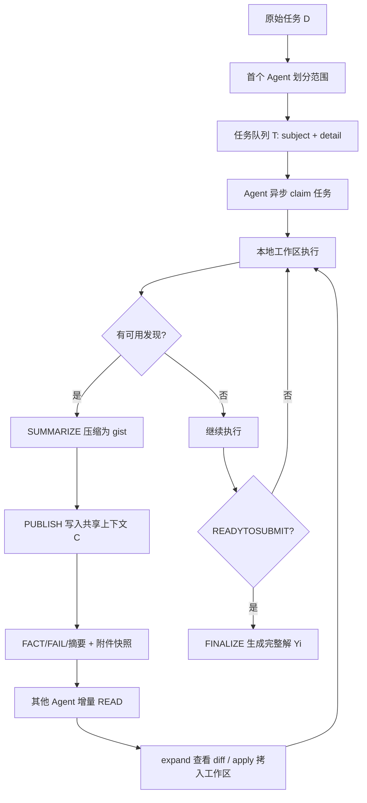

# Decentralized Multi-Agent Systems with Shared Context

**作者**: Yuzhen Mao, Jerry Gu, Aadi Chauhan, Qizheng Zhang, Hangoo Kang, Azalia Mirhoseini | **会议 / 年份**: arXiv 预印本, 2026 | **链接**: https://arxiv.org/abs/2606.10662

## 一句话总结

DELM 用共享上下文和任务队列替代中心主智能体，让多个 LLM agent 异步认领任务、即时发布发现并复用同伴进展，从而消除多智能体系统中的等待与重复计算“气泡”。

## 核心贡献

- 提出 DELM 框架：以只追加的共享上下文 $C$（存 FACT/FAIL/摘要）和排他认领的任务队列 $T$ 取代主智能体，agent 异步工作、即时发布紧凑发现，无需同步轮次或中继。
- 在 Terminal-Bench 4.0 和 DeepSWE v1.1 各 10 个长程任务上，DELM 比最强基线准确率高最多 17.5 点（DeepSWE v1.1，Claude Opus 5.5，n=4），比所基于的 harness 快最多 2.49×（Terminal-Bench 4.0，Claude Opus 5.5，n=4）。
- SWE-bench Verified 上用 Gemini 3 Flash 达 66.08%（n=4），比 AOrchestra 高 10.8 点、比 Claude Code 快 2.12×，单次提交成本仅 $0.12。
- ProgramBench 120 分钟预算下，DELM (n=4) 测试通过率比 Claude Code 高最多 19.91 点（pandoc；ctags 为 18.96 点），在 ctags 上约 60 分钟即追平后者最终结果。
- 消融实验证明增益来自协调机制：在 Terminal-Bench 4.0（n=2）上逐一移除 early sharing、peer-status 或 shared context，两 agent 的加速比都降到 0.82–1.09×。

## 📖 批读导航

| 章节 | 这一章解决什么 | 值得看的点 |
|---|---|---|
| Abstract + §1 Introduction | 定义“气泡”问题，对比独立/对等/中心化三类 MAS 的缺陷 | Figure 3：Claude Code 的主 agent 有 73% 时间在等待、全部 agent 时间 44% 在等待，DELM 为 2% |
| §2 DELM | 方法核心：共享上下文结构、任务队列规则、纠错与文件复用机制 | FACT/FAIL 条目格式、expand/apply 分离设计、增量读取类比 OS 分页 |
| §3 Experiments | 四个基准的主结果、成本分析与消融 | Table 2–5 的准确率/延迟/Cost per Task 与 Cost per Submission；注意 n=4 准确率反而略降的解释 |
| §4 Trace Analysis | 用运行轨迹验证四大机制的实际效果 | 720 条轨迹中 5237 次文件导入、80.3% 后来导入了修订版；共享上下文平均 <15K tokens |
| §5 Related Work | 定位 DELM 与黑板系统、多 agent 编排、coding harness 的关系 | 与 AOrchestra、MetaGPT、传统 blackboard 的关键差异 |
| §6 Discussion & Limitations | 总结与已知局限 | 自然语言共享上下文不适合精确聚合；Cost/Task 可能更高 |
| Appendix C, C.1 | LongBench-v2 多文档 QA 及与 RLM 结合 | DELM+RLM 在 OOLONG 和 LongBench-v2 同时取得最高准确率和最低成本 |
| Appendix D | SWE-bench 上低成本高效率的 trace 级解释 | 失败共享、约束绑定、紧凑摘要三个机制的具体案例 |
| Appendix E Prompts | 完整 agent 指令模板 | board CLI 命令（publish/claim/reserve/done/apply/expand/status/read）及队列准入规则 |

## 关键数字

| 指标 | 数值 | 条件 |
|---|---|---|
| Terminal-Bench 4.0 准确率 | 93.33% | DELM n=2, Claude Opus 5.5, 10 个长程任务 |
| Terminal-Bench 4.0 加速比 | 2.49× | DELM n=4 vs 所基于的 Claude Code, Claude Opus 5.5 |
| DeepSWE v1.1 准确率 | 98.33% | DELM n=2, GPT-6-Astra, 10 个长程任务 |
| DeepSWE v1.1 最大增益 | +17.5 点 | DELM n=4 vs AOrchestra, Claude Opus 5.5 |
| SWE-bench Verified 准确率 | 66.08% | DELM n=4, Gemini 3 Flash（n=2 为 63.72%） |
| SWE-bench Cost/Submission | $0.12 | DELM n=2 或 n=4, Gemini 3 Flash |
| ProgramBench 通过率提升 | +19.91 点 | DELM n=4 vs Claude Code, pandoc, 120 min 预算（ctags 为 +18.96） |
| 消融后加速比 | 0.82–1.09× | Terminal-Bench 4.0, n=2, 移除 peer-status/early sharing/shared context |
| 共享上下文大小 | <15K tokens | 任务完成时平均（Table 6） |
| 等待时间占比 | 2% | DELM 四个 agent, retro-console-soc（Claude Code 原生子代理为 44%） |

## 数据流：输入 → 中间表示 → 输出

## 优缺点与还能做什么

### 优点

- 彻底去中心化：没有主 agent 这个串行瓶颈，每个 agent 始终在推进自己的工作；在 retro-console-soc 单任务上，四个 DELM agent 只有 2% 时间在等待，而 Claude Code 原生子代理的全部 agent 时间有 44% 花在等待上（Figure 3）。
- 协调层可叠加：直接建于 Codex 与 Claude Code 之上，不替换单 agent 循环；作者据此把与同一 harness 的差异归因于协调层（§3.4）。
- 成本口径分得细：区分 Cost/Task 与 Cost/Submission，并说明后者按独立提交数摊分；共享上下文用短摘要加附件按引用存放，任务完成时平均 <15K tokens。
- 消融结果直接：Terminal-Bench 4.0（n=2）上逐一移除 early sharing、peer-status、shared context，加速比都退回 0.82–1.09×，支持“增益来自协调而非单纯并行”的说法。

### 局限 / 风险

- Terminal-Bench 上 n=4 的准确率较 n=2 降 3–4 点，作者归因于每个 agent 仍须提交完整方案、自建部分更少，集成错误与共享缺陷扩散风险上升；DeepSWE 上该关系随模型而异（Claude Opus 5.5 下 n=4 90.83% 高于 n=2 88.33%，GPT-6-Astra 下 n=4 90.00% 低于 n=2 98.33%，Table 3）。
- 自然语言共享上下文不适合需要精确计数、过滤、比较的聚合型任务：OOLONG 上单独 DELM 为 53.3%，低于 RLM 的 56.0%（Table 9）。
- Cost/Task 在部分设置下高于单 agent 基线（GPT-6-Astra 的 Terminal-Bench：$13.65 vs Codex $9.01），低延迟与低 Cost/Submission 以总 API 费用增加为代价。
- 评估只覆盖按基线延迟筛出的长程任务（Terminal-Bench 15–60 分钟、DeepSWE ≥10 分钟）；作者自己指出短任务上单 agent 可能在协调见效前就完成，这类场景的收益未验证。

### 还能做什么

- 推断：把结构化/代码中介的共享状态与自然语言上下文混合，可能让聚合型任务同时得到并行协调与精确性——作者在附录 C.1 已给出 DELM+RLM 的初步版本（OOLONG 64.0%）。
- 推断：按任务阶段动态调整 agent 数量，可能缓解 n=4 时的集成退化。
- 推断：将这套协调基底迁移到非编码场景（数据分析、科研流水线），需要重新定义 FACT/FAIL 的领域语义与证据标准。
- 推断：队列准入规则与提示词目前靠手工设计，自动调优可能进一步压低通信开销。

## 阅读 Q&A 记录

- **Q：2.49× 加速比的参照对象是什么？** A：是 DELM 所基于的 agent harness（Codex 或 Claude Code）本身，不是独立基线系统。Abstract 和 §1 明确写的是“faster than the harness it builds on”。
- **Q：n=4 为什么准确率反而比 n=2 低？** A：§3.1 就 Terminal-Bench 解释：每个 agent 仍须提交完整方案，自建部分更少导致集成错误增多、共享缺陷可能扩散到多份提交；但 n=4 延迟最低、Cost/Submission 最低。DeepSWE 上并非一律下降（Claude Opus 5.5 下 n=4 90.83% 高于 n=2 88.33%，GPT-6-Astra 下 90.00% 低于 98.33%）。
- **Q：Cost/Task 和 Cost/Submission 有什么区别？** A：Cost/Task 是一次运行所有 agent 的总 API 费用；Cost/Submission 再除以 agent 数，因为每个 agent 独立产生一份打分的提交。对 SWE-bench 这类按提交计分场景，后者更公平。
- **Q：任务队列的准入限制具体是什么？** A：Appendix E 的 The queue 一节规定，队列条目仅用于“必需实现”“已证实缺陷修复”“实现所需的未决问题”三类，禁止另立验证、测试、审查类条目，防止队列膨胀。
- **Q：共享上下文的 token 开销如何控制？** A：作者把体积归因于短摘要加附件按引用存放（§2.1、§4.4），任务完成时共享上下文平均 <15K tokens；增量读取（只返回新条目与状态变化）则让每次读取更便宜。读取成本占总任务成本的比例模型间差异大：GPT-6-Astra 7.7–17.7%，Claude Opus 5.5 1.7–3.7%。
- **Q：成本数字该信表格还是正文？** A：Table 2/3 中若干 Cost/Task 单元格数值异常（例如出现 $123,456,7），跨系统成本对比建议采用正文明确写出的数字，如 DELM (n=2) 在 GPT-6-Astra 的 Terminal-Bench 上 $13.65 vs Codex $9.01。
- **Q：实验是否报告了统计显著性？** A：Table 2–5 给出三次运行的 mean±std，但正文未做显著性检验（如 t-test），这是复现和评估时需留意的。

## 📊 Citation Landscape

数据来源：Semantic Scholar API（ARXIV:2606.10662）。该次查询返回 HTTP 429 限流，因此本文被引次数与完整引用图谱不可用；可用的只有本文引用的参考文献条目（最多前 100 条，不是完整引用图谱）与推荐论文列表。

**本文引用的关键工作（按主题，括号内为 Semantic Scholar 给出的被引次数）**：
- 多 agent 协调：MetaGPT（2724）、CAMEL（2106）、ChatDev（1404）、AOrchestra（38）、Recursive Multi-Agent Systems（10）。
- 推理与搜索：Self-Consistency（8128）、Tree of Thoughts（5255）、Multi-Agent Debate（2557/1506）、Graph of Thoughts（1675）。
- 编码 agent 与基准：SWE-bench（4627）、SWE-agent（2322）、Terminal-Bench（670）、LongBench v2（456）、ProgramBench（64）。
- 经典系统：MapReduce（26834）、BSP（4314）、GPipe（2349）、Hearsay-II（1544）、Blackboard Systems（668）。

**推荐相关论文（Semantic Scholar 推荐）**：Muffin - A Shared Memory Buffer for Asynchronous AI Agents (2026)、Scaling Inference-Time Compute with Teams of Coding Agents (2026)、BusMA: A Bus Communication Substrate for Multi-Agent Systems (2026)、Scaling Multi-Agent Intelligence with Substrate-Centric Coordination (2026)、AECP: Artifact-Exclusive Communication Protocol for Multi-Agent Code Generation (2026)。

**不可用项**：本文被引次数与被引论文列表（Semantic Scholar 返回 HTTP 429）。