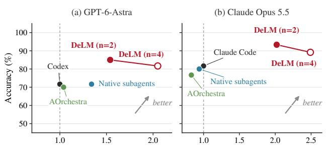
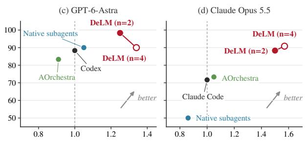
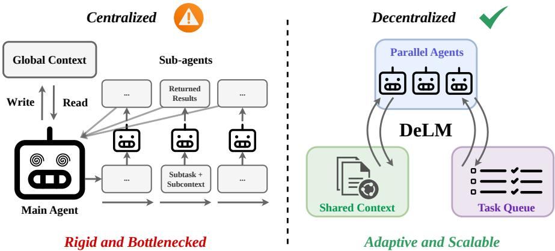

[← 返回 README](../README.md)

## Abstract

Multi-agent systems (MAS) can scale large language model agents on long-horizon tasks by running them in parallel, yet existing designs waste much of this parallelism in bubbles: agent time spent waiting on others or redoing a peer’s work. These bubbles stem from how agents communicate. Independent agents share nothing and rediscover what their peers have already found; peer-communicating agents wait at synchronous rounds; and under centralized orchestration, the main agent blocks on its sub-agents while progress is relayed. We propose Decentralized Language Models (DELM), a MAS framework on top of existing agent harnesses that squeezes out these bubbles by replacing the main agent with a shared context and a task queue. Agents asynchronously claim tasks, publish findings as soon as they are available, and build on or correct one another’s progress, with every peer’s status visible to all. On long-horizon tasks from Terminal-Bench 4.0 and DeepSWE v1.1, and on SWE-bench Verified, DELM is both more accurate and faster than Codex, Claude Code, their native subagents, and AOrchestra in every setting, improving accuracy by up to 17.5 points over the strongest baseline and running up to 2.49× faster than the harness it builds on. On ProgramBench, where agents rebuild programs from scratch, DELM makes faster progress than Claude Code and finishes a 120-minute budget up to 19.9 points higher in test pass rate. The code is available on our project website at https://yuzhenmao.github.io/DeLM/.

> 💡 **核心机制与主结果**: DELM 用共享上下文加任务队列取代主代理，让 agent 异步认领任务、即时发布发现并互相构建或纠正，针对的是“等别人”和“重做同伴工作”这两类气泡。作者报告在 Terminal-Bench 4.0、DeepSWE v1.1 与 SWE-bench Verified 的所有设置上均优于 Codex、Claude Code 及其原生 subagent 与 AOrchestra；准确率最多高 17.5 分（对最强基线），速度最多快 2.49×（对“它所基于的 harness”，与前者不是同一参照）。

Terminal-Bench 4.0  

> 💡 **Figure 1 面板**: 本段只有图题和图片，按紧随其后的 caption 推断，这是 Figure 1 中对应 Terminal-Bench 4.0 的一个面板；图片本身未做视觉核验，读数只能依赖 caption 与 §3 给出的数字。

DeepSWE v1.1  
  
Speedup (×)  
Figure 1: DeLM is both faster and more accurate than existing multi-agent coding systems. Averaged over the two models, DeLM (n=2) is 1.78× faster and 12.5 points more accurate than Codex/Claude Code (dashed line, 1×) on Terminal-Bench 4.0, and 1.38× faster and 13.3 points more accurate on DeepSWE v1.1. Each benchmark uses 10 long-horizon tasks (§3).

> 💡 **Figure 1 解读**: 按 caption，DeLM（n=2）相对 Codex/Claude Code（虚线，1×）在 Terminal-Bench 4.0 上快 1.78×、准确率高 12.5 分，在 DeepSWE v1.1 上快 1.38×、高 13.3 分。这组数是对两个模型取平均，每个基准各 10 个长程任务（§3）；属作者自报，图中点位未作视觉核验。

  
Figure 2: Centralized vs. decentralized multi-agent systems. Centralized MAS relies on a main agent to assign subcontexts, spawn sub-agents, and integrate their results, so progress is shared mainly through the main agent and sub-agents remain unaware of one another’s work. In contrast, DELM decentralizes coordination through parallel agents, a shared context, and a task queue: agents asynchronously claim ready tasks, publish findings incrementally to a shared context, and build on or correct each other’s progress without a main agent in the loop.

> 💡 **架构对比**: Figure 2阐释了集中式与去中心化的区别：前者依赖主代理中转导致阻塞，后者通过异步任务认领和共享上下文实现并行协作，无需主代理介入即可互相修正进度。

