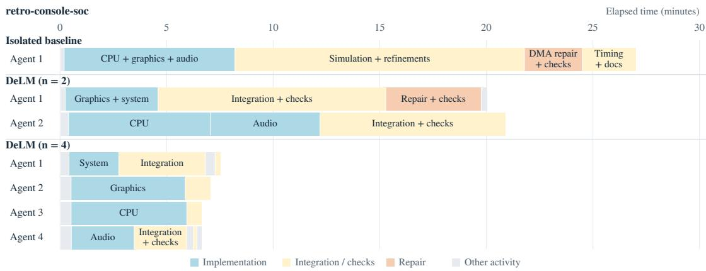

[← 返回 README](../README.md)

## 4 Trace Analysis: How Does Decentralized Coordination Help?

To understand how the coordination mechanisms in Table 1 squeeze out bubbles, we analyze all DELM runs on Terminal-Bench 4.0 and DeepSWE v1.1. Parallel subtask execution lets agents build components concurrently (§4.1). Intermediate-results sharing lets agents start dependent work before a peer finishes, avoiding relay waits (§4.2). Peer-status awareness keeps agents from duplicating a peer’s search, avoiding redundant work (§4.3). Finally, a stateful shared context lets corrections reach every agent without another round of delegation, while staying small enough to read cheaply (§4.4).

> 💡 **机制概览**: 本节拆解DELM的四个去中心化协调机制：并行执行缩短关键路径、中间结果共享消除等待、状态感知避免重复搜索、有状态上下文实现低成本纠错。

## 4.1 Parallel subtask execution shortens the critical path

Parallel agents speed up a task only if the work is divided so that no agent idles or duplicates a peer. DELM agents claim distinct components from the task queue, share their code through the shared context, and each integrates its peers’ components into its own solution. Adding agents makes this division finer and shortens the critical path.

> 💡 **并行原理**: 通过任务队列让智能体认领互斥组件并共享代码，增加智能体数量可细化分工，从而直接缩短任务的关键路径长度。

Figure 7 shows this on Terminal-Bench’s retro-console-soc task with GPT-6-Astra. A single agent builds the CPU, graphics, and audio in sequence and finishes in 27.0 minutes. With n=2, one agent builds the graphics and system components while its peer builds the CPU and then the audio, finishing in 20.9 minutes (1.29×). With $n { = } 4 ,$ , separate agents build the system, graphics, CPU, and audio concurrently, and the task finishes in 7.5 minutes (3.6×). The same pattern appears across Terminal-Bench 4.0: moving from n=2 to n=4 raises the average speedup from 1.54× to 2.05× with GPT-6-Astra and from 2.02× to 2.49× with Claude Opus 5.5 (§3.1).

> 💡 **加速实证**: 在Terminal-Bench的retro-console-soc任务中，GPT-6-Astra从单智能体的27.0分钟降至n=4的7.5分钟（3.6×，n=2为20.9分钟、1.29×）；全基准上n=2→n=4的平均加速比为GPT-6-Astra 1.54×→2.05×、Claude Opus 5.5 2.02×→2.49×。

  
Figure 7: More agents build more components in parallel. Execution timelines on Terminal-Bench 4.0’s retro-console-soc task with GPT-6-Astra.

> 💡 **图表解读**: Figure 7给出该任务在不同智能体数下的执行时间线，可对照正文的27.0、20.9、7.5分钟看各组件是串行还是重叠执行；此判断仅来自caption与正文，未查看图像本身。

## 4.2 Intermediate-results sharing unblocks dependent work

When one component depends on another, centralized orchestration makes the consumer wait until the producer finishes its subtask and the main agent relays the result. DELM agents instead publish partial results as soon as they are usable, so dependent work and integration testing overlap with implementation rather than following it.

> 💡 **依赖解耦**: 区别于集中式编排需等待子任务完全结束，DELM允许发布可用部分结果，使下游依赖工作与上游实现及集成测试重叠进行。

In Terminal-Bench’s telecom-entity-resolution task, Agent 2’s household-separation step consumes the clusters produced by Agent 1’s record matcher. Agent 1 shared the matcher as soon as it ran, before its thresholds were tuned, so Agent 2 developed its step on real clusters while the matcher was still being refined.

> 💡 **案例佐证**: 在电信实体解析任务中，Agent 2利用Agent 1尚未调优阈值的初步聚类结果提前开发分离步骤，实现了真正的流水线并行而非严格串行。

## 4.3 Peer-status awareness avoids duplicate exploration

Parallel agents that cannot see each other’s work tend to converge on the same promising direction. In centralized systems, each sub-agent sees only the subcontext the main agent assigned it, so overlapping work goes unnoticed until the main agent collects the results. DELM exposes every agent’s claims, status, and stated scope through the task queue and shared context, so an agent can notice an overlap while its search is still running and redirect.

> 💡 **冲突检测**: 集中式系统里子智能体只看到主智能体分配的局部上下文，重叠要到汇总时才暴露；DELM把各智能体的认领、状态和声明范围放进任务队列与共享上下文，使重叠在搜索仍在进行时就能被发现并改道。

In Terminal-Bench’s wdm-design task, agents optimize an optical device by changing its port geometry and material pattern. In one four-agent run, Agents 1 and 3 independently began tuning the same port widths and positions. Agent 1 then saw Agent 3’s claim through the shared context:

> 💡 **场景引入**: 在一次四智能体运行中，Agent 1与Agent 3独立开始调优相同的端口宽度与位置，构成一次真实的重复搜索实例。

[agent-3/FACT] [...] I will tune only w\_in,w\_long,w\_short,y\_long,y\_short [...]   
[agent-1/FACT] [...] applying the cavity artifact revealed agent-3 had just claimed   
the same five-parameter port tuning. [...]   
[agent-1/EXEC] kill -TERM 770   
[agent-1/EXEC] python binary\_refine.py [...]

> 💡 **日志实录**: 记录显示Agent 1通过共享上下文看到Agent 3声明的五个参数调优范围，随后用kill -TERM终止自己的进程并改跑另一脚本。

Agent 1 terminates its own port search and returns to refining the material pattern of its earlier candidate, while Agent 3 continues port tuning. The agents resolve the overlap themselves, before either search finishes, without a main agent having to detect the duplication and re-plan.

> 💡 **自主协调**: Agent 1转回材料模式优化、Agent 3继续端口调优，冲突在两次搜索结束前由智能体自己解决，不需要主智能体检测重复并重新规划。

Table 6: Final shared-context size (thousands of tokens) and the cost of reading it as a percentage of total task cost.
<table><tr><td colspan="2"></td><td colspan="2">Terminal-Bench 4.0</td><td colspan="2">DeepSWE v1.1</td></tr><tr><td>Model</td><td>Agents</td><td>Context (k)</td><td>Cost (%)</td><td>Context (k)</td><td>Cost (%)</td></tr><tr><td rowspan="2">GPT-6-Astra</td><td> $n = 2$ </td><td> $7 . 3 1 \pm 0 . 4 2$ </td><td> $9 . 1 7 \pm 0 . 3 8$ </td><td> $7 . 5 4 \pm 0 . 2 1$ </td><td> $7 . 7 1 \pm 0 . 1 8$ </td></tr><tr><td> $n = 4$ </td><td> $1 2 . 8 8 \pm 0 . 9 7$ </td><td> $1 7 . 6 8 \pm 0 . 2 5$ </td><td> $1 3 . 0 3 \pm 0 . 9 6$ </td><td> $1 4 . 5 6 \pm 0 . 3 7$ </td></tr><tr><td rowspan="2">Claude Opus 5.5</td><td> $n = 2$ </td><td> $6 . 6 2 \pm 0 . 3 4$ </td><td> $1 . 9 2 \pm 0 . 1 1$ </td><td> $4 . 6 7 \pm 0 . 1 1$ </td><td> $1 . 6 9 \pm 0 . 0 6$ </td></tr><tr><td> $n = 4$ </td><td> $1 4 . 4 8 \pm 0 . 4 7$ </td><td> $3 . 6 6 \pm 0 . 2 9$ </td><td> $1 0 . 4 3 \pm 0 . 5 3$ </td><td> $3 . 0 4 \pm 0 . 2 3$ </td></tr></table>

> 💡 **成本量化**: Table 6中共享上下文随智能体数增长（Terminal-Bench上GPT-6-Astra 7.31k→12.88k，Claude Opus 5.5 6.62k→14.48k），读取开销占比GPT-6-Astra为7.7–17.7%、Claude Opus 5.5仅1.7–3.7%，模型间差异远大于n=2与n=4的差异。

## 4.4 Stateful shared context enables reuse and correction

Shared results help only if later improvements reach the agents that already used them. Because updates and corrections are appended as new entries that reference revised files, rather than overwriting old ones (§2.1), an agent can re-import a peer’s updated work at any time. Agents rely on this heavily. Across 720 agent trajectories on Terminal-Bench 4.0 and DeepSWE v1.1, agents imported shared files 5,237 times, and 80.3% of trajectories later imported a revised version of a file they had already imported. Agents thus track their peers’ work as it improves, and fixes reach every agent that depends on them without re-planning. In centralized systems, by contrast, correcting a result that has already been summarized and relayed requires another round of delegation.

> 💡 **版本追溯**: 更新以追加新条目并引用修订文件而非覆盖旧条目，使修正可被随时重新导入；720条轨迹中共导入5,237次，且80.3%的轨迹后来导入了自己已导入文件的修订版，无需主智能体重新委派。

This reuse is inexpensive. Because agents publish short summaries and attach files by reference (§2.1), the shared context averages under 15K tokens at task completion (Table 6). Each read also returns only what is new since the agent’s last read, so most of this content enters an agent’s session once. Accounting for all reads by all agents, including this cached reuse, reading the shared context accounts for 1.7–3.7% of total task cost with Claude Opus 5.5 and 7.7–17.7% with GPT-6-Astra.

> 💡 **复用效率**: 短摘要加文件引用的策略让任务完成时共享上下文平均低于15K tokens，读取只返回自上次读取以来的新增内容，因此大部分内容只进入会话一次，读取开销占1.7–3.7%（Claude Opus 5.5）与7.7–17.7%（GPT-6-Astra）。

