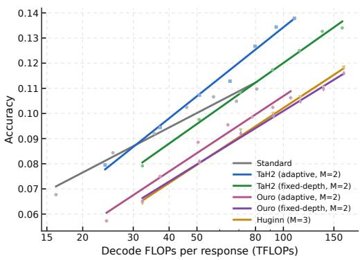
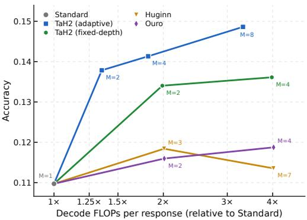
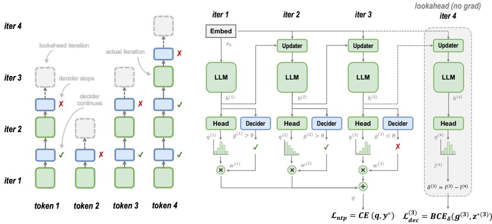

[← 返回 README](../README.md)

## ABSTRACT

Looped transformers have demonstrated promising parameter efficiency by reusing layers for latent computation. Prior studies compare looped and nonlooped models at matched parameters or per-token FLOPs. However, to the best of our knowledge, whether looping improves test-time scaling as outputs grow longer remains underexplored. Through post-training looped transformers, we study the accuracy–compute slope, measured as the accuracy gain per doubling of test-time decoding FLOPs. We find that existing looped transformers often yield steeper slopes than their non-looped baseline, yet underperform it at matched compute. While fixed-depth looping spends extra iterations on every token, our analysis show that many tokens do not benefit from extra iterations. We therefore propose TaH2, which enables the model to focus extra iterations on the tokens that benefit from looping. It jointly post-trains the backbone and an iteration decider through lookahead depth supervision, which uses online labels indicating whether further iteration improves the prediction. TaH2 improves both the efficiency and attainable accuracy of test-time scaling. On challenging AIME benchmarks, TaH2 improves the accuracy–compute slope by 53% (2.74 vs. 1.79) over the non-looped baseline, exceeding the baseline’s peak accuracy by about 3.4 points at matched test-time compute. As the maximum iteration depth increases, existing looped models largely plateau, while TaH2’s gain over the non-looped baseline continues to grow from +2.8 points at depth 2 to +3.9 points at depth 8.

> 💡 **问题动机与核心发现**（AI 批注）:
> - 原文真正的问题设定有两层限定：一是**在 post-training 设定下**研究循环 Transformer；二是已有研究在匹配参数量或每 token FLOPs 下比较循环与非循环模型；据作者所知，输出变长时循环是否改善 test-time scaling 仍缺乏充分研究。指标定义为 accuracy–compute slope，即 test-time decoding FLOPs 每翻倍所换来的准确率增益。
> - 发现要按原文的限定词读：**existing looped transformers often** yield steeper slopes，是「往往、并非全部」；初稿把它写成「固定深度循环模型虽然斜率更陡」，属于把后文 "fixed-depth looping spends extra iterations on every token" 的限定前移了——这一等价是**推断**，摘要此处并未把 existing looped 与 fixed-depth 划等号。
> - underperform 的限定条件是 **at matched compute**，不是全局落后，离开这个条件该结论不成立。
> - TaH2 机制：联合后训练 backbone 与 iteration decider，用 lookahead depth supervision 产生 online labels（该标签指示继续迭代是否改善预测），把额外迭代集中到受益的 token 上。注意「decider 决定的粒度是 token 而非整条序列」来自 "focus extra iterations on the tokens that benefit"，是原文明确表述。
> - 数字核对无误：斜率提升 53%（2.74 vs 1.79）；深度 2→8 时相对非循环基线增益 +2.8 → +3.9。但 3.4 分的原文是 "exceeding the baseline's **peak** accuracy by about 3.4 points"，初稿写成「超越基线约 3.4 个点」丢掉了 peak 这一关键限定，应改为「超过基线**峰值准确率**约 3.4 分」。
> - 边界：以上均为 AIME 基准上的结果，摘要未给方差、误差棒、运行次数，也未列出对比了哪些具体循环基线。

  
(a) Test-time scaling

> 💡 **Figure 1(a) 批读**（AI 批注）:
> - caption 说明实验扫描了 4K–16K 的输出 token 截断预算，曲线为拟合趋势；它并未据此把横轴定义为输出长度。正文 3.2 明确说明，准确率对每次响应解码 FLOPs 的 log₂ 做线性拟合，因此应区分「用于改变计算量的输出预算」与「分析准确率—计算关系的计算量变量」。
> - 纵轴 caption 未直接写出，结合正文对 accuracy–compute slope 的定义可**推断**为 AIME 平均准确率；该推断应标注为推断。
> - 初稿「图中应对比了 Non-looped baseline、Existing Looped models 和 Proposed TaH2」用的是「应」，caption 并未逐一列出曲线构成，具体曲线数量、颜色与图例**待证**，不能当作已核实事实。
> - 可确认的只有整体主张：Figure 1 展示 TaH2 同时改善 test-time scaling 与 iteration-depth scaling。
> - 另需注意结构问题：Figure 1(a) 与 (b) 共享同一条 caption（(b) 与 caption 文本都在下一段），按展示规范应左右并列、共用一条 caption，而不是当成两个独立图注处理。当前仅有文本描述，未获得图像视觉信息，线条形态、交点、误差带均无法从文本核验。

  
(b) Iteration-depth scaling  
Figure 1: TaH2 improves both test-time and iteration-depth scaling. Mean AIME24–26 accuracy over 32 samples for 1.7B models post-trained from the same checkpoint. (a) Output-token cutoffs sweep 4K–16K; lines are fitted trends. (b) Accuracy at a 16K cutoff as the depth ceiling M grows.

> 💡 **Figure 1(b) 批读**（AI 批注）:
> - caption 明确：纵轴是 **16K cutoff 下的准确率（Accuracy）**，横轴是深度上限 M 增长。初稿写「纵轴为相对基线的性能增益」**与原文不符**，必须改为「16K 截断下的准确率」；摘要里的 +2.8 → +3.9 点是 TaH2 相对非循环基线的差值，不等于该图的纵轴量，两者不能混为一谈。
> - caption 给出可核验的实验设定：1.7B 模型、从**同一 checkpoint** 后训练、AIME24–26 平均准确率、**32 个样本**。初稿未引用这些设定，应补上，否则读者无法判断跨模型比较是否公平。
> - 该图支撑的 claim：随 M 增大，已有循环模型大体进入平台期（largely plateau），而 TaH2 相对非循环基线的增益持续增长——即 "TaH2 improves iteration-depth scaling" 的直接视觉证据。
> - 证据边界：caption 未说明图中画了哪些具体模型的曲线，也没有误差棒或显著性信息，因此「增益持续扩大」究竟是趋势描述还是统计显著，从文本无法判定，**待证**。

  
Figure 2: TaH2’s architecture and training scheme. Left: the decider decides whether to continue after each iteration. Right: the updater reinjects token embeddings at each iteration, and stopping probabilities weight per-iteration predictions. All modules share parameters across iterations. The decider receives online depth supervision after each iteration; the no-gradient lookahead supplies the target at the stopping point and is omitted at inference.

> 💡 **Figure 2 批读**（AI 批注）:
> - caption 实际描述的结构是：**Left**——decider 在每次迭代后决定是否继续；**Right**——updater 每次迭代重新注入 token embeddings，且 stopping probabilities 对每次迭代的预测加权；所有模块**跨迭代共享参数**；decider 在每次迭代后接收 online depth supervision；no-gradient lookahead 在停止点提供目标，**推理时省略**。这才是读这张图应抓住的四件事：决策、重注入、加权、监督来源。
> - 初稿的「梯度隔离与权重共享：通过分离不同迭代的计算图来稳定训练」**在 caption 与摘要中都没有依据**，属于超出证据的推断，应予删除或明确标为推断。caption 只说明 lookahead 是 no-gradient（不传梯度）且推理时省略，其作用是**为停止点提供监督目标**，无法推出「为了稳定训练」；至于「分离计算图」是否发生、以何种方式发生，caption 未提。
> - 初稿「此图是理解高效推理和架构创新的关键视觉证据」是模板化空话，已替换为上述具体机制。
> - 待证：decider 的网络结构、stop 概率的具体加权形式、lookahead 的深度范围与目标构造方式，caption 均未给出，需回到正文 Method 与公式处核对；未获得该图的图像视觉信息，图中的箭头方向与模块边界无法从文本核验。

