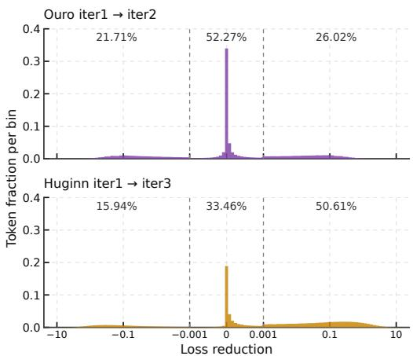

[← 返回 README](../README.md)

## 3 TEST-TIME SCALING OF CURRENT LOOPED TRANSFORMERS

We formalise the recurrent computation of looped transformers and empirically show the test-time scaling behavior of existing looped transformers.

> 💡 **问题动机**: 本节分两步走——先把循环 Transformer 的递归计算**形式化**（formalise），再用实验刻画已有循环模型在测试时计算扩展下的行为。「揭示局限」是后面结果的产物，不是本节开头这句话本身的承诺，批注中不应提前把它写成动机声明。

## 3.1 PRELIMINARIES

We use subscript t for token position and superscript (m) for iteration index. We focus on models that repeat all L Transformer layers, denoting the shared Transformer backbone by $\mathcal { F } _ { \theta }$ and the embedding at token position t by $\mathbf { e } _ { t }$ . Let $\mathbf { h } _ { t } ^ { ( m ) }$ denote the hidden state at token position t after iteration m. Starting from $\mathbf { h } _ { t } ^ { ( 0 ) } = \mathbf { e } _ { t }$ , the basic forward pass applies the backbone at each iteration m and computes next-token probabilities:

> 💡 **符号与机制拆解**: 记号约定：下标 $t$ 表示 token 位置，上标 $(m)$ 表示迭代轮次。论文聚焦「重复全部 $L$ 层」的模型，共享 Transformer 骨干记作 $\mathcal{F}_\theta$，token $t$ 的嵌入记作 $\mathbf{e}_t$，第 $m$ 轮后的隐藏状态记作 $\mathbf{h}_t^{(m)}$。起点是 $\mathbf{h}_t^{(0)} = \mathbf{e}_t$，之后每一轮把**同一套骨干参数**重新施加在上一步的隐藏状态上，并据此算 next-token 概率。（初稿此处把共享骨干误写成「共享权重 $\boldsymbol{\theta}$ 的骨干网络 $\boldsymbol{\theta}$ 被反复应用」，主语重复且有歧义，已更正为共享骨干 $\mathcal{F}_\theta$ 被反复应用。）

$$
{ \bf h } _ { t } ^ { ( m ) } = \mathcal { F } _ { \boldsymbol { \theta } } \Big ( { \bf h } _ { t } ^ { ( m - 1 ) } \Big ) , \qquad { \bf q } _ { t } ^ { ( m ) } = \mathrm { s o f t m a x } \Big ( { \bf W } _ { \mathrm { o u t } } { \bf h } _ { t } ^ { ( m ) } \Big ) ,\tag{1}
$$

> 💡 **公式批读 (Eq. 1)**: 上行是递归更新 $\mathbf{h}_t^{(m)} = \mathcal{F}_{\boldsymbol{\theta}}\big(\mathbf{h}_t^{(m-1)}\big)$——第 $m$ 轮隐藏状态由共享骨干 $\mathcal{F}_{\boldsymbol{\theta}}$（其参数为 $\boldsymbol{\theta}$）作用在第 $m-1$ 轮隐藏状态上得到；下行是读出 $\mathbf{q}_t^{(m)} = \mathrm{softmax}\big(\mathbf{W}_{\mathrm{out}}\mathbf{h}_t^{(m)}\big)$——用输出投影 $\mathbf{W}_{\mathrm{out}}$ 把当前轮隐藏状态映射为词表上的 next-token 概率分布。要点在于：参数在整个迭代过程中不变，变的只有轮次 $m$，因此「加深」不增加参数量，只增加序列化的计算步数。这里 $\boldsymbol{\theta}$ 是骨干网络参数，$\mathbf{W}_{\mathrm{out}}$ 才是输出投影；初稿把 $\boldsymbol{\theta}$ 说成「参数矩阵」并在批注里讨论 GitHub 渲染格式，前者表述不准、后者不属于论文机制批读，均已改写。

Here $\mathbf { W _ { \mathrm { o u t } } }$ is the output projection. Ouro follows this recurrence (Zhu et al., 2025). Huginn repeats only a middle block, with input injection at each iteration (Geiping et al., 2025a). Let $m _ { t } \in \{ 1 , \ldots , M \}$ denote the executed depth of token t, where M is the maximum iteration depth. Fixed-depth models use $m _ { t } = M$ for all tokens; Standard is the non-looped baseline with $m _ { t } = 1$ Adaptive models choose $m _ { t }$ per token, as Ouro does with a learned exit gate.

> 💡 **模型对比与深度控制**: 这段给出三类对比对象与深度记号。Ouro 直接沿用 Eq. (1) 的全层递归；Huginn 只重复中间一个 block，并在每轮做 input injection（输入注入）。$m_t \in \{1, \ldots, M\}$ 表示 token $t$ 实际执行的深度，$M$ 为最大迭代深度。由此定义三组：**Fixed-depth** 对所有 token 取 $m_t = M$；**Standard** 是不循环的基线，$m_t = 1$；**Adaptive** 逐 token 选择 $m_t$，例如 Ouro 用学习到的 exit gate 决定。这为下文「固定深度 vs 自适应深度」的对比划定了坐标系：注意 Standard 的「深度 1」与循环模型的「最大深度 $M$」在算力账本上口径不同，后面比较斜率时必须按 FLOPs 而非按层数对齐。

## 3.2 TEST-TIME SCALING BEHAVIOUR

Setup. We post-train Standard, Ouro (M = 2) and Huginn (M = 3) from Qwen3-1.7B-Base on same data with a 16K context. Huginn runs at fixed depth; Ouro is evaluated both at fixed depth and with its exit gate, trained afterwards on the frozen backbone (Appendix A.2). We measure mean AIME24–26 accuracy with 32 samples per problem, sweeping output-token cutoffs from 4K to 16K in 2K increments. We fit accuracy linearly against $\log _ { 2 }$ of the decoding FLOPs per response (Appendix A.4.2). Further settings appear in Section 5.1.

> 💡 **实验设置 (Setup)**: 基座统一为 Qwen3-1.7B-Base，用同一份数据、16K 上下文分别后训练 Standard、Ouro（$M=2$）与 Huginn（$M=3$）。Huginn 以固定深度运行；Ouro 同时在固定深度和启用 exit gate 两种方式下评估，而 exit gate 是在**冻结骨干**上事后训练的（Appendix A.2）——这一条很关键，它意味着 gate 没有和骨干联合优化。评估指标是 AIME24–26 的平均准确率，每题 32 个样本；输出 token cutoff 从 4K 扫到 16K、步长 2K；最后把准确率对「每条响应解码 FLOPs 的 $\log_2$」做**线性拟合**来取斜率（Appendix A.4.2），其余设置见 Section 5.1。注意斜率是拟合出来的估计量，不是被证明的定律。

Results. Fixed-depth Ouro, adaptive Ouro and Huginn yield slopes of 2.12, 2.27 and 2.26 accuracy points per compute doubling, versus 1.79 for Standard (Figure 1a), suggesting larger accuracy gains from latent computation as test-time compute increases. Yet all three remain less accurate than Standard over the overlapping compute range; the exit gate lowers Ouro’s decoding cost but does not close the gap. Recurrence has proven effective in pretraining, as in Ouro and Huginn, but our results point to a gap when it is introduced only in post-training:

> 💡 **核心结果 (Results)**: 固定深度 Ouro、自适应 Ouro、Huginn 的斜率分别为 2.12、2.27、2.26 accuracy points per compute doubling，Standard 为 1.79（Figure 1a）。也就是说，随测试时算力增加，循环类模型从隐式计算中获得的**准确率增量**更大。但原文紧接着限定：在重叠的算力区间内，这三者仍然都比 Standard 更不准；Ouro 的 exit gate 只是降低了解码成本，并未缩小这一差距。作者的原话是「只在 post-training 阶段引入循环时存在 gap」，而不是「循环结构本身无效」——批注不应把这句话升级成对方法家族的否定。

Post-trained looped models gain accuracy faster as test-time compute increases, yet underperform the non-looped baseline at matched compute.

> 💡 **关键论断核对**: 这是原文的粗体结论句：后训练得到的循环模型在测试时算力增加时准确率涨得更快，但在**匹配算力**下仍不如非循环基线。原文在此只陈述现象，**没有给出成因**。因此「循环机制未能有效利用额外步数」或「初始性能损失过大」都只是批注者的推断，需由后文的 token 级分析或附录证伪/证实，不能当作原文结论引用。

Analysis and motivation. To examine how fixeddepth iteration affects individual tokens, we compare next-token losses after the first and final iterations on the validation set. Figure 3 shows the loss reduction from iterations 1 → 2 for Ouro and 1 → 3 for Huginn. Both distributions concentrate near zero, and a substantial fraction of tokens obtain worse prediction loss after the additional iterations. For Ouro and Huginn, respectively, 52.3% and 33.5% of tokens change by at most $1 0 ^ { - 3 }$ while 21.7% and 15.9% become worse by more than this threshold.

> 💡 **Token 级 loss 分析**: 为检查固定深度迭代对单个 token 的影响，作者在验证集上比较第一次与最终一次迭代的 next-token loss：Ouro 比较 1→2，Huginn 比较 1→3（Figure 3）。两个分布都集中在 0 附近，且相当一部分 token 在额外迭代后预测 loss 反而变大。原文给出的数字：Ouro 有 **52.3%**、Huginn 有 **33.5%** 的 token 变化幅度不超过 $10^{-3}$；Ouro **21.7%**、Huginn **15.9%** 的 token 变差超过该阈值。注意「变化小」和「变差」是两个不同统计口径（互不包含），批注中不应混为一谈。初稿用「over-thinking / noise accumulation」来解释，这两个术语原文并未出现，属于推测性措辞，已标注为推断。

Fixed-depth looping therefore spends additional iterations on many tokens that gain little or even get worse. Ouro’s exit gate improves efficiency but still underperforms Standard at matched compute. Its backbone is trained only at full depth, causing a train–inference mismatch under early exit. This motivates learning token-dependent depth jointly with the backbone, supervised by measured loss reductions.

> 💡 **归因与动机**: 原文的论证链是：固定深度循环把额外迭代花在大量收益很小、甚至变差的 token 上；Ouro 的 exit gate 提高了效率，但在匹配算力下仍低于 Standard；原因在于 Ouro 的骨干**只按全深度训练**，early exit 时出现 train–inference mismatch。由此引出动机：应当让 token 依赖的深度与骨干**联合学习**，并以实测的 loss reduction 作为监督信号。需要限定的是，原文在本节只说「motivates learning token-dependent depth jointly with the backbone」，并未在这里命名后续方法；初稿猜测的具体方法名属于推断，需回到方法章节确认。

  
Figure 3: Token-level loss reduction from the first to final iteration in Ouro and Huginn. The three regions report the fractions of tokens that become worse, change little, or improve.

> 💡 **Figure 3 批读**: 依据 caption，这张图展示 Ouro 与 Huginn 从首次到最终迭代的 token 级 loss reduction 分布，并用三个区域分别标注「变差 / 几乎不变 / 改善」的 token 比例。它与正文中 52.3%/33.5% 与 21.7%/15.9% 两组数字对应，是把「大量 token 没从额外迭代中获益、少数甚至倒退」这一论点可视化的证据，也支撑了后面「盲目加深浪费算力」的动机。**证据边界说明**：本次核对只拿到 caption 与正文文字描述，未获得图片本身的视觉信息，因此直方图的具体形状、坐标范围、三个区域的划分阈值不作断言。

