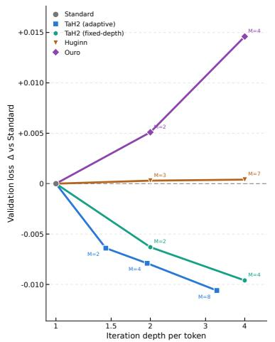
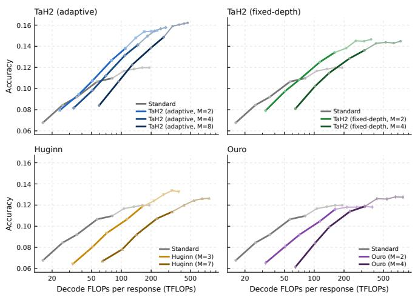
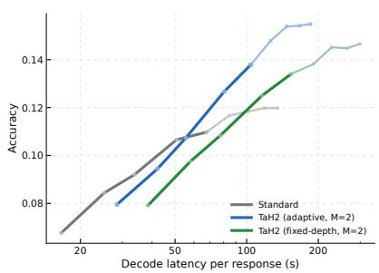
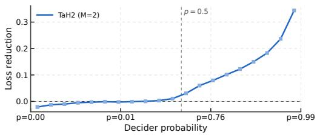

[← 返回 README](../README.md)

## 5 EXPERIMENTS

## 5.1 SETUP

We summarise the key configuration here; full details are in Appendix A.

> 💡 **配置指引与复现边界**: 这一段把 5.1 定位为“摘要式配置”——完整超参在 Appendix A。因此本节出现的数字（5.2 的 273K prompts / 3.4B tokens、5.3 的固定 TPP = 2、$\tau_{exit} = 0.5$）只是关键项，要复现必须回到附录 A。初稿“指明详细参数在附录”核对无误，此处补充它的复现含义：本节数字不构成完整训练配方。

Models and baselines. We use Qwen3-{1.7B, 4B, 8B}-Base (Yang et al., 2025) as backbones. We use the 1.7B model in Section 5.2, and the 4B and 8B models in Section 5.3. We compare TaH2 with the following baselines: (1) Standard, the single-pass model (M = 1); (2) TaH2-fixed, a variant of TaH2 without a decider that executes all M iterations at every token position; (3) Ouro, which loops all L layers and carries the hidden state directly across iterations (Zhu et al., 2025); and (4) Huginn, which loops a middle span of layers, reinjects the pre-loop representation through an input adapter, and uses a fixed depth (Geiping et al., 2025a). All variants at a given scale use the same Qwen3 initialization and post-training recipe. We train and evaluate TaH2-fixed and Ouro at M = 2, 4, and Huginn at M = 3, 7; looping 14 of the 28 layers gives Huginn the same effective depths of 2 and 4 full-model passes, respectively. Figure 4a reports mean iteration depth in units of a full L-layer pass.

> 💡 **基线与等效深度口径（含初稿纠错）**:
> - **Backbone**: Qwen3-{1.7B, 4B, 8B}-Base；1.7B 用于 5.2，4B/8B 用于 5.3。
> - **四个对照**: (1) Standard = 单次前向 $M=1$；(2) TaH2-fixed = 无 decider、每个 token 位置都执行全部 $M$ 次迭代的 TaH2 变体；(3) Ouro = 全部 $L$ 层循环、隐状态直接跨迭代传递；(4) Huginn = 循环中间一段层、用 input adapter 重注入循环前表示、深度固定。
> - **公平性**: 同规模的各变体使用相同 Qwen3 初始化与后训练配方（原文明确，初稿表述正确）。
> - ⚠️ **纠错**: 初稿旁注把 Huginn 的 $M=3,7$ 换算成“约 1.5×/3.5× 次全模型 pass”，与原文口径不符。原文说“looping 14 of the 28 layers gives Huginn the same effective depths of 2 and 4 full-model passes”。按“非循环 14 层 + $M\times14$ 循环层”计：$M=3$ → $14+42=56=2\times28$，$M=7$ → $14+98=112=4\times28$，正好对应原文的 2 和 4。已删除 1.5×/3.5× 的换算，并强调 Huginn 的 $M$（循环体执行次数）与 TaH2/Ouro 的 $M$（全模型迭代次数）**不是同一计量单位**，比较时必须先换算。
> - 初稿称 TaH2-fixed“作为上界参考”：原文只说它是无 decider 的变体，它同时可读作算力上界与性能参照系，但“上界”是解读而非原文表述。
> - 本段还提到 Figure 4a 的纵轴单位是“一次全 L 层 pass”下的平均迭代深度——这是后面读 Fig. 4a 的关键口径。

Training setup. Training data combine math, code and QA prompts from AM-Qwen3-Distilled (am-team, 2025) with tool use samples from Nemotron-Agentic-v1 (NVIDIA, 2025). For the experiments in Section 5.2, we use 273K prompts with responses regenerated by Qwen3-8B, the bestperforming teacher in our comparison of downstream student accuracy (Appendix B.1). We train for three epochs with a 16,384-token context, totalling 3.4B training tokens. Section 5.3 uses the original responses generated by Qwen3-235B-A22B and fixes the training budget at TPP = 2 tokens per parameter for every model size. A validation set of 1,000 samples randomly drawn from the training mixture is used for loss and token-level analyses.

> 💡 **训练数据、teacher 信号与预算**:
> - **数据混合**: AM-Qwen3-Distilled（math/code/QA）+ Nemotron-Agentic-v1（tool use）。
> - **5.2 主实验**: 273K prompts，回复由 Qwen3-8B 重新生成；训练 3 epochs、上下文 16,384 tokens、共 3.4B tokens（初稿漏了 context 长度）。
> - **纠偏**: 原文说 Qwen3-8B 是“best-performing teacher in our comparison of downstream student accuracy (Appendix B.1)”。也就是说 teacher 的优劣不是直接测 teacher 本身，而是通过**下游学生准确率**这一间接代理指标选出的；初稿只写“最佳 Teacher”，丢掉了这个判定口径，容易让人误以为有直接的 teacher 质量评测。
> - **5.3 扩展实验**: 使用 Qwen3-235B-A22B 生成的原始回复，并把训练预算固定为 TPP = 2 tokens/parameter（对每个模型规模都如此）。结合 block 3，5.3 对应 4B/8B 规模；但“用于探究不同规模下的表现”是初稿的推断，原文这一句只交代了数据与预算，未明说目的——已标为推断。
> - **验证集**: 从训练混合中随机抽 1,000 条，用于 loss 与 token-level 分析。注意它是从训练分布抽的，不是独立域验证集。

Evaluation setup. We evaluate on math (AIME24–26, AMC23, MATH500 (Lightman et al., 2023), OlympiadBench (He et al., 2024), and IMO-AnswerBench (IMO-AB) (Luong et al., 2025)), QA (GPQA (Rein et al., 2023) and SuperGPQA (SGPQA) (M-A-P Team et al., 2025)), code (HumanEval (Chen et al., 2021), MBPP (Austin et al., 2021), and LiveCodeBench v6 (LCB) (Jain et al., 2024)), and tool use (BFCL v3 (Patil et al., 2025)). We use zero-shot CoT with temperature 0.6, top-p 0.95, top-k 20, and a default maximum generation length of 32K tokens. We report avg@32 on the primary math benchmarks and use fewer samples per problem on larger benchmarks (Appendix A.3). The decider threshold is $\tau _ { \mathrm { e x i t } } = 0 . 5$ for TaH2.

> 💡 **评测协议与一处未对齐（初稿补充）**:
> - **解码设置**: zero-shot CoT，temperature 0.6、top-p 0.95、top-k 20，默认最大生成长度 32K tokens（初稿核对无误）。
> - **指标**: 主要数学基准报 avg@32；更大的基准减少每题采样数（Appendix A.3）。
> - **退出阈值**: TaH2 的 decider 阈值 $\tau_{exit} = 0.5$。原文此处只给了这个数值，**没有**说明阈值如何作用于退出判定；初稿“这是自适应深度的核心开关”属机制性解释，需配合方法节的判定公式才能成立，应读作推断。
> - ⚠️ **新增核对**: 正文列出的评测集合是 AIME24–26、AMC23、MATH500、Olympiad、IMO-AnswerBench (IMO-AB)、GPQA、SuperGPQA (SGPQA)、HumanEval、MBPP、LiveCodeBench v6 (LCB)、BFCL v3，共 **12 项**；但下一段 Table 1 标题写的是“across ten benchmarks”，实报 10 项（缺 IMO-AB、SGPQA、LCB v6）。初稿直接照抄列表，未指出这个“列出多、报告少”的差异，做证据链核对时必须记住这一点。

Table 1: Accuracy (%) of Qwen3-1.7B models across ten benchmarks. Olympiad: OlympiadBench; HE: HumanEval. Bold/underline indicate the best/second-best accuracy per row; subscripts show gains over Standard in points. FLOPs/token is total decoding FLOPs divided by total generated tokens across benchmarks, relative to Standard.
<table><tr><td rowspan="2">Domain</td><td rowspan="2">Benchmark</td><td>Std.</td><td colspan="2">Huginn</td><td colspan="2">Ouro</td><td colspan="2">TaH2-fixed</td><td colspan="3">TaH2</td></tr><tr><td>M=1</td><td>M=3</td><td>M=7</td><td>M=2</td><td>M=4</td><td>M=2</td><td>M=4</td><td>M=2</td><td>M=4</td><td>M=8</td></tr><tr><td rowspan="6">math</td><td>AIME24</td><td>11.0</td><td>13.9</td><td>10.6</td><td>10.5</td><td>14.5</td><td>15.7</td><td>14.3</td><td>15.7</td><td>16.3</td><td>16.3</td></tr><tr><td>AIME25</td><td>13.0</td><td>14.2</td><td>14.0</td><td>13.9</td><td>13.4</td><td>15.0</td><td>15.4</td><td>16.5</td><td>16.9</td><td>17.9</td></tr><tr><td>AIME26</td><td>11.9</td><td>11.8</td><td>13.3</td><td>11.0</td><td>10.3</td><td>13.2</td><td>13.8</td><td>14.3</td><td>14.2</td><td>14.5</td></tr><tr><td>AMC23</td><td>45.3</td><td>45.8</td><td>49.0</td><td>45.9</td><td>45.9</td><td>51.1</td><td>52.2</td><td>50.7</td><td>50.9</td><td>52.8</td></tr><tr><td>MATH500</td><td>75.2</td><td>74.4</td><td>75.2</td><td>75.1</td><td>73.5</td><td>76.1</td><td>78.5</td><td>78.1</td><td>78.6</td><td>79.3</td></tr><tr><td>Olympiad</td><td>40.4</td><td>40.6</td><td>40.4</td><td>37.9</td><td>37.6</td><td>42.1</td><td>44.0</td><td>43.8</td><td>44.1</td><td>47.4</td></tr><tr><td rowspan="2">code</td><td>HE</td><td>63.6</td><td>61.7</td><td>64.2</td><td>61.2</td><td>58.2</td><td>63.8</td><td>65.2</td><td>66.8</td><td>65.2</td><td>72.6</td></tr><tr><td>MBPP</td><td>70.2</td><td>70.3</td><td>69.3</td><td>69.6</td><td>67.3</td><td>70.8</td><td>71.3</td><td>71.8</td><td>72.3</td><td>74.4</td></tr><tr><td>QA</td><td>GPQA</td><td>31.5</td><td>33.7</td><td>33.4</td><td>34.0</td><td>31.2</td><td>31.9</td><td>32.8</td><td>33.1</td><td>33.0</td><td>32.0</td></tr><tr><td>tool use</td><td>BFCL</td><td>15.3</td><td>15.6</td><td>14.8</td><td>14.3</td><td>12.1</td><td>14.6</td><td>15.5</td><td>15.3</td><td>17.4</td><td>17.9</td></tr><tr><td>Avg.</td><td></td><td>37.7</td><td>38.2</td><td>38.4</td><td>37.3</td><td>36.4</td><td>39.4</td><td>40.3</td><td>40.6/+2.9</td><td>40.9/+3.2</td><td>42.5/+4.8</td></tr><tr><td colspan="2">FLOPs/token</td><td>1.00×</td><td>1.90×</td><td>3.72×</td><td>1.91×</td><td>3.75×</td><td>1.99×</td><td>3.97×</td><td>1.21×</td><td>1.47×</td><td>2.37×</td></tr></table>

> 💡 **Table 1 数字逐项核对（1.7B）**:
> - **规模限定**: caption 明确是 Qwen3-1.7B，不能外推到 4B/8B（那是 5.3）。粗体/下划线表示每行最佳/次佳；下标是相对 Standard 的分数增益；FLOPs/token = 各 benchmark 总解码 FLOPs ÷ 总生成 token，相对 Standard 归一。
> - **Avg 行核对**: Standard 37.7；TaH2 $M=2/4/8$ = 40.6/40.9/42.5，对应 +2.9/+3.2/+4.8。初稿引用“42.5 (+4.8)”正确。逐项差值也自洽：M=8 相对 Standard 的十项增益平均为 4.77 ≈ +4.8。
> - **FLOPs/token 核对**: TaH2 = 1.21×/1.47×/2.37×；TaH2-fixed = 1.99×/3.97×；Ouro = 1.91×/3.75×；Huginn = 1.90×/3.72×。初稿写 TaH2-fixed “~2.0×, ~4.0×”正确。
> - ⚠️ **纠错（推断标注）**: 初稿说“M=8 仅 2.37× 说明 Decider 有效跳过了大量不需要深层计算的 token，实现稀疏化加速”。caption 只定义了 FLOPs/token 的算法，本表既没有给出各 token 的平均迭代深度，也没有给退出率；2.37× 与 decider 提前退出**一致**，但此处不构成因果证据，需 Figure 4a 或附录支撑。已改为“推断/待证”。
> - ⚠️ **纠错（领域结论）**: 初稿说“Math 和 Code 提升最明显；QA 提升较小，说明深度推理对复杂逻辑任务更有益”。前半句按 M=8 与 Standard 的差值成立（Olympiad +7.0、HumanEval +9.0、AMC23 +7.5、AIME24 +5.3、MATH500 +4.1、MBPP +4.2）；但后半句不成立：GPQA 本身就是常被认为需要复杂推理的基准，TaH2 在它上面只 +0.5（31.5→32.0），且 Huginn $M=3$ 的 33.7、Ouro $M=2$ 的 34.0 都高于 TaH2 的 32.0。本文数据无法支撑“对复杂逻辑任务更有益”这一归因，已删除该解释。
> - **可追问点**: TaH2 $M=2$ 在 AMC23（50.7）低于 TaH2-fixed $M=2$（51.1）与 $M=4$（52.2）；AIME26 从 $M=4$（14.2）到 $M=8$（14.5）只 +0.3——平均增益单调，但单项并非处处单调。

  
(a) Final validation loss versus iteration depth.

> 💡 **Figure 4a 批读（仅依 caption + 正文，未获图像视觉信息）**:
> - 这是 Figure 4 的 (a)：纵轴为最终验证 loss，横轴为迭代深度；完整 caption 在下一段的合并说明里——(a) 的每个 marker 表示以标注的深度上限 $M$ 训练的模型，越低越好。
> - 该图承担的定量结论来自 block 11 正文，而不是 caption：Ouro 与 Huginn 在每个深度上限上都 ≥ Standard；TaH2 的两个变体随 $M$ 增大 loss 继续下降；adaptive TaH2 在 $M=8$ 达到最低（较 Standard 低 0.0106），且该优势在整个训练过程中持续（Appendix C.1）。
> - ⚠️ 我**没有**拿到图片的视觉内容（只拿到 caption 文本和 images/ 路径），因此无法核对曲线形状、marker 数量、是否存在饱和点。初稿“需观察是否存在过拟合或饱和点”属于看图前的预期，已被替换为上述可核对内容。
> - 排版提示: MinerU 把 Figure 4 拆成两张 jpg 但共享一个 caption，按批读规范 (a)/(b) 应左右并列展示并共用一条 caption。

  
(b) Mean AIME24–26 accuracy versus decoding FLOPs.  
Figure 4: Depth and test-time scaling at 1.7B. (a) Each marker denotes a model trained with the labelled depth ceiling M; lower is better. (b) Dark segments show output-token cutoffs within 16K; light segments extend beyond it to 32K.

> 💡 **Figure 4b 批读（仅依 caption + 正文，未获图像视觉信息）**:
> - caption 关键信息: (b) 纵轴是 AIME24–26 平均准确率，横轴是解码 FLOPs；深色段表示输出 token 截断在 16K 以内，浅色段延伸到 32K。整图标题: “Depth and test-time scaling at 1.7B”。
> - 正文给出的读图结论（block 10）是 TaH2 的 test-time scaling 斜率更陡、在同等计算量下准确率高于 Standard。也就是说这张图是用来支撑“同样算力更划算 / 同样精度更省算力”的 claim，而不是单纯精度对比。
> - 粒度提醒: “深/浅段”把生成长度上限（16K vs 32K）显式编码进曲线，比较时要注意同一方法在不同段内的可比性；这一点初稿未提到。
> - ⚠️ 同样地，我没有图片视觉信息，无法核对斜率数值、截断段实际位置或交叉点位置；初稿“TaH2 应在同等 FLOPs 下提供更高精度”是读图前的预测，已改为对 caption 与正文主张的转述。

## 5.2 PERFORMANCE

At 1.7B, TaH2 improves accuracy across domains. Its performance continues to improve with iteration depth, while its test-time scaling yields a steeper slope and higher accuracy at matched compute than Standard.

> 💡 **1.7B 结论句拆解（逐条对照证据）**:
> - **claim 1“improves accuracy across domains”**: 按十项平均成立（37.7 → 42.5）。但逐项看 GPQA 只 +0.5（31.5→32.0），且低于 Huginn $M=3$ 的 33.7 与 Ouro $M=2$ 的 34.0；“across domains”应读作平均值意义上的，不能读成“每个域都提升”。
> - **claim 2“continues to improve with iteration depth”**: Avg 40.6→40.9→42.5 单调递增，成立；但个别行不单调（AIME26 14.3→14.2，GPQA 33.1→33.0），所以这是平均趋势而非逐项单调。
> - **claim 3“steeper slope and higher accuracy at matched compute than Standard”**: 对应 Figure 4b；计算量口径为 Table 1 的 FLOPs/token（TaH2 1.21×–2.37×，相对 Standard）。
> - ⚠️ **纠错**: 初稿写“通过聚焦难 token 提升了整体效果”。本段没有任何机制说明，block 5 也只给了 $\tau_{exit}=0.5$ 这个数值；decider 到底按什么信号给不同 token 分配多少深度，需要看方法节才能判断。已标为推断。相对地，“控制了平均计算成本”有 Table 1 的 FLOPs 数据支撑，可以保留。

Depth scaling. Raising the depth ceiling benefits TaH2 but not the existing looped methods. On validation loss (Figure 4a), Ouro and Huginn remain at or above Standard at every ceiling, whereas both TaH2 variants lower the loss further as M grows, with adaptive TaH2 reaching the lowest loss (−0.0106 versus Standard at M = 8); this advantage persists throughout training (Appendix C.1). Across the ten benchmarks (Table 1), TaH2’s average gain over Standard grows from +2.9 points at M = 2 to +4.8 at M = 8, whereas Huginn and Ouro stay close to Standard; Figure 1b shows the same trend on AIME24–26.

> 💡 **Depth scaling 证据链（含三处初稿纠错）**:
> - **数字核对**: loss 侧——Ouro 与 Huginn 在每个深度上限上都不低于 Standard；TaH2 两个变体随 $M$ 增大继续降 loss；adaptive TaH2 在 $M=8$ 最低，比 Standard 低 0.0106，且优势贯穿整个训练（Appendix C.1）。准确率侧——TaH2 相对 Standard 的平均增益从 $M=2$ 的 +2.9 升到 $M=8$ 的 +4.8（Table 1）。原文还指出 Figure 1b 在 AIME24–26 上呈现同样趋势（初稿未提；注意 Figure 1b 不在本段组提供的材料里，无法核对曲线）。
> - ⚠️ **纠错 1（过度解读）**: 初稿“证实了‘更深潜在能力’确实存在”超出证据。本文证据只支持“把深度上限从 $M=2$ 提到 $M=8$，TaH2 的收益持续变大”，并没有证明存在一个叫“潜在能力”的实体。已改写为证据层面的表述。
> - ⚠️ **纠错 2（推测当结论）**: 初稿“Huginn/Ouro 未能获益，暗示其架构缺乏有效的 Exit 机制或状态传递方式限制了深层特征融合”“可能引入噪声或优化困难”，都是机制性推测；5.2 只报告了现象，没有给出解释，相关分析应在方法节或附录。已标为推断/待证。
> - ⚠️ **纠错 3（措辞精度）**: 正文说 Huginn 与 Ouro “stay close to Standard”，但 Table 1 中 Ouro $M=4$ 平均只有 36.4，实际**低于** Standard 37.7。更准确的说法是“它们没有获得随深度增长的收益，Ouro 深层甚至退化”，而不是“数值持平”。
> - **可追问点**: 既然 TaH2-fixed 也随 $M$ 降 loss，而 adaptive TaH2 只需 2.37× FLOPs 就到最低 loss（TaH2-fixed $M=4$ 需 3.97×），真正的对比应是“固定 4 次迭代 vs 自适应最多 8 次”在同一 FLOPs 预算下的差异——这是后面 5.3 与效率分析应当回答的问题。

<table><tr><td></td><td colspan="3">Batch size = 1</td><td colspan="3">Batch size = 4</td></tr><tr><td>Metric</td><td>Std.</td><td>TaH2- fixed</td><td>TaH2</td><td>Std.</td><td>TaH2- fixed</td><td>TaH2</td></tr><tr><td>GFLOPs/tok</td><td>7.04</td><td>14.09</td><td>8.59</td><td>7.04</td><td>14.09</td><td>8.59</td></tr><tr><td>vs. Std.</td><td>1.00×</td><td>2.00×</td><td>1.22×</td><td>1.00×</td><td>2.00×</td><td>1.22×</td></tr><tr><td>Latency(s)</td><td>139.8</td><td>328.7</td><td>187.0</td><td>220.3</td><td>483.3</td><td>285.4</td></tr><tr><td>vs. Std.</td><td>1.00×</td><td>2.35×</td><td>1.34×</td><td>1.00×</td><td>2.19×</td><td>1.30×</td></tr><tr><td>Tokens/s</td><td>202.3</td><td>89.8</td><td>144.3</td><td>507.6</td><td>229.9</td><td>376.2</td></tr><tr><td>vs. Std.</td><td>1.00×</td><td>0.44×</td><td>0.71×</td><td>1.00×</td><td>0.45×</td><td>0.74×</td></tr></table>

> 💡 **Table 2 数据核对与口径批读（AI 批注）**: 该表给出 AIME26 上的运行时效率，三档为 Std. / TaH2-fixed / TaH2。可核验数字：GFLOPs/tok 为 7.04 / 14.09 / 8.59，比值 1.00× / 2.00× / 1.22×，即 TaH2 每 token 解码算力约 +22%，与正文 block 17 的 "adds 22% decoding FLOPs per token" 一致。延迟与吞吐随 batch size 变化：batch=1 时 latency 139.8→187.0 s（1.34×）、tokens/s 202.3→144.3（0.71×）；batch=4 时 latency 220.3→285.4 s（1.30×）、tokens/s 507.6→376.2（0.74×）。因此能从表内直接支撑的只有"相对算力约 1.22×、端到端延迟约 1.3×、吞吐约为 Std. 的七成"。初稿中"这表明额外的计算图构建或内存访问开销显著"在原文和 caption 中均无依据，属于对延迟成因的推断；"batch size=4 的并行化能有效缓解瓶颈"也不成立——两档 batch 下的相对延迟比几乎持平（1.34× vs 1.30×），原文并未做该对照。

  
Table 2: Runtime efficiency on AIME26. Ratios are to Std. at the same batch size; GFLOPs/token is the decode cost per generated token (Appendix A.4.1).  
Figure 5: Accuracy versus mean endto-end latency. Lighter segments extend beyond the 16K training length.

> 💡 **Table 2 / Figure 5 caption 批读（AI 批注）**: caption 交代了两个口径：所有比值都相对同一 batch size 下的 Std.，GFLOPs/token 是"每生成一个 token 的解码成本"，细节见 Appendix A.4.1；Figure 5 是 accuracy 对 mean end-to-end latency 的曲线，浅色段表示超出 16K 训练长度的部分。可直接核验的是"浅色段标记了训练长度之外"这一读图约定；由它推出"模型具备外推能力"属于推断，需要看 Figure 4b / Appendix C.2 的曲线才能确认。另外本次核对未获得 Figure 5 的图片视觉信息，图上各点数值不可核验，"同等延迟预算下 TaH2 准确率优势明显"只能由 block 17 的文字"better test-time scaling and higher attainable accuracy in actual serving (Figure 5)"间接支持，具体曲线点值待证。

Table 3: Accuracy (%) at 4B and 8B. Subscripts give gains over Standard in points.
<table><tr><td colspan="5">4B</td><td colspan="2">8B</td></tr><tr><td></td><td>Domain Benchmark Std.</td><td></td><td>TaH2</td><td>Std.</td><td></td><td>TaH2</td></tr><tr><td rowspan="6">math</td><td>AIME24</td><td>52.0</td><td>57.7</td><td>66.4</td><td></td><td>70.8</td></tr><tr><td>AIME25</td><td>40.3</td><td>43.1</td><td>52.0</td><td></td><td>55.9</td></tr><tr><td>AIME26</td><td>45.5</td><td>52.4</td><td>60.9</td><td></td><td>63.4</td></tr><tr><td>AMC23</td><td>88.6</td><td>89.2</td><td>93.5</td><td></td><td>96.6</td></tr><tr><td>Olymp.</td><td>67.0</td><td>68.4</td><td>73.3</td><td></td><td>74.4</td></tr><tr><td>IMO-AB</td><td>31.2</td><td>33.8</td><td>40.3</td><td></td><td>42.0</td></tr><tr><td>code</td><td>LCB</td><td>35.4</td><td>37.3</td><td>42.1</td><td></td><td>44.4</td></tr><tr><td>QA</td><td>SGPQA</td><td>28.6</td><td>30.5</td><td></td><td>38.0</td><td>39.2</td></tr><tr><td>tool use BFCL</td><td></td><td>29.2</td><td>33.6</td><td></td><td>38.0</td><td>39.4</td></tr><tr><td>Avg.</td><td></td><td>46.4</td><td> $\mathbf { 4 9 . 6 } _ { I + 3 . 2 }$ </td><td></td><td>56.1</td><td> $5 8 . 5 _ { / + 2 . 4 }$ </td></tr></table>

> 💡 **Table 3 数据核对批读（AI 批注）**: 逐项核对 Std.→TaH2（4B / 8B）：AIME24 52.0→57.7 与 66.4→70.8；AIME25 40.3→43.1 与 52.0→55.9；AIME26 45.5→52.4 与 60.9→63.4；AMC23 88.6→89.2 与 93.5→96.6；Olymp. 67.0→68.4 与 73.3→74.4；IMO-AB 31.2→33.8 与 40.3→42.0；LCB 35.4→37.3 与 42.1→44.4；SGPQA 28.6→30.5 与 38.0→39.2；BFCL 29.2→33.6 与 38.0→39.4。Avg. 46.4→49.6（+3.2）与 56.1→58.5（+2.4），与正文的 3.2 / 2.4 吻合；9 个 benchmark 逐项均为正增益，故"每个 benchmark 上都优于 Standard"可核验。最大单点增益为 AIME26 +6.9（4B）与 AIME24 +4.4（8B），对应正文"up to 6.9 / 4.4"。需注意表中 4B 的 Std. 远低于 8B（如 AIME24 52.0 vs 66.4），说明这是两条规模曲线而非同一模型的消融。初稿中"相对增益随规模下降是因为大模型自身迭代修正能力更强、小模型从结构化思维获益更多"在原文任何位置都没有解释或实验支撑，应标为推断而非结论。

Table 4: Design choices at 1.7B. Each row varies one aspect from TaH2 (default in gray ).
<table><tr><td colspan="4">Variant AIME24 AIME25 AIME26</td><td>Avg.</td></tr><tr><td>TaH2</td><td>15.7</td><td>16.5</td><td>14.3</td><td>15.5</td></tr><tr><td>Depth labels (TaH2:</td><td>Iteration gain)</td><td></td><td></td><td></td></tr><tr><td>Top-1 mismatch</td><td>14.1</td><td>16.5</td><td>12.6</td><td>14.4/-1.1</td></tr><tr><td>Decider loss weights (TaH2:</td><td></td><td>Cost-sensitive)</td><td></td><td></td></tr><tr><td>Uniform</td><td>12.9</td><td>11.6</td><td>11.3</td><td>11.9/-3.6</td></tr><tr><td>Gain coverage (TaH2:</td><td>ρ= 0.99 )</td><td></td><td></td><td></td></tr><tr><td>ρ=1</td><td>14.0</td><td>13.4</td><td>13.5</td><td>13.6/-1.9</td></tr><tr><td>Training decisions (TaH2:</td><td>Deterministic)</td><td></td><td></td><td></td></tr><tr><td>Sampled</td><td>14.4</td><td>16.3</td><td>12.0</td><td>14.2/-1.3</td></tr><tr><td colspan="3">Updater (TaH2: Learned)</td><td></td><td></td></tr><tr><td>Top-100 embedding</td><td>13.3</td><td>14.1</td><td>12.7</td><td>13.4/-2.1</td></tr><tr><td>Output (TaH2: Stopping-weighted mixture)</td><td></td><td></td><td></td><td></td></tr><tr><td>Final iteration</td><td>15.4</td><td>15.4</td><td>12.7</td><td>14.5/-1.0</td></tr></table>

> 💡 **Table 4 消融数据核对批读（AI 批注）**: 设定为 1.7B、M=2、32K 评测。默认 TaH2 三列为 15.7 / 16.5 / 14.3，Avg. 15.5。逐项变体（我复算了三列均值，与表中 Avg. 和差值全部吻合）：Depth labels 用 top-1 mismatch → 14.4（-1.1）；Decider loss weights 改 Uniform → 11.9（-3.6，最大跌幅，且三个 benchmark 全线下降）；Gain coverage 取 ρ=1 → 13.6（-1.9）；Training decisions 改 Sampled → 14.2（-1.3）；Updater 改 top-100 embedding → 13.4（-2.1）；Output 只用 final iteration → 14.5（-1.0）。据此可读出代价最小与最大的替换：final iteration（-1.0）和 top-1 mismatch（-1.1）代价最小，Uniform 权重代价最大。初稿对各行的方向判断正确，此表本身只提供相对重要性排序，不提供机制层面的因果证明。

Test-time scaling. As decoding FLOPs increase, TaH2 improves accuracy more efficiently than baselines and reaches a higher peak accuracy. Within the 16K training length (Figure 1a), TaH2 at M = 2 gains 2.74 points per doubling of decoding FLOPs, compared with 2.12–2.42 for other looped models and 1.79 for Standard. Extending evaluation to 32K (Figure 4b), Standard saturates at 12.0% with 191.7 TFLOPs per response, whereas TaH2 reaches 15.4% at the same compute, 3.4 points higher. Larger ceilings (M = 4, 8) raise peak accuracy further, while M = 2 offers the best accuracy–compute trade-off among the three. Appendix C.2 further shows these scaling curves on each benchmark. TaH2 also improves parallel scaling through majority voting: AIME24–26 cons@32 reaches 27.3–29.3% for M = 2–8, versus 21.9% for Standard (Appendix C.3).

> 💡 **Test-time scaling 证据链批读（AI 批注）**: 三个可核验数字：(1) 16K 训练长度内（Figure 1a），M=2 的解码 FLOPs 每翻倍带来 2.74 分增益，高于其他 looped 模型的 2.12–2.42 与 Standard 的 1.79，即"斜率更高"；(2) 外推到 32K（Figure 4b），Standard 在 191.7 TFLOPs/response 处饱和于 12.0%，TaH2 在同等算力下为 15.4%，高 3.4 分；(3) 并行扩展用 majority voting，M=2–8 的 cons@32 在 AIME24–26 达 27.3–29.3%，Standard 为 21.9%（Appendix C.3）。原文只说 M=2 在三档 ceiling 中提供最佳 accuracy–compute trade-off，并未给出 M=4/8 的"边际效益递减"曲线证据，初稿这一表述应改为推断。Appendix C.2 提供逐 benchmark 的 scaling 曲线，是核验细节的入口。

Runtime efficiency and real-world test-time scaling. We serve all models with an extended Mini-SGLang engine that batches requests at different iteration depths in a shared forward pass (Appendix A.3). Although TaH2 adds 22% decoding FLOPs per token and 30–34% end-to-end latency relative to Standard (Table 2), it still achieves better test-time scaling and higher attainable accuracy in actual serving (Figure 5).

> 💡 **Runtime efficiency 部署批读（AI 批注）**: 工程前提是三个模型都用扩展版 Mini-SGLang 服务，该引擎能在同一 forward pass 中批处理处于不同 iteration depth 的请求（细节见 Appendix A.3）。这里可核验的因果只有一句：尽管每 token 解码算力 +22%、端到端延迟 +30–34%（Table 2），TaH2 在实际服务中仍取得更好的 test-time scaling 与更高的可达准确率（Figure 5）。初稿中"工程优化（如混合批次调度）是释放算法潜力的关键"是原文未直接论证的推论——原文只把该引擎作为评测条件，并未做调度策略的对照实验；"更具竞争力"也是评价性措辞，非原文论断。

## 5.3 ADDITIONAL SCALES

We further evaluate TaH2 (M = 2) on 4B and 8B backbones (Table 3). TaH2 outperforms Standard on every benchmark at both sizes, raising average accuracy by 3.2 points at 4B and 2.4 points at 8B. On challenging AIME math, TaH2 improves by up to 6.9 points at 4B and 4.4 points at 8B.

> 💡 **Additional scales 批读（AI 批注）**: 本节把 1.7B 上的结论外推到 4B / 8B（均为 M=2），可核验结论是两档规模下每个 benchmark 都超过 Standard，平均 +3.2 / +2.4，AIME 上最高 +6.9 / +4.4（数字见 Table 3 及上文逐项核对）。原文并未解释"为什么规模变大后平均增益变小"，也没有使用"结构化迭代推理"或"提升能力上限"这类表述，这两点是批读者的解读/推断，不应作为论文主张。

## 5.4 DESIGN CHOICE EXPLORATION

We examine the training and architectural choices of TaH2 at 1.7B with M = 2. Table 4 reports AIME24–26 accuracy under the 32K evaluation setting.

> 💡 **Design choice exploration 概述批读（AI 批注）**: 设定是 1.7B、M=2，Table 4 报的是 32K 评测设置下的 AIME24–26 准确率。控制变量方式是"Each row varies one aspect from TaH2"，即从默认配置出发每次只改一个方面。初稿说它"旨在确定哪些设计是必要的、哪些可以简化，是复现的关键指南"属评价性推断：这是单变量消融，只能说明各组件的相对重要性，无法排除组件间的交互效应——原文未做多组件联合移除或替换实验。

Training scheme. (1) Depth labels. We compare gain-based labels with top-1 mismatch labels, which label a token to continue when its top-1 prediction differs from the target, as in TaH (Fu et al., 2025b). Mismatch labels reduce average accuracy by 1.1 points, as they only reflect whether the current prediction is correct, not whether further iteration actually improves it. (2) Decider loss weights. Weighting all decisions uniformly instead of by gain magnitude causes the largest drop, 3.6 points, and lowers accuracy on all three benchmarks. (3) Gain coverage. Retaining all positive gains $( \rho = 1 )$ reduces average accuracy by 1.9 points, supporting the filtering of marginal gains to reduce label noise. (4) Training decisions. Sampling rather than thresholding continuation decisions during training reduces average accuracy by 1.3 points. This suggests that consistent token selection across training and inference helps each depth specialise.

> 💡 **Training scheme 机制拆解（AI 批注）**（数字均可在 Table 4 复核）：(1) Depth labels——用 top-1 mismatch 标"当前预测与目标不同就继续"，比 gain-based 标签低 1.1 分；原文给的原因是 mismatch 只反映当前预测对不对，不反映继续迭代是否真有提升。(2) Decider loss weights——改均匀权重是最大跌幅 3.6 分，且三个 benchmark 全降，说明按 gain 幅度加权是该设计的核心。(3) Gain coverage——保留全部正增益（ρ=1，默认是 ρ=0.99）降 1.9 分，原文据此支持过滤微小增益以减少标签噪声。(4) Training decisions——训练时采样而非阈值化降 1.3 分；原文用 "suggests" 表述训练与推理一致的 token 选择有助于各深度特化，属解释性推测而非已证因果（默认设置对应 Table 4 的 Deterministic）。

Model architecture. (1) Updater. We replace the learned updater with the probability-weighted sum of the top-100 token embeddings (Fu et al., 2025b). This alternative reduces average accuracy by 2.1 points, supporting learned state updates. (2) Output. Using only the final prediction reduces average accuracy by 1.0 point, supporting the stopping-weighted mixture.

> 💡 **Model architecture 机制拆解（AI 批注）**: (1) Updater——把学到的 updater 换成 top-100 token embedding 的概率加权和，平均降 2.1 分，原文据此支持保留 learned state update；初稿的"因为它能捕捉复杂依赖关系"是原文未给出的机制解释，属推断。(2) Output——只用最后一次迭代的预测降 1.0 分，原文据此支持 stopping-weighted mixture；初稿的"能利用中间高质量结果、避免末步退化"同样是推断，原文没有提供中间迭代质量的分析。两处都只是消融支持的相对结论，不构成对内部机理的直接证据。

## 5.5 FURTHER ANALYSIS

Decider–gain alignment. For TaH2 $( M = 2 )$ at 1.7B, we group validation tokens by continue probability and measure the mean loss reduction from a second iteration (Figure 6). Tokens with probabilities near zero show negative or negligible gains, while mean gain increases with continue probability overall. At the decision threshold of 0.5, the corresponding loss reduction is near zero. These results support the decider’s ability to direct additional iterations towards tokens that benefit more from them.

> 💡 **机制拆解 + 证据边界**: 本段是 decider–gain alignment 的核心验证。实验设置：TaH2 $(M = 2)$、1.7B 模型、验证集 token 按 decider 的 continue probability 分组，测量“第二次迭代”带来的平均 loss reduction。三点结论：(1) 概率接近 0 的 token 收益为负或可忽略；(2) 平均收益随 continue probability 整体上升（原文为 overall，不是严格单调）；(3) 决策阈值 0.5 处对应 loss reduction 接近零。注意原文用词是 These results support，即“支持”而非“证明”：分组统计是相关性证据，不是对 decider 的干预实验，因此不能推断出因果性的“精准分配”。
> > 💡 初稿把结论写成“证实模型能够精准地将计算资源分配给真正需要额外迭代的 token”，强度超出了原文的 support；“高概率 token 收益显著”也超出了原文的 mean gain increases ... overall（只说整体趋势，未给显著性检验）。此处按原文降级表述。
> > 💡 可追问点：阈值 0.5 处收益恰为零，是 decider 训练目标（阈值处收益≈0）的副产品，还是通过校准得到的？正文未说明，属于待证。

  
Figure 6: Mean loss reduction from a second iteration versus the decider’s continue probability for TaH2 (M = 2) on the validation set.

> 💡 **Figure 6 批读**: 依据 caption，该图刻画 TaH2 $(M = 2)$ 在验证集上“第二次迭代的平均 loss reduction”随 decider continue probability 的变化，横轴为 continue probability、纵轴为 mean loss reduction。它与 block 25 的文字结论对应：整体趋势上升，且低概率端出现负/可忽略收益，0.5 处接近零。
> > 💡 说明：本批注仅依据已提供的 caption 与正文描述，未获得图片的视觉信息（曲线形状、采样点、误差棒、分箱方式均不可见），因此不对曲线单调性、噪声幅度或置信区间下判断。
> > 💡 初稿称“正相关关系”“表现符合预期”，方向大体一致但需软化：原文限定为 overall 上升，且明确存在低概率区间的负收益，不宜写成严格正相关；该图本身也不构成 decider 与收益之间因果关系的证据。

Token-level depth allocation. We visualise token-level iteration depths in sampled responses from OlympiadBench, HumanEval and GPQA (Appendix C.4). In the math and code examples, mathematical expressions and final code use fewer iterations than the preceding natural-language reasoning, whereas the QA example maintains greater depth throughout.

> 💡 **观察方向纠正**: 原文（token-level depth allocation）说的是：在数学与代码样例中，数学表达式与最终代码使用的迭代次数少于其前面的自然语言推理部分；而 QA 样例则全程维持更大的深度（细节见 Appendix C.4）。
> > 💡 初稿写成“模型能识别出哪些具体的 token 处于‘困难’区域并自动加深处理”，与原文观察方向相反——至少在数学表达式和最终代码上，分配的是更少迭代，而不是更多。初稿把附录位置写成“附录 C”，精确位置应为 C.4。
> > 💡 可推断（待证）：这说明 decider 学到的深度偏好与 token 的表面“计算难度”并不一致，自然语言推理片段反而获得更多迭代；但正文未解释原因，也未给出量化统计，此推断需附录 C.4 的完整数据佐证。
> > 💡 可追问点：QA 样例“全程更深”是任务域差异，还是该样例整体 continue probability 偏高所致？正文未区分，待证。

Cross-iteration attention. We examine attention across iterations in three representative heads on validation sequences (Appendix C.5). We find that different attention heads learn distinct iteration preferences: attending primarily to first-iteration states, later-iteration states, or both.

> 💡 **纠错：block 28 并非空块**: 该段有实质内容——在验证序列上检查跨迭代注意力（cross-iteration attention），选取三个代表性注意力头，发现不同头学到不同的迭代偏好：主要关注第一迭代的状态、主要关注较后迭代的状态，或两者兼顾；细节见 Appendix C.5。
> > 💡 初稿称“Block 28 为空或无实质文本内容，可能是排版残留或图片占位符已被 Block 26 覆盖”，与原文不符，属于误判，已按原文重写批注。
> > 💡 证据边界：三个头是“representative heads”，但正文未说明选取标准（按注意力熵、按层/头编号，还是人工挑选），也未给出量化指标；本 section 无法验证该结论的统计强度，需 Appendix C.5 佐证，属待证。
> > 💡 可追问点：若不同头分工关注不同迭代阶段，是否意味着可以按头做深度路由或剪枝？这属于展望，正文未讨论。

