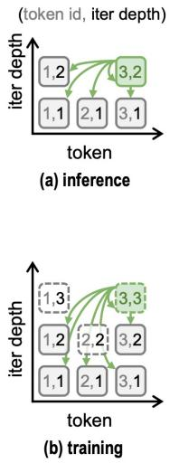
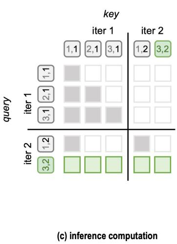
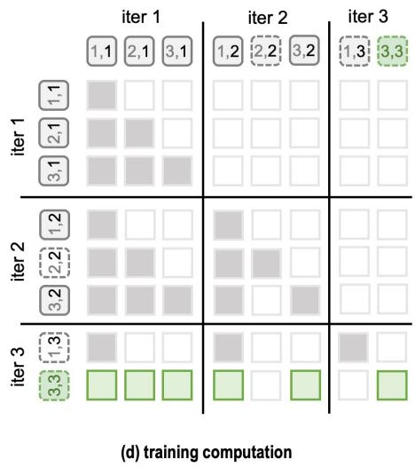

[← 返回 README](../README.md)

## A.2.1 ARCHITECTURE DEFINITIONS

Extended duo-causal attention. Following TaH (Fu et al., 2025b), each iteration keeps its own KV cache, and a query at token t and depth m attends to executed states at positions $s \leq t$ and depths $j \le m ( \mathrm { F i g u r e } 7 )$ . Concatenating the per-iteration caches into one sequence turns this rule into a block-structured mask, so training and prefill process all tokens in parallel. During training, a stopped token also computes a no-gradient lookahead iteration. Lookahead queries cannot attend to other tokens’ lookahead states, but can attend to their executed states under the duo-causal rule. Self-attention is retained, and all other attention follows the same position and depth constraints.

> 💡 **AI 批注**：**机制拆解**: 本段定义 TaH2 的扩展双因果注意力。四个可核对点：(1) 每次迭代各自维护 KV cache；(2) 位置 $t$、深度 $m$ 的 query 只能 attend 位置 $s \leq t$、深度 $j \le m$ 的已执行状态（Fig. 7）；(3) 把各迭代 cache 拼接为一个序列后等价于块结构掩码，训练与 prefill 因而可并行处理所有 token；(4) 训练时被停止的 token 会额外计算一次无梯度前瞻迭代，前瞻 query 不能看其他 token 的前瞻状态、但可按双因果规则看其已执行状态。原文只声明训练/prefill 并行，初稿『保持推理时序列依赖』属推断；原文另外说明 self-attention 保留、其余注意力遵循同样位置与深度约束，初稿未提。

Qwen3 MLP. The updater and decider each use a Qwen3 SwiGLU MLP, written as $B { \mathrm { : } }$

> 💡 **AI 批注**：**组件定义**: Updater 与 Decider 各使用一个 Qwen3 SwiGLU MLP，原文以 $B$ 记之（MinerU 在此处截断为 'written as $B \mathrm{:}$'）。式 (8) 给出该 MLP 的形式，式 (9)(10) 中的 $B_u$、$B_d$ 是两条分支各自实例化的模块。初稿『是后续公式 (8)-(10) 的基础模块』表述含混：式 (8) 本身就是该 MLP 的定义。

$$
\mathcal { B } ( \mathbf { x } ) = \mathbf { W } _ { \mathrm { d o w n } } \big [ \mathrm { S i L U } ( \mathbf { W } _ { \mathrm { g a t e } } \mathbf { x } ) \odot \left( \mathbf { W } _ { \mathrm { u p } } \mathbf { x } \right) \big ] ,\tag{8}
$$

> 💡 **AI 批注**：**公式批读**: 式 (8) $\mathcal{B}(\mathbf{x})=\mathbf{W}_{down}[\mathrm{SiLU}(\mathbf{W}_{gate}\mathbf{x})\odot(\mathbf{W}_{up}\mathbf{x})]$：gate 分支经 SiLU 后与 up 分支逐元素相乘，再由 down 投影回原维度，即标准 SwiGLU FFN。$\odot$ 的含义来自下一段（block 4），『所有投影无 bias』来自 block 12，二者都不在本式内，初稿把无 bias 一并写进本式批注略早。

where ⊙ denotes elementwise multiplication. We write RN for RMSNorm and $[ \cdot ; \cdot ]$ for concatenation. The two MLPs, $\scriptstyle B _ { \mathrm { u } }$ and $ { { \mathcal { B } } } _ { \mathrm { d } }$ , have separate weights, and each RN operation has its own learned scale.

> 💡 **AI 批注**：**参数细节**: 两个 MLP $B_u$、$B_d$ 权重独立，每个 RMSNorm 有各自的可学习缩放；$\odot$ 为逐元素乘，$[\cdot;\cdot]$ 为拼接。初稿『功能解耦、分别负责特征融合与停止决策』是对后文模块职责的概括，本段只提供『权重与归一化参数各自独立』这一证据；职责描述需由 block 8、10 支撑，属推断而非本段陈述。

> 💡 **AI 批注**：**图片待证**: 本块只有一张图片，无文字也无 caption；它与 block 6、7 相邻、而 Figure 7 的 caption 出现在 block 7，因此把它归入 Figure 7 只是基于版面相邻的推断，原文未给出该图编号标注。本次核对未获得图片视觉内容，故不对图中箭头、颜色或可见 cell 作任何断言。

> 💡 **AI 批注**：**图片待证**: 同为无 caption 的图片块，归入 Figure 7 的依据同样只是与 block 7 的 caption 相邻。未获得视觉信息，无法核对初稿『展示不同迭代深度下可见键值对分布』的具体内容；该说法只能由 block 7 的 caption 间接支持，不能当作对图片内容的确认。

  
Figure 7: Extended duo-causal attention in TaH2. Each cell denotes a (token id, iteration depth) pair; green arrows and cells show the keys visible to token 3. (a, b) Executed depths at inference and training; dashed cells are no-gradient lookahead iterations used only for depth supervision. $( \mathrm { c } , \mathrm { d } )$ The corresponding attention masks over concatenated per-iteration KV caches, where shaded cells are visible. Lookahead queries cannot attend to other tokens’ lookahead states; all other attention fol lows the duo-causal rule.

> 💡 **AI 批注**：**Figure 7 批读**: caption 明确：(a,b) 表示推理与训练时的已执行深度，绿箭头与绿色 cell 是 token 3 能看到的 keys；虚线 cell 为仅用于深度监督的无梯度前瞻迭代。(c,d) 是拼接各迭代 KV cache 后的注意力掩码，阴影 cell 可见。规则层面：前瞻 query 不能 attend 其他 token 的前瞻状态，其余遵循 duo-causal 规则。初稿『此图验证了并行化可行性』偏强——它是掩码规则的示意图，不是实验验证；且本次核对只依据 caption，未看图。

Updater. The updater fuses the original token embedding with the current hidden state and produces the next iteration’s input:

> 💡 **AI 批注**：**Updater 动机**: Updater 把原始 token embedding $\mathbf{e}_t$ 与当前隐状态 $\mathbf{h}_t^{(m)}$ 融合，生成下一次迭代的输入，作用是每次迭代重新注入 token 信息并整合当前状态。初稿称它是『实现动态深度的关键步骤』与原文不符：动态退出由 Decider 判定，而 TaH2-fixed 保留 updater 但强制执行全部 $M$ 次迭代（block 14），可见 updater 与动态深度并无绑定关系。

$$
\begin{array} { r } { \mathbf { x } _ { \mathrm { u } , t } ^ { ( m ) } = \mathbf { W } _ { \mathrm { u } } [ \mathrm { R N } ( \mathbf { e } _ { t } ) ; \mathrm { R N } ( \mathbf { h } _ { t } ^ { ( m ) } ) ] , } \\ { \mathcal { U } _ { \psi } ( \mathbf { e } _ { t } , \mathbf { h } _ { t } ^ { ( m ) } ) = \mathrm { R N } \Big ( \mathcal { B } _ { \mathrm { u } } \Big ( \mathrm { R N } ( \mathbf { x } _ { \mathrm { u } , t } ^ { ( m ) } ) \Big ) \Big ) . } \end{array}\tag{9}
$$

> 💡 **AI 批注**：**公式批读**: 式 (9) 两行分别定义 $\mathbf{x}_{u,t}^{(m)}=\mathbf{W}_u[RN(\mathbf{e}_t);RN(\mathbf{h}_t^{(m)})]$ 与 $\mathcal{U}_\psi(\mathbf{e}_t,\mathbf{h}_t^{(m)})=RN(B_u(RN(\mathbf{x}_{u,t}^{(m)})))$，流程是拼接 → 线性投影 → RMSNorm → SwiGLU MLP → 再次 RMSNorm，**式中没有残差连接**；初稿『残差+归一化+MLP+归一化』的『残差』属误读，两个 RN 都是后归一化。『提升数值稳定性、增强非线性』是通用解释，原文未作此断言，应标为推断。

Decider. The decider combines the same embedding and hidden state with the largest prediction probabilities to predict whether to continue:

> 💡 **AI 批注**：**Decider 动机**: Decider 在 embedding 与隐状态之外再接入『最大的预测概率』来判断是否继续。结合 block 12，$\mathrm{TopK}$ 返回降序概率值、1.7B 模型取 2048 个，所以输入是 Top-2048 概率向量而非单一最大值，初稿『预测概率的最大值 TopK』表述不准确。这些概率来自模型自身的 next-token 分布；『旨在更准确判断收敛』是设计意图推断，原文没有给出动机句。

$$
\begin{array} { r l } & { \mathbf { x } _ { \mathrm { d } , t } ^ { ( m ) } = \mathbf { W } _ { \mathrm { d } } [ \mathrm { R N } ( \mathbf { e } _ { t } ) ; \mathrm { R N } ( \mathbf { h } _ { t } ^ { ( m ) } ) ; \mathrm { R N } ( \mathrm { T o p K } ( \mathbf { q } _ { t } ^ { ( m ) } ) ) ] , } \\ & { g _ { t } ^ { ( m ) } = \sigma \Big ( \mathbf { W } _ { \mathrm { s c o r e } } \ \mathrm { R N } \Big ( \mathcal { B } _ { \mathrm { d } } ( \mathbf { x } _ { \mathrm { d } , t } ^ { ( m ) } ) \Big ) \Big ) . } \end{array}\tag{10}
$$

> 💡 **AI 批注**：**公式批读**: 式 (10) 第一行 $\mathbf{x}_{d,t}^{(m)}=\mathbf{W}_d[RN(\mathbf{e}_t);RN(\mathbf{h}_t^{(m)});RN(\mathrm{TopK}(\mathbf{q}_t^{(m)}))]$，第二行 $g_t^{(m)}=\sigma(\mathbf{W}_{score}RN(B_d(\mathbf{x}_{d,t}^{(m)})))$。计算顺序为三路拼接 → $\mathbf{W}_d$ → $B_d$（SwiGLU）→ RMSNorm → $\mathbf{W}_{score}$ → sigmoid，得到继续/退出概率；TopK 取 2048 个值来自 block 12。初稿对顺序的复述正确。

Here $\sigma$ is the sigmoid function, and $\mathrm { T o p K }$ returns probability values in descending order (2,048 values for the 1.7B model). All projections are bias-free, and both modules share their parameters across iterations.

> 💡 **AI 批注**：**实现细节**: $\sigma$ 为 sigmoid；TopK 按降序返回概率值，1.7B 模型取 2048 个；所有投影无 bias；Updater 与 Decider 的模块参数跨迭代共享。初稿的『共享减少显存占用』与『假设不同深度的转换逻辑一致』都是合理但原文未陈述的推断，原文只陈述了参数共享这一事实。

Baseline implementations. All baselines are post-trained from the same Qwen3-1.7B-Base checkpoint using the same data, sample order, training recipe and evaluation protocol as TaH2. Our Ouro and Huginn implementations adapt their architectures to this setting rather than reproduce the released checkpoints; neither uses TaH2’s updater, decider or online supervision.

> 💡 **AI 批注**：**Baseline 公平性设定**: 所有 baseline 与 TaH2 从同一 Qwen3-1.7B-Base checkpoint 出发，使用相同数据、样本顺序、训练配方与评测协议（初稿漏了『样本顺序』和『评测协议』）。Ouro 与 Huginn 是把各自架构适配到该设定，而非复现公开 checkpoint；两者都不使用 TaH2 的 updater、decider 或 online supervision。由这些设定推出『突出 TaH2 架构的独特贡献』属评价性推断，原文未作此判断。

TaH2-fixed. This variant retains TaH2’s updater, replaces extended duo-causal attention with causal attention and removes the decider. Every token executes all M iterations. The model is trained with next-token prediction loss on the uniformly averaged distribution, $\begin{array} { r } { \mathbf q _ { t } = \frac { 1 } { M } \sum _ { m = 1 } ^ { M } \mathbf q _ { t } ^ { ( m ) } } \end{array}$

> 💡 **AI 批注**：**TaH2-fixed 对照**: 该变体保留 TaH2 的 updater，将扩展双因果注意力换成普通因果注意力并去掉 decider，每个 token 都执行全部 $M$ 次迭代，训练用均匀平均分布 $\mathbf{q}_t=\frac{1}{M}\sum_{m=1}^{M}\mathbf{q}_t^{(m)}$ 上的 next-token prediction 损失。初稿对配置的复述正确；『用于评估动态退出与特殊注意力机制的贡献』是推断出的实验意图，原文未明说。

Ouro. Our implementation loops the entire backbone, passing the hidden state unchanged to the next iteration as in Equation 1, and follows the two-stage training of Zhu et al. (2025). To avoid gate col lapse in post-training, where every token exits after the first iteration, we simplify Stage I by removing the exit gate and uniformly averaging the per-iteration losses, $\begin{array} { r } { \mathcal { L } _ { \mathrm { O u r o } } = \frac { 1 } { N } \sum _ { t } \frac { \bar { 1 } } { M } \sum _ { m = 1 } ^ { \bar { M } } \ell _ { t } ^ { ( m ) } } \end{array}$ with every token executing M iterations. Unless otherwise stated, Ouro results use this fixed-depth model.

> 💡 **AI 批注**：**Ouro 实现差异**: Ouro 循环整个 backbone，隐状态按式 (1) 原样传入下一次迭代（不经 TaH2 的 updater 融合），沿用 Zhu et al. (2025) 的两阶段训练。为规避 post-training 中的 gate 坍缩（每个 token 第一次迭代后就退出），Stage I 去掉 exit gate、把各迭代损失均匀平均，所有 token 执行 $M$ 次迭代。原文明确『除非另有说明，Ouro 结果使用该固定深度模型』，初稿写『可能基于』偏弱；『因为动态 gate 不稳定』是把规避坍缩的动机外推为结论，属推断。

Stage II follows the original gate training (Zhu et al., 2025, Section 3.4). From the Stage I checkpoint at $M = 2$ , we freeze the backbone and train a linear exit gate $\boldsymbol { \lambda } _ { t } ^ { ( m ) } = \sigma ( \mathbf { w } _ { \mathrm { e x i t } } ^ { \top } \mathbf { s } \mathbf { g } [ \mathbf { h } _ { t } ^ { ( m ) } ] )$ ), where $\mathrm { s g } [ \cdot ]$ stops gradients. With all iterations executed, the gate is supervised by the soft target $\tilde { c } _ { t } ^ { ( m ) } =$ $\sigma \big ( k ( I _ { t } ^ { ( m ) } - \gamma ) \big )$ , where $I _ { t } ^ { ( m ) } = \operatorname* { m a x } \big ( 0 , \mathrm { s g } [ \ell _ { t } ^ { ( m ) } - \ell _ { t } ^ { ( m + 1 ) } ] \big )$ :

> 💡 **AI 批注**：**Gate 训练机制**: Stage II 沿用 Zhu et al. (2025, Section 3.4) 的原始 gate 训练，**并非本文新提出的创新**，初稿『关键创新在于』需改。从 Stage I 在 $M=2$ 的 checkpoint 出发冻结 backbone，训练线性 exit gate $\lambda_t^{(m)}=\sigma(\mathbf{w}_{exit}^\top sg[\mathbf{h}_t^{(m)}])$；软目标 $\tilde{c}_t^{(m)}=\sigma(k(I_t^{(m)}-\gamma))$，$I_t^{(m)}=\max(0,sg[\ell_t^{(m)}-\ell_t^{(m+1)}])$，即继续迭代后损失下降越多、$\tilde{c}$ 越接近 1。初稿漏掉 $M=2$ 起点，并把 $sg$ 的作用说成『防止 Gate 影响 Backbone 更新』；更准确是截断梯度进入 $\mathbf{h}_t$ 一侧（backbone 本身已冻结）。

$$
\mathcal { L } _ { \mathrm { g a t e } } = \frac { 1 } { M } \sum _ { m = 1 } ^ { M - 1 } \frac { 1 } { N } \sum _ { t } \mathrm { B C E } \Big ( 1 - \lambda _ { t } ^ { ( m ) } , \tilde { c } _ { t } ^ { ( m ) } \Big ) ,\tag{11}
$$

> 💡 **AI 批注**：**公式批读**: 式 (11) $\mathcal{L}_{gate}=\frac{1}{M}\sum_{m=1}^{M-1}\frac{1}{N}\sum_t \mathrm{BCE}(1-\lambda_t^{(m)},\tilde{c}_t^{(m)})$。注意求和上限为 $M-1$（最后一次迭代没有 gate 目标），外层归一化仍用 $1/M$。预测项是 $1-\lambda$、目标是软标签 $\tilde{c}$，等价于把 $\lambda$ 拟合到 $1-\tilde{c}$；结合 Q-exit 的累积概率阈值 0.5，$\lambda$ 越大越倾向在该深度退出。$k=50$、$\gamma=0.005$ 出自下一段而非本式；初稿『sigmoid 接近 1 表示高置信度』是泛化解释，与本文语义无直接对应。

using the original $k = 5 0$ and $\gamma = 0 . 0 0 5$ . Training settings follow our main post-training setup (Appendix A.1.1), except for a learning rate of $1 0 ^ { - 4 }$ and a single epoch. At inference, the original Q-exit rule stops each token at the first depth whose cumulative exit probability reaches $q = 0 . 5$ Prefill executes all iterations; during decoding, an early-exiting token skips the remaining iterations and reuses its last executed KV entries for deeper ones (Zhu et al., 2025).

> 💡 **AI 批注**：**训练与推理配置**: 本段仍属 Ouro Stage II：沿用原始 $k=50$、$\gamma=0.005$；训练设置跟随主 post-training（Appendix A.1.1），但学习率为 $10^{-4}$、只训 1 个 epoch。推理用原始 Q-exit 规则：token 在累积退出概率首次达到 $q=0.5$ 的深度停止；prefill 执行全部迭代；解码时提前退出的 token 跳过剩余迭代，并复用最后执行的 KV 条目。初稿对规则的复述正确，但未标明这些超参属于 Ouro Stage II；『平衡训练稳定性与推理效率』是评述性推断。

Huginn. Following the middle-block recurrence of Geiping et al. (2025a), our 28-layer backbone repeats layers 8–21 (14 layers). Layers 1–7 are evaluated once to produce $\mathbf { z } _ { t } .$ . After iteration $m ,$ an input adapter combines $\mathbf { z } _ { t }$ with the middle-block output $\mathbf { r } _ { t } ^ { ( m ) }$ to form the next input:

> 💡 **机制拆解**: 本段交代 Huginn 在本文 28 层 backbone 上的落地方式。原文首句 'Following the middle-block recurrence of Geiping et al. (2025a)' 表明该递归方案沿用既有工作，本段是在 'our 28-layer backbone' 上复现/对齐，而非本文新提出的结构；段末又把 Huginn 与 Ouro 并列比较。数据流为：Layers 1–7 只执行一次（'evaluated once'），产出初始状态 $\mathbf{z}_t$；Layers 8–21（14 层）是被重复执行的中间块，第 $m$ 次迭代的中间输出记为 $\mathbf{r}_t^{(m)}$；随后 input adapter 把 $\mathbf{z}_t$ 与 $\mathbf{r}_t^{(m)}$ 融合成下一轮输入。
> 
> > 💡 **推断与界限**: 原文只写了 'Layers 1–7 are evaluated once' 与 adapter 'combines ... to form the next input'，**没有**给出设计动机。初稿所称'前 7 层是静态编码器''用时间上的迭代深度换取空间参数的高效利用''避免深层网络的梯度消失或计算冗余'均无本段证据，属批注者推断，须显式标注为待证，不能写成 Huginn 的设计目的。

$$
\begin{array} { r } { \mathbf { u } _ { t } ^ { ( m + 1 ) } = \mathbf { a } \odot \mathbf { r } _ { t } ^ { ( m ) } + \mathbf { v } \odot \mathbf { W } _ { \mathrm { i n } } \mathbf { z } _ { t } , \qquad \mathbf { v } = \mathrm { s o f t p l u s } ( \mathbf { b } _ { \mathrm { i n } } ) , \quad \mathbf { a } = \exp \big ( - \mathbf { v } \odot \exp ( \mathbf { b } _ { \mathrm { r e t } } ) \big ) , } \end{array}\tag{12}
$$

> 💡 **公式批读**: Eq. (12) 是 input adapter 的状态更新式：$\mathbf{u}_t^{(m+1)} = \mathbf{a}\odot\mathbf{r}_t^{(m)} + \mathbf{v}\odot\mathbf{W}_{\mathrm{in}}\mathbf{z}_t$，形式上是'保留上一轮中间块输出 + 注入经 $\mathbf{W}_{\mathrm{in}}$ 投影的初始编码'的逐元素组合，两项系数分别由学到的 bias 生成：$\mathbf{v}=\mathrm{softplus}(\mathbf{b}_{\mathrm{in}})$、$\mathbf{a}=\exp\!\big(-\mathbf{v}\odot\exp(\mathbf{b}_{\mathrm{ret}})\big)$。这与紧接原文 'a and v control state retention and input injection' 直接对应，属可直接核对的主张。
> 
> > 💡 **从公式形式推出的性质（批注者推导，非原文断言）**: 因 softplus 输出恒为正、$\exp(\mathbf{b}_{\mathrm{ret}})$ 恒为正，故 $\mathbf{a}\in(0,1)$ 逐元素成立，$\mathbf{a}$ 在形式上天然是一个衰减系数。
> 
> > 💡 **推断与待证**: 初稿'防止信号在多次迭代中爆炸或消失''保证递归过程的数值稳定性'属于对设计意图的推断，原文未作此声明；'为何选择 softplus 而非 sigmoid'可作为 Q&A 追问点，但本段无证据可作答。

where $\mathbf { b } _ { \mathrm { i n } }$ and $\mathbf { b } _ { \mathrm { r e t } }$ are learned bias vectors, a and v control state retention and input injection. The adapter adds $d ^ { 2 } + 2 d = 4 . 2 0 \mathbf { M }$ parameters for hidden dimension $d = 2 0 4 8 ( 0 . 2 \hat { 4 } \% )$ ). Every token executes M iterations of the middle block, after which layers 22–28 and the LM head produce the prediction used for next-token cross-entropy. This gives an effective depth of $1 4 + 1 4 M$ layers: Huginn at $M = 3 .$ , 7 matches the 56 and 112 layers executed by Ouro at $M = 2 , 4$ , respectively.

> 💡 **关键数字与效率核对**:
> - **参数量**：原文给出 adapter 增加 $d^2+2d=4.20\mathbf{M}$ 参数，$d=2048$。实算 $2048^2+2\times2048=4{,}198{,}400\approx4.20\text{M}$，与原文一致；原文占比写作 $0.2\hat{4}\%$（解析产物，应为 0.24%）。批注统一写 **0.24%**；该比例相对何种总量（应为 backbone 总参数）原文未明说，属推断。
> - **执行流程**：每个 token 执行 $M$ 次中间块，之后 Layers 22–28（7 层）与 LM head 产生用于 next-token 交叉熵的预测，与原文一致。
> - **有效深度**：$14+14M$；$M=3\Rightarrow56$、$M=7\Rightarrow112$，与 'Huginn at M = 3, 7 matches the 56 and 112 layers executed by Ouro at M = 2, 4' 一致，即 56/112 是 Ouro 在 $M=2,4$ 时执行的层数。
> 
> > 💡 **证据边界（已纠正初稿）**: 原文只主张**执行层数相匹配**（'matches the 56 and 112 layers'），既未主张 Huginn 与 Ouro 性能相当，也未主张'超越'，更没有把 Ouro 定义为性能基准。初稿'试图通过不同的递归策略复现或超越现有动态深度模型的性能基准'超出证据范围，应删除或改写为'仅对齐执行层数，性能关系本文此处未作声明'。

