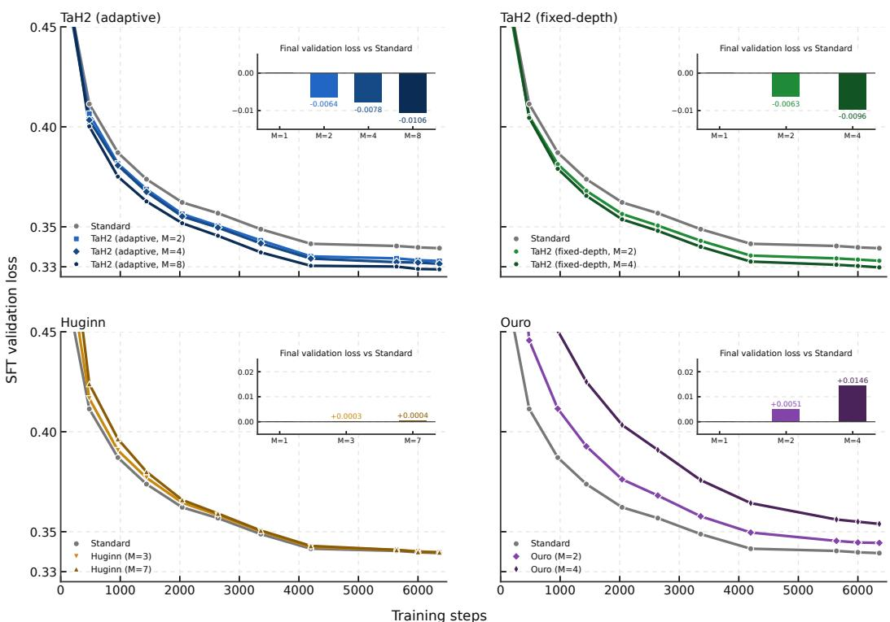

[← 返回 README](../README.md)

## C.1 VALIDATION LOSS DURING POST-TRAINING

Figure 8 shows validation loss throughout post-training at 1.7B. Both TaH2 variants maintain lower loss than Standard, with greater iteration depth yielding further reductions and adaptive TaH2 attaining the lowest final loss.

> 💡 **机制与证据批注（已核对原文）**
> - 原文陈述一：Figure 8 展示 1.7B 规模后训练全程的验证损失；两个 TaH2 变体（Both TaH2 variants）的损失均低于 Standard。
> - 原文陈述二：迭代深度越大（greater iteration depth），损失进一步下降；自适应 TaH2（adaptive TaH2）取得最低的最终损失。
> - 证据边界：原文只给出相对趋势词（lower / further reductions / lowest final loss），**没有**任何绝对值、差值量级或显著性检验；也未说明为何迭代深度增加会降低验证损失。
> - 修正说明：初稿"暗示了模型容量或优化路径对训练稳定性的影响"超出证据——原文既未提"模型容量"，也未讨论训练"稳定性"机制。此处应标为**推断/待证**，而非对原文的复述。
> 
> > 💡 **Q&A 批注记录**：
> > - Q："lower loss"是全程更低还是仅最终更低？
> > - A：原文写 maintain lower loss throughout（全程维持更低），但仅凭本节文字与 caption 无法核验曲线是否全程无交叉，属未验证项。

  
Figure 8: Validation loss during post-training at 1.7B. Insets show final loss differences from Standard; negative values indicate improvements.

> 💡 **Figure 8 批读（已核对 caption）**
> - 图中承载两条信息：(a) 1.7B 后训练期间验证损失的走势；(b) 插图（Insets）给出各变体相对 Standard 的**最终损失差值**，负值表示改进。
> - 与正文 block 1 的对应关系：正文"低于 Standard / 最低最终损失"这一相对结论，正是由插图中的负差值直接支撑。
> - 证据边界：本次**未获得图片视觉信息**，曲线形态、纵轴数值范围、收敛位置与插图具体读数均无法核验；"曲线"这一呈现形式由正文"validation loss throughout post-training"与 caption 共同支持，但具体走势属未验证。
> - 待证：caption 未给出差值量级，因此不能判断改进幅度是否显著，也不能比较两个 TaH2 变体之间的差距大小。

