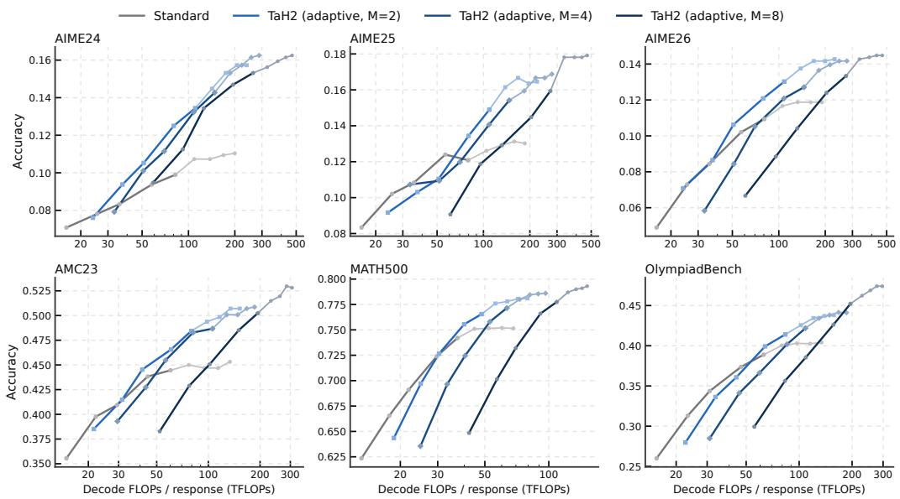

[← 返回 README](../README.md)

## C.2 PER-BENCHMARK TEST-TIME SCALING

Figure 9 shows test-time scaling on each of the six math benchmarks. We use output-token cutoffs of 4K, 6K, 8K, 12K, 16K, 20K, 24K, 28K and 32K, matching the sampling grid of Figure 4b.

> 💡 **实验设置拆解（AI 批注）**: 原文给出三点：测试时扩展覆盖六个数学基准；输出 token 截断档位为 4K、6K、8K、12K、16K、20K、24K、28K、32K，共 9 档；该档位与 Figure 4b 的采样网格一致。批注将“控制变量一致性”和“旨在探究长序列边界”标为推断：原文只声明采样网格匹配，并未说明实验目的或推断性能边界，需由后续结果正文支撑。

  
Figure 9: Per-benchmark test-time scaling on the six math benchmarks at 1.7B. Each panel compares Standard with TaH2 at $M \in \{ 2 , 4 , 8 \}$ using the same nine output-token cutoffs as Figure 4b. Dark segments extend through 16K and light segments through 32K.

> 💡 **Figure 9 批读（AI 批注）**: 依据图注，Figure 9 展示六个数学基准上的 per-benchmark test-time scaling，模型规模为 1.7B；每个 panel 比较 Standard 与 TaH2，TaH2 配置写作 $M \in \{2,4,8\}$；使用与 Figure 4b 相同的 9 个输出 token 截断档位；深色线段延伸到 16K，浅色线段延伸到 32K。未在给定文本中定义 $M$，因此不能写成“并行采样数/聚合规模”，只能标注为待证。图注没有给出曲线高低或性能增益结论，且本次未获得图片视觉信息，不能由 caption 推断 TaH2 在长上下文阶段更优或更鲁棒；这些应等待图内数据或正文结果说明。

