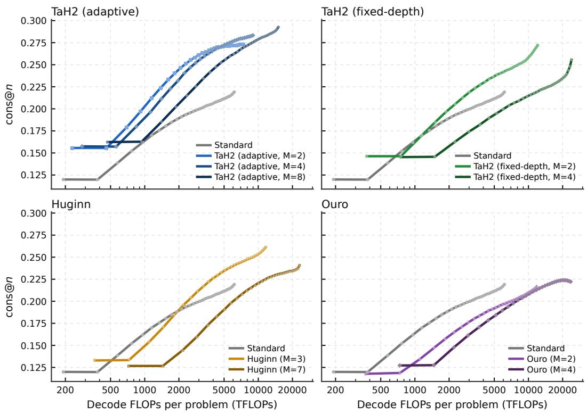
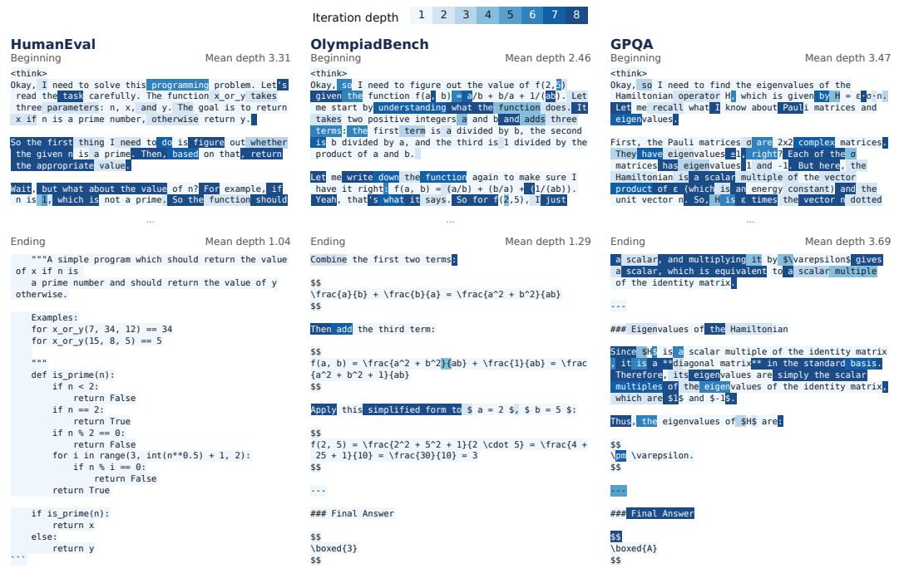
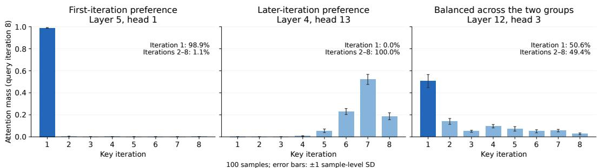

[← 返回 README](../README.md)

## D FULL FORMULATION OF LOOKAHEAD DEPTH SUPERVISION

Continuation labels and gain coverage. The continue target $c _ { t } ^ { ( m ) }$ indicates whether token t should execute another iteration, whereas $m _ { t }$ records how many iterations token t executes under the current decider. As in Section 4.2, $a _ { t } ^ { ( m ) } = \mathbf { 1 } [ m _ { t } \geq m ]$ records whether supervised token t executes iteration m. These labels are recomputed from the current backbone on every training batch and do not determine the routes used in that forward pass. We initialise $c _ { t } ^ { ( 0 ) } = 1$ for every supervised token and compute the loss reduction $\delta _ { t } ^ { ( m ) } = \ell _ { t } ^ { ( \bar { m } ) } - \ell _ { t } ^ { ( m + 1 ) }$ as in Equation 5. For a token that stops, a no-gradient lookahead supplies its next-iteration loss.

> 💡 **机制拆解**: 这一段定义 Lookahead Depth Supervision 的标签体系。continue target $c_t^{(m)}$ 表示 token t 是否应再执行一次迭代；$m_t$ 记录 token t 在当前 decider 下实际执行的迭代数；$a_t^{(m)} = \mathbf{1}[m_t \geq m]$ 标记受监督 token 是否执行第 $m$ 次迭代。关键设计：这些标签在每个训练 batch 上由当前 backbone 重新计算，且不决定该次前向传播实际使用的 routes——监督信号与前向 routing 解耦。
> 
> > 💡 **公式批读**: 初始化 $c_t^{(0)}=1$，loss reduction 按原文记为 $\delta_t^{(m)} = \ell_t^{(\bar{m})} - \ell_t^{(m+1)}$（原文指向 Equation 5）。对已停止的 token，其 next-iteration loss 由 no-gradient lookahead 提供，即 $\ell_t^{(m+1)}$ 一侧不参与梯度。
> 
> > 💡 **纠正初稿**: 初稿把 $\bar{m}$ 解释为“最大深度”，并把被减项写成 $\bar{\boldsymbol{\ell}}_t^{(m+1)}$；原文实际写作 $\ell_t^{(\bar{m})}$，且本节未定义 $\bar{m}$ 的含义，这一解释只能标为待证。另外“是否执行第 $m+1$ 次”是对原文 “another iteration” 的推断，并非原文显式编号。

  
Figure 10: Parallel test-time scaling: mean AIME24–26 cons@n versus decoding FLOPs per problem for $n = 1 , \ldots , 3 2$ , one model family per panel with Standard for reference.

> 💡 **Figure 10 批读**: 未提供图片像素信息，以下仅依据 caption 逐项核对——横轴为 per-problem decoding FLOPs，纵轴为 AIME24–26 的 mean cons@n，$n = 1, \ldots, 32$，每个 panel 对应一个模型家族，并以 Standard 作参考线。
> 
> > 💡 **证据边界**: caption 只给出坐标含义、$n$ 范围与 panel 组织方式，没有给出任何具体模型家族名称、数值或提升幅度；初稿所谓“验证了增加采样次数对准确率的提升及成本效益”属于对图面趋势的推断，在无图面信息时不能作为既定结论，应标为推断。

  
Figure 11: Token-level iteration depth in sampled correct responses from OlympiadBench, HumanEval and GPQA. Darker shading indicates more iterations; mean depths refer to the displayed spans.

> 💡 **Figure 11 批读**: 依据 caption，该图展示从 OlympiadBench、HumanEval 与 GPQA 中采样的正确回答里 token 级迭代深度分布，颜色越深表示迭代越多；caption 明确说明 mean depths 只针对所展示的 span，而非整条回答或整题。
> 
> > 💡 **证据边界**: 初稿“揭示不同任务或 token 位置对计算深度的需求差异”是对趋势的解释性推断，caption 并未陈述该结论，也不支持把它写成图的既定发现；同时 caption 用词为 sampled correct responses，是采样后的正确回答，不宜泛化为全部回答。

  
Figure 12: Attention mass by key iteration for three representative heads at query iteration 8. Bars show means over 100 sequences; error bars indicate one sample-level standard deviation. Queries are averaged within each sequence first.

> 💡 **Figure 12 批读**: 依据 caption，该图给出三个代表性 head 在 query iteration 8 时按 key iteration 的 attention mass；bar 为 100 条序列的均值，误差棒为 sample-level 一个标准差，且在每条序列内部先对 query 求平均。
> 
> > 💡 **纠正初稿**: 初稿末尾“说明深层迭代可能更关注早期或特定阶段的中间表示”超出 caption 证据范围——caption 没有给出任何关于关注早期层或特定阶段的结论，该句应删除或明确标为待证推断。误差棒含义应表述为“样本（序列）级标准差”，与初稿一致，但需注意先对序列内 query 求平均这一预处理。

At iteration $m ,$ collect the positive gains of tokens with $a _ { t } ^ { ( m ) } = 1$ and $c _ { t } ^ { ( m - 1 ) } = 1$ across dataparallel ranks and sort them as $\delta _ { [ 1 ] } ^ { ( m ) } \geq \cdots \geq \delta _ { [ n ] } ^ { ( m ) } > 0$ , where [i] denotes gain rank and n is the number of positive gains. The coverage cutoff is

> 💡 **覆盖率统计的准备步骤**: 在第 $m$ 次迭代，收集同时满足 $a_t^{(m)} = 1$（该轮执行过迭代）与 $c_t^{(m-1)} = 1$（上一轮 continue 标签为继续）的 token 的正增益，跨 data-parallel ranks 聚合后降序排序 $\delta_{[1]}^{(m)} \geq \cdots \geq \delta_{[n]}^{(m)} \gt 0$，$[i]$ 表示增益秩，$n$ 为正增益个数。
> 
> > 💡 **纠正初稿**: 初稿把 $c_t^{(m-1)} = 1$ 表述为“计划继续”，更准确的表述是“上一轮迭代被标记为继续”；另外这里只收集正增益（$\gt 0$），并明确跨 rank 聚合，这两点初稿未完整点出。

$$
i _ { \mathrm { c o v } } = \operatorname* { m i n } \Big \{ i : \sum _ { i ^ { \prime } = 1 } ^ { i } \delta _ { [ i ^ { \prime } ] } ^ { ( m ) } \geq \rho \sum _ { i ^ { \prime } = 1 } ^ { n } \delta _ { [ i ^ { \prime } ] } ^ { ( m ) } \Big \} , \qquad \delta _ { \mathrm { c u t } } ^ { ( m ) } = \delta _ { [ i _ { \mathrm { c o v } } ] } ^ { ( m ) } .\tag{24}
$$

> 💡 **公式批读 (Eq. 24)**: 定义覆盖截断 $i_{\mathrm{cov}} = \min\{ i : \sum_{i'=1}^{i} \delta_{[i']}^{(m)} \geq \rho \sum_{i'=1}^{n} \delta_{[i']}^{(m)} \}$，$\delta_{\mathrm{cut}}^{(m)} = \delta_{[i_{\mathrm{cov}}]}^{(m)}$。含义是：把排序后的正增益逐项累加，取累积和首次达到全局正增益总量 $\rho$ 比例的位置，该位置对应的增益值即为截断值。
> 
> > 💡 **设计解读**: 阈值由增益贡献度分布自适应确定，而非固定常数；$\rho$ 控制的是增益质量比例。注意求和是在跨 rank 聚合后的全局正增益集合上完成，因此截断值具有 batch 级（全局）统计意义。

Equation 6 assigns continue labels to gains at or above this cutoff, including ties. Thus $\rho$ specifies a fraction of total positive gain, not a fraction of tokens. As an exception to Equation $^ { 6 , }$ if there are no positive gains, we set $\delta _ { \mathrm { c u t } } ^ { ( m ) } = 0$ only for weight computation and assign zero continue labels at this and all later iterations.

> 💡 **Eq. 6 与截断值的衔接**: 依据 Eq. 6，增益大于等于该 cutoff 的 token 被赋予 continue 标签（含并列情形）；因此 $\rho$ 指定的是总正增益的比例，而不是 token 数量的比例。
> 
> > 💡 **纠正初稿（例外分支）**: 原文的例外是“若不存在正增益，则 set $\delta_{\mathrm{cut}}^{(m)} = 0$ only for weight computation，并在该轮及之后所有迭代赋零 continue 标签”。初稿写成“权重设为极小值并标记停止”不准确：$\delta_{\mathrm{cut}}^{(m)} = 0$ 后代入 Eq. 25 得到的权重是 $\mathrm{clip}(|\delta_t^{(m)}|, 10^{-6}, 1)$，只有当增益本身趋近 0 时才接近下界，并非一律“极小值”。原文的“only for weight computation”这一限定也必须保留。

Cost-sensitive weights. For tokens with $a _ { t } ^ { ( m ) } = 1$ , the per-token weights are

> 💡 **范围限定**: 这是 Cost-sensitive weights 小节的引入句，明确后续 per-token 权重的适用范围是满足 $a_t^{(m)} = 1$（该轮执行过第 $m$ 次迭代）的 token。
> 
> > 💡 **纠正初稿**: 初稿仅标注“标题/过渡”，遗漏了这一适用范围限定，而它决定了权重定义只覆盖该轮实际执行迭代的受监督 token，是复现时的必要条件。

$$
w _ { t } ^ { ( m ) } = \left\{ \begin{array} { l l } { \mathrm { c l i p } \Big ( | \delta _ { t } ^ { ( m ) } - \delta _ { \mathrm { c u t } } ^ { ( m ) } | , 1 0 ^ { - 6 } , 1 \Big ) , } & { c _ { t } ^ { ( m - 1 ) } = 1 , } \\ { 1 0 ^ { - 6 } , } & { c _ { t } ^ { ( m - 1 ) } = 0 . } \end{array} \right.\tag{25}
$$

> 💡 **公式批读 (Eq. 25)**: $w_t^{(m)} = \mathrm{clip}(|\delta_t^{(m)} - \delta_{\mathrm{cut}}^{(m)}|, 10^{-6}, 1)$ 当 $c_t^{(m-1)} = 1$；当 $c_t^{(m-1)} = 0$ 时取固定值 $10^{-6}$。即权重由增益与截断值的绝对距离决定，下界 $10^{-6}$、上界 $1$。
> 
> > 💡 **纠正初稿（关键错误）**: 初稿称“接近截断值的 token 获得较小权重……而显著高于截断值的获得较大权重”，这只说对了一半。由于权重取自绝对差 $|\delta_t^{(m)} - \delta_{\mathrm{cut}}^{(m)}|$，离开截断值越远（无论是高于还是低于）权重越大，越靠近截断值权重越小（视为边界不确定）。不应把它解读为单调“越高越大”。另外上一轮标签为停止的 token 是固定 $10^{-6}$，不是按距离计算。

The fixed lower bound preserves a small supervision weight near the cutoff and for tokens already labelled to stop; the upper bound limits the influence of large loss changes. Labels, cutoffs and weights are treated as constants during backpropagation.

> 💡 **上下界语义与反传处理**: 原文给出的理由有两层——固定的下界在 cutoff 附近以及已标记停止的 token 上保留一个小监督权重；上界限制大 loss changes 的影响。同时明确：标签、cutoffs 与权重在反向传播中被视为常数。
> 
> > 💡 **纠正初稿**: 初稿“限制极端大增益对梯度的主导作用”不准确，原文说的是大 loss changes，不是增益。初稿“防止零权重导致梯度消失或数值问题”是对下界动机的补充推断，原文只陈述了“保留小监督权重”，若保留需标为推断。“避免循环依赖或不稳定的二阶导数效应”同样是推断，原文仅陈述 treated as constants during backpropagation。

Class balancing and joint loss. At each iteration, we count stop and continue labels among tokens with $a _ { t } ^ { ( m ) } = 1$ , pooling counts across data-parallel ranks. The positive-class balancing weight $\beta ^ { ( m ) }$ is their stop-to-continue count ratio; it is set to one if either class is absent. The BCE in Equation 7 is therefore

> 💡 **类平衡机制**: 在每次迭代，统计满足 $a_t^{(m)} = 1$ 的 token 中的 stop 与 continue 标签数，并跨 data-parallel ranks 汇总；正类平衡权重 $\beta^{(m)}$ 定义为 stop-to-continue 计数比，若任意一类缺失则置为 1。原文随后说明 Eq. 7 中的 BCE 即为下式展开。
> 
> > 💡 **纠正初稿**: 初稿只写“Stop 和 Continue 标签的数量比”，方向不明；原文明确是 stop 与 continue 的计数之比（即 stop 数除以 continue 数）。初稿“通常 Stop 远多于 Continue”属于推断，原文未陈述哪一类更多，应删除或标为待证。初稿“最终的二元交叉熵损失”也不够准确——Eq. 26 是 Eq. 7 中 BCE 的显式形式。

$$
\mathrm { B C E } \Big ( g _ { t } ^ { ( m ) } , c _ { t } ^ { ( m ) } \Big ) = - \beta ^ { ( m ) } c _ { t } ^ { ( m ) } \log g _ { t } ^ { ( m ) } - ( 1 - c _ { t } ^ { ( m ) } ) \log ( 1 - g _ { t } ^ { ( m ) } ) .\tag{26}
$$

> 💡 **公式批读 (Eq. 26)**: $\mathrm{BCE}(g_t^{(m)}, c_t^{(m)}) = -\beta^{(m)} c_t^{(m)} \log g_t^{(m)} - (1 - c_t^{(m)}) \log(1 - g_t^{(m)})$。可见平衡系数 $\beta^{(m)}$ 只乘在 continue 类（$c_t^{(m)} = 1$）的项上，$g_t^{(m)}$ 为 decider 输出的继续概率。结合 $\beta^{(m)}$ 为 stop/continue 计数比，当 stop 标签多于 continue 时，continue 项的权重被放大。
> 
> > 💡 **证据边界**: 初稿“防止模型倾向于总是预测停止以最小化简单损失”是对该加权动机的合理解释，但原文未直接陈述此动机，宜标为推断；公式本身的加权位置则与原文完全一致。

The coverage cutoff and class-balancing weights are calculated from each batch, with the clipping bounds above fixed throughout the experiments.

> 💡 **计算位置与固定超参**: coverage cutoff 与 class-balancing weights 均按每个 batch 计算（结合前文，计数跨 data-parallel ranks 汇总），而上面的裁剪边界在整个实验过程中固定不变。
> 
> > 💡 **复现要点**: 动态部分是截断值与 $\beta^{(m)}$（随 batch 数据分布变化），静态部分是 $10^{-6}$ 与 $1$ 这两个 clip 边界；把“batch 计算”与“跨 rank 汇总”一起理解，才能与 Block 5 的全局排序口径一致。

