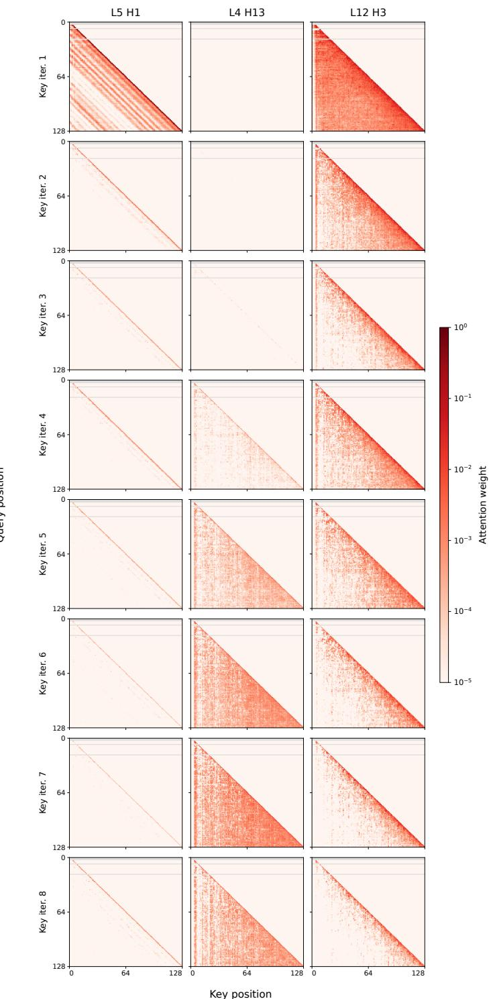

[← 返回 README](../README.md)

## E ADDITIONAL RELATED WORK

This section extends Section 2, grouped by test-time compute, recurrent design, adaptive depth and serving.

> 💡 **Section 概览（AI 批注）**: 本附录自称是正文第 2 节的扩展，原文声明的分组是 test-time compute、recurrent design、adaptive depth 与 serving 四类。但附录正文实际出现的小标题是六类：Test-time scaling、Recurrent architectures、Scaling under resource constraints、Depth scaling and stability、Recurrent states and output aggregation、Post-training recurrence into pretrained LLMs——其中并没有独立的 serving 小节，adaptive depth 也分散在 depth scaling and stability 与 output aggregation 两处。因此阅读时应以实际小标题为准，首句的分类只是作者的粗略归并，不能当作目录结构来对齐。

Test-time scaling. Token-based scaling further differs in how it controls reasoning length and selects candidates. Within a sequence, online confidence adjusts reasoning budgets (Li et al., 2026c), while analyses of overthinking show that longer chains are not uniformly better (Wu et al., 2025b).

> 💡 **机制拆解 - 测试时缩放的“序列内”一支（Test-time scaling）**: 本段只覆盖序列内控制：在线置信度调整推理预算（Li et al., 2026c），以及 overthinking 分析指出更长的链并非一致更好（Wu et al., 2025b）。需要划清界限：本段没有讨论候选间搜索（process-reward search、likelihood-based sampling 等在下一段才出现），不应跨段并入；也尚未给出任何具体数值。可支撑的结论仅是——长度控制存在置信度类做法，且长链收益非单调。至于这是否构成本文自适应停止或并行流的动机，原文在本段没有声明，只能算阅读者的推断。

  
Figure 13: Attention maps for the same heads, with columns indexing heads and rows indexing key iterations. Each query position is averaged over sequences that reach iteration 8. All panels share a logarithmic colour scale; grey marks positions with no executed queries. Prompt keys are omitted without renormalising attention.

> 💡 **Figure 13 批读**: 依据 caption 可确认的只有：列为 heads 索引、行为 key iterations；每个 query 位置在达到 iteration 8 的序列上取平均；所有面板共用对数色标；灰色表示没有执行 query 的位置；prompt keys 被省略且未对注意力做重归一化。必须说明的界限是——未获得该图的图像视觉信息，无法核验热力图的稀疏模式、是否收敛或是否存在冗余计算，caption 也未声明行是按迭代递增排列，更未提及“模型内部状态演变”，相关表述属推测，不成立。另需注意位置问题：该图夹在 Related Work 的段落之间，与相邻的测试时缩放文字没有直接内容关联，很可能是 MinerU 按页提取造成的错位，其真实归属需回到正文确认（此为推断）。

Across candidates, process-reward search (Guan et al., 2025), likelihood-based sampling (Karan & Du, 2025) and effort-aware sample scheduling (Chen et al., 2026c) guide exploration; call-count studies examine the non-monotone returns of additional LLM calls (Chen et al., 2024). Within latent representations, methods compress multimodal reasoning (Shen et al., 2025), supervise parallel latent blocks (Fan et al., 2026), switch between latent and discrete reasoning by confidence (Xu et al., 2026), or add hidden sequence positions (Liu et al., 2026). ParScale instead adds parallel computation through multiple streams sharing model parameters (Chen et al., 2025a).

> 💡 **机制拆解 - 测试时缩放的“候选间”分支**: 探索引导手段有三种：process-reward search（Guan et al., 2025）、likelihood-based sampling（Karan & Du, 2025）、effort-aware sample scheduling（Chen et al., 2026c）；此外 call-count 研究指出额外 LLM 调用的回报是非单调的（Chen et al., 2024）。两处需要更正常见误读：一是原文写的是 process-reward search（过程奖励搜索），不是“过程奖励模型”；二是不能漏掉 call-count 的非单调回报这一条。潜在空间一侧并列了四种做法——压缩多模态推理（Shen et al., 2025）、监督并行潜块（Fan et al., 2026）、按置信度在潜推理与离散推理之间切换（Xu et al., 2026）、增加隐藏序列位置（Liu et al., 2026）；ParScale 则以共享参数的多个流增加并行计算（Chen et al., 2025a）。ParScale 的 instead 是对比前述方法，原文并未在此声明本文采用串行递归，把二者对立起来属推断。

Recurrent architectures. Recurrent architectures differ in what they repeat and retain. Universal Transformers share transformations across depth (Dehghani et al., 2019), whereas block-recurrent Transformers carry recurrent state across sequence blocks (Hutchins et al., 2022). Within depth recurrence, studies of growing and looping examine which blocks to repeat (Kapl et al., 2026); Loopies repeats individual layers, offering an alternative to middle-block and full-stack recurrence (Gao et al., 2026). Pondering models feed predictions back as embeddings (Zeng et al., 2025), CoT Former interleaves intermediate representations as additional tokens (Mohtashami et al., 2023), and recursive reasoners refine latent states on structured tasks (Ge et al., 2025; Ren & Liu, 2026; Baek et al., 2026; Altabaa et al., 2025). Theory examines the expressivity and memory requirements of repeated computation relative to explicit CoT (Saunshi et al., 2025; Zhang, 2026).

> 💡 **机制拆解 - 循环架构“重复什么、保留什么”**: Universal Transformers 跨深度共享变换（Dehghani et al., 2019）；block-recurrent Transformer 在序列块之间携带循环状态（Hutchins et al., 2022）。深度循环内部，growing/looping 研究考察该重复哪些块（Kapl et al., 2026），Loopies 则重复单个层，作为 middle-block 与 full-stack 递归之外的替代（Gao et al., 2026）。反馈式路线：Pondering 把预测当作 embedding 回喂（Zeng et al., 2025），CoT Former 把中间表示作为额外 token 交错插入（Mohtashami et al., 2023），recursive reasoner 在结构化任务上精炼潜状态（Ge et al., 2025; Ren & Liu, 2026; Baek et al., 2026; Altabaa et al., 2025）。理论一侧关心重复计算相对显式 CoT 的表达力与内存需求（Saunshi et al., 2025; Zhang, 2026）。本段不涉及本文机制，只提供定位坐标。

Scaling under resource constraints. Scaling results depend on which resources are held fixed as recurrence increases. Parcae studies compute allocation at fixed unique parameter count, allowing effective depth and per-token computation to grow (Prairie et al., 2026). Iso-Depth instead fixes effective depth and quantifies the capacity retained when independent blocks are replaced by shared iterations (Schwethelm et al., 2026b). Sparse-layer studies examine how expert routing affects the cost of parameter sharing (Lee et al., 2026), and Loopies compares layer-looped MoE models under matched wall-clock training budgets (Gao et al., 2026). SMELT matches per-token FLOPs, total non-embedding parameters and KV cache, then fits separate pretraining scaling laws for looped and non-looped MoE models (Wang et al., 2026b). Architectural syntheses likewise distinguish parameter efficiency from computational cost (Huang et al., 2026a). Our comparison varies outputtoken budgets after post-training and measures reasoning accuracy against decoding FLOPs per response, complementing these architectural and pretraining studies.

> 💡 **证据链 - 资源约束下的缩放：结论取决于“固定了什么”**: Parcae 在固定 unique parameter count 的前提下研究 compute allocation，因此 effective depth 与 per-token computation 会同时增长（Prairie et al., 2026）；Iso-Depth 反过来固定 effective depth，量化用共享迭代替换独立块后保留了多少容量（Schwethelm et al., 2026b）。这里有两处需要补全：SMELT 匹配的是 per-token FLOPs、total non-embedding parameters 与 KV cache 三项（不是只匹配 FLOPs 与 KV cache），并且是为 looped 与 non-looped 两类 MoE 分别拟合预训练缩放定律（Wang et al., 2026b）。原文用这一组对比点出本文的差异：在 post-training 之后变化 output token 预算，并以每次响应的 decoding FLOPs 对照推理准确率。这是测量口径的不同，而不是同一种“固定资源”设定。

Depth scaling and stability. Increasing the depth used during training and executing more iterations than were seen during training are distinct settings. Ouro, Parcae and STARS report saturation or degradation when inference extends beyond the trained depth regime (Zhu et al., 2025; Prairie et al., 2026; Yang et al., 2026b); RecurTrace, TaH and code-model studies also document non-monotone returns from additional iterations (Wang et al., 2026c; Fu et al., 2025b; Yang et al., 2026a). Stability methods, including STARS, modify residual scaling, input injection or recurrent dynamics (Li et al., 2026b; Wang et al., 2026a; Fu et al., 2026b; Yang et al., 2026b; Labovich, 2026), while readout analyses show that per-loop supervision constrains only the state variables exposed to the readout (Sharma & Vu, 2026). Mechanistic studies distinguish state convergence from predictive improvement (Blayney et al., 2026; Viakhirev et al., 2026), examining two-scale dynamics (Pappone et al., 2025), dynamical regimes (Kim, 2026; Zhang et al., 2026), Jacobian structure (Wang & Reid, 2026) and links between latent and verbal reasoning (Chen et al., 2026a). Our depth-scaling experiments increase the maximum iteration depth used in training; Appendix B.2 examines inference beyond it.

> 💡 **问题动机 - 训练深度与“推理超出训练深度”是两个设定**: 原文明确区分：训练时增大深度，与执行比训练见过更多的迭代，二者不可混为一谈。Ouro、Parcae、STARS 报告推理超出训练深度区间时出现饱和或退化（Zhu et al., 2025; Prairie et al., 2026; Yang et al., 2026b）；RecurTrace、TaH 以及 code-model 研究也记录了额外迭代的非单调回报（Wang et al., 2026c; Fu et al., 2025b; Yang et al., 2026a）。稳定性方法改动的对象是残差缩放、输入注入或循环动力学（Li et al., 2026b; Wang et al., 2026a; Fu et al., 2026b; Yang et al., 2026b; Labovich, 2026）。容易漏掉的一条关键限定是：readout 分析表明 per-loop supervision 只约束暴露给 readout 的状态变量（Sharma & Vu, 2026）。机制研究则区分状态收敛与预测改进（Blayney et al., 2026; Viakhirev et al., 2026），并涉及 two-scale dynamics（Pappone et al., 2025）、dynamical regimes（Kim, 2026; Zhang et al., 2026）、Jacobian 结构（Wang & Reid, 2026）及潜推理与言语推理的关联（Chen et al., 2026a）。原文末句给本文定位：depth-scaling 实验增大的是训练时的最大迭代深度，Appendix B.2 才考察超出该深度的推理。

Recurrent states and output aggregation. State design determines which information remains available across iterations. Memory highways (Yu et al., 2025) and depth attention (Knupp et al., 2026) expose earlier states, while anchored injection (Kim et al., 2026), discrete–continuous channels (Fu et al., 2026a) and gated modulation (Hegazy et al., 2026) alter state updates. Other work changes the repeated computation through mixer-only loops (Lin et al., 2026), multi-token guidance (Shomali et al., 2026) or denoising objectives (Suleymanzade et al., 2026). For output aggregation, PonderLM-3 weights hidden states by predicted depth probabilities (Li et al., 2026a); Adaptive Latent CoT and Adaptive Loops and Memory use halting probabilities to combine intermediate states (Zeng et al., 2026; Frey et al., 2026). TaH2 uses input injection between iterations and mixes output distributions across executed depths, with the final depth absorbing the remaining stopping mass.

> 💡 **机制拆解 - 状态设计决定“跨迭代留下什么”**: 暴露早期状态的路线有 memory highways（Yu et al., 2025）与 depth attention（Knupp et al., 2026）；改动状态更新的有 anchored injection（Kim et al., 2026）、离散–连续双通道（Fu et al., 2026a）、门控调制（Hegazy et al., 2026）；改动重复计算本身的有 mixer-only 循环（Lin et al., 2026）、multi-token guidance（Shomali et al., 2026）、去噪目标（Suleymanzade et al., 2026）。输出聚合一侧：PonderLM-3 用预测的深度概率加权隐藏状态（Li et al., 2026a）；Adaptive Latent CoT 与 Adaptive Loops and Memory 用 halting 概率组合中间状态（Zeng et al., 2026; Frey et al., 2026）——这里必须保留原文的双方法引用，不能合并成单一“Adaptive Loops”。TaH2 在迭代之间做 input injection，并在已执行的各深度上混合输出分布，剩余停止质量由最后执行的深度吸收。这属于本文自身机制的陈述，但本段未给出实现细节与任何数值，需回到方法正文核实。

Post-training recurrence into pretrained LLMs. Conversion methods differ in how they preserve and adapt pretrained computation, paralleling upcycling into MoE or deeper models (Komatsuzaki et al., 2022; Kim et al., 2023; Wu et al., 2024a). Beyond the conversions in Section 2, path-preserving initialisation retains single-pass behaviour (Shapiro, 2026), a trainable recurrent module can be attached to a frozen backbone (Panwar et al., 2026), and middle layers can be repeated without training (Chen et al., 2026b). Retrofitted recurrence has been evaluated on math and compositional tool use (McLeish et al., 2025; Popescu et al., 2026a). DND learns selective re computation with routing regularisation and target selection ratios (Chen et al., 2025b); TaH trains a decider from offline mismatch labels in a separate stage (Fu et al., 2025b). TaH2 instead jointly adapts the backbone and decider using online supervision of iteration gains.

> 💡 **对比分析 - 把循环结构植入预训练 LLM**: 原文先给类比：这类转换方法与 upcycling into MoE 或更深模型的工作平行（Komatsuzaki et al., 2022; Kim et al., 2023; Wu et al., 2024a）。具体路线有：path-preserving initialisation 保留单遍行为（Shapiro, 2026）、把可训练循环模块挂到冻结骨干上（Panwar et al., 2026）、中间层无训练重复（Chen et al., 2026b）；改造后的循环已在数学与组合式工具使用上评测（McLeish et al., 2025; Popescu et al., 2026a）。DND 的两项设计容易被漏记：routing regularisation 与 target selection ratios（Chen et al., 2025b）。TaH 用离线 mismatch 标签在单独阶段训练 decider（Fu et al., 2025b）；TaH2 则以 iteration gains 的在线监督联合适配 backbone 与 decider。需标注为推断的一点是：把 TaH2 直接等同于“本文方法”，依据的是本附录上下文与其他段落的表述，本段自身并未显式声明这一点。

Dimensions of adaptive computation. Adaptive architectures select computation within layers or across depth. Along width, sparse MoE routing selects experts for each token (Fedus et al., 2022); ZEDA further varies expert activation through zero-expert injection and self-distillation (Lv et al., 2026). Its token-level visualisations show reduced computation for mathematical expressions and code fragments relative to natural-language reasoning, relating compute allocation to response content. Along depth, LayerSkip enables early exits (Elhoushi et al., 2024), while MoD routes selected tokens through each layer (Raposo et al., 2024). Other approaches change computation by routing to larger models (Fu et al., 2025a) or grouping tokens into concepts (Huang et al., 2026b; Qu et al., 2025).

> 💡 **机制拆解：自适应计算的两个维度（宽度 / 深度）**
> 
> 原文用 "Along width ... Along depth ..." 自行组织分类，所以"宽度 vs 深度"不是批注额外添加的框架，而是原文路线图。逐项核对：
> - 宽度：sparse MoE 为每个 token 选择 expert（Fedus et al., 2022）；ZEDA 以 zero-expert injection + self-distillation 改变 expert 激活（Lv et al., 2026）。批注"层内专家选择"与原文 within layers 一致。
> - ZEDA 的 token-level 可视化：原文称数学表达式与代码片段相较自然语言推理计算减少，据此把 compute allocation 与 response content 关联。批注复述正确；注意原文只写 relating（相关联），并未证明内容类型决定算力分配，批注也不应升格为因果。
> - 深度：LayerSkip 支持早退（Elhoushi et al., 2024）；MoD 让被选中的 token 通过每层（Raposo et al., 2024）。
> - 其他路径：路由到更大模型（Fu et al., 2025a）；把 token 分组为概念（Huang et al., 2026b; Qu et al., 2025）。
> 
> > 💡 **Q&A 批注记录（推断/开放问题）**:
> > - Q: 宽度与深度两种策略是否互补？为何现有工作多只优化一个维度？
> > - A: 原文未讨论，属开放问题。原文只做并列综述，没有给出两者互补或互斥的证据，不应读成原文结论。

Adaptive iteration depth. Within looped models, depth decisions differ in granularity and timing. LoopFormer follows a user-specified sequence budget (Jeddi et al., 2026); T-LoopFormer and PonderLM-3 predict token depths from initial states (Yu et al., 2026a; Li et al., 2026a); ANIRA compares such initial allocation with decisions after each iteration (Moosa et al., 2026). Training signals provide a separate distinction. AdaPonderLM trains iterative gates with a compute penalty (Song et al., 2026), whereas RL-Halting uses terminal rewards to learn sequence-level stopping (Kuo et al., 2026). Explicit gain supervision is also used by Ouro’s second-stage gate and RecurTrace’s separately trained sequence-level head (Zhu et al., 2025; Wang et al., 2026c); TaH2 derives token-level targets online from the evolving backbone during joint training. Alternatives use a learned confidence head (Park et al., 2026) or convergence-based stopping rules (Geiping et al., 2025a; Logan, 2026; Movahedi et al., 2026; Pappone et al., 2025). Gate collapse has been reported for Ouro, Recur-Trace and retrofitted models (Zhu et al., 2025; Wang et al., 2026c; Shapiro, 2026) under particular objectives and training settings, and we observe it for Ouro’s Stage I in our post-training setting (Appendix A.2.1). Controlled diagnoses examine how jointly learned gates affect training trajectories (Popescu et al., 2026b), while analyses of hierarchical recurrent models find settings where fixed maximum depth outperforms adaptive halting (Ge et al., 2025).

> 💡 **证据链分析：迭代深度的粒度、时机与训练信号**
> 
> - 粒度/时机：LoopFormer 用用户给定的 sequence budget（Jeddi et al., 2026）；T-LoopFormer 与 PonderLM-3 从初始状态预测 token depth（Yu et al., 2026a; Li et al., 2026a）；ANIRA 比较初始分配与每轮迭代后的决策（Moosa et al., 2026）。批注"序列级 vs token 级""初始预测 vs 逐次判断"的分类与原文一致。
> - 训练信号：AdaPonderLM 用 compute penalty 训练迭代门（Song et al., 2026）；RL-Halting 用 terminal reward 学序列级停止（Kuo et al., 2026）；显式增益监督见于 Ouro 第二阶段门与 RecurTrace 单独训练的序列级 head（Zhu et al., 2025; Wang et al., 2026c）；TaH2 在 joint training 中从演化中的 backbone 在线推导 token-level targets。置信度 head（Park et al., 2026）与收敛式停止规则（Geiping et al., 2025a; Logan, 2026; Movahedi et al., 2026; Pappone et al., 2025）是另外两条路线。
> 
> **三处已修正**：
> 1. 初稿写"门控坍塌……尤其在联合训练或特定目标下"。原文只说 under particular objectives and training settings，并未点名 joint training。joint training 只与 TaH2 的在线目标推导绑定，不能移作 gate collapse 的触发条件。
> 2. 初稿写"普遍风险"。原文是 has been reported，涉及 Ouro、Recur-Trace、retrofitted 模型，且作者自述在 post-training 设置下观察到 Ouro Stage I（Appendix A.2.1）。应写"已在若干模型与设置下被报告"，样本范围有限，不能升格为普遍规律。
> 3. 初稿"TaH2……旨在解决上述静态预测或分离训练的局限性"是推断。原文只陈述 TaH2 的做法（在线推导 token-level 目标、联合训练），未声明其动机是对着静态预测或分离训练去的，已标注为推断。
> 
> 固定最大深度优于自适应停止：原文限定为 hierarchical recurrent models 的 settings where，即特定设置下的发现，不是一般结论；初稿的"部分研究指出"可保留，但限定语必须保留。
> 
> > 💡 **Q&A 批注记录**:
> > - Q: 门控坍塌的诱因是什么？
> > - A: 原文只给出"特定目标与训练设置下"的条件与三个被报告对象，未给出统一机制解释。另可对照受控诊断工作（Popescu et al., 2026b，考察联合学习的 gate 如何影响训练轨迹）；初稿漏掉这一条，已补入。

Serving adaptive depth. Whether FLOPs savings become wall-clock gains depends on execution. Continuous depth batching schedules tokens at different depths in shared passes (Bae et al., 2024; Schwethelm et al., 2026a), cross-loop parallelism and diffusion-style samplers overlap iterations across tokens (Wu et al., 2025a; Geiping et al., 2025b), and cross-loop KV sharing or compression bounds memory (Vendrell et al., 2026; Deng et al., 2026; O’Neill & Reid, 2026). CHASE adapts training to the missing states left by skipped iterations under early exit (Yu et al., 2026b). We report decoding FLOPs as the primary metric and verify throughput with a depth-batched engine (Section 5.2).

> 💡 **工程落地视角：FLOPs 节省 → wall-clock 收益**
> 
> - 原文主张：FLOPs 节省能否变成 wall-clock 收益取决于执行（depends on execution）。批注复述正确。
> - 原文列出的手段：continuous depth batching 在共享 pass 中调度不同深度的 token（Bae et al., 2024; Schwethelm et al., 2026a）；cross-loop parallelism 与 diffusion-style sampler 跨 token 重叠迭代（Wu et al., 2025a; Geiping et al., 2025b）；cross-loop KV sharing 或压缩限制内存（Vendrell et al., 2026; Deng et al., 2026; O'Neill & Reid, 2026）。初稿称其为"核心手段"，原文并未做重要性排序，已改为"原文列出的手段"。
> 
> **三处已修正**：
> 1. CHASE 的定位。原文说 CHASE adapts training to the missing states left by skipped iterations under early exit，即让训练适配早退跳步造成的缺失状态，属训练侧适配，不是推理调度算法。初稿把它当作"高效调度算法"的例子，属误读，已改。
> 2. 初稿"内存碎片化或同步开销"原文未出现，是外部推断，已删除；若要保留必须明确写为推断。
> 3. 初稿写"本文后续实验需验证其方法在实际部署中的墙钟时间收益"，与原文相反。原文明确：We report decoding FLOPs as the primary metric and verify throughput with a depth-batched engine (Section 5.2)。即主指标是 decoding FLOPs，吞吐量另用 depth-batched engine 验证，wall-clock 收益本身并不作为主指标。此为初稿最需要纠正的一处。

