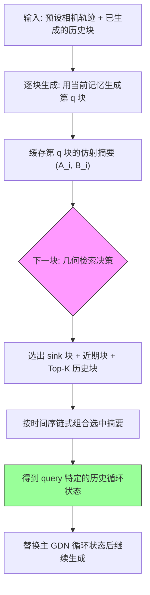

# HLA-WM: Hybrid Linear Attention for Long-Horizon Video World Models

**作者**: Zhuokun Chen, Feng Chen, Xi Lin, Xiyu Wu, Jiahao He, Jianfei Cai, Bohan Zhuang  
**机构**: Monash University, The University of Adelaide, Zhejiang University  
**会议/期刊**: arXiv 预印本 | **年份**: 2026（据 arXiv 编号 2610.05739 与参考文献年份推断，元数据未给出年份）  
**链接**: [arXiv](https://arxiv.org/abs/2610.05739) | [Project Page](https://caesarhhh.github.io/hla-wm/)

> **证据边界声明**：本次批读未获得任何图片的视觉信息，Figure 1–9 与 Table 1–11 只能依据正文文字与 caption 转述；部分附录表格在转写文本中已出现行列错位，对应数值标为“待核”。所有主观关联与改进建议均已标注为推断。

## 一句话总结

长时程视频世界模型用 Gated DeltaNet (GDN) 这类循环线性注意力把全部历史压进固定大小状态，相机长距离回访时早期场景会被后续更新逐步“洗掉”；HLA-WM 免训练地把每个 chunk 的 GDN 状态转移缓存为紧凑仿射摘要 $(A_i,B_i)$，用相机几何检索几何相关的历史 chunk，再与 sink 块、近期块一起按时间序重组为 query 特定的循环状态。在 60 秒 SANA-WM-Bench 上，Stage 1 直接把 Hard 轨迹 PSNR 提升 0.74 dB、旋转误差降低 26.0%，并把 60 秒上下文的历史状态内存较 full KV 缓存减少 12×。

## 核心贡献

1. **实证刻画 GDN 的长程遗忘**：用 chunk 级递推 $S_i=S_{i-1}A_i+B_i$（Eq. 1）与累积保留量 $W_{i\to j}=\mathrm{AvgNorm}(A_{i+1}\cdots A_j)$（Eq. 3）说明早期 chunk 写入的信息必须穿过其后所有中间转移才能影响未来；代表性轨迹上 Chunk 3 的保留影响到 Chunk 35 只剩 0.0416。
2. **提出 HLA-WM**：免训练混合线性注意力框架，用 chunk 级仿射摘要 + 相机几何寻址 + 按时间序状态重组，把“单一累积状态”换成“一组可独立寻址的历史状态”，且不重放历史视觉 token。
3. **实验证据**：在 60 秒 SANA-WM-Bench 上，Stage 1 直接把 Hard 轨迹 PSNR 提升 0.74 dB、旋转误差降低 26.0%（Simple 轨迹为 0.73 dB 与 31.0%）；MBench-A 的 547 个样本、4 个官方子集与 3 种推理模式下 PSNR/SSIM/LPIPS 一致改善；60 秒上下文下历史状态内存比 full KV 缓存少 12×，推理吞吐最多下降 1.6%。

## 📖 批读导航

| Section | 内容 |
|---------|------|
| [00 - 标题与摘要](sections/00-section.md) | 标题、作者/机构、Abstract、项目主页与关键词 |
| [01 - Introduction](sections/01-section.md) | 动机（KV cache 增长 vs 循环状态压缩）、Fig. 1 现象、HLA-WM 概览与 3 条贡献 |
| [02 - Related Work](sections/02-section.md) | 视频世界模型四类记忆机制 + 线性注意力演进（GLA / DeltaNet / GDN）、Fig. 2 遗忘证据 |
| [03 - Empirical Insights](sections/03-section.md) | Eq. 1–3 的 chunk 级衰减推导 + Chunk 3→35 单轨迹案例、Fig. 3 方法总览 |
| [04 - Method](sections/04-section.md) | 4.1–4.4：chunk-wise GDN 记忆、几何检索、选择性重组、Triton 内核与开销、Table 1 |
| [05 - Experiments](sections/05-section.md) | 5.1–5.2：数据集/实现/指标、Table 1–2 主结果、效率分析、Fig. 4–5 |
| [06 - Conclusion](sections/06-section.md) | 结论 + 作者自陈的两点局限与未来工作 |
| [07 - References](sections/07-section.md) | 28 条参考文献 |
| [08 - Appendix](sections/08-section.md) | 附录总览入口 |
| [09 - A.1 额外实现细节](sections/09-section.md) | 实现细节分节入口 |
| [10 - A.1.1 几何感知历史检索](sections/10-section.md) | 分块、7×7 采样、三层代理深度、$R(i,j)$ 检索流程（Eq. 18–21） |
| [11 - A.1.2 转向感知近期上下文](sections/11-section.md) | $d_{early}$ / $d_{late}$ 夹角与 $\tau_{turn}=25°$ 的近期预算切换（Eq. 22–24） |
| [12 - A.2 状态重组实现](sections/12-section.md) | 复用 GDN Phase-A / Phase-B 内核，只重组主 GDN 与归一化状态 |
| [13 - A.2.1 整体推理流程](sections/13-section.md) | Algorithm 1 的逐 chunk 推理与摘要缓存流程 |
| [14 - A.3 组件消融](sections/14-section.md) | Table 3：w/o Sink、w/o Select A/B、w/o Turn-aware（K=1，Hard） |
| [15 - A.4 GDN 重组与 KV 对齐](sections/15-section.md) | Table 4–5：GDN-only 与 KV-only 的非对称互补及失配证据 |
| [16 - A.5 检索块数 K](sections/16-section.md) | Table 6：K=1 保真度最优、K=5 的 RotErr 最低 |
| [17 - A.6 几何选择的有效性](sections/17-section.md) | Table 7 + Fig. 6：Random / Recent / Uniform vs 几何检索（K=4，Hard80） |
| [18 - A.7 重访间隔的影响](sections/18-section.md) | Fig. 6：短 / 中 / 长间隔的增益趋势 |
| [19 - A.8 详细基准结果](sections/19-section.md) | Table 8：SANA-WM-Bench 类别级（Stage 1） |
| [20 - A.8.1 类别结果](sections/20-section.md) | 4 类场景 × 2 split 的类别级结论 |
| [21 - A.8.2 MBench-A 子集结果](sections/21-section.md) | 547 样本、4 子集、12 个 mode–subset 组合 |
| [22 - A.9 补充定性结果](sections/22-section.md) | 补充可视化入口 |
| [23 - A.9.1 Stage 1](sections/23-section.md) | Fig. 7 定性 + Table 9 类别级 |
| [24 - A.9.2 Stage 1 + AR Refine](sections/24-section.md) | Fig. 8 定性 + Table 10 类别级（caption 写双向精修，归属待核） |
| [25 - A.9.3 Stage 1 + 双向精修](sections/25-section.md) | Fig. 9 定性 + Table 11 的 MBench-A 子集数值 |

## 关键数字

| 指标 | 数值 |
|------|------|
| 60s SANA-WM-Bench Stage-1 PSNR 提升 | +0.74 dB (Hard) / +0.73 dB (Simple) |
| 60s SANA-WM-Bench Stage-1 RotErr 降低 | −26.0% (Hard) / −31.0% (Simple) |
| 摘要口径的 RotErr 降低 | 28.5%（与 Hard −26.0% / Simple −31.0% 的两 split 平均一致，为本次批读的算式推断） |
| Stage-1 Hard 的 SSIM / LPIPS 变化 | +0.0223 / −0.0196 |
| 双向精修后 PSNR 提升（Simple / Hard） | +0.52 / +0.46 dB；RotErr −22.0% / −20.1% |
| MBench-A Stage-1 | PSNR +0.84 dB、SSIM +0.0303、LPIPS −0.0428（547 样本 / 4 子集 / 3 模式） |
| 60s 历史状态内存 | 2.15 GiB，较 full KV 缓存减少 12× |
| 吞吐（Stage-1，Table 1） | 22.403 → 22.053 FPS（约 −1.56%，原文口径 ≤1.6%） |
| 默认检索配置 | sink 1 块 + 最近 1 块（急转时 3 块）+ top-1 历史块 |
| 转向阈值 $\tau_{turn}$ | 25° |
| GDN 保留量案例 | $W_{3\to35}=0.0416$ |
| 评测规模 | SANA-WM-Bench：每 split 80 条轨迹 / 961 帧 @16 fps / 1280×704；MBench-A：547 样本；单卡 H200 140 GB |

## 数据流：输入 → 中间表示 → 输出

## 优缺点与还能做什么

### 优点
- **免训练、可直接叠加**：不改预训练权重、不重放历史视觉 token，只改推理期的记忆存储与读取（4.2–4.4、A.2）。
- **内存随 chunk 数而非 token 数扩展**：只额外缓存固定大小的 $(A_i,B_i)$ 与轻量相机元数据；60 秒上下文为 2.15 GiB，比 full KV 缓存少 12×。
- **检索信号与生成质量解耦**：只用相机位姿、内参与场景级中值深度估计视锥重叠，不需要 RGB 内容、光流、语义特征或密集深度（A.1.1），也不引入学习型路由器。
- **退化一致性可检查**：当全部历史 chunk 被选中时，重组退化为原始按时间序的 GDN 递推（4.4，作者称为一致性检查，非证明）。

### 局限 / 风险
- **免训练限制增益上限**（作者自陈，6 节）；AR 精修下 Simple 轨迹的 TransErr 与 CamMC 反而轻微变差，说明相机可控性增益并非无条件（5.2、Table 1）。
- 检索只用相机几何与 FOV overlap 代理，不建模遮挡、可见性或语义相关性（6 节、A.1.1）；“静态 / 刚性场景假设”以及稀疏代理点（7×7、三档深度）在复杂遮挡下的精度影响，属**推断**，原文未做实验。
- 大 K 反而使保真度变差、AR Simple 的相机误差轻微回升，原文未给出机制解释（A.5、5.2）；附录多张表格在转写文本中行列错位，精确数值待核。

### 还能做什么
- 把选择性状态检索纳入训练（作者展望，6 节）。
- 引入更丰富或可学习的检索信号（语义、遮挡、可见性）（作者展望，6 节）；用单目深度 / 语义先验替换中值深度标量属**推断**，原文未提。
- 把同样的“几何寻址 + 仿射摘要重组”扩展到 camera-GDN、短卷积与 FFN 时序卷积状态（**推断**，原文明确只重组主 GDN 记忆）。
- A.4 显示两条记忆通路（GDN 与 softmax KV）存在失配，可研究二者的一致性约束（**推断**，基于 Hard 双向精修 GDN-only RotErr 13.17°→33.04° 的证据）。

## 阅读 Q&A 记录

- **Q: 摘要说“旋转误差降低 28.5%”，但 5.2 节说 Hard 26.0%、Simple 31.0%，矛盾吗？**
  A: 不矛盾但口径不统一。用 Table 1 的 RotErr 做算式：Hard 20.3759→15.0887 为 −26.0%，Simple 19.7040→13.5864 为 −31.0%，两者平均恰为 28.5%，即摘要用的是两 split 平均口径；同句中的 0.74 dB 只对应 Hard split。故摘要内部两个数字的取样口径可能不一致（该归因为本次批读**推断**）。

- **Q: HLA-WM 到底改了哪一个中间表示？**
  A: 只改“主 GDN 循环状态”的读取路径：用缓存的 $(A_i,B_i)$ 重组出 $S_q^{hist}=S_0A_{\pi_q}+B_{\pi_q}$（Eq. 17）替换主 GDN 记忆；camera-GDN、GDN 短卷积与 FFN 时序卷积状态仍按原时间序更新（A.2），同时把同一选中历史同步到 softmax 注意力通路的 KV cache（4.4）。

- **Q: 为什么固定用 K=1，检索更多历史不是更好吗？**
  A: A.5 的 Table 6（Hard，Stage 1）显示 K 增大后 PSNR/SSIM 单调下降、LPIPS 上升，而相机指标非单调——K=4 的 TransErr/CamMC 最低、K=5 的 RotErr 最低。作者据此选 K=1（保真度最优且开销最小），但未解释大 K 变差的原因；A.6 提到一分钟视野下 Uniform 覆盖已很强，可能削弱额外检索的边际收益（**推断**）。

- **Q: 几何检索真的比“不看几何”的策略强吗？**
  A: 在 A.6 的 Hard80、K=4 设定下，HLA-WM 相对 Uniform 提升 PSNR 9.91→10.00、SSIM 0.1910→0.1936、LPIPS 0.5957→0.5885，RotErr 与 CamMC 也略低，但 TransErr 略高（1.6985 vs 1.6881）；作者本人声明这是选择策略比较而非严格等算力消融。

- **Q: 论文里的图能直接看出“场景一致”吗？**
  A: 本次批读未获得图片视觉信息，Figure 1/5/7/8/9 的定性结论只能转述作者描述；且 Figure 5 的 caption 明确回访指标是在每种方法内部的首次访问帧与回访帧之间计算，衡量的是方法自身跨时间自洽性，而非与真值帧的保真度或方法间配对比较。

## 📊 Citation Landscape

*数据来源：Semantic Scholar API。论文详情（TLDR、引用数/被引数/influential citation count）与参考文献列表查询均返回 HTTP 429，**不可用**；因此本批读不提供 TLDR 与任何引用次数统计，也不编造引用量。下表的推荐论文来自 Recommendations API（成功返回）。正文 References 共 28 条，按题名可粗分为五类：交互式/实时视频世界模型、长时域记忆与一致性、高效线性注意力、世界模型基础、评测与指标。* 

### 推荐相关论文 (Top 10)
1. **HLA: Expressive Hybrid Linear Attention via Chunk-Wise Dynamic Mixing** (2026) — ArXiv: 2610.05842
2. **WorldCrafter: Consistent Video World Model with Implicit 3D-aware Memory** (2026) — ArXiv: 2609.24984
3. **LOCI: Spatial Linear Memory for Streaming World Models** (2026) — ArXiv: 2609.40222
4. **WorldAttention: An Efficient Attention Architecture for Interactive Video World Models** (2026) — ArXiv: 2609.34606
5. **Geometry as Address: Routing Attention to Visual Memory for Long-Horizon Camera-Controlled Video Generation** (2026) — ArXiv: 2609.34722
6. **Learning to Retrieve: Internalizing Memory Retrieval for Video World Models** (2026) — ArXiv: 2610.11444
7. **Honeycomb: Constant-Size Scene Memory Representation for Video World Models** (2026) — ArXiv: 2609.37690
8. **World-T3: Test-Time Training as Persistent Memory for Real-Time Video World Models** (2026) — ArXiv: 2610.17434
9. **LayerRecall: A State-Conditioned Memory Router for Long-Horizon Consistency in Video Generation** (2026) — ArXiv: 2608.28460
10. **DeltaS: Reading the Gated Linear Attention State for KV Cache Eviction in Streaming Video** (2026) — ArXiv: 2609.27470

*外部链接*: [Connected Papers](https://www.connectedpapers.com/main/2610.05739)