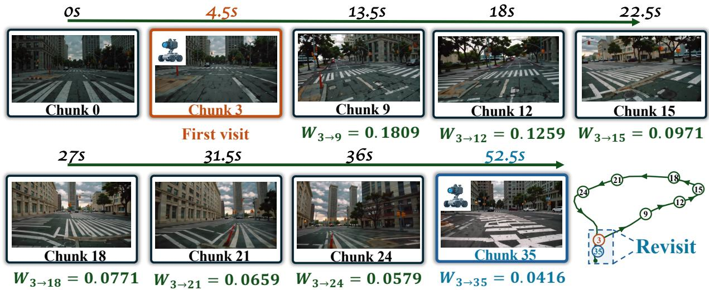
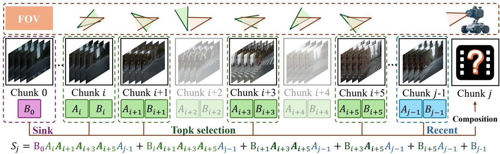
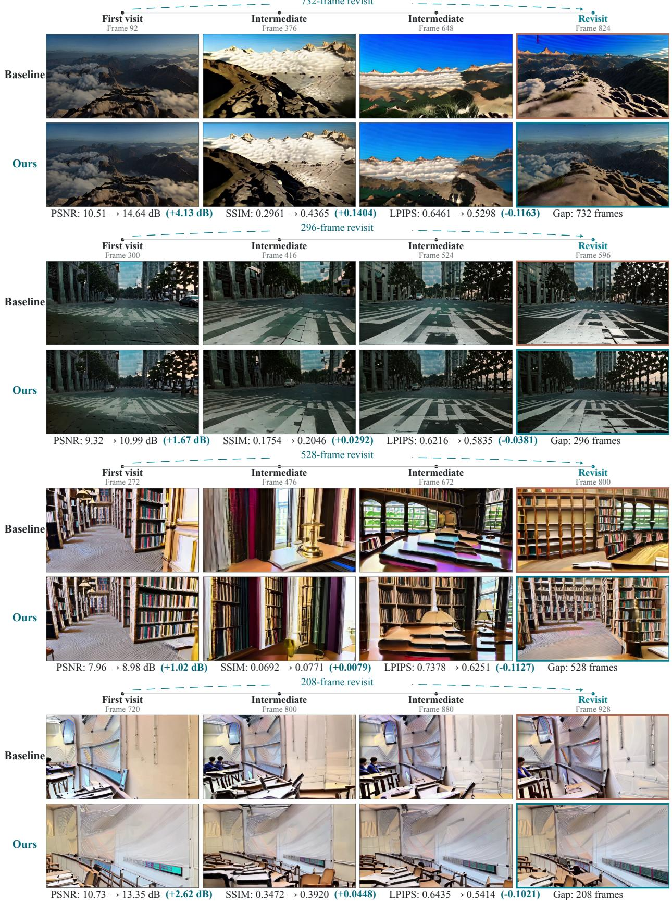
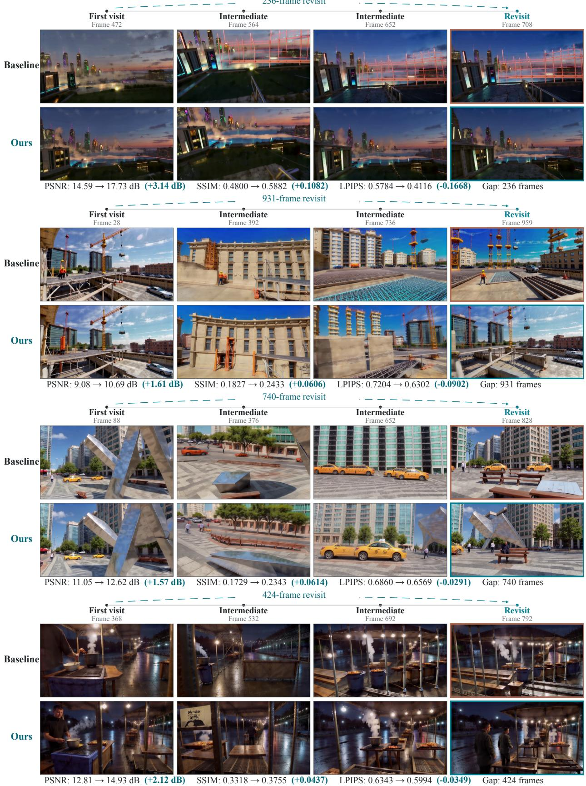
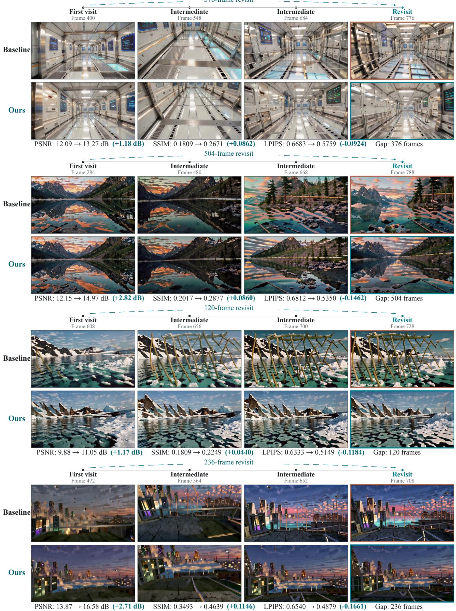

# HLA-WM: Hybrid Linear Attention for Long-Horizon Video World Models

Zhuokun Chen1 Feng Chen2 Xi Lin3 Xiyu Wu3 Jiahao He3 Jianfei Cai1 Bohan Zhuang3

1Monash University 2The University of Adelaide 3Zhejiang University

Abstract. Long-horizon video world models require persistent memory to preserve scene consistency over extended rollouts. Softmax attention retains the full generation history through a growing KV cache, whereas recurrent linear attention compresses history into fixed-size states with substantially lower memory cost. However, we identify severe long-range forgetting in Gated DeltaNet (GDN), where information from distant but relevant scenes is progressively attenuated by subsequent state updates. To address this limitation, we propose HLA-WM, a training-free hybrid linear-attention framework that combines coarse-grained geometry-guided retrieval with fine-grained recurrent linear-state computation. HLA-WM exploits the afine structure of GDN to cache compact chunk-wise transition summaries, retrieve scene-relevant historical chunks using camera geometry, and recompose them into query-specific recurrent states. On the 60-second SANA-WM-Bench, HLA-WM improves all six aggregate revisit-consistency and camera-control metrics of the base autoregressive generator without additional training, including a 0.74 dB PSNR gain and a 28.5% reduction in rotation error. The improvements persist after downstream refinement and generalize to MBench-A, where HLA-WM consistently improves all three revisit-consistency metrics across all four subsets and all evaluated inference modes over 547 samples. At a 60-second context, HLA-WM reduces historical-state memory by 12× relative to full KV caching while incurring at most a 1.6% reduction in inference throughput. These results demonstrate that selectively addressable recurrent memory can improve long-range scene recall while preserving the eficiency advantages of GDN.

Project Page: https://caesarhhh.github.io/hla-wm/

Keywords: Video World Models, Linear Attention, Long-Range Memory, Gated DeltaNet

## 1 Introduction

World models predict environment dynamics, enabling agents to anticipate future observations and reason about the consequences of their actions [1, 2]. Recent video world models realize such simulation through autoregressive generation conditioned on agent actions or camera trajectories [3– 7]. Beyond short-term temporal continuity, long-horizon simulation requires previously observed scenes to remain recoverable after they leave the recent context [8–10]. When the camera later returns, the model should recover the earlier scene structure rather than generate a semantically similar but spatially inconsistent view. Full-history key-value (KV) caching provides direct access to past observations, but its storage cost grows continuously with the rollout length [11, 12]. Recurrent linear attention ofers a compact alternative by compressing history into fixed-size states [7, 13, 14]. This raises a central question for long-horizon world modeling: how can recurrent models retain eficient memory while still recovering distant scene information when it becomes relevant again?

Among modern recurrent linear-attention architectures, Gated DeltaNet (GDN) combines data-dependent decay with delta-rule updates to manage information within a compact recurrent state [15]. Nevertheless, we observe a clear long-range forgetting problem in GDN-based video world models. As illustrated in Fig. 1, SANA-WM exhibits a pronounced decline in revisit consistency as the temporal gap increases, while the qualitative example shows substantial changes in scene structure after the camera leaves and later returns. Such revisits are particularly challenging because information that is no longer locally relevant may become essential again after a long sequence of intermediate observations. This behavior suggests that compact recurrent memory alone is insuficient to reliably preserve distant scene information over extended rollouts.

  
Figure 1 Long-range forgetting in GDN-based world-model rollouts. Upper left: Revisit SSIM over increasing temporal gaps. Lower left: Camera displacement along the qualitative trajectory. Right: Qualitative comparison of the first visit, far excursion, and revisit at the similar camera pose. After the long excursion, the baseline SANA-WM shows noticeable changes in scene layout and object arrangement, whereas our HLA-WM better preserves the first-visit scene content.

To understand this limitation, we analyze the recurrent state transition in GDN. Since the full history is compressed into a single recurrent state, earlier information must survive all intervening updates to remain recoverable, motivating a memory organization in which compact historical states remain independently addressable.

We therefore ask whether a pretrained recurrent video world model can recover distant scene history without retaining a full token-level KV cache or requiring additional training. To this end, we propose HLA-WM, a training-free hybrid linear-attention framework that combines coarse-grained geometry-guided retrieval with fine-grained recurrent linear-attention access. HLA-WM exploits the afine structure of GDN to cache compact chunk-wise summaries of historical state transitions, selectively retrieves relevant summaries using camera geometry, and recomposes them into a query-specific recurrent state. This establishes an intermediate memory regime between a single recurrent state and token-level full-history caching, enabling selective access to distant history while retaining compact linear-state storage.

For camera-controlled world-model rollouts, camera metadata provides a natural addressing signal without requiring a learned router [16, 17]. HLA-WM uses a lightweight camera-frustum overlap proxy derived from poses, intrinsics, and a scene-level depth estimate to identify relevant historical chunks. The selected summaries, together with the first chunk as a persistent sink and recent context for local continuity, are recomposed as retrieved context in chronological order without replaying historical visual tokens. Selective recomposition is applied only to the main GDN memory, while camera-control and local convolutional states retain their original recurrent updates. All pretrained parameters remain unchanged. Thus, HLA-WM changes how historical memory is stored and accessed rather than retraining the underlying generator.

Experiments on SANA-WM-Bench [7] and MBench-A [18] demonstrate consistent improvements in long-range revisit fidelity. At Stage 1, where HLA-WM directly modifies recurrent memory, it also improves camera controllability by reducing accumulated structural drift and maintaining a more stable spatial reference during generation. Downstream refinement introduces mode-dependent trade-ofs, while the long-range consistency gains remain evident across both benchmarks. On MBench-A, all three revisit-consistency metrics improve across all four subsets and all evaluated inference modes. At a 60-second context, HLA-WM requires 12× less historical-state storage than full KV caching while incurring at most a 1.6% reduction in inference throughput across the evaluated pipelines. These results show that selectively addressable recurrent memory can substantially improve long-range scene recall.

Our main contributions are summarized as follows:

• We empirically characterize long-range forgetting in GDN-based video world models and show how accumulated recurrent transitions progressively weaken access to distant scene information.

• We propose HLA-WM, a training-free hybrid linear-attention framework that equips recurrent video world models with selectively addressable historical memory through compact afine summaries, camera-guided addressing, and chronological state recomposition.

• Extensive experiments on SANA-WM-Bench and MBench-A demonstrate improved longrange scene consistency. On the 60-second SANA-WM-Bench, HLA-WM improves the base autoregressive generator by 0.74 dB in PSNR and reduces rotation error by 28.5% without training.

## 2 Related Work

Video World Models. Recent advances in video generation have enabled world models to predict future visual observations conditioned on actions, camera trajectories, or other control signals, supporting interactive and long-horizon environment simulation [3–7]. To maintain scene consistency over extended rollouts, existing approaches preserve historical information in diferent forms. Frame-based methods retain selected historical observations as references for future generation [8, 10]. Token- or KV-based methods preserve historical visual tokens or attention caches to provide direct access to past context [9, 19, 20]. Feature-memory methods summarize past observations into compact latent representations or dedicated memory tokens [21]. Spatial-memory approaches instead maintain explicit geometric or 3D representations that can be queried according to the current viewpoint [8, 10, 22]. Although these mechanisms improve long-range consistency, they introduce additional storage and retrieval overhead that can grow with the rollout. In particular, frame-based memories may require retrieved observations to be re-encoded and their attention caches recomputed, while token, feature, and spatial memories require maintaining and querying additional historical representations, limiting their eficiency for long-horizon generation.

Linear Attention for World Models. Linear attention reformulates attention through associative computation, allowing historical information to be summarized into fixed-size recurrent states instead of maintaining a KV cache that grows with sequence length [13, 23]. Building on this formulation, subsequent works improve the expressiveness and memory management of linear states through more sophisticated recurrent updates. Gated Linear Attention introduces datadependent decay to selectively forget historical information [24], while DeltaNet employs the delta rule to enable targeted updates to the recurrent memory [25]. Gated DeltaNet (GDN) further combines these two mechanisms, providing both adaptive forgetting and selective memory updates within a fixed-size state [15]. More recently, recurrent linear attention has been extended to autoregressive video generation, where linear states serve as compact cross-frame memory for long-form generation [7, 14]. Despite their favorable memory eficiency, these methods continuously compress historical observations into a limited recurrent state, making distant information increasingly susceptible to attenuation and interference from subsequent updates during long-horizon generation.

  
Figure 2 Long-range forgetting in GDN. The camera follows a long loop and eventually returns near the region observed at Chunk 3 around Chunk 35. We visualize representative generated chunks along the trajectory together with the cumulative retention $W _ { 3 \to j }$ of Chunk 3. Although the early scene becomes relevant again near the end of the rollout, its retained influence continuously decreases as intermediate chunks are generated, reaching only 0.0416 at Chunk 35.

## 3 Empirical Insights

We first investigate the long-range forgetting behavior of GDN in SANA-WM [7]. At the chunk level, the recurrent update of chunk i can be written as

$$
S _ { i } = S _ { i - 1 } A _ { i } + B _ { i } ,\tag{1}
$$

where $A _ { i }$ denotes the state transition applied to historical memory and $B _ { i }$ represents the information newly written by the current chunk. Expanding the recurrence over multiple chunks gives

$$
S _ { j } = \cdots + B _ { i } A _ { i + 1 } A _ { i + 2 } \cdots A _ { j } + \cdots + B _ { j } .\tag{2}
$$

Thus, information written by an early chunk is repeatedly transformed by all subsequent transition matrices before it can influence a distant future scene. We quantify its cumulative retention from chunk i to chunk j using the average norm of the intervening transition product:

$$
W _ { i \to j } = { \mathrm { A v g N o r m } } \left( A _ { i + 1 } A _ { i + 2 } \cdot \cdot \cdot A _ { j } \right) ,\tag{3}
$$

where a smaller $W _ { i \to j }$ indicates stronger attenuation from chunk i to $j .$

Figure 2 illustrates this phenomenon on a representative trajectory from the SANA-WM Benchmark. The camera leaves the region observed at Chunk 3, traverses a large loop, and eventually returns to a nearby viewpoint at Chunk 35. Since the two chunks observe highly overlapping regions, the information stored at Chunk 3 should remain particularly relevant when generating Chunk 35. However, its retained influence steadily diminishes as the rollout progresses and drops to only 0.0416 by the time the camera revisits the scene. Correspondingly, the scene generated at Chunk 35 deviates substantially from the earlier observation, indicating that the model can no longer efectively recover the distant but relevant scene information.

More importantly, most intermediate chunks correspond to diferent viewpoints and are only weakly related to the scene revisited at Chunk 35. Nevertheless, their state-transition matrices are still sequentially applied to the memory written by Chunk 3, causing that memory to undergo repeated transformations even when the intermediate observations provide little useful information for the later revisit. As a result, scene information that becomes relevant again can be substantially attenuated before it is needed. This exposes a fundamental mismatch in conventional GDN memory: historical information is updated according to temporal progression, whereas its relevance in worldmodel rollouts is often determined by spatial and geometric proximity. This mismatch motivates selectively preserving and composing scene-relevant historical states instead of propagating all past information uniformly through every intermediate chunk.

  
Figure 3 Overview of HLA-WM. Historical video chunks are represented by independent GDN summaries. Given the current query, geometry-guided retrieval selects scene-relevant historical chunks together with persistent sink and recent context. The selected summaries are then composed in chronological order to construct a query-specific recurrent state.

## 4 Method

## 4.1 Overview

We propose HLA-WM, a hybrid linear-attention framework for long-horizon video world models. The key idea is to replace the single accumulated GDN memory with a collection of independently addressable chunk-wise memories. Specifically, we partition the generated sequence into temporal chunks and summarize the GDN transition induced by each chunk. For each query chunk, HLA-WM uses camera geometry to retrieve a sparse set of scene-relevant historical chunks and selectively composes their summaries into the recurrent state used for generation. As illustrated in Fig. 3, this design combines coarse-grained geometry-guided memory retrieval with recurrent linear attention, allowing distant but relevant information to bypass unrelated intermediate updates while preserving the compactness of linear-state memory.

## 4.2 Chunk-wise GDN Memory

Gated DeltaNet maintains a recurrent linear state through token-wise updates [15]. Let t index tokens in the recurrent scan order. For token $t ,$ the state update is

$$
S _ { t } = \gamma _ { t } S _ { t - 1 } + \beta _ { t } \left( v _ { t } - S _ { t - 1 } k _ { t } \right) k _ { t } ^ { \top } ,\tag{4}
$$

where $k _ { t }$ and $v _ { t }$ are the key and value vectors projected from the current token representation, γt controls memory decay, and $\beta _ { t }$ controls the strength of the delta update. Rearranging Eq. 4 gives

$$
S _ { t } = S _ { t - 1 } A _ { t } + B _ { t } ,\tag{5}
$$

where

$$
A _ { t } = \gamma _ { t } I - \beta _ { t } k _ { t } k _ { t } ^ { \top } , \qquad B _ { t } = \beta _ { t } v _ { t } k _ { t } ^ { \top } .\tag{6}
$$

This afine form can be directly composed over consecutive tokens. Consider chunk i containing

L tokens, and let $( i , \ell )$ denote its ℓ-th token. Unrolling the recurrence within the chunk gives

$$
S _ { i } = S _ { i - 1 } A _ { i , 1 } A _ { i , 2 } \cdot \cdot \cdot A _ { i , L } + B _ { i , 1 } A _ { i , 2 } \cdot \cdot \cdot A _ { i , L } + \cdot \cdot \cdot + B _ { i , L } .
$$

Therefore, the entire chunk can be represented by a single afine transition

$$
S _ { i } = S _ { i - 1 } A _ { i } + B _ { i } ,\tag{7}
$$

where

$$
A _ { i } = A _ { i , 1 } A _ { i , 2 } \cdot \cdot \cdot A _ { i , L } , \qquad B _ { i } = \sum _ { \ell = 1 } ^ { L } B _ { i , \ell } \prod _ { u = \ell + 1 } ^ { L } A _ { i , u } .\tag{8}
$$

Here, the products follow the recurrent scan order, with an empty product defined as the identity. The pair $( A _ { i } , B _ { i } )$ therefore provides a suficient summary of chunk i: $A _ { i }$ describes how the chunk transforms existing memory, while $B _ { i }$ represents the information written by the chunk itself.

Equivalently, their summaries follow the composition rule

$$
( A _ { i } , B _ { i } ) \star ( A _ { j } , B _ { j } ) = ( A _ { i } A _ { j } , B _ { i } A _ { j } + B _ { j } ) .\tag{9}
$$

The operation is associative, enabling an arbitrary subset of historical chunk summaries to be eficiently recomposed without replaying their original visual tokens through the model.

## 4.3 Geometry-Guided Memory Retrieval

Given the individually addressable chunk-wise memories, we retrieve historical chunks according to their geometric relevance to the current view. For each query chunk q and an eligible historical chunk i, we estimate their overlap using only camera poses, intrinsics, and a scene-level mediandepth estimate. For a sampled image-plane location $( u , v )$ , we construct the camera-space ray

$$
\mathbf { r } ( u , v ) = \left[ \frac { u - c _ { x } } { f _ { x } } , \frac { v - c _ { y } } { f _ { y } } , 1 \right] ^ { \top } ,\tag{10}
$$

and instantiate proxy 3D points at several depths around the scene-level median depth,

$$
\mathcal { D } = \{ 0 . 5 d _ { \mathrm { m e d } } , d _ { \mathrm { m e d } } , 1 . 5 d _ { \mathrm { m e d } } \} .\tag{11}
$$

These proxy points are transformed into world coordinates using the corresponding camera poses and projected into the camera views of the other chunk.

Let $V ( i  q )$ denote the fraction of proxy points constructed from chunk i that project with positive depth into at least one camera view of chunk $q .$ We define the symmetric frustum-overlap score as

$$
R ( i , q ) = \frac { 1 } { 2 } \left[ V ( i \to q ) + V ( q \to i ) \right] .\tag{12}
$$

The score provides a lightweight proxy for geometric overlap rather than exact 3D scene intersection. Similar geometry-based criteria have been used to retrieve relevant historical context for longhorizon video generation and world simulation [16, 17]. Importantly, our retrieval requires neither generated RGB content nor learned semantic features. We rank the eligible historical chunks according to $R ( i , q )$ and retrieve the top-K most relevant ones. Further details of the camera sampling and overlap computation are provided in Appendix A.1.1.

In addition to the retrieved historical chunks, we retain the first chunk as a persistent sink to preserve global context, together with recent chunks to maintain local temporal continuity. When the change in camera translation direction exceeds a threshold $\tau _ { \mathrm { t u r n } }$ , we temporarily expand the recent context to the three most recent chunks to improve robustness under abrupt camera

motion.

Let $\mathcal { H } _ { q }$ denote the remaining historical chunks after excluding the sink and recent context. The selected history is

$$
\begin{array} { r } { \mathcal { T } _ { q } = \mathcal { T } _ { \mathrm { s i n k } } \cup \mathcal { T } _ { \mathrm { r e c e n t } } \cup \mathrm { T o p K } _ { i \in \mathcal { H } _ { q } } R ( i , q ) . } \end{array}\tag{13}
$$

This design combines sparse retrieval of geometrically relevant long-range memory with adaptive preservation of short-term context, reducing interference from unrelated intermediate scenes while maintaining local continuity during abrupt camera motion.

## 4.4 Selective State Recomposition

After retrieval, the selected chunks are restored to their original chronological order. Denote the ordered set as

$$
\pi _ { q } = ( \pi _ { 1 } , \pi _ { 2 } , \ldots , \pi _ { M } ) .\tag{14}
$$

Using the associative rule in Eq. 9, their summaries can be directly composed as

$$
A _ { \pi _ { q } } = \prod _ { m = 1 } ^ { M } A _ { \pi _ { m } } ,\tag{15}
$$

and

$$
B _ { \pi _ { q } } = \sum _ { m = 1 } ^ { M } B _ { \pi _ { m } } \prod _ { n = m + 1 } ^ { M } A _ { \pi _ { n } } .\tag{16}
$$

The resulting historical recurrent state is

$$
S _ { q } ^ { \mathrm { h i s t } } = S _ { 0 } A _ { \pi _ { q } } + B _ { \pi _ { q } } ,\tag{17}
$$

where $S _ { 0 }$ is the initial GDN state.

Standard GDN composes every historical chunk in temporal order, causing information written by an early scene to be repeatedly transformed by all subsequent chunks. In contrast, HLA-WM shortens this propagation path by excluding geometrically irrelevant intermediate chunks. Distant but relevant memories are therefore exposed to substantially fewer unrelated transitions before being reused. Meanwhile, the original GDN dynamics within each selected chunk are fully preserved, rather than replacing them with direct averaging or summation of linear states.

The recomposition is performed directly from cached $( A _ { i } , B _ { i } )$ summaries and does not require reforwarding the selected historical chunks. When all previous chunks are selected, the composition reduces to the original chronological GDN recurrence, providing a direct consistency check for the chunk-wise formulation. For the accompanying softmax-attention pathway, we apply the same selected chunk set to the corresponding historical KV cache.

Eficient State Recomposition Kernel. We implement direct state recomposition on top of the chunk-wise Triton GDN kernels. During the original forward pass, the afine summaries $( A _ { i } , B _ { i } )$ of each chunk are computed once and cached independently of the incoming recurrent state. For each query chunk $q ,$ the summaries in $\mathcal { T } _ { q }$ are gathered in chronological order and directly composed through an eficient forward scan to reconstruct $S _ { q } ^ { \mathrm { h i s t } }$

Memory and Computational Overhead. HLA-WM introduces additional storage only for a fixed-size afine summary $( A _ { i } , B _ { i } )$ and lightweight camera metadata for each temporal chunk. Since historical information is cached at the chunk level rather than the token level, the memory footprint scales with the number of chunks instead of the number of visual tokens. During generation, only the selected summaries are involved in state composition, while geometry-based retrieval operates directly on camera information with minimal overhead. Consequently, HLA-WM provides selective access to long-range memory while largely preserving the memory and computational eficiency of recurrent linear attention.

Table 1 Main results on SANA-WM-Bench under diferent generation stages and refinement modes. We report revisit consistency, camera controllability, and inference throughput. Best results within each setting are shown in bold.
<table><tr><td rowspan="2">Pipeline</td><td rowspan="2">Method</td><td colspan="3">Revisit Consistency</td><td colspan="3">Camera Control</td><td>Efficiency</td></tr><tr><td>PSNR ↑</td><td>SSIM ↑</td><td>LPIPS ↓</td><td>RotErr (°) ↓</td><td>TransErr ↓</td><td>CamMC ↓</td><td>FPS ↑</td></tr><tr><td colspan="7">Simple-Trajectory Split</td><td></td><td></td></tr><tr><td>Stage-1</td><td>SANA-WM HLA-WM</td><td>9.18 9.91</td><td>0.1729 0.1999</td><td>0.6327 0.6049</td><td>19.7040 13.5864</td><td>2.2625 2.0928</td><td>2.3974 2.1798</td><td>22.403 22.053</td></tr><tr><td>Stage-1 + AR Refine</td><td>SANA-WM HLA-WM</td><td>14.44 14.82</td><td>0.2770 0.2872</td><td>0.5738 0.5682</td><td>20.9315 20.2933</td><td>2.1587 2.1910</td><td>2.3121 2.3240</td><td>8.280 8.211</td></tr><tr><td>Stage-1 + Bi. Refine</td><td>SANA-WM HLA-WM</td><td>13.04 13.56</td><td>0.2945 0.3148</td><td>0.5786 0.5614</td><td>11.3848 8.8823</td><td>1.9893 1.8637</td><td>2.0545</td><td>7.701</td></tr><tr><td colspan="7">Hard-Trajectory Split</td><td>1.9127</td><td>7.700</td></tr><tr><td>Stage-1</td><td>SANA-WM HLA-WM</td><td>9.37 10.11</td><td>0.1774 0.1997</td><td>0.6044 0.5848</td><td>20.3759 15.0887</td><td>1.9952 1.8388</td><td>2.1507 1.9482</td><td>22.403 22.053</td></tr><tr><td>Stage-1 + AR Refine</td><td>SANA-WM HLA-WM</td><td>14.12 14.47</td><td>0.2719 0.2812</td><td>0.5621 0.5557</td><td>25.6330 22.0165</td><td>2.0099 1.9351</td><td>2.2079 2.1043</td><td>8.280 8.211</td></tr><tr><td>Stage-1 + Bi. Refine</td><td>SANA-WM HLA-WM</td><td>13.05 13.51</td><td>0.2972 0.3142</td><td>0.5468 0.5384</td><td>13.1713 10.5268</td><td>1.6649 1.5449</td><td>1.7694 1.6230</td><td>7.701 7.700</td></tr></table>

## 5 Experiments

## 5.1 Experimental Setup

Datasets and Baselines. We conduct experiments on SANA-WM-Bench [7] and MBench-A [18]. SANA-WM-Bench contains simple and hard splits, each with 80 camera-controlled trajectories spanning four scene categories: indoor, outdoor city, outdoor nature, and game-style environments. Each trajectory contains 961 frames at 16 fps, corresponding to approximately 60 seconds, with a resolution of $1 2 8 0 \times 7 0 4$ . MBench-A contains 547 samples across four oficial subsets: Causal, Human, Environment, and Object. We use the oficial 1.6B SANA-WM as our baseline. Its Stage 1 model performs 4-step distilled autoregressive streaming generation with recurrent GDN states, followed by optional causal AR or bidirectional refinement. HLA-WM modifies only the Stage 1 memory mechanism and requires no additional training or fine-tuning, while downstream refinement remains unchanged. Within each setting, the baseline and HLA-WM use identical inputs, camera trajectories, prompts, and generation configurations.

Implementation Details. All video-generation experiments are conducted on a single NVIDIA H200 GPU with 140 GB of memory. We follow the oficial SANA-WM autoregressive streaming pipeline [7], including the chunk-causal LTX-2 refiner and causal VAE. Following the default 4-step distilled configuration, we use the sampling schedule [1000, 960, 889, 727, 0] and three latent frames per autoregressive block. Unless otherwise specified, HLA-WM retains one sink chunk, the most recent chunk, and the top-1 historical chunk ranked by geometric overlap. When the within-chunk change in camera translation direction exceeds $\tau _ { \mathrm { t u r n } } = 2 5 ^ { \circ }$ , the recent context is temporarily expanded from one to three chunks.

Evaluation Metrics. We evaluate long-range scene consistency using PSNR, SSIM [26], and LPIPS [27] between frames corresponding to repeated or near-repeated camera poses. Camera controllability is measured by rotation error (RotErr), relative translation error $\left( \mathrm { T r a n s E r r } _ { \mathrm { r e l } } \right)$ , and relative camera-motion consistency $\left( \mathrm { C a m M C _ { r e l } } \right)$ , following the SANA-WM evaluation protocol [7]. Camera trajectories are estimated using Pi3X, an enhanced implementation of $\pi ^ { 3 }$ [28].

Table 2 Overall results on MBench-A under diferent inference modes. Best results within each setting are shown in bold.
<table><tr><td>Pipeline</td><td>Method</td><td>PSNR ↑</td><td>SSIM ↑</td><td>LPIPS ↓</td></tr><tr><td>Stage-1</td><td>SANA-WM</td><td>10.17</td><td>0.2545</td><td>0.6251</td></tr><tr><td></td><td>HLA-WM</td><td>11.01</td><td>0.2848</td><td>0.5823</td></tr><tr><td>Stage-1 + AR Refine</td><td>SANA-WM</td><td>12.36</td><td>0.2996</td><td>0.6554</td></tr><tr><td></td><td>HLA-WM</td><td>12.73</td><td>0.3122</td><td>0.6447</td></tr><tr><td>Stage-1 + Bi. Refine</td><td>SANA-WM</td><td>12.94</td><td>0.3310</td><td>0.5597</td></tr><tr><td></td><td>HLA-WM</td><td>13.52</td><td>0.3431</td><td>0.5470</td></tr></table>

  
Figure 4 Memory scaling comparison.

## 5.2 Main Results

Performance on SANA-WM-Bench. Table 1 evaluates HLA-WM across diferent stages of the SANA-WM generation pipeline. At Stage 1, where HLA-WM directly modifies the recurrent memory, it improves all revisit-consistency and camera-control metrics on both trajectory splits. On Hard trajectories, PSNR and SSIM increase by 0.74 dB and 0.0223, LPIPS decreases by 0.0196, and RotErr is reduced by 26.0%. Similar improvements are observed on Simple trajectories, including a 0.73 dB PSNR gain and a 31.0% reduction in RotErr. These camera-control gains are consistent with improved scene stability, as preserving previously observed geometry reduces structural drift and provides a more reliable spatial reference for camera-conditioned generation. The improvements largely persist after downstream refinement. Under causal AR refinement, all three revisit-consistency metrics improve on both splits. On Hard trajectories, all three cameracontrol metrics also improve, while on Simple trajectories RotErr decreases but TransErr and CamMC increase slightly. Full-sequence refinement preserves the benefits more consistently and improves all six metrics on both splits, including PSNR gains of 0.52/0.46 dB and RotErr reductions of 22.0%/20.1% on the Simple/Hard splits. Overall, selective long-range memory consistently improves revisit fidelity while generally enhancing camera controllability over long rollouts. Detailed category-level results, together with extensive ablations on component contributions, GDN/KV alignment, retrieval budget, and historical selection strategies, are provided in the Appendix.

Performance on MBench. We further evaluate HLA-WM on the full MBench-A benchmark with 547 samples to assess its generalization beyond SANA-WM-Bench. As shown in Table 2, HLA-WM consistently improves PSNR, SSIM, and LPIPS across all three inference modes. The gains are most pronounced at Stage 1, where PSNR and SSIM increase by 0.84 dB and 0.0303, respectively, while LPIPS decreases by 0.0428. The improvements remain consistent after downstream refinement, with PSNR gains of 0.37 dB and 0.58 dB under causal AR and bidirectional refinement, respectively. These results demonstrate that the proposed memory mechanism generalizes efectively across diferent refinement modes and diverse scene and interaction patterns. Detailed subset-level results are provided in the Appendix.

Eficiency Analysis. HLA-WM ofers a practical trade-of between full-KV attention and recurrent linear attention. While full KV caching preserves direct access to the entire history at a memory cost that grows rapidly with context length, native GDN maintains constant memory but compresses the entire history into a single recurrent state. HLA-WM retains selectively addressable long-range memory through compact chunk-wise summaries, requiring only 2.15 GiB of historical-state memory at a 60-second context, 12× less than full KV caching, while incurring at most a 1.6% reduction in inference throughput across the evaluated settings.

Qualitative Results. Figure 5 further illustrates the long-range memory improvements of HLA-WM under diferent refinement modes. In the AR-refined indoor example, the baseline exhibits substantial structural drift after a long revisit: the aisle geometry changes, the shelf arrangement becomes inconsistent, and the alignment between the shelves and ceiling lights deviates noticeably from the first visit. In contrast, HLA-WM better preserves the two-sided shelf layout, central aisle structure, and overall scene perspective. In the bidirectionally refined outdoor example, the baseline shows larger changes in the foreground composition and spatial arrangement of the walkway, vegetation, and distant buildings. HLA-WM more consistently preserves these scene elements and their relative geometry upon revisit. Additional visualizations are provided in the Appendix.

  
Figure 5 Qualitative comparison on long-range revisit scenarios under causal AR refinement (top) and bidirectional refinement (bottom). Each example shows the first visit, intermediate views, and a later revisit along the same camera trajectory. Revisit metrics are computed between the first-visit and revisit frames within each method.

## 6 Conclusion

We identify long-range forgetting as a key limitation of recurrent linear attention in video world models. Our chunk-level analysis of GDN shows that distant but relevant scene information is progressively attenuated by subsequent, often unrelated, state transitions. Based on this insight, we propose HLA-WM, which retrieves geometrically relevant chunk-wise memories and selectively recomposes them for long-range recall. Experiments on SANA-WM-Bench demonstrate consistent improvements in revisit fidelity and camera controllability, while retaining substantially lower memory cost than full KV caching and introducing only modest inference overhead.

Limitations and Future Work. HLA-WM is currently training-free, which limits the achievable gains. Future work could integrate selective state retrieval into training to better preserve and exploit long-range memory. In addition, our retrieval relies solely on camera geometry and FOV overlap, without explicitly modeling occlusion, visibility, or semantic relevance. Incorporating richer or learned retrieval signals may further improve robustness in complex scenes.

## References

[1] David Ha and Jürgen Schmidhuber. World models. arXiv preprint arXiv:1803.10122, 2(3): 440, 2018.

[2] Danijar Hafner, Jurgis Pasukonis, Jimmy Ba, and Timothy Lillicrap. Mastering diverse control tasks through world models. Nature, 640(8059):647–653, 2025.

[3] Yifan Zhang, Chunli Peng, Boyang Wang, Puyi Wang, Qingcheng Zhu, Fei Kang, Biao Jiang, Zedong Gao, Eric Li, Yang Liu, et al. Matrix-game: Interactive world foundation model. arXiv preprint arXiv:2506.18701, 2025.

[4] Xianglong He, Chunli Peng, Zexiang Liu, Boyang Wang, Yifan Zhang, Qi Cui, Fei Kang, Biao Jiang, Mengyin An, Yangyang Ren, et al. Matrix-game 2.0: An open-source real-time and streaming interactive world model. arXiv preprint arXiv:2508.13009, 2025.

[5] Xiaofeng Mao, Shaoheng Lin, Zhen Li, Chuanhao Li, Wenshuo Peng, Tong He, Jiangmiao Pang, Mingmin Chi, Yu Qiao, and Kaipeng Zhang. Yume: An interactive world generation model. arXiv preprint arXiv:2507.17744, 2025.

[6] Yixuan Zhu, Jiaqi Feng, Wenzhao Zheng, Yuan Gao, Xin Tao, Pengfei Wan, Jiwen Lu, and Jie Zhou. Astra: General interactive world model with autoregressive denoising. In ICLR, volume 2026, pages 79167–79184, 2026.

[7] Haoyi Zhu, Haozhe Liu, Yuyang Zhao, Tian Ye, Junsong Chen, Jincheng Yu, Tong He, Song Han, and Enze Xie. Sana-wm: Eficient minute-scale world modeling with hybrid linear difusion transformer. arXiv preprint arXiv:2605.15178, 2026.

[8] Tong Wu, Shuai Yang, Ryan Po, Yinghao Xu, Ziwei Liu, Dahua Lin, and Gordon Wetzstein. Video world models with long-term spatial memory. In D. Belgrave, C. Zhang, H. Lin, R. Pascanu, P. Koniusz, M. Ghassemi, and N. Chen, editors, NeurIPS, volume 38, Main Conference, pages 49371–49393. Curran Associates, Inc., 2025. doi: 10.52202/ 085713-1651. URL https://proceedings.neurips.cc/paper\_files/paper/2025/file/ 467655d26fcc207bca08915dc91964c6-Paper-Conference.pdf.

[9] Yicong Hong, Yiqun Mei, Chongjian Ge, Yiran Xu, Yang Zhou, Sai Bi, Yannick Hold-Geofroy, Mike Roberts, Matthew Fisher, Eli Shechtman, et al. Relic: Interactive video world model with long-horizon memory. arXiv preprint arXiv:2512.04040, 2025.

[10] Zile Wang, Zexiang Liu, Jiaxing Li, Kaichen Huang, Baixin Xu, Fei Kang, Mengyin An, Peiyu Wang, Biao Jiang, Yichen Wei, et al. Matrix-game 3.0: Real-time and streaming interactive world model with long-horizon memory. arXiv preprint arXiv:2604.08995, 2026.

[11] Shuai Yang, Wei Huang, Ruihang Chu, Yicheng Xiao, Yuyang Zhao, Xianbang Wang, Muyang Li, Enze Xie, Ying-Cong Chen, Yao Lu, Song Han, and Yukang Chen. Longlive: Real-time interactive long video generation. In ICLR, 2026. URL https://openreview.net/forum? id=nCAODkpsPJ.

[12] Hidir Yesiltepe, Jiazhen Hu, Tuna Han Salih Meral, Adil Kaan Akan, Kaan Oktay, Hoda Eldardiry, and Pinar Yanardag. Videomla: Low-rank latent kv cache for minute-scale autoregressive video difusion. arXiv preprint arXiv:2605.30351, 2026.

[13] Angelos Katharopoulos, Apoorv Vyas, Nikolaos Pappas, and François Fleuret. Transformers are rnns: Fast autoregressive transformers with linear attention. In ICML, pages 5156–5165. PMLR, 2020.

[14] Kunyang Li, Mubarak Shah, and Yuzhang Shang. Attend locally, remember linearly: Linear attention as cross-frame memory for autoregressive video difusion. arXiv preprint arXiv:2605.16579, 2026.

[15] Songlin Yang, Jan Kautz, and Ali Hatamizadeh. Gated delta networks: Improving mamba2 with delta rule. In ICLR, volume 2025, pages 29687–29707, 2025.

[16] Jiwen Yu, Jianhong Bai, Yiran Qin, Quande Liu, Xintao Wang, Pengfei Wan, Di Zhang, and Xihui Liu. Context as memory: Scene-consistent interactive long video generation with memory retrieval. In Proceedings of the SIGGRAPH Asia 2025 Conference Papers, pages 1–11, 2025.

[17] Zeqi Xiao, Yushi LAN, Yifan Zhou, Wenqi Ouyang, Shuai Yang, Yanhong Zeng, and Xingang Pan. Worldmem: Long-term consistent world simulation with memory. In D. Belgrave, C. Zhang, H. Lin, R. Pascanu, P. Koniusz, M. Ghassemi, and N. Chen, editors, NeurIPS, volume 38, Main Conference, pages 49632–49652. Curran Associates, Inc., 2025. doi: 10. 52202/085713-1659. URL https://proceedings.neurips.cc/paper\_files/paper/2025/ file/470629a47e2d65ce0606c40055df5d26-Paper-Conference.pdf.

[18] Shengjun Zhang, Zhang Zhang, Simin Huang, Zhenyu Tang, Hanyang Wang, Chensheng Dai, Min Chen, Yifan Li, Yuxin Li, Yingjie Chen, Hao Liu, Chen Li, Jing Lyu, and Yueqi Duan. Mbench: A comprehensive benchmark on memory capability for video world models, 2026. URL https://arxiv.org/abs/2606.00793.

[19] Dvir Samuel, Issar Tzachor, Matan Levy, Michael Green, Gal Chechik, and Rami Ben-Ari. Fast autoregressive video difusion and world models with temporal cache compression and sparse attention. arXiv preprint arXiv:2602.01801, 2026.

[20] Xindi Wu, Sven Elflein, James Lucas, Olga Russakovsky, Laura Leal-Taixé, Despoina Paschalidou, Jonathan Lorraine, and Aljoša Ošep. Addressable memory for video world models. arXiv preprint arXiv:2608.07408, 2026.

[21] Zhengxuan Wei, Xu Guo, Xinghui Li, Xunzhi Xiang, Min Wei, Yiran Zhu, Qiulin Wang, Xintao Wang, Pengfei Wan, Xiangwang Hou, et al. Geometry-aware implicit memory for video world models. arXiv preprint arXiv:2606.02436, 2026.

[22] AlayaWorld Team, Kaipeng Zhang, Chuanhao Li, Yifan Zhan, Yongtao Ge, Yuanyang Yin, Jiaming Tan, Kang He, Liaoyuan Fan, Mingliang Zhai, et al. Alayaworld: Interactive long-horizon world modeling–full technical report. arXiv preprint arXiv:2607.18367, 2026.

[23] Imanol Schlag, Kazuki Irie, and Jürgen Schmidhuber. Linear transformers are secretly fast weight programmers. In ICML, pages 9355–9366. PMLR, 2021.

[24] Songlin Yang, Bailin Wang, Yikang Shen, Rameswar Panda, and Yoon Kim. Gated linear attention transformers with hardware-eficient training. In Ruslan Salakhutdinov, Zico Kolter, Katherine Heller, Adrian Weller, Nuria Oliver, Jonathan Scarlett, and Felix Berkenkamp, editors, ICML, volume 235 of Proceedings of Machine Learning Research, pages 56501–56523. PMLR, 21–27 Jul 2024.

[25] Songlin Yang, Bailin Wang, Yu Zhang, Yikang Shen, and Yoon Kim. Parallelizing linear transformers with the delta rule over sequence length. NeurIPS, 37:115491–115522, 2024.

[26] Zhou Wang, Alan C Bovik, Hamid R Sheikh, and Eero P Simoncelli. Image quality assessment: from error visibility to structural similarity. IEEE transactions on image processing, 13(4): 600–612, 2004.

[27] Richard Zhang, Phillip Isola, Alexei A Efros, Eli Shechtman, and Oliver Wang. The unreasonable efectiveness of deep features as a perceptual metric. In CVPR, pages 586–595. IEEE, 2018.

[28] Yifan Wang, Jianjun Zhou, Haoyi Zhu, Wenzheng Chang, Yang Zhou, Zizun Li, Junyi Chen, Jiangmiao Pang, Chunhua Shen, and Tong He. \π3: Permutation-equivariant visual geometry learning. In ICLR, volume 2026, pages 10481–10497, 2026.

## A Appendix

## A.1 Additional Implementation Details

## A.1.1 Geometry-Aware Historical Retrieval

For each autoregressive chunk, we estimate its geometric overlap with historical chunks from the prescribed camera trajectory. The retrieval uses only camera intrinsics, extrinsics, and a scene-level median-depth scalar from the trajectory metadata, without relying on generated RGB frames, optical flow, semantic features, or dense depth maps.

For a video with N output frames and C autoregressive chunks, let $a _ { c }$ and $b _ { c }$ denote the starting and ending frame indices assigned to chunk $^ { c , }$ respectively. We compute them as

$$
a _ { c } = \mathrm { r o u n d } \left( \frac { c N } { C } \right) , \qquad b _ { c } = \mathrm { m a x } \left( a _ { c } + 1 , \mathrm { r o u n d } \left( \frac { ( c + 1 ) N } { C } \right) \right) .\tag{18}
$$

In our 60-second setting, $N = 9 6 1$ and $C = 4 0$ , yielding approximately 24 camera poses per chunk. For each camera frame, we uniformly sample a $7 \times 7$ image-plane grid over 5%–95% of the image extent. Each sampled ray is instantiated at three proxy depths,

$$
\mathcal { D } = \{ 0 . 5 d _ { \mathrm { m e d } } , d _ { \mathrm { m e d } } , 1 . 5 d _ { \mathrm { m e d } } \} ,\tag{19}
$$

where $d _ { \mathrm { m e d } }$ denotes the scene-level median-depth proxy. For a pixel coordinate $( u , v )$ , the corresponding camera-space ray is

$$
\mathbf { r } ( u , v ) = \left[ \frac { u - c _ { x } } { f _ { x } } , \frac { v - c _ { y } } { f _ { y } } , 1 \right] ^ { \top } .\tag{20}
$$

Each proxy point at depth $d \in \mathcal { D }$ is then transformed into world coordinates using the camera-toworld transformation.

Let $\mathcal { P } _ { i }$ denote the set of proxy points constructed from chunk i. We define the directed visibility score $V ( i  j )$ as the fraction of points in $\mathcal { P } _ { i }$ that project with positive depth into the image plane of at least one camera frame in chunk $j .$ The $\mathrm { s y }$ mmetric overlap score is then

$$
R ( i , j ) = \frac { 1 } { 2 } [ V ( i  j ) + V ( j  i ) ] .\tag{21}
$$

This score provides a lightweight proxy for frustum overlap rather than exact 3D scene intersection, as it does not explicitly model occlusion or scene geometry.

For each query chunk $^ { c , }$ we retain the sink and recent chunks and retrieve the top-K remaining historical chunks according to $R ( i , c )$ . The selected chunks are reordered chronologically before GDN state recomposition.

## A.1.2 Turn-Aware Recent Context

To preserve local continuity under abrupt trajectory changes, we adapt the recent-history budget based on the motion within the current query chunk. For a regular 24-frame camera chunk with translation vectors $\{ \mathbf { p } _ { 0 } , \ldots , \mathbf { p } _ { 2 3 } \}$ , we define

$$
\mathbf { d } _ { \mathrm { e a r l y } } = \mathbf { p } _ { 7 } - \mathbf { p } _ { 0 } , \qquad \mathbf { d } _ { \mathrm { l a t e } } = \mathbf { p } _ { 2 3 } - \mathbf { p } _ { 1 6 } ,\tag{22}
$$

and compute their angular diference as

$$
\theta _ { c } = \operatorname { a r c c o s } \frac { \mathbf { d } _ { \mathrm { e a r l y } } ^ { \top } \mathbf { d } _ { \mathrm { l a t e } } } { \| \mathbf { d } _ { \mathrm { e a r l y } } \| _ { 2 } \| \mathbf { d } _ { \mathrm { l a t e } } \| _ { 2 } } .\tag{23}
$$

The recent-history budget is then set to

$$
r _ { c } = { \left\{ \begin{array} { l l } { 3 , } & { \theta _ { c } \geq \tau _ { \mathrm { t u r n } } , } \\ { 1 , } & { \mathrm { o t h e r w i s e } , } \end{array} \right. }\tag{24}
$$

where $\tau _ { \mathrm { t u r n } } = 2 5 ^ { \circ }$ . The expanded recent context is applied only to the current chunk; subsequent chunks revert to the default budget unless the criterion is triggered again.

## A.2 Implementation of State Recomposition

The afine state composition described in the main text is implemented directly on top of the original GDN kernels. After each chunk is completed, we cache its frame-wise Phase-A suficient statistics, which characterize its afine efect on an arbitrary incoming recurrent state. For each query chunk, the statistics of the selected historical chunks are gathered in chronological order and passed to the original Phase-B forward scan to reconstruct the query-specific GDN state. This avoids re-evaluating historical chunks through the Transformer.

Selective recomposition is applied only to the main GDN matrix and normalization states. The camera-GDN recurrent state, GDN short-convolution state, and FFN temporal-convolution state retain their original chronological updates. We additionally batch compatible GDN blocks during recomposition to reduce kernel-launch and data-movement overhead without changing the underlying recurrence.

## A.2.1 Overall Inference Procedure

Algorithm 1 summarizes the complete inference procedure of HLA-WM. The pairwise geometric overlap scores are first computed from the prescribed camera trajectory using Eq. 21. At each autoregressive step, we determine the recent-history budget according to the within-chunk trajectory change, select the historical chunks using Eq. 13, and recompose the corresponding main-GDN state. The current chunk is then generated using the resulting query-specific memory. After generation, an additional $t = 0$ forward pass caches the afine summary of the completed chunk for subsequent retrieval. Throughout this process, camera-control and local convolutional states retain their original chronological updates.

The retrieval procedure accesses only historical chunks, and the selected chunks are always recomposed in their original temporal order. Importantly, HLA-WM recomposes only the main-GDN recurrent memory; the camera-GDN recurrent state and local convolutional states follow the original streaming recurrence. Historical chunks are therefore never re-evaluated through the Transformer.

## A.3 Component Ablation

Table 3 evaluates the major components of HLA-WM with K = 1 on the Hard-Trajectory split. Here, $^ { 6 6 } \mathrm { W / o }$ Select $A ^ { \mathfrak { s } }$ retains the transition terms $A _ { i }$ of all historical chunks while selectively composing their write terms, whereas $^ { 6 6 } \mathrm { W / o }$ Select $B ^ { \ast }$ retains all historical write terms $B _ { i }$ while selectively composing the transitions. Removing the sink degrades both revisit consistency and camera controllability, highlighting the importance of persistent global context. Retaining the transition terms of unselected chunks substantially reduces PSNR and SSIM and increases camera errors, supporting our observation that irrelevant intermediate transitions contribute to long-range forgetting. Similarly, retaining all historical write terms consistently degrades both revisit fidelity and camera controllability, indicating that selective composition is beneficial for both transition and write components of the recurrent memory. Removing the turn-aware recent context also reduces revisit consistency and worsens camera control, confirming its role in preserving local continuity under abrupt camera motion. Overall, the full HLA-WM achieves the best performance across all six metrics, demonstrating the complementary contributions of selective state composition, persistent sink memory, and adaptive recent context.

Algorithm 1 Overall Inference Procedure of HLA-WM   
Require: Prescribed camera trajectory, retrieval budget K, and turn threshold τturn   
1: Compute pairwise geometric overlap scores $R ( i , j )$ using Eq. 21   
2: Initialize the chunk-wise GDN summary bank and streaming states   
3: for query chunk q = 0, . . . , C − 1 do   
4: Compute the recent-history budget $r _ { q }$ using Eqs. 23–24   
5: if insuficient history for selective retrieval then   
6: $\mathcal { T } _ { q } \gets \{ 0 , \dots , q - 1 \}$   
7: else   
8: Select historical chunks $\mathcal { T } _ { q }$ according to Eq. 13   
9: Sort $\mathcal { T } _ { q }$ in chronological order   
10: Gather the cached afine summaries of chunks in $\mathcal { T } _ { q }$   
11: Recompose the query-specific historical state $S _ { q } ^ { \mathrm { h i s t } }$   
12: Replace the main-GDN recurrent state with $S _ { q } ^ { \mathrm { { h i s t } } }$   
13: end if   
14: Generate chunk q using the resulting streaming cache   
15: Perform the t = 0 cache-writing forward pass   
16: Cache the afine summary of chunk q   
17: Update camera-GDN and local convolutional states chronologically   
18: end for

Table 3 Component ablation on the Hard-Trajectory split using Stage 1 outputs. Best results are shown in bold.
<table><tr><td rowspan="2">Variant</td><td colspan="3">Revisit Consistency</td><td colspan="3">Camera Control</td></tr><tr><td>PSNR ↑</td><td>SSIM ↑</td><td>LPIPS↓</td><td>RotErr (°) ↓</td><td>TransErr ↓</td><td>CamMC↓</td></tr><tr><td>HLA-WM</td><td>10.11</td><td>0.1997</td><td>0.5848</td><td>15.0887</td><td>1.8388</td><td>1.9482</td></tr><tr><td>w/o Sink</td><td>9.71</td><td>0.1867</td><td>0.6019</td><td>15.9351</td><td>1.9326</td><td>2.0531</td></tr><tr><td>w/o Select A</td><td>9.61</td><td>0.1887</td><td>0.5901</td><td>15.2426</td><td>1.8552</td><td>2.0562</td></tr><tr><td>w/o Select B</td><td>9.64</td><td>0.1892</td><td>0.5921</td><td>15.2326</td><td>1.9830</td><td>2.0564</td></tr><tr><td>w/o Turn-aware</td><td>9.96</td><td>0.1917</td><td>0.5876</td><td>15.1784</td><td>2.1096</td><td>1.9899</td></tr></table>

## A.4 GDN-State Recomposition and KV-Cache Alignment

We further isolate the roles of GDN-state recomposition and softmax KV-cache alignment under the Top-1 retrieval setting. GDN-only applies selective recomposition to the main GDN memory while retaining the native softmax KV history. KV-only applies the selected history only to the softmax KV cache while keeping the native GDN states. The full HLA-WM applies the same retrieved history to both memory pathways. Tables 4 and 5 report the results on SANA-WM-Bench and MBench-A, respectively.

The two memory pathways play complementary but asymmetric roles. At Stage 1, GDN-only already yields substantial gains in revisit consistency on both SANA-WM-Bench splits, whereas KV-only provides comparatively smaller improvements. Their combination further improves long-range recall, with the full HLA-WM achieving the best PSNR, SSIM, and LPIPS on both splits. KV alignment additionally improves camera stability, although its efect varies across trajectory types. Under causal AR refinement, the full method achieves the strongest revisit performance on both splits and improves all six metrics on Hard trajectories. These results indicate that GDN-state recomposition is the primary source of long-range memory improvement, while KV-cache alignment provides complementary stabilization of the attention-based context.

Table 4 Ablation of GDN-state recomposition and KV-cache alignment on SANA-WM-Bench under Top-1 retrieval. Best results within each split and inference setting are shown in bold.
<table><tr><td>Pipeline</td><td>Method</td><td>PSNR ↑</td><td>SSIM ↑</td><td>LPIPS ↓</td><td>RotErr (°) ↓</td><td>TransErr ↓</td><td>CamMC↓</td></tr><tr><td colspan="8">Simple-Trajectory Split</td></tr><tr><td rowspan="4">Stage 1</td><td>Baseline</td><td>9.18</td><td>0.1729</td><td>0.6327</td><td>19.7040</td><td>2.2625</td><td>2.3974</td></tr><tr><td>GDN-only</td><td>9.45</td><td>0.1812</td><td>0.6219</td><td>17.9934</td><td>2.2832</td><td>2.4083</td></tr><tr><td>KV-only</td><td>9.50</td><td>0.1866</td><td>0.6149</td><td>14.4283</td><td>1.9569</td><td>2.0556</td></tr><tr><td>HLA-WM</td><td>9.91</td><td>0.1999</td><td>0.6049</td><td>13.5864</td><td>2.0928</td><td>2.1798</td></tr><tr><td rowspan="4">Stage 1 + AR Refine</td><td>Baseline</td><td>14.44</td><td>0.2770</td><td>0.5738</td><td>20.9315</td><td>2.1587</td><td>2.3121</td></tr><tr><td>GDN-only</td><td>14.65</td><td>0.2784</td><td>0.5687</td><td>21.2344</td><td>2.3596</td><td>2.5147</td></tr><tr><td>KV-only</td><td>13.88</td><td>0.2703</td><td>0.5812</td><td>20.9084</td><td>2.2087</td><td>2.3662</td></tr><tr><td>HLA-WM</td><td>14.82</td><td>0.2872</td><td>0.5682</td><td>20.2933</td><td>2.1910</td><td>2.3240</td></tr><tr><td rowspan="4">Stage 1 + Bi. Refine</td><td>Baseline</td><td>13.04</td><td>0.2945</td><td>0.5786</td><td>11.3848</td><td>1.9893</td><td>2.0545</td></tr><tr><td>GDN-only</td><td>13.26</td><td>0.2998</td><td>0.5746</td><td>10.7564</td><td>1.8627</td><td>1.9310</td></tr><tr><td>KV-only</td><td>13.17</td><td>0.2999</td><td>0.5762</td><td>9.6939</td><td>1.8866</td><td>1.9417</td></tr><tr><td>HLA-WM</td><td>13.56</td><td>0.3148</td><td>0.5614</td><td>8.8823</td><td>1.8637</td><td>1.9127</td></tr><tr><td colspan="8">Hard-Trajectory Split</td></tr><tr><td rowspan="4">Stage 1</td><td>Baseline</td><td>9.37</td><td>0.1774</td><td>0.6044</td><td>20.3759</td><td>1.9952</td><td>2.1507</td></tr><tr><td>GDN-only</td><td>9.78</td><td>0.1890</td><td>0.5929</td><td>20.0838</td><td>1.9502</td><td>2.1075</td></tr><tr><td>KV-only</td><td>9.52</td><td>0.1805</td><td>0.6000</td><td>13.3992</td><td>1.7635</td><td>1.8616</td></tr><tr><td>HLA-WM</td><td>10.11</td><td>0.1997</td><td>0.5848</td><td>15.0887</td><td>1.8388</td><td>1.9482</td></tr><tr><td rowspan="4">Stage 1 + AR Refine</td><td>Baseline</td><td>14.12</td><td>0.2719</td><td>0.5621</td><td>25.6330</td><td>2.0099</td><td>2.2079</td></tr><tr><td>GDN-only</td><td>14.35</td><td>0.2797</td><td>0.5576</td><td>23.1860</td><td>1.9519</td><td>2.1296</td></tr><tr><td>KV-only</td><td>13.54</td><td>0.2599</td><td>0.5721</td><td>24.1145</td><td>2.0425</td><td>2.2302</td></tr><tr><td>HLA-WM</td><td>14.47</td><td>0.2812</td><td>0.5557</td><td>22.0165</td><td>1.9351</td><td>2.1043</td></tr><tr><td rowspan="4">Stage 1 + Bi. Refine</td><td>Baseline</td><td>13.05</td><td>0.2972</td><td>0.5468</td><td>13.1713</td><td>1.6649</td><td>1.7694</td></tr><tr><td>GDN-only</td><td>13.49</td><td>0.3304</td><td>0.5601</td><td>33.0406</td><td>2.1843</td><td>2.4584</td></tr><tr><td>KV-only HLA-WM</td><td>13.26</td><td>0.3047</td><td>0.5469 0.5384</td><td>11.4688 10.5268</td><td>1.5860 1.5449</td><td>1.6696</td></tr><tr><td></td><td>13.51</td><td>0.3142</td><td></td><td></td><td></td><td>1.6230</td></tr></table>

The bidirectional setting further illustrates the interaction between the two pathways. On Hard trajectories, GDN-only substantially improves SSIM but increases RotErr from 13.17◦ to 33.04◦. This suggests that modifying only the recurrent history can create a mismatch with the accompanying softmax context. Applying the same historical selection to the KV cache restores consistency between the two memory pathways, and the full method achieves the best PSNR, LPIPS, and all three camera-control metrics. Thus, KV alignment is particularly important for maintaining stable generation when the recurrent history is selectively recomposed.

MBench-A exhibits an even clearer pattern. Across Stage 1, causal AR refinement, and bidirectional refinement, GDN-only consistently provides larger gains than KV-only, while the full HLA-WM achieves the best PSNR, SSIM, and LPIPS in every setting. This confirms that directly modifying the recurrent GDN memory is the main driver of improved long-range recall, whereas KV-cache alignment alone provides limited gains. Combining the two yields the strongest and most consistent overall performance.

## A.5 Number of Retrieved Historical Chunks

We study the efect of the retrieval budget K on the Hard-Trajectory split using Stage 1 outputs. All variants use the same sink memory and turn-aware recent-context strategy, difering only in the number of historical chunks retrieved by geometric overlap. As shown in Table 6, performance remains broadly comparable across diferent retrieval budgets, and increasing K does not consis tently improve either revisit fidelity or camera controllability. Notably, K = 1 achieves the best PSNR, SSIM, and LPIPS while using the smallest retrieval budget. Larger values provide modest gains in some camera-control metrics, with K = 5 achieving the lowest RotErr and K = 4 the lowest TransErr and CamMC. These results indicate that a single highly relevant historical chunk is often suficient for efective long-range recall. We therefore adopt K = 1 as the default setting for its favorable trade-of between retrieval quality and eficiency.

Table 5 Ablation of GDN-state recomposition and KV-cache alignment on MBench-A under Top-1 retrieval. Best results within each inference setting are shown in bold.
<table><tr><td>Pipeline</td><td>Method</td><td>PSNR ↑</td><td>SSIM ↑</td><td>LPIPS ↓</td></tr><tr><td rowspan="4">Stage 1</td><td>Baseline</td><td>10.17</td><td>0.2545</td><td>0.6251</td></tr><tr><td>GDN-only</td><td>10.61</td><td>0.2626</td><td>0.6052</td></tr><tr><td>KV-only</td><td>10.43</td><td>0.2606</td><td>0.6091</td></tr><tr><td>HLA-WM</td><td>11.01</td><td>0.2848</td><td>0.5823</td></tr><tr><td rowspan="4">Causal AR Refine</td><td>Baseline</td><td>12.36</td><td>0.2996</td><td>0.6554</td></tr><tr><td>GDN-only</td><td>12.57</td><td>0.3064</td><td>0.6492</td></tr><tr><td>KV-only</td><td>12.35</td><td>0.3016</td><td>0.6547</td></tr><tr><td>HLA-WM</td><td>12.73</td><td>0.3122</td><td>0.6447</td></tr><tr><td rowspan="4">Bidirectional Refine</td><td>Baseline</td><td>12.94</td><td>0.3310</td><td>0.5597</td></tr><tr><td>GDN-only</td><td>13.28</td><td>0.3389</td><td>0.5477</td></tr><tr><td>KV-only</td><td>13.04</td><td>0.3325</td><td>0.5563</td></tr><tr><td>HLA-WM</td><td>13.52</td><td>0.3431</td><td>0.5470</td></tr></table>

Table 6 Ablation on the retrieval budget K on the Hard-Trajectory split using Stage 1 outputs. Best results are shown in bold.
<table><tr><td rowspan="2">K</td><td colspan="3">Revisit Consistency</td><td colspan="3">Camera Control</td></tr><tr><td>PSNR ↑</td><td>SSIM↑</td><td>LPIPS↓</td><td>RotErr (°) ↓</td><td>TransErr ↓</td><td>CamMC↓</td></tr><tr><td>1</td><td>10.11</td><td>0.1997</td><td>0.5848</td><td>15.0887</td><td>1.8388</td><td>1.9482</td></tr><tr><td>3</td><td>10.06</td><td>0.1973</td><td>0.5865</td><td>14.1537</td><td>1.7658</td><td>1.8661</td></tr><tr><td>4</td><td>10.00</td><td>0.1936</td><td>0.5885</td><td>12.2795</td><td>1.6985</td><td>1.7832</td></tr><tr><td>5</td><td>9.89</td><td>0.1886</td><td>0.5915</td><td>11.5435</td><td>1.7200</td><td>1.7970</td></tr></table>

## A.6 Efectiveness of Geometry-Guided Historical Selection

We evaluate whether geometry provides an efective signal for selecting historical states by comparing HLA-WM with three geometry-agnostic selection strategies on Hard80 under Stage 1 inference. To more clearly expose the diferences among selection strategies, we conduct this comparison with a larger retrieval budget of K = 4, allowing each method to operate over a broader historical context. Random deterministically samples up to six states from the available history, Recent retains the six most recent states, and Uniform selects six states approximately uniformly over the entire history. In contrast, HLA-WM retains a sink state and recent context while selecting distant historical chunks according to camera-frustum overlap. All variants use the same model, generation setting, seed, and evaluation protocol, covering 80 scenes and 400 revisit pairs. The three heuristic baselines use a fixed budget of at most six historical states, whereas HLA-WM normally uses six states but temporarily expands the recent context when the turn-aware criterion is triggered. We therefore regard this experiment as a comparison of historical selection strategies rather than a strictly equal-compute ablation.

Table 7 Comparison of historical state selection strategies on Hard80 under Stage 1 inference with K = 4. Higher PSNR and SSIM are better, while lower LPIPS and camera errors are better.
<table><tr><td>Selection Policy</td><td>PSNR ↑</td><td>SSIM ↑</td><td>LPIPS ↓</td><td>RotErr (°) ↓</td><td>TransErr ↓</td><td>CamMC↓</td></tr><tr><td>Random</td><td>9.70</td><td>0.1864</td><td>0.6049</td><td>14.1883</td><td>1.7822</td><td>1.8924</td></tr><tr><td>Recent</td><td>9.29</td><td>0.1696</td><td>0.6179</td><td>27.6876</td><td>2.0142</td><td>2.2408</td></tr><tr><td>Uniform</td><td>9.91</td><td>0.1910</td><td>0.5957</td><td>12.3324</td><td>1.6881</td><td>1.7838</td></tr><tr><td>HLA-WM</td><td>10.00</td><td>0.1936</td><td>0.5885</td><td>12.2795</td><td>1.6985</td><td>1.7832</td></tr></table>

  
Figure 6 Performance improvement over SANA-WM across diferent revisit intervals on the Hard-Trajectory split. We report PSNR improvement (left), SSIM improvement (middle), and LPIPS reduction (right) for Stage 1, AR refinement, and bidirectional refinement.

As shown in Table 7, uniformly covering the history already provides a substantially stronger baseline than random or purely recent selection, highlighting the importance of maintaining access to distant context. Uniform selection remains competitive, likely because the one-minute evaluation horizon allows uniformly sampled states to cover much of the observed scene history. Nevertheless, geometry-guided selection further improves all three revisit-consistency metrics, increasing PSNR from 9.91 to 10.00 and SSIM from 0.1910 to 0.1936, while reducing LPIPS from 0.5957 to 0.5885. It also achieves slightly lower RotErr and CamMC, while Uniform obtains a marginally lower TransErr. These results indicate that explicitly selecting view-relevant historical states provides additional benefit beyond broad temporal coverage, supporting camera geometry as an efective criterion for long-range memory retrieval.

## A.7 Efect of Revisit Interval

Figure 6 analyzes the efect of revisit interval on the improvement of HLA-WM. We group revisit pairs into short (< 10 s), medium (10–40 s), and long $\mathrm { ( \ge 4 0 ~ s ) }$ intervals. Across Stage 1, AR refinement, and bidirectional refinement, the gains are generally larger for medium and long revisits. In particular, PSNR improvement increases consistently with the revisit interval across all three generation modes. LPIPS exhibits a similar trend, shifting from minor degradation at short intervals to clear improvement for long revisits. SSIM also shows substantially larger gains at medium or long intervals for Stage 1 and bidirectional refinement, although the trend under AR refinement is not monotonic. Overall, these results indicate that the benefit of selective long-range memory becomes more pronounced as the temporal distance between repeated observations increases, consistent with its efectiveness in mitigating long-horizon forgetting.

## A.8 Detailed Benchmark Results

We provide detailed category- and subset-level results to complement the aggregate results in the main paper. We first report the four scene categories of SANA-WM-Bench, followed by the four oficial subsets of MBench-A.

Table 8 Category-level results on SANA-WM-Bench using Stage 1 outputs. Best results within each category are shown in bold.
<table><tr><td>Category</td><td>Method</td><td>PSNR ↑</td><td>SSIM ↑</td><td>LPIPS ↓</td><td>RotErr (°) ↓</td><td>TransErr ↓</td><td>CamMC↓</td></tr><tr><td colspan="8">Simple-Trajectory Split</td></tr><tr><td>Game Style</td><td>SANA-WM HLA-WM</td><td>9.85 11.06</td><td>0.2070 0.2639</td><td>0.6197 0.5866</td><td>16.5064 12.8640</td><td>1.9242 2.0047</td><td>2.0482 2.0939</td></tr><tr><td>Indoor</td><td>SANA-WM HLA-WM</td><td>9.38 10.05</td><td>0.2105 0.2338</td><td>0.6576 0.6306</td><td>38.6940 29.0323</td><td>1.6993 1.6196</td><td>2.0227 1.8481</td></tr><tr><td>Outdoor City</td><td>SANA-WM HLA-WM</td><td>8.96 9.25</td><td>0.1323 0.1561</td><td>0.6390 0.6240</td><td>12.2424 5.9851</td><td>2.0782 1.5976</td><td>2.1372 1.6170</td></tr><tr><td>Outdoor Nature</td><td>SANA-WM HLA-WM</td><td>8.52 9.29</td><td>0.1419 0.1459</td><td>0.6145 0.5785</td><td>11.3733 6.4643</td><td>3.3483 3.1493</td><td>3.3814 3.1603</td></tr><tr><td colspan="8">Hard-Trajectory Split</td></tr><tr><td>Game Style</td><td>SANA-WM HLA-WM</td><td>9.84 11.41</td><td>0.2023 0.2550</td><td>0.5823 0.5505</td><td>14.2161 14.3713</td><td>1.8745 1.8250</td><td>1.9719 1.9349</td></tr><tr><td>Indoor</td><td>SANA-WM HLA-WM</td><td>9.22 9.63</td><td>0.2085 0.2305</td><td>0.6390 0.6330</td><td>36.5361 26.6061</td><td>1.2446 1.0675</td><td>1.6297 1.3277</td></tr><tr><td>Outdoor City</td><td>SANA-WM HLA-WM</td><td>9.17 9.56</td><td>0.1463 0.1611</td><td>0.6206 0.6122</td><td>16.0176 9.9119</td><td>1.8409 1.6669</td><td>1.9254 1.7070</td></tr><tr><td>Outdoor Nature</td><td>SANA-WM HLA-WM</td><td>9.23 9.84</td><td>0.1526 0.1521</td><td>0.5756 0.5437</td><td>14.7337 9.4654</td><td>3.0208 2.7958</td><td>3.0760 2.8233</td></tr></table>

## A.8.1 SANA-WM-Bench Category Results

SANA-WM-Bench contains four scene categories—Game Style, Indoor, Outdoor City, and Outdoor Nature—with 20 scenes per category in each trajectory split. Tables 8–10 report category-level results under Stage 1, causal AR refinement, and bidirectional refinement. The gains are broadly distributed across scene categories, with Stage 1 showing the most consistent improvements and downstream refinement introducing several category-dependent trade-ofs.

Overall, the category-level results show that the improvements are not concentrated in a single scene type. Stage 1 provides the most consistent gains, while downstream refinement introduces several category-specific trade-ofs. At the aggregate level, HLA-WM improves all three revisit-consistency metrics under each evaluated inference mode.

## A.8.2 MBench-A Subset Results

MBench-A contains 547 samples across four oficial subsets: Causal, Human, Environment, and Object. For each sample, we first average its matched revisit pairs and then compute the macro average across samples. Table 11 reports the complete subset-level results under the three evaluated inference modes. Across all 12 mode–subset combinations, HLA-WM simultaneously improves PSNR, SSIM, and LPIPS, demonstrating consistent generalization across diverse scene and interaction types.

The subset-level results confirm that the aggregate improvements are not driven by a particular subset. Although the gain magnitude varies across subsets and refinement modes, HLA-WM improves all three revisit-consistency metrics in every evaluated MBench-A setting.

## A.9 Additional Qualitative Results

## A.9.1 Stage 1

Figure 7 provides additional qualitative comparisons for the Stage 1 outputs before downstream refinement. In the first example, the baseline exhibits clear drift in the revisit view, with noticeable changes in the mountain contours, foreground ridge shape, and cloud distribution. In contrast, HLA-WM better preserves the overall mountain silhouette, the foreground terrain layout, and the spatial relationship between the ridge and the cloud layer. In the second example, the baseline alters the street geometry upon revisit, leading to inconsistent crosswalk patterns, road markings, and building alignment. HLA-WM more faithfully maintains the width and orientation of the crosswalk, the road layout, and the arrangement of nearby buildings and trees. In the third example, the baseline largely loses the original library-like structure and replaces it with a substantially diferent interior configuration. HLA-WM better preserves the bookshelf arrangement, corridor layout, desk region, and window placement, resulting in a revisit view that remains much closer to the first visit. In the fourth example, the baseline shows substantial changes in the classroom structure, including distortions in the wall geometry, seating layout, and front display region. By comparison, HLA-WM better maintains the overall room geometry, the arrangement of desks and chairs, and the long horizontal display panels along the wall. Overall, these examples show that HLA-WM improves long-range scene consistency already at Stage 1, before any subsequent refinement.

Table 9 Category-level results on SANA-WM-Bench after causal AR refinement. Best results within each category are shown in bold.
<table><tr><td>Category</td><td>Method</td><td>PSNR ↑</td><td>SSIM ↑</td><td>LPIPS ↓</td><td>RotErr (°) ↓</td><td>TransErr ↓</td><td>CamMC↓</td></tr><tr><td colspan="8">Simple-Trajectory Split</td></tr><tr><td>Game Style</td><td>SANA-WM HLA-WM</td><td>15.19 15.79</td><td>0.3225 0.3505</td><td>0.5582 0.5492</td><td>19.8894 16.5280</td><td>2.1729 2.0506</td><td>2.3106 2.1496</td></tr><tr><td>Indoor</td><td>SANA-WM HLA-WM</td><td>13.64 14.08</td><td>0.3127 0.3172</td><td>0.6013 0.5956</td><td>35.3855 34.3931</td><td>1.5308 1.6263</td><td>1.8652 1.9040</td></tr><tr><td>Outdoor City</td><td>SANA-WM HLA-WM</td><td>14.21 14.26</td><td>0.2353 0.2510</td><td>0.5803 0.5777</td><td>15.1111 14.4444</td><td>1.9558 1.9104</td><td>2.0376 1.9801</td></tr><tr><td>Outdoor Nature</td><td>SANA-WM HLA-WM</td><td>14.70 15.13</td><td>0.2375 0.2302</td><td>0.5555 0.5503</td><td>13.3400 15.8077</td><td>2.9753 3.1768</td><td>3.0350 3.2625</td></tr><tr><td colspan="8">Hard-Trajectory Split</td></tr><tr><td>Game Style</td><td>SANA-WM HLA-WM</td><td>14.95 15.73</td><td>0.3220 0.3398</td><td>0.5269 0.5140</td><td>23.5136 18.0932</td><td>1.8901 1.8923</td><td>2.0707 2.0223</td></tr><tr><td>Indoor</td><td>SANA-WM HLA-WM SANA-WM</td><td>13.81 13.71</td><td>0.3003 0.3139</td><td>0.5923 0.5920</td><td>35.8487 30.6444</td><td>1.2361 1.1457</td><td>1.6201 1.4865</td></tr><tr><td>Outdoor City</td><td>HLA-WM SANA-WM</td><td>13.56 13.74</td><td>0.2507 0.2570</td><td>0.5812 0.5877</td><td>20.0231 19.7262</td><td>1.8331 1.8103</td><td>1.9407 1.9228</td></tr><tr><td>Outdoor Nature</td><td>HLA-WM</td><td>14.18 14.71</td><td>0.2147 0.2143</td><td>0.5478 0.5290</td><td>23.1465 19.6023</td><td>3.0804 2.8921</td><td>3.2001 2.9858</td></tr></table>

## A.9.2 Stage 1 + AR Refine

Figure 8 provides additional qualitative comparisons under causal AR refinement. Across all examples, HLA-WM better preserves previously observed scene content when the camera revisits the same region after an extended rollout. In the first example, the baseline substantially changes the distant skyline and foreground layout upon revisit, whereas HLA-WM better preserves the overall scene structure and characteristic background content. In the second example, the baseline noticeably alters the foreground geometry and loses much of the original structural layout, while HLA-WM better maintains the major scene elements and their spatial arrangement. In the third example, the baseline largely loses the distinctive foreground structure and changes the arrangement of surrounding objects, whereas HLA-WM more faithfully preserves these characteristic elements and their relative geometry. In the fourth example, HLA-WM better maintains the spatial arrangement of tables, people, and illuminated structures, while the baseline exhibits substantial changes in the revisited scene. Overall, these examples demonstrate improved preservation of both global scene structure and distinctive visual content over long-range revisits.

Table 10 Category-level results on SANA-WM-Bench after bidirectional refinement. Best results within each category are shown in bold.
<table><tr><td>Category</td><td>Method</td><td>PSNR ↑</td><td>SSIM ↑</td><td>LPIPS↓</td><td>RotErr (°) ↓</td><td>TransErr ↓</td><td>CamMC↓</td></tr><tr><td colspan="8">Simple-Trajectory Split</td></tr><tr><td>Game Style</td><td>SANA-WM HLA-WM</td><td>13.74 14.20</td><td>0.3351 0.3553</td><td>0.5485 0.5377</td><td>9.7648 6.8672</td><td>1.7510 1.8842</td><td>1.8012 1.9156</td></tr><tr><td>Indoor</td><td>SANA-WM HLA-WM</td><td>12.67 13.03</td><td>0.3174 0.3401</td><td>0.6045 0.5980</td><td>21.6798 16.1626</td><td>1.4978 1.0450</td><td>1.6675 1.1800</td></tr><tr><td>Outdoor City</td><td>SANA-WM HLA-WM</td><td>12.79 13.05</td><td>0.2479 0.2676</td><td>0.5767 0.5644</td><td>7.1726 6.6284</td><td>1.7286</td><td>1.7495</td></tr><tr><td>Outdoor Nature</td><td>SANA-WM HLA-WM</td><td>12.97</td><td>0.2776</td><td>0.5849</td><td>6.9223</td><td>1.6204 2.9796</td><td>1.6402 2.9997</td></tr><tr><td>Hard-Trajectory Split</td><td></td><td>13.94</td><td>0.2960</td><td>0.5456</td><td>5.8709</td><td>2.9053</td><td>2.9150</td></tr><tr><td colspan="8"></td></tr><tr><td>Game Style</td><td>SANA-WM HLA-WM</td><td>13.75 14.55</td><td>0.3443</td><td>0.5140</td><td>8.1256</td><td>1.4874</td><td>1.5398</td></tr><tr><td>Indoor</td><td>SANA-WM</td><td>12.96</td><td>0.3797 0.3148</td><td>0.4956 0.5846</td><td>9.1194 22.9948</td><td>1.5393 0.9594</td><td>1.5961 1.2115</td></tr><tr><td></td><td>HLA-WM</td><td>12.98</td><td>0.3248</td><td>0.5774</td><td>14.8387</td><td>0.7795</td><td>0.9455</td></tr><tr><td>Outdoor City</td><td>SANA-WM</td><td>12.46</td><td>0.2631</td><td>0.5644</td><td>13.5222</td><td>1.6371</td><td>1.7186</td></tr><tr><td></td><td>HLA-WM</td><td>12.89</td><td>0.2822</td><td>0.5585</td><td>11.4256</td><td>1.5799</td><td>1.6459</td></tr><tr><td>Outdoor Nature</td><td>SANA-WM</td><td>13.03</td><td>0.2667</td><td>0.5242</td><td>8.0424</td><td>2.5758</td><td>2.6078</td></tr><tr><td></td><td>HLA-WM</td><td>13.61</td><td>0.2702</td><td>0.5220</td><td>6.7236</td><td>2.2810</td><td>2.3046</td></tr></table>

## A.9.3 Stage 1 + Bidirectional Refine

Figure 9 provides additional qualitative comparisons under bidirectional refinement. In the first example, the baseline exhibits noticeable drift in the corridor geometry upon revisit, including changes in the floor pattern, wall modules, and spatial arrangement of the side structures. In contrast, HLA-WM better preserves the corridor layout, perspective, and characteristic interior elements. In the second example, the baseline substantially alters the lake surface, shoreline, and surrounding landscape, with pronounced distortions appearing in the revisited view. HLA-WM more faithfully maintains the mountain silhouette, tree line, shoreline geometry, and their reflections on the water. In the third example, the baseline introduces a large wooden structure that is absent from the first visit and significantly changes the foreground composition. HLA-WM avoids this spurious structural change and better preserves the open-water layout, ice distribution, and distant mountain ridge. In the fourth example, the baseline shows considerable changes in the rooftop geometry, foreground structures, and distant skyline, whereas HLA-WM better retains their relative arrangement and the overall scene identity. Together, these examples further demonstrate that selective long-range memory retrieval improves the preservation of both global geometry and distinctive scene content during bidirectional refinement.

  
Figure 7 Additional qualitative comparisons for Stage 1 outputs. Each example shows the first visit, two intermediate views, and a later revisit along the same camera trajectory. Revisit consistency is evaluated between the first-visit and revisit frames within each method.

  
Figure 8 Additional qualitative comparisons under causal AR refinement. Each example shows the first visit, two intermediate views, and a later revisit along the same camera trajectory. Revisit consistency is evaluated between the first-visit and revisit frames within each method.

  
Figure 9 Additional qualitative comparisons under bidirectional refinement. Each example shows the first visit, two intermediate views, and a later revisit along the same camera trajectory. Revisit consistency is evaluated between the first-visit and revisit frames within each method.

Table 11 Detailed Top-1 results on the four oficial MBench-A subsets under diferent inference modes. Best results within each subset and mode are shown in bold.
<table><tr><td>Subset</td><td>n</td><td>Method</td><td>PSNR ↑</td><td>SSIM ↑</td><td>LPIPS ↓</td></tr><tr><td>Stage 1</td><td></td><td></td><td></td><td></td><td></td></tr><tr><td>Causal</td><td>100</td><td>SANA-WM HLA-WM</td><td>10.4068 11.0022</td><td>0.28982 0.31830</td><td>0.65461 0.61659</td></tr><tr><td>Human</td><td>120</td><td>SANA-WM HLA-WM</td><td>9.5147</td><td>0.26845</td><td>0.67977</td></tr><tr><td>Environment</td><td>227</td><td>SANA-WM HLA-WM</td><td>10.2161 10.4140</td><td>0.30275 0.24056</td><td>0.63759 0.59436</td></tr><tr><td>Object</td><td>100</td><td>SANA-WM</td><td>11.4626 10.1755</td><td>0.27144 0.23386</td><td>0.54857 0.59953</td></tr><tr><td></td><td></td><td>HLA-WM</td><td>10.9412</td><td>0.25989</td><td>0.55808</td></tr><tr><td>Causal AR Refine</td><td></td><td>SANA-WM</td><td>12.4358</td><td></td><td></td></tr><tr><td>Causal</td><td>100</td><td>HLA-WM</td><td>12.6230</td><td>0.33422 0.34587</td><td>0.67586 0.66550</td></tr><tr><td>Human</td><td>120</td><td>SANA-WM HLA-WM</td><td>11.8551 12.2041</td><td>0.30453 0.31959</td><td>0.70110 0.68707</td></tr><tr><td>Environment</td><td>227</td><td>SANA-WM HLA-WM</td><td>12.6355 13.0913</td><td>0.29205 0.30450</td><td>0.62765 0.61762</td></tr><tr><td>Object</td><td>100</td><td>SANA-WM HLA-WM</td><td>12.2440</td><td>0.27644</td><td>0.64322</td></tr><tr><td>Bidirectional Refine</td><td></td><td></td><td>12.6283</td><td>0.28724</td><td>0.63458</td></tr><tr><td></td><td></td><td>SANA-WM</td><td>12.8197</td><td></td><td></td></tr><tr><td>Causal</td><td>100</td><td>HLA-WM</td><td>13.2118</td><td>0.36602 0.37457</td><td>0.58537 0.57395</td></tr><tr><td>Human</td><td>120</td><td>SANA-WM HLA-WM</td><td>12.0657</td><td>0.33279</td><td>0.62407</td></tr><tr><td>Environment</td><td></td><td>SANA-WM</td><td>12.5213 13.3562</td><td>0.34830 0.32284</td><td>0.60919 0.52598</td></tr><tr><td></td><td>227</td><td>HLA-WM</td><td>14.1215</td><td>0.33725</td><td>0.51069</td></tr><tr><td></td><td></td><td>SANA-WM</td><td>13.1585</td><td>0.31224</td><td></td></tr><tr><td></td><td>100</td><td></td><td></td><td></td><td>0.53320</td></tr><tr><td>Object</td><td></td><td>HLA-WM</td><td>13.6448</td><td>0.31892</td><td>0.52774</td></tr></table>