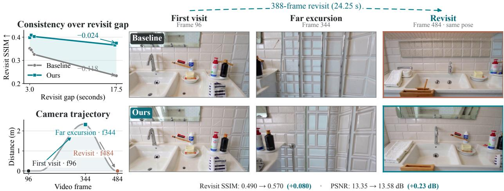

[← 返回 README](../README.md)

## 1 Introduction

World models predict environment dynamics, enabling agents to anticipate future observations and reason about the consequences of their actions [1, 2]. Recent video world models realize such simulation through autoregressive generation conditioned on agent actions or camera trajectories [3– 7]. Beyond short-term temporal continuity, long-horizon simulation requires previously observed scenes to remain recoverable after they leave the recent context [8–10]. When the camera later returns, the model should recover the earlier scene structure rather than generate a semantically similar but spatially inconsistent view. Full-history key-value (KV) caching provides direct access to past observations, but its storage cost grows continuously with the rollout length [11, 12]. Recurrent linear attention ofers a compact alternative by compressing history into fixed-size states [7, 13, 14]. This raises a central question for long-horizon world modeling: how can recurrent models retain eficient memory while still recovering distant scene information when it becomes relevant again?

> 💡 修正初稿。原文的核心问题不是“在 full-history KV 缓存与循环线性注意力之间取得平衡”，而是“循环模型如何保留高效记忆（efficient memory），同时在遥远场景信息再次相关时恢复它”。原文前提是：full-history KV caching 的存储成本随 rollout 长度持续增长，而 recurrent linear attention 把历史压缩到固定大小状态，提供紧凑替代。初稿把“易遗忘”放在本段，但该段尚未给出这一观察（见下一段 GDN 诊断），应删去或注明跨段推断。原文直接支持的关键洞察是：相机回归时模型应恢复早期场景结构，而不是生成语义相似但空间不一致的视图。批注作者：AI 批注。

Among modern recurrent linear-attention architectures, Gated DeltaNet (GDN) combines data-dependent decay with delta-rule updates to manage information within a compact recurrent state [15]. Nevertheless, we observe a clear long-range forgetting problem in GDN-based video world models. As illustrated in Fig. 1, SANA-WM exhibits a pronounced decline in revisit consistency as the temporal gap increases, while the qualitative example shows substantial changes in scene structure after the camera leaves and later returns. Such revisits are particularly challenging because information that is no longer locally relevant may become essential again after a long sequence of intermediate observations. This behavior suggests that compact recurrent memory alone is insuficient to reliably preserve distant scene information over extended rollouts.

> 💡 核对初稿：原文确实说 GDN 结合 data-dependent decay 与 delta-rule updates 管理紧凑循环状态，并观察到 GDN-based 视频世界模型中明显的长程遗忘；Fig. 1 中 SANA-WM 的 revisit consistency 随 temporal gap 增加而显著下降，定性例子显示相机离开再返回后场景结构发生实质变化。需修正两处：初稿“为引入混合架构提供实证依据”是合理推断，但原文只说“compact recurrent memory alone is insufficient”，并未直接推出混合架构，应标为推断；“实验观察”宜改为“论文自身的诊断性观察”，Fig. 1 是分析图而非独立对照实验。批注作者：AI 批注。

  
Figure 1 Long-range forgetting in GDN-based world-model rollouts. Upper left: Revisit SSIM over increasing temporal gaps. Lower left: Camera displacement along the qualitative trajectory. Right: Qualitative comparison of the first visit, far excursion, and revisit at the similar camera pose. After the long excursion, the baseline SANA-WM shows noticeable changes in scene layout and object arrangement, whereas our HLA-WM better preserves the first-visit scene content.

> 💡 Figure 1 批读（未获得图片视觉信息，以下依据 caption 与正文描述）：左上角为 Revisit SSIM 随 temporal gap 变化的曲线，正文称 SANA-WM 出现 pronounced decline（“急剧下降”来自正文而非 caption）；左下角为定性轨迹上的相机位移；右侧为 first visit、far excursion、revisit（相近相机位姿）的定性对比，caption 称 SANA-WM 在场景布局与物体排列上有明显变化，而 HLA-WM 更好地保留首次访问场景内容。该图承担“症状展示”角色，用来支撑上一段的遗忘判断；但它是定性与单模型诊断，不能单独证明根因，根因分析见下一段。初稿“作为核心证据”是推断，应注明。批注作者：AI 批注。

To understand this limitation, we analyze the recurrent state transition in GDN. Since the full history is compressed into a single recurrent state, earlier information must survive all intervening updates to remain recoverable, motivating a memory organization in which compact historical states remain independently addressable.

> 💡 机制拆解：原文把限制归因于“全历史被压缩进单一循环状态”，因此早期信息必须存活过所有中间更新才可恢复，这直接导向“紧凑历史状态保持独立可寻址”的记忆组织。注意本段只给出定性机理陈述，未给出状态转移公式或定量证明；初稿“深入分析”略显过强，宜写为“提出机理假设并据此设计记忆组织”。批注作者：AI 批注。

We therefore ask whether a pretrained recurrent video world model can recover distant scene history without retaining a full token-level KV cache or requiring additional training. To this end, we propose HLA-WM, a training-free hybrid linear-attention framework that combines coarse-grained geometry-guided retrieval with fine-grained recurrent linear-attention access. HLA-WM exploits the afine structure of GDN to cache compact chunk-wise summaries of historical state transitions, selectively retrieves relevant summaries using camera geometry, and recomposes them into a query-specific recurrent state. This establishes an intermediate memory regime between a single recurrent state and token-level full-history caching, enabling selective access to distant history while retaining compact linear-state storage.

> 💡 方法概览：原文提出的问题条件是——能否在不保留 full token-level KV cache、且不额外训练的前提下，让预训练循环视频世界模型恢复遥远场景历史。HLA-WM 的定位是 training-free hybrid linear-attention framework，结合 coarse-grained geometry-guided retrieval 与 fine-grained recurrent linear-attention access；利用 GDN 的 affine structure 缓存 chunk-wise 历史状态转移摘要，用相机几何选择性检索并重组为 query-specific recurrent state。需修正初稿的“稀疏历史访问”：原文是 selective access，不是 sparse；同时初稿漏掉了 coarse/fine 两个层级的区分。它在 single recurrent state 与 token-level full-history caching 之间建立中间记忆机制。批注作者：AI 批注。

For camera-controlled world-model rollouts, camera metadata provides a natural addressing signal without requiring a learned router [16, 17]. HLA-WM uses a lightweight camera-frustum overlap proxy derived from poses, intrinsics, and a scene-level depth estimate to identify relevant historical chunks. The selected summaries, together with the first chunk as a persistent sink and recent context for local continuity, are recomposed as retrieved context in chronological order without replaying historical visual tokens. Selective recomposition is applied only to the main GDN memory, while camera-control and local convolutional states retain their original recurrent updates. All pretrained parameters remain unchanged. Thus, HLA-WM changes how historical memory is stored and accessed rather than retraining the underlying generator.

> 💡 实现细节：相机元数据被用作 natural addressing signal，且原文强调 without requiring a learned router；寻址代理由 poses、intrinsics 与 scene-level depth estimate 推导的 camera-frustum overlap proxy 构成。初稿漏了两个关键组成：first chunk 作为 persistent sink，以及 recent context 用于 local continuity。检索摘要按 chronological order 重组，不回放历史视觉 token；选择性重组只作用于 main GDN memory，camera-control 与 local convolutional states 保留原循环更新，所有预训练参数不变。因此方法改变的是历史记忆的存储与访问，而非重训生成器。批注作者：AI 批注。

Experiments on SANA-WM-Bench [7] and MBench-A [18] demonstrate consistent improvements in long-range revisit fidelity. At Stage 1, where HLA-WM directly modifies recurrent memory, it also improves camera controllability by reducing accumulated structural drift and maintaining a more stable spatial reference during generation. Downstream refinement introduces mode-dependent trade-ofs, while the long-range consistency gains remain evident across both benchmarks. On MBench-A, all three revisit-consistency metrics improve across all four subsets and all evaluated inference modes. At a 60-second context, HLA-WM requires 12× less historical-state storage than full KV caching while incurring at most a 1.6% reduction in inference throughput across the evaluated pipelines. These results show that selectively addressable recurrent memory can substantially improve long-range scene recall.

> 💡 实验证据链：主结果在两个基准上支持长程重访 fidelity 提升；MBench-A 上三个 revisit-consistency 指标在四个子集与所有评估推理模式上均提升。关键数字：60 秒上下文下，历史状态存储比 full KV caching 少 12×，推理吞吐量下降至多 1.6%。需要修正初稿的因果范围：相机可控性改善是 Stage 1（HLA-WM 直接修改循环记忆）的结论，且原文明确 downstream refinement 会引入 mode-dependent trade-offs；只有长程一致性增益跨两个基准保持。初稿“不仅提升……还改善相机可控性”省略了 Stage 1 限定，应补上。批注作者：AI 批注。

Our main contributions are summarized as follows:

> 💡 贡献列表的引导句，无实质主张需核验；保留为过渡批注。批注作者：AI 批注。

• We empirically characterize long-range forgetting in GDN-based video world models and show how accumulated recurrent transitions progressively weaken access to distant scene information.

> 💡 贡献 1：原文是 empirically characterize long-range forgetting in GDN-based video world models，并展示 accumulated recurrent transitions 如何 progressively weaken access to distant scene information。初稿“对该领域已知问题的量化”属于推断——原文未使用“已知问题”或“量化”的措辞，且本段没有给出量化指标；宜写为“对 GDN 长程遗忘的实证刻画与机理解释”。批注作者：AI 批注。

• We propose HLA-WM, a training-free hybrid linear-attention framework that equips recurrent video world models with selectively addressable historical memory through compact afine summaries, camera-guided addressing, and chronological state recomposition.

> 💡 贡献 2：原文明确三个手段——compact affine summaries、camera-guided addressing、chronological state recomposition，并强调 training-free、hybrid linear-attention、selectively addressable historical memory。初稿末句“提供一种……通用范式”超出原文，原文未声称 generality，应标为推断或删除。批注作者：AI 批注。

• Extensive experiments on SANA-WM-Bench and MBench-A demonstrate improved longrange scene consistency. On the 60-second SANA-WM-Bench, HLA-WM improves the base autoregressive generator by 0.74 dB in PSNR and reduces rotation error by 28.5% without training.

> 💡 贡献 3：数字核对一致。原文限定为 60-second SANA-WM-Bench、base autoregressive generator、without training：PSNR +0.74 dB，rotation error 降低 28.5%。注意“without training”修饰的是该提升的取得方式，而非所有实验设置；MBench-A 的具体数字未在此列出。批注作者：AI 批注。

