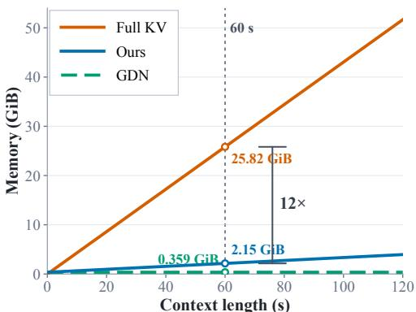
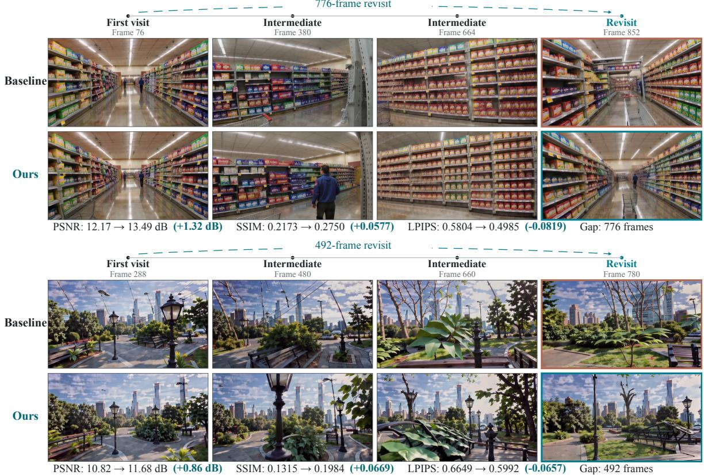

[← 返回 README](../README.md)

## 5 Experiments

## 5.1 Experimental Setup

Datasets and Baselines. We conduct experiments on SANA-WM-Bench [7] and MBench-A [18]. SANA-WM-Bench contains simple and hard splits, each with 80 camera-controlled trajectories spanning four scene categories: indoor, outdoor city, outdoor nature, and game-style environments. Each trajectory contains 961 frames at 16 fps, corresponding to approximately 60 seconds, with a resolution of $1 2 8 0 \times 7 0 4$ . MBench-A contains 547 samples across four oficial subsets: Causal, Human, Environment, and Object. We use the oficial 1.6B SANA-WM as our baseline. Its Stage 1 model performs 4-step distilled autoregressive streaming generation with recurrent GDN states, followed by optional causal AR or bidirectional refinement. HLA-WM modifies only the Stage 1 memory mechanism and requires no additional training or fine-tuning, while downstream refinement remains unchanged. Within each setting, the baseline and HLA-WM use identical inputs, camera trajectories, prompts, and generation configurations.

> 💡 **数据集与基线设置（问题动机与公平性边界）**：核对无误。SANA-WM-Bench 的 simple/hard 两个 split 各含 80 条相机控制轨迹，覆盖 indoor、outdoor city、outdoor nature、game-style 四类场景；每条轨迹 961 帧 @16 fps（约 60 秒），分辨率 $1280 \times 704$。MBench-A 共 547 个样本，含 Causal、Human、Environment、Object 四个官方子集。基线是官方 1.6B SANA-WM，其 Stage 1 为带 recurrent GDN states 的 4 步蒸馏自回归流式生成，之后可接 causal AR 或 bidirectional refinement。**公平性边界**：HLA-WM 只改 Stage 1 的记忆机制、不做额外训练或微调，下游细化不变，且 baseline 与 HLA-WM 在每一设置内使用完全相同的输入、相机轨迹、prompt 和生成配置——因此二者的差异可归因到记忆机制本身，而非训练数据或超参差异。

Implementation Details. All video-generation experiments are conducted on a single NVIDIA H200 GPU with 140 GB of memory. We follow the oficial SANA-WM autoregressive streaming pipeline [7], including the chunk-causal LTX-2 refiner and causal VAE. Following the default 4-step distilled configuration, we use the sampling schedule [1000, 960, 889, 727, 0] and three latent frames per autoregressive block. Unless otherwise specified, HLA-WM retains one sink chunk, the most recent chunk, and the top-1 historical chunk ranked by geometric overlap. When the within-chunk change in camera translation direction exceeds $\tau _ { \mathrm { t u r n } } = 2 5 ^ { \circ }$ , the recent context is temporarily expanded from one to three chunks.

> 💡 **实现细节批读**：核对无误。单卡 NVIDIA H200（140 GB），沿用官方 SANA-WM 自回归流式管线（chunk-causal LTX-2 refiner + causal VAE）。默认 4 步蒸馏配置：采样调度 [1000, 960, 889, 727, 0]，每个自回归 block 3 个 latent 帧。记忆策略默认（除非另作说明）保留 1 个 sink chunk + 最近 1 个 chunk + 按几何重叠排序的 top-1 历史 chunk；当 chunk 内相机平移方向变化超过 $\tau_{turn} = 25^{\circ}$ 时，近期上下文由 1 个 chunk 临时扩展到 3 个。**机制要点**：该触发是规则式（非学习式）调度——转向剧烈时多取近期上下文，平缓时省显存；阈值作用在“chunk 内相机平移方向变化”这一轨迹级量上，不涉及任何新增训练模块。

Evaluation Metrics. We evaluate long-range scene consistency using PSNR, SSIM [26], and LPIPS [27] between frames corresponding to repeated or near-repeated camera poses. Camera controllability is measured by rotation error (RotErr), relative translation error $\left( \mathrm { T r a n s E r r } _ { \mathrm { r e l } } \right)$ , and relative camera-motion consistency $\left( \mathrm { C a m M C _ { r e l } } \right)$ , following the SANA-WM evaluation protocol [7]. Camera trajectories are estimated using Pi3X, an enhanced implementation of $\pi ^ { 3 }$ [28].

> 💡 **评估指标批读（两类证据）**：核对无误。①长程场景一致性：在重复或近重复相机位姿的对应帧之间计算 PSNR、SSIM、LPIPS，衡量“回到同一地点时画面是否一致”，属保真类指标（PSNR/SSIM 越高越好，LPIPS 越低越好）。②相机可控性：RotErr、$TransErr_{rel}$、$CamMC_{rel}$，沿用 SANA-WM 评估协议，衡量生成视频的相机运动是否贴合给定轨迹。**隐含依赖**：相机轨迹由 Pi3X（$\pi^3$ 的增强实现）估计，即指标值依赖一个外部位姿估计器的精度，其误差会进入 RotErr/TransErr/CamMC；原文未对该估计器做误差分析，也未给出不依赖它的替代验证。

Table 2 Overall results on MBench-A under diferent inference modes. Best results within each setting are shown in bold.
<table><tr><td>Pipeline</td><td>Method</td><td>PSNR ↑</td><td>SSIM ↑</td><td>LPIPS ↓</td></tr><tr><td>Stage-1</td><td>SANA-WM</td><td>10.17</td><td>0.2545</td><td>0.6251</td></tr><tr><td></td><td>HLA-WM</td><td>11.01</td><td>0.2848</td><td>0.5823</td></tr><tr><td>Stage-1 + AR Refine</td><td>SANA-WM</td><td>12.36</td><td>0.2996</td><td>0.6554</td></tr><tr><td></td><td>HLA-WM</td><td>12.73</td><td>0.3122</td><td>0.6447</td></tr><tr><td>Stage-1 + Bi. Refine</td><td>SANA-WM</td><td>12.94</td><td>0.3310</td><td>0.5597</td></tr><tr><td></td><td>HLA-WM</td><td>13.52</td><td>0.3431</td><td>0.5470</td></tr></table>

> 💡 **Table 2 批读（MBench-A 的原始证据）**：在本节原文块顺序中，Table 2 排在 5.2 标题之前，但 caption 明确是 MBench-A 的整体结果，对应 block 9 的叙述，而非 block 8 的 SANA-WM-Bench 结果。**算术核对**：Stage-1 的 PSNR 10.17→11.01 = +0.84 dB，SSIM 0.2545→0.2848 = +0.0303，LPIPS 0.6251→0.5823 = −0.0428；AR 细化 12.36→12.73 = +0.37 dB；双向细化 12.94→13.52 = +0.58 dB，与 block 9 文字完全吻合。三种推理模式下 HLA-WM 的 PSNR/SSIM 都更高、LPIPS 都更低，双向细化给出最高绝对分（13.52/0.3431/0.5470）。**观察（不下因果）**：AR 细化行的 LPIPS 绝对值高于 Stage-1 行（SANA-WM 0.6554 vs 0.6251；HLA-WM 0.6447 vs 0.5823），说明下游细化并非在所有指标上单调改进；但这是跨 pipeline 的比较，不是同一设置内部对比。**推断部分**：初稿把“提升主要来自基础生成阶段、不依赖后续细化弥补”当作结论，这属于对数据的解释（原文仅在 block 9 说 gains are most pronounced at Stage 1），应视为推断。另：block 8 引用的 Table 1（SANA-WM-Bench）不在本段提供的原文范围内，其数值无法据表核对。

  
Figure 4 Memory scaling comparison.

> 💡 **Figure 4 批读（仅有 caption，视觉内容未提供）**：caption 只有一句 Memory scaling comparison，本段未提供任何图片视觉信息，因此以下均为推断、待证：该图大概率以上下文长度为横轴、记忆占用为纵轴，对比 full KV caching（随长度快速增长）、native GDN（常数内存）与 HLA-WM（选择性可寻址的 chunk 摘要）。与之相关的数字（60 秒上下文 2.15 GiB、比 full KV 少 12×、吞吐最多降 1.6%）来自 block 10 正文，并非来自本 caption；在未见到图的前提下，不能断言曲线具体形状、是否包含 GDN 曲线或任何绝对数值。若要核实需查看 images 目录中的原图。

## 5.2 Main Results

Performance on SANA-WM-Bench. Table 1 evaluates HLA-WM across diferent stages of the SANA-WM generation pipeline. At Stage 1, where HLA-WM directly modifies the recurrent memory, it improves all revisit-consistency and camera-control metrics on both trajectory splits. On Hard trajectories, PSNR and SSIM increase by 0.74 dB and 0.0223, LPIPS decreases by 0.0196, and RotErr is reduced by 26.0%. Similar improvements are observed on Simple trajectories, including a 0.73 dB PSNR gain and a 31.0% reduction in RotErr. These camera-control gains are consistent with improved scene stability, as preserving previously observed geometry reduces structural drift and provides a more reliable spatial reference for camera-conditioned generation. The improvements largely persist after downstream refinement. Under causal AR refinement, all three revisit-consistency metrics improve on both splits. On Hard trajectories, all three cameracontrol metrics also improve, while on Simple trajectories RotErr decreases but TransErr and CamMC increase slightly. Full-sequence refinement preserves the benefits more consistently and improves all six metrics on both splits, including PSNR gains of 0.52/0.46 dB and RotErr reductions of 22.0%/20.1% on the Simple/Hard splits. Overall, selective long-range memory consistently improves revisit fidelity while generally enhancing camera controllability over long rollouts. Detailed category-level results, together with extensive ablations on component contributions, GDN/KV alignment, retrieval budget, and historical selection strategies, are provided in the Appendix.

> 💡 **SANA-WM-Bench 主结果批读（证据链拆解）**：核对无误的部分——Stage 1 上两个 split 的重访一致性与相机控制指标全部改善；Hard 轨迹 PSNR +0.74 dB、SSIM +0.0223、LPIPS −0.0196、RotErr −26.0%；Simple 轨迹 PSNR +0.73 dB、RotErr −31.0%。经 causal AR 细化后，两个 split 的三个重访一致性指标都改善，Hard 上三个相机控制指标也改善，但 Simple 上 RotErr 下降而 TransErr 与 CamMC 略有上升——原文自己承认了这一例外，因此不能笼统写成相机控制全面提升。**修正初稿**：初稿称全序列细化“能恢复并放大这些收益”不准确。原文只说 full-sequence refinement preserves the benefits more consistently，即两个 split 上六个指标全部改善，PSNR 增益 0.52/0.46 dB、RotErr 降低 22.0%/20.1%（Simple/Hard）；这些 PSNR 增益实际小于 Stage 1 的 0.73/0.74 dB，谈不上“放大”；“恢复”也暗示 AR 细化丢失了增益，原文无此表述。**推断部分**：block 2 把下游称为 causal AR 或 bidirectional refinement，此处称 Full-sequence refinement，二者等同属推断（很可能指双向细化），原文未明确对应；此外 Table 1 未在提供范围内，上述数字无法用表格独立核对。结论句与原文 consistently improves revisit fidelity while generally enhancing camera controllability 一致，其中 generally 的保留语气应保留。

Performance on MBench. We further evaluate HLA-WM on the full MBench-A benchmark with 547 samples to assess its generalization beyond SANA-WM-Bench. As shown in Table 2, HLA-WM consistently improves PSNR, SSIM, and LPIPS across all three inference modes. The gains are most pronounced at Stage 1, where PSNR and SSIM increase by 0.84 dB and 0.0303, respectively, while LPIPS decreases by 0.0428. The improvements remain consistent after downstream refinement, with PSNR gains of 0.37 dB and 0.58 dB under causal AR and bidirectional refinement, respectively. These results demonstrate that the proposed memory mechanism generalizes efectively across diferent refinement modes and diverse scene and interaction patterns. Detailed subset-level results are provided in the Appendix.

> 💡 **MBench-A 泛化批读**：核对无误——547 个样本上、三种推理模式下 PSNR/SSIM/LPIPS 全部改善；Stage-1 增益最大（PSNR +0.84 dB、SSIM +0.0303、LPIPS −0.0428），下游细化后仍保持（AR +0.37 dB、Bi +0.58 dB）。这些数字与 Table 2 的加减完全吻合，属可用表格核实的证据。**修正初稿**：初稿把 MBench-A 称为“更大的基准”并说“证实”通用性。MBench-A 的 547 个样本与 SANA-WM-Bench（两个 split 各 80 条约 60 秒轨迹）并非严格可比的更大或更小，且 547 样本仍属中等规模；“证实”应降级为原文主张得到实验支持，作者原话是 generalizes effectively across different refinement modes and diverse scene and interaction patterns。另需注意本表只报 PSNR/SSIM/LPIPS，未报相机控制指标，因此 MBench-A 上的结论仅限画面与重访保真维度。

Eficiency Analysis. HLA-WM ofers a practical trade-of between full-KV attention and recurrent linear attention. While full KV caching preserves direct access to the entire history at a memory cost that grows rapidly with context length, native GDN maintains constant memory but compresses the entire history into a single recurrent state. HLA-WM retains selectively addressable long-range memory through compact chunk-wise summaries, requiring only 2.15 GiB of historical-state memory at a 60-second context, 12× less than full KV caching, while incurring at most a 1.6% reduction in inference throughput across the evaluated settings.

> 💡 **效率权衡批读**：数字核对无误——60 秒上下文下历史状态内存 2.15 GiB，比 full KV caching 少 12×，推理吞吐最多下降 1.6%。**口径澄清**：2.15 GiB 指 historical-state memory（历史状态内存），不是整模型显存占用；12× 的参照是 full KV caching；1.6% 是“至多”且是跨所评估设置的最大吞吐损失，不能推广为所有配置下的固定开销。**推断/待证**：初稿说 native GDN 压缩全部历史会“丢失细节”、HLA-WM 是“最佳折中”——原文只说 GDN 以常数内存把全部历史压进单个 recurrent state，并未测量它丢失了哪些细节；“最佳折中”是评价性判断，不是本文测得的结论。可核实的是：HLA-WM 用 chunk 级摘要换取 selectively addressable 的长程记忆，即在不随长度线性增长内存的前提下保留了可寻址的历史条目。

Qualitative Results. Figure 5 further illustrates the long-range memory improvements of HLA-WM under diferent refinement modes. In the AR-refined indoor example, the baseline exhibits substantial structural drift after a long revisit: the aisle geometry changes, the shelf arrangement becomes inconsistent, and the alignment between the shelves and ceiling lights deviates noticeably from the first visit. In contrast, HLA-WM better preserves the two-sided shelf layout, central aisle structure, and overall scene perspective. In the bidirectionally refined outdoor example, the baseline shows larger changes in the foreground composition and spatial arrangement of the walkway, vegetation, and distant buildings. HLA-WM more consistently preserves these scene elements and their relative geometry upon revisit. Additional visualizations are provided in the Appendix.

> 💡 **机制拆解：两种精修模式下的定性证据链**
> 
> 本段是“Qualitative Results”小节对 Figure 5 的文字解释，功能是给此前的定量/主结果补一组视觉证据，而不是提出新的定量结论。它按两种精修模式分两组描述：
> 
> 1. **AR 精修（室内案例）**：基线在长距离回访后出现 substantial structural drift，作者具体化为三点——通道（aisle）几何发生变化、货架（shelf）排列变得不一致、货架与天花板灯之间的对齐明显偏离首次访问的帧；HLA-WM 则更好地保持双侧货架布局、中央通道结构和整体场景透视。
> 2. **双向精修（室外案例）**：基线在前景构图以及步道、植被、远处建筑的空间排列上变化更大；HLA-WM 更一致地保留这些场景元素及其相对几何关系。
> 3. 作者声明更多可视化放在 Appendix，因此本段不是完整证据集。
> 
> **证据边界（重要）**：本段全部是作者的主观定性描述，段落内没有给出任何数值度量（没有指标名、没有分数、没有误差值），也没有说明“结构漂移”是如何测量或标注的。“improvements”一词是作者的表述性用语，本段本身不足以支撑“统计上更优”的结论；要判断长程记忆是否真正改善，必须去核对正文的定量表格与附录中的补充可视化。
> 
> **Q&A 批注记录**:
> - Q：文中“structural drift”有没有可复现的量化定义？
> - A：本段未定义，正文此处只给出自然语言描述（“通道几何改变 / 货架排列不一致 / 对齐偏离”），是否另有基于重投影误差或特征匹配分数的指标，需查后文或附录确认——目前属**待证**。
> - Q：为什么 AR 用室内、双向用室外，两种模式是否在同一场景上做过对比？
> - A：本段只各给一个案例（AR→室内，双向→室外），未交代为何如此配对，也没有交叉场景对照，因此不能从本段推断两种精修模式的优劣排序，只能读作“两种模式下都能观察到基线漂移、HLA-WM 更稳定”。

  
Figure 5 Qualitative comparison on long-range revisit scenarios under causal AR refinement (top) and bidirectional refinement (bottom). Each example shows the first visit, intermediate views, and a later revisit along the same camera trajectory. Revisit metrics are computed between the first-visit and revisit frames within each method.

> 💡 **Figure 5 批读**
> 
> - **可见信息范围说明**：本次核对只拿到 MinerU 解析出的图片路径与 caption 文本，**未获得该图的像素级视觉内容**，以下关于画面布局的判断均依据 caption，而非对图本身的直接核对。
> - **图的结构（据 caption）**：上排对应 causal AR refinement，下排对应 bidirectional refinement；每个示例由“首次访问 → 中间视图 → 后续回访”构成，且三段沿同一条相机轨迹（same camera trajectory）。这说明图的阅读单位是“轨迹”，不是孤立的单帧画质对比。
> - **关键评测协议**：caption 写明 Revisit metrics are computed between the first-visit and revisit frames within each method——即指标是**在各方法自己内部的首次访问帧与回访帧之间**计算的。这一点决定了它衡量的是“同一方法前后自洽性/记忆保持”，而不是与真值帧的保真度（fidelity），也不是方法之间的直接配对比较。这个区分直接影响如何解读：自洽性高不等价于生成保真度高。
> - **推断标注**：初稿称“这暗示了评估标准是‘一致性’而非单纯的生成质量”，方向正确但属**推断**——caption 只说明了指标的计算区间，没有给出指标名称、公式或数值，也没有声明“一致性”是该图的唯一评价维度；“而非生成质量”是外部解读，不能算原文主张。
> - **待证点**：该图对应的具体指标名与数值不在本段/caption 中，需要正文表格或附录补全；此外每个精修模式只展示若干示例，案例数量与选取方式未说明，存在择优展示的可能。

