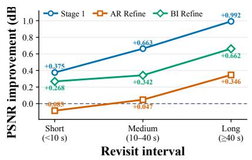
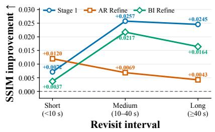
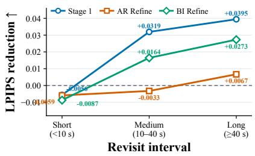

[← 返回 README](../README.md)

## A.6 Efectiveness of Geometry-Guided Historical Selection

We evaluate whether geometry provides an efective signal for selecting historical states by comparing HLA-WM with three geometry-agnostic selection strategies on Hard80 under Stage 1 inference. To more clearly expose the diferences among selection strategies, we conduct this comparison with a larger retrieval budget of K = 4, allowing each method to operate over a broader historical context. Random deterministically samples up to six states from the available history, Recent retains the six most recent states, and Uniform selects six states approximately uniformly over the entire history. In contrast, HLA-WM retains a sink state and recent context while selecting distant historical chunks according to camera-frustum overlap. All variants use the same model, generation setting, seed, and evaluation protocol, covering 80 scenes and 400 revisit pairs. The three heuristic baselines use a fixed budget of at most six historical states, whereas HLA-WM normally uses six states but temporarily expands the recent context when the turn-aware criterion is triggered. We therefore regard this experiment as a comparison of historical selection strategies rather than a strictly equal-compute ablation.

> 💡 **实验设计与基线对比**：本节验证几何信号（相机视锥重叠，camera-frustum overlap）对历史状态选择的有效性。对比三种 geometry-agnostic 策略：Random（原文为 deterministically samples up to six states，即确定性采样，**不是随机采样**）、Recent（保留六个最近状态）、Uniform（在整段历史中近似均匀地选六个状态）。HLA-WM 保留 sink state 与 recent context，并按 camera-frustum overlap 挑选远处历史 chunk。控制变量为相同模型、相同生成设置、相同 seed、相同评估协议，覆盖 80 场景与 400 重访对；检索预算取 $K=4$ 是为了让各方法在更宽的历史上下文上运行。作者明确限定：基线固定最多六个状态，而 HLA-WM 在触发 turn-aware criterion 时会临时扩展 recent context，因此这是**历史选择策略的比较，而非严格等计算量消融**——这属于原文自述的边界，不应被读成效率结论。

Table 7 Comparison of historical state selection strategies on Hard80 under Stage 1 inference with K = 4. Higher PSNR and SSIM are better, while lower LPIPS and camera errors are better.
<table><tr><td>Selection Policy</td><td>PSNR ↑</td><td>SSIM ↑</td><td>LPIPS ↓</td><td>RotErr (°) ↓</td><td>TransErr ↓</td><td>CamMC↓</td></tr><tr><td>Random</td><td>9.70</td><td>0.1864</td><td>0.6049</td><td>14.1883</td><td>1.7822</td><td>1.8924</td></tr><tr><td>Recent</td><td>9.29</td><td>0.1696</td><td>0.6179</td><td>27.6876</td><td>2.0142</td><td>2.2408</td></tr><tr><td>Uniform</td><td>9.91</td><td>0.1910</td><td>0.5957</td><td>12.3324</td><td>1.6881</td><td>1.7838</td></tr><tr><td>HLA-WM</td><td>10.00</td><td>0.1936</td><td>0.5885</td><td>12.2795</td><td>1.6985</td><td>1.7832</td></tr></table>

> 💡 **Table 7 数据解读**：逐项核验数值无误——Random 9.70/0.1864/0.6049/14.1883/1.7822/1.8924；Recent 9.29/0.1696/0.6179/27.6876/2.0142/2.2408；Uniform 9.91/0.1910/0.5957/12.3324/1.6881/1.7838；HLA-WM 10.00/0.1936/0.5885/12.2795/1.6985/1.7832。Uniform 明显强于 Random 与 Recent，RotErr 12.33° 对比 14.19°/27.69°。HLA-WM 相对 Uniform：PSNR +0.09、SSIM +0.0026、LPIPS −0.0072，RotErr（12.2795 vs 12.3324）与 CamMC（1.7832 vs 1.7838）略低，但 **TransErr 1.6985 略高于 Uniform 的 1.6881**。因此不能写成“所有指标最优”，HLA-WM 在 TransErr 上并非最优。

> 💡 **Figure 6（子图）批读**：此 block 仅为图片引用，**本环境未获得其视觉内容**，只能依据 caption 判断归属。caption 说明 Figure 6 报告相对 SANA-WM 在不同重访间隔上的改进，左栏为 PSNR improvement，且覆盖 Stage 1、AR refinement、bidirectional refinement 三个阶段。至于曲线走势、增益是否随重访间隔增大而保持稳定，缺少图像视觉信息，**待证**；初稿对趋势的具体描述应视为推断。

> 💡 **Figure 6（子图）批读**：同为图片引用，无视觉信息。按 caption 对应关系，此栏为 SSIM improvement（middle）。它是否“佐证结构细节保留优势”需看到图像才能核实，**待证**。另外此图与前后两张共享同一 Figure 6 caption，说明原多子图被拆为多张，规范上应使用完整整图；当前无法执行 PDF 裁剪，故以文字说明替代。

  
Figure 6 Performance improvement over SANA-WM across diferent revisit intervals on the Hard-Trajectory split. We report PSNR improvement (left), SSIM improvement (middle), and LPIPS reduction (right) for Stage 1, AR refinement, and bidirectional refinement.

> 💡 **Figure 6（右）与 caption 批读**：右栏为 LPIPS reduction。caption 已明确三件事：改进是**相对 SANA-WM**、评测在 **Hard-Trajectory split** 上按不同重访间隔进行、覆盖 **Stage 1 / AR refinement / bidirectional refinement** 三个阶段。据此可确认该图与 Table 7 不是同一实验（Table 7 是 Hard80 上的选择策略对比，Figure 6 是相对 SANA-WM 的间隔分层改进），不能混为一谈。三阶段是否“持续贡献增益”仍需图像证据，**待证**。

As shown in Table 7, uniformly covering the history already provides a substantially stronger baseline than random or purely recent selection, highlighting the importance of maintaining access to distant context. Uniform selection remains competitive, likely because the one-minute evaluation horizon allows uniformly sampled states to cover much of the observed scene history. Nevertheless, geometry-guided selection further improves all three revisit-consistency metrics, increasing PSNR from 9.91 to 10.00 and SSIM from 0.1910 to 0.1936, while reducing LPIPS from 0.5957 to 0.5885. It also achieves slightly lower RotErr and CamMC, while Uniform obtains a marginally lower TransErr. These results indicate that explicitly selecting view-relevant historical states provides additional benefit beyond broad temporal coverage, supporting camera geometry as an efective criterion for long-range memory retrieval.

> 💡 **结论提炼与证据边界**：原文指出 Uniform 已显著强于 Random 与纯近期策略，凸显保留远距离上下文的重要性；作者对这一现象的解释是“一分钟评测视野使均匀采样即可覆盖大部分场景历史”。几何引导在此基础上进一步改善三项重访一致性指标：PSNR 9.91→10.00、SSIM 0.1910→0.1936、LPIPS 0.5957→0.5885，并取得略低的 RotErr 与 CamMC，而 Uniform 的 TransErr 略低（1.6985 vs 1.6881）。结论支持“相机几何是有效的长程记忆检索准则”。需注意：原文只把它表述为**历史状态选择策略**，并未声称这是“稀疏注意力机制”，后者属于超出证据的推断，应删除。

