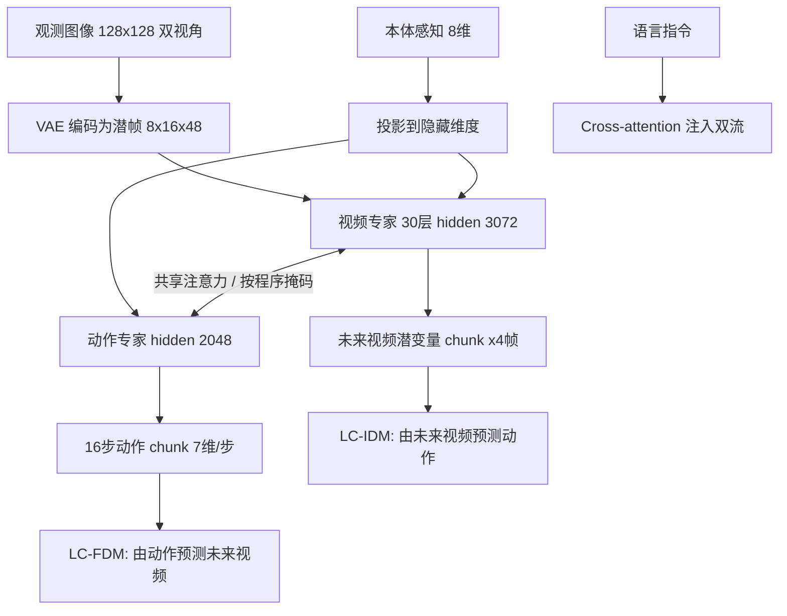

# OPENWAM: An Open Framework for Composable World-Action Models

**作者**: Heng Yu*, David D. Yuan*, Juze Zhang*, Changan Chen, Yao Feng, Michelle Baldonado, Steve Cousins, Li Fei-Fei, Jiajun Wu, Ehsan Adeli | **会议 / 年份**: arXiv / 2026 | **链接**: https://arxiv.org/abs/2610.07922

## 一句话总结
在共享因果视频骨干与 MoT 架构上统一四种视频–动作交互模式，并证明用反事实数据独立训练局部上下文动力学组件后，仅微调视频预测器即可在新任务上复用冻结的动作接口。

## 核心贡献
- 提出 OPENWAM 框架：以 Wan2.2-5B 为起点，在 333.6 万条轨迹（约 14,642 小时，Table 8 为训练窗口采样前统计）异构机器人/人类视频上做无动作标签的因果预训练，再用 Mixture-of-Transformers 接入动作专家，支持 Joint、VTA、ATV、Decoupled 四种生成程序。
- 骨干初始化消融：同一 VTA 程序在 LIBERO-Long 上从原始 Wan2.2 的 68.4% 提升到 97.8%（+29.4 点），Joint 从 62.2% 提升到 96.6%（+34.4 点），收益跨交互模式迁移（D.1、Table 12）。
- 局部上下文逆动力学（LC-IDM）复用：冻结 IDM、仅适配视频预测器时，混合监督（60% 反事实 + 40% 演示）在 4 个 held-out LIBERO-90 任务上平均成功率 84.0%，全上下文 IDM 仅 47.0%，纯演示 LC-IDM 仅 21.5%。
- 局部上下文正动力学（LC-FDM）：反事实监督将 RGB 预测误差降低 34.5%，16 分支结果识别率从 21.1% 提升到 71.3%。
- 构建 LIBERO-Long-CF 数据集：32,000 条反事实片段、4,096,000 控制步，覆盖 Table 10 的 7 类干预配方，90.4% 的片段含夹爪接触（Table 11）。

## 📖 批读导航
| 章节 | 这一章解决什么 | 值得看的点 |
|---|---|---|
| Abstract & Intro | 动机与三项贡献概述 | 四种交互模式的定义；局部 vs 全局上下文的区分 |
| Sec. 2 Related Work | 定位 WAM 设计空间空白 | 与同名并发工作 OpenWAM [79] 的差异说明 |
| Sec. 3 Methodology | 形式化框架、MoT 架构、flow-matching 目标、局部动力学接口 | Eq. 3 的链式分解；Eq. 6 的条件边界；Figure 3 注意力掩码 |
| Sec. 4 Experiments | 策略性能、组件复用、动力学精度 | Table 3（LIBERO）、Table 5–6（IDM 迁移）、Table 7（FDM） |
| Sec. 5 Discussion | 价值总结与局限 | 承认未证实完整模型零样本迁移 |
| App. A Implementation | 复现细节 | 30 层 MoT 维度、20 步去噪、CFG=5.0、chunk 对齐方式 |
| App. B Pretraining | 因果预训练语料与算力 | Table 8 八大数据源统计；32×B200 训练 14 天 |
| App. C LIBERO-Long-CF | 反事实数据构建 | 干预分布 Table 10、物理交互率 Table 11 |
| App. D Ablations | 骨干初始化与 MoT 消融 | Table 12–13 |
| App. E External Comparison | 与 UVA 对比 | Table 14 多目标 vs 专用模型权衡 |

## 关键数字
| 指标 | 数值 | 条件 |
|---|---|---|
| VTA 平均成功率 | 98.6% | LIBERO 四套件，3 seed 均值（Table 3） |
| VTA LIBERO-Long | 97.8% | 因果预训练后；原始 Wan2.2 为 68.4% |
| Joint 平均成功率 | 97.6% | LIBERO 四套件 |
| ATV 平均成功率 | 96.8% | LIBERO 四套件 |
| Decoupled 平均成功率 | 98.0% | LIBERO 四套件 |
| 真实双臂平均成功率 | 92.1% (VTA) / 91.9% (Joint) | 3 个任务，Table 4 |
| LC-IDM 迁移成功率 | 84.0% | 4 个 held-out LIBERO-90 任务，混合监督 |
| 全上下文 IDM 迁移 | 47.0% | 同上 |
| FDM RGB MSE 降幅 | 34.5% | CF-only vs Demo-only |
| FDM K=16 结果识别率 | 71.3% | CF-only；Demo-only 为 21.1% |
| 预训练数据量 | 3,336,241 条 / 14,641.56 h | 8 个来源，Table 8，训练窗口采样前 |
| 反事实数据量 | 32,000 条 / 4,096,000 步 | LIBERO-Long-CF |
| 预训练算力 | 32×NVIDIA B200 × 14 天 | App. B.3 |

## 数据流：输入 → 中间表示 → 输出

## 优缺点与还能做什么
### 优点
- 受控比较：四种交互程序共享骨干、tokenization、训练目标与下游训练配方，差异只来自生成顺序与未来跨模态注意力，作者据此把交互设计从其他变量中分离出来。
- 局部动力学接口的可复用性被定量验证：冻结 IDM + 仅微调视频预测器即达 84.0%，证明显式条件边界设计的实用价值。
- 反事实数据构建流程清晰：从模拟器状态分支、多类干预覆盖、物理交互率高，为动力学学习提供了可复制的数据工程范式。
- 开源与算力透明：论文给出项目页与代码链接（标注 2026-06-04 发布），并公开预训练语料规模与 32×B200×14 天的算力；原文未说明是否发布预训练 checkpoint。

### 局限 / 风险
- 主要验证于 LIBERO 仿真，真实机器人仅 3 个双臂任务且每任务只报告单一成功率，泛化证据不足。
- Table 3 中 VTA 平均 98.6% 仅比最强基线 LingBot-VA（98.5%）高 0.1 点，且 LIBERO-Long 上 LingBot-VA 的 98.5% 高于 VTA 的 97.8%；ATV 平均 96.8% 也低于 OpenVLA-OFT 的 97.1%。
- VTA/ATV 两阶段推理时以第一遍生成为条件，而训练第二遍以真值为条件（teacher forcing），存在暴露偏差，原文未量化其影响。
- 基线方法为他人报告数字而非同设置重跑，公平性依赖各论文评估协议一致。
- 多目标联合训练（policy + IDM + FDM）在反事实动力学精度上不及专用模型，且策略得分因仅 60% 更新用于策略而下降。

### 还能做什么
- （推断）将 LIBERO-Long-CF 的反事实采集流程移植到真实机器人，利用失败/探索 transition 替代模拟器分支，检验 LC-IDM 在物理噪声下的鲁棒性。
- （推断）对 VTA/ATV 引入一致性蒸馏或自博弈校正，缓解 teacher forcing 带来的训练–推理分布偏移。
- （推断）在更长 horizon 任务（如 50+ action chunk）上测试 decoupled 模式是否因缺乏跨模态交互而退化，以及局部上下文是否仍然充分。
- （推断）探索 video backbone 冻结比例与下游任务数量的 scaling law，当前只用了单一 5B 规模。

## 阅读 Q&A 记录

**一个疑问**: Q：VTA/ATV 推理时第二阶段条件于第一阶段生成的轨迹而非真值，这种暴露偏差如何影响性能？ A：原文在 A.3 节末段说明了训练用 teacher forcing、推理用生成轨迹的事实，但未提供定量消融来衡量该偏差的影响。

**一个疑问**: Q：局部上下文 IDM 排除语言和历史信息，在需要长程语义理解的任务中是否会失效？ A：第 3 节明确承认"局部充分性并非普遍成立"，但实验仅在 LIBERO 上验证，未在更长 horizon 或语义复杂任务上测试边界。

**一个疑问**: Q：Table 3 中基线方法是同设置重跑还是引用原论文数字？ A：第 4 节说明基线为他人报告结果（reported results），非同一代码库重跑，因此比较的前提是各论文评估协议一致。

**一个疑问**: Q：反事实数据混合比例 η=0.6 是如何选取的？是否有敏感性分析？ A：第 4.1 节给出 η=0.6，但未报告其他比例的消融；Table 5 显示 CF-only (η=1.0) 与混合 (η=0.6) 效果相当（84.5% vs 84.0%），暗示比例不敏感，但未系统扫描。

**一个疑问**: Q：预训练的 14,642 小时视频中各来源的采样权重是什么？ A：App. B.1 Table 8 给出了各来源原始时长，但明确说明"表内数字是训练窗口采样前的统计"，未披露采样或混合权重。

## 📊 Citation Landscape

数据来源：Semantic Scholar API（Paper ID: ARXIV:2610.07922）。该论文自身的引用数与被引数不可用（查询 HTTP 状态 429）。以下分析基于 API 返回的参考文献列表，references_scope 注明"最多前 100 条参考文献；不是完整引用图谱"。

**参考文献规模**：正文编号至 [108]；API 返回 100 条参考文献条目。

**时间分布**：返回的 100 条集中在 2022–2026 年，其中 2026 年预印本占多数；最早条目为 2020 年的 Human-in-the-Loop Imitation Learning。个别更早的经典文献（如 2011 年 DAgger、2017 年 Deep Visual Foresight）出现在论文正文参考文献表中，但不在 API 返回的这 100 条内。

**主题聚类**：
- WAM 架构与方法：Streaming-WAM、AffordanceWAM、Light-WAM、GE-Act 2.0、TacPAC、SG-WAM、SelfWAM、GlanceWAM、LD4WAM、FACT、World-Coherent Decoding、DiT4DiT、OA-WAM、DeVA、τ0-WM、Unified World Models、GigaWorld-Policy、Fast-WAM 等。
- VLA / 视觉运动策略：π0（3176 次引用）、π0.5（2347 次）、OpenVLA（3959 次）、RT-2（4745 次）、RT-1（3043 次）、GR-2、Cosmos Policy、VideoVLA、Octo 等。
- 视频生成基础：Wan（2876 次）、Motus（321 次）、DreamGen（198 次）。
- 数据与基准：LIBERO（1944 次）、Open X-Embodiment（1232 次）、ALOHA（2696 次）、RoboCOIN、RoboMIND、FastUMI、UMI、Ego-Exo4D（648 次）、InternData-A1。
- 动力学 / Flow Matching：Flow Matching（7007 次）、Diffusion Policy（4750 次）、MoT（196 次）、DayDreamer。

**高引基础文献**（供读者追溯）：Flow Matching 7007、Diffusion Policy 4750、RT-2 4745、OpenVLA 3959、π0 3176、Wan 2876、ALOHA 2696、LIBERO 1944、Open X-Embodiment 1232。

**并发同名工作**：参考文献 [79] "OpenWAM: An Open, Modular Exploration Towards Systematic World-Action Model Pretraining"（2026，26 次引用），本文在第 2 节声明其侧重模块化预训练框架，而本文侧重固定基础模型下交互模式的比较。

**Semantic Scholar 推荐的相关论文**：ZimaBlue、XPACE、HWAM、WAVE-0、DualWAM、Magic-W0、Skel-WAM、MoWAM 等，均为 2026 年 WAM 方向工作。