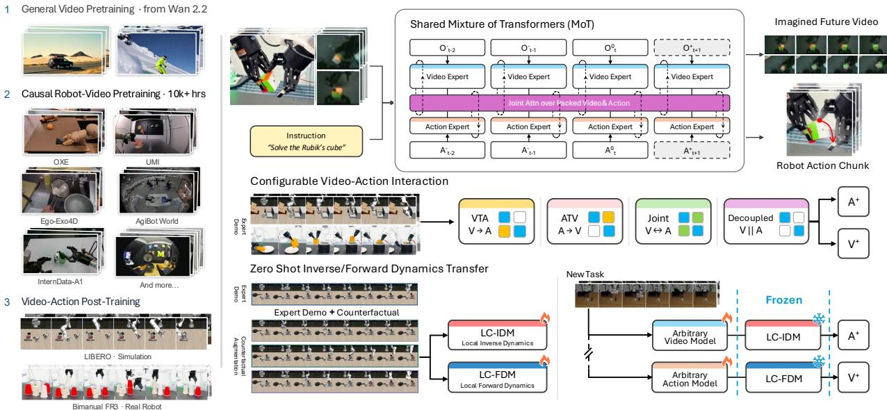

[← 返回 README](../README.md)

## 1. Introduction

World-action models (WAMs) integrate future-observation prediction with robot control. Recent systems such as DreamZero [90], DVA [71] and LingBot-VA [43, 97] use pretrained video models to couple future-observation prediction with robot action generation. However, differences in their backbones, training data, objectives, and inference procedures make it difficult to isolate the effect of video–action interaction.

> 💡 **问题背景**: WAMs 把未来观测预测与机器人控制结合起来，但 DreamZero、DVA、LingBot-VA 等在 backbone、训练数据、目标函数和推理流程上各不相同，作者认为这使视频–动作交互本身的效果难以被单独隔离。这是全文的出发点。

Two challenges arise when studying these systems systematically. First, video–action interaction spans multiple choices: video and actions can be generated jointly, sequentially, or through restricted cross-modal connections. A shared architecture and evaluation protocol would allow these interaction patterns and generation orders to be compared under controlled conditions. Second, successful demonstrations cover only a limited subset of possible action–outcome relationships. Other interactions, including failures, exploratory behavior, and counterfactual rollouts, can provide additional supervision about local dynamics. However, it remains unclear whether such data can improve the reuse of an action-grounding component when the visual predictor is adapted to a new task. We study this question by independently training local-context dynamics models and evaluating their transfer across adapted video predictors.

> 💡 **核心挑战**: 需统一架构以对比不同交互模式；且成功演示数据有限，需探究失败或反事实数据能否提升动作模块在新任务中的复用性。

To this end, we introduce OPENWAM, an open framework and model series for controlled world–action modeling, summarized in Figure 1. Starting from a pretrained generalpurpose video model, we adapt its visual prior through causal robot-video training without action labels, then introduce an action branch through a Mixture-of-Transformers (MoT) architecture [49]. The resulting model supports joint, sequential, and restricted video–action interaction. These configurations share the video initialization, representations, and evaluation pipeline, allowing us to compare how their interaction patterns affect the control performance.

> 💡 **方法概述**: OPENWAM 从预训练通用视频模型出发，先在无动作标签的因果机器人视频上适配视觉先验，再用 MoT 加出动作分支，从而在同一视频初始化、表示与评估管道下比较联合、顺序、受限三类交互模式对控制性能的影响。

  
Figure 1. Overview of OPENWAM. Left: Starting from Wan2.2 [75], causal pretraining on robot and human-interaction video builds a predictive backbone without action labels, followed by video–action training on simulated and real-robot demonstrations. Top right: A shared Mixture-of-Transformers couples temporally aligned video and action streams through joint attention while retaining modality specific experts. Middle right: Configurable cross-modal attention and generation order support joint, video-then-action, action-then-video, and decoupled prediction within the same architecture. Bottom right: Local-context inverse and forward dynamics models are trained independently using demonstrations and counterfactual transitions. A frozen IDM translates predictions from compatible task-adapted video models into actions, while an FDM predicts the visual consequences of candidate actions.

> 💡 **Figure 1 批读**: caption 显示流程是从 Wan2.2 出发，先在机器人及人–物交互视频上做无动作标签的因果预训练，再在仿真与真机演示上做视频–动作训练；MoT 用联合注意力耦合时间对齐的视频与动作流，同时保留各模态专属专家。右下角是独立训练的局部 IDM 与 FDM：推理时冻结的 IDM 把任务适配视频预测器给出的轨迹翻译成动作，FDM 预测候选动作的视觉后果。未获得图像视觉信息，以上仅据 caption 与正文。

Furthermore, OPENWAM trains local-context inverse and forward models independently. The inverse model predicts actions from the current observation and a future visual trajectory, while the forward model predicts that trajectory from supplied actions. In simulation, we broaden their training data by executing alternative action sequences from the same initial state. This local-transition formulation is also compatible with failed and exploratory interactions, because it does not require a successful task outcome or a success label. Each recorded transition supplies dynamics supervision regardless of whether it completes the task. At inference, a video predictor can propose a visual trajectory and a separately trained inverse model can translate it into executable actions.

> 💡 **局部动力学**: 独立训练逆/正动力学模型，利用模拟中的替代动作序列扩充数据，使模型能从非成功轨迹中学习局部动态，并在推理时分离视觉预测与动作生成。

We evaluate robot-video pretraining, closed-loop policy success across video–action interaction modes and dynamicscomponent reuse. In transfer experiments, task-adapted video predictors are paired with frozen inverse models to compare demonstration-only with counterfactual-augmented supervision and local-context with full-context conditioning. We additionally evaluate forward prediction under alternative actions from the same initial state.

> 💡 **实验设计**: 评估覆盖机器人视频预训练、各交互模式下的闭环成功率与动力学组件复用；迁移实验把任务适配的视频预测器配上冻结逆模型，比较仅演示与反事实增强监督、局部与全局上下文条件。另有同一初始状态下替代动作的正向预测评估。

This work makes three contributions:

> 💡 **贡献引言**: 本节列出论文的三项主要贡献，分别对应框架、接口设计和实证分析。

• A controlled WAM framework. OPENWAM combines a causal video backbone with configurable video–action models under shared training and evaluation protocols.

> 💡 **贡献一：框架**: 提出 OPENWAM 受控世界-动作建模框架，结合因果视频骨干网与可配置的视频-动作模型，统一训练与评估协议。

• Local-context dynamics interfaces. We independently train inverse- and forward-dynamics models from demonstrations and broader local transitions and evaluate their composition with separately trained predictors.

> 💡 **贡献二：接口**: 定义局部动力学接口，独立训练逆/正模型并利用更广泛的局部转移数据，评估其与单独训练的预测器的组合效果。

• Controlled empirical analysis. We measure the effects of robot-video pretraining, interaction design, transition coverage, and conditioning context on policy performance and component reuse.

> 💡 **贡献三：分析**: 进行受控实证分析，量化视频预训练、交互设计、转移覆盖率和条件上下文对策略性能及组件复用的具体影响。

