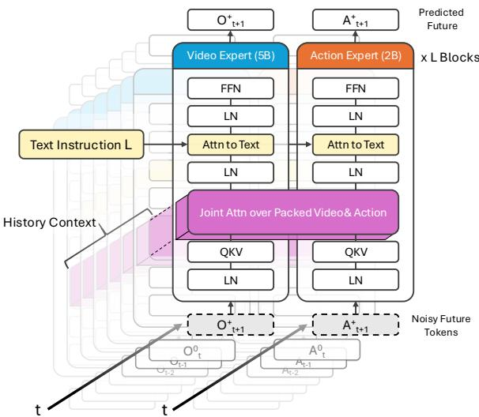
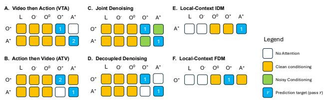
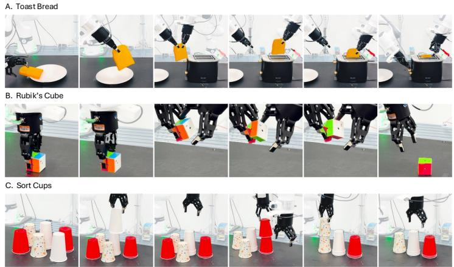
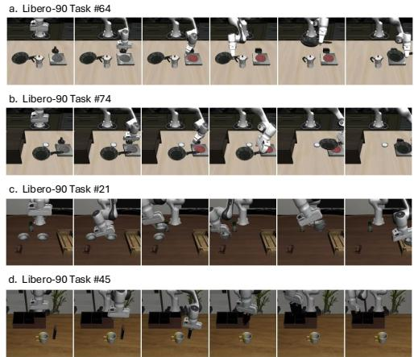

[← 返回 README](../README.md)

## 3. Methodology

We develop OPENWAM as an open framework for composing world prediction and action generation. It combines three ingredients: a causal video backbone pretrained on robot video without action labels, a common video–action architecture whose cross-modal interaction can be reconfigured, and separately trained inverse and forward dynamics components operating through local trajectory interfaces.

> 💡 **框架构成**: OPENWAM由三个核心组件构成：无动作标签预训练的因果视频骨干、可重构交互的视频-动作架构，以及通过局部轨迹接口独立训练的正逆动力学模块。

The design supports two forms of composition. At the architectural level, we vary how future observation and action streams interact while retaining a common backbone and objective family. At the component level, we connect independently trained predictors through explicit future-observation and action-trajectory interfaces. The latter motivates localcontext dynamics models that do not require the language and nonlocal history used by a task-conditioned generator.

> 💡 **组合机制**: 支持架构级（调整未来观测与动作流的交互方式）和组件级（通过显式接口连接独立预测器）两种组合，后者催生了不依赖语言和非局部历史的局部上下文动力学模型。

## 3.1. World–Action Modeling Formulation

Let $o _ { t } \in \mathcal { O } , a _ { t } \in \mathcal { A } , q _ { t } \in \mathcal { Q }$ , and $\ell \in \mathcal L$ denote the visual observation, action, proprioceptive state, and language instruction at time t. For fixed observation- and action-history lengths $K _ { o } \in \mathbb { N }$ and $K _ { a } \in \mathbb { N }$ , respectively, we define

> 💡 **符号定义**: 定义视觉观测 $o_t$、动作 $a_t$、本体感知状态 $q_t$ 和语言指令 $\ell$，并引入固定的历史长度 $K_o$ 和 $K_a$ 作为后续序列构造的基础参数。

$$
\begin{array} { l } { { O _ { t } ^ { - } = \bigl ( o _ { t - K _ { o } } , \ldots , o _ { t - 1 } \bigr ) , } } \\ { { A _ { t } ^ { - } = \bigl ( a _ { t - K _ { a } } , \ldots , a _ { t - 1 } \bigr ) , } } \\ { { O _ { t } ^ { 0 } = o _ { t } . } } \end{array}\tag{1}
$$

> 💡 **历史序列构造**: 公式(1)定义了基于固定窗口长度的过去观测序列 $O_t^-$、过去动作序列 $A_t^-$ 以及当前时刻的观测 $O_t^0$，为预测任务提供标准化的输入表示。

Let $H \in \mathbb { N } _ { > 0 }$ denote the prediction horizon. The future action and observation trajectories are defined as

> 💡 **预测视界**: 引入正整数 $H$ 作为预测视界，界定未来动作与观测轨迹的时间跨度；它与历史长度 $K_o$、$K_a$ 共同决定模型输入输出的时序范围。

$$
A _ { t } ^ { + } = ( a _ { t } , \ldots , a _ { t + H - 1 } ) , \quad O _ { t } ^ { + } = ( o _ { t + 1 } , \ldots , o _ { t + H } ) .\tag{2}
$$

> 💡 **未来轨迹定义**: 公式(2)中未来动作 $A_t^+$ 从 $a_t$ 起共 $H$ 步，未来观测 $O_t^+$ 则从 $o_{t+1}$ 到 $o_{t+H}$，两者在时间上错开一步，对应“先执行动作、再观察结果”的因果顺序。

We collect the information available before predicting the future into the task context

> 💡 **任务上下文概念**: 把预测未来之前可用的信息汇总为任务上下文 $\mathcal{C}_t$，使联合分布可以用统一的单条件项 $p(O_t^+, A_t^+ \mid \mathcal{C}_t)$ 书写。

$$
\mathcal { C } _ { t } = ( O _ { t } ^ { - } , O _ { t } ^ { 0 } , A _ { t } ^ { - } , q _ { t } , \ell ) .
$$

> 💡 **上下文组装**: 公式给出任务上下文 $\mathcal{C}_t$ 的具体组成，即过去观测、当前观测 $O_t^0$、过去动作、本体感知状态 $q_t$ 和语言指令 $\ell$ 的五元组，所有条件生成路径都以此为输入。

Recorded future trajectories are denoted without hats, whereas generated trajectories are denoted by $\hat { O } _ { t } ^ { + }$ and $\hat { A } _ { t } ^ { + }$ We omit the time index t when it is unambiguous.

> 💡 **记号约定**: 真实记录的未来轨迹不加帽子符号，模型生成的轨迹写作 $\hat{O}_t^+$ 与 $\hat{A}_t^+$，无歧义时省略时间索引 $t$；读后续公式与图时可据此区分数据与预测。

OPENWAM models future observations and actions jointly. For a reference joint distribution, the two chain-rule factorizations are

> 💡 **公式背景**: 指出 OPENWAM 联合建模未来观测 $O_t^+$ 与动作 $A_t^+$，并给出同一个联合分布的两种链式分解，作为后文对比不同生成路径的出发点。

$$
\begin{array} { r } { p _ { \mathrm { W A M } } ( O _ { t } ^ { + } , A _ { t } ^ { + } \mid \mathcal { C } _ { t } ) = \underbrace { p ( O _ { t } ^ { + } \mid \mathcal { C } _ { t } ) } _ { \mathrm { C V P } } \underbrace { p ( A _ { t } ^ { + } \mid O _ { t } ^ { + } , \mathcal { C } _ { t } ) } _ { \mathrm { I D M } } } \\ { = \underbrace { p ( A _ { t } ^ { + } \mid \mathcal { C } _ { t } ) } _ { \mathrm { V L A } } \underbrace { p ( O _ { t } ^ { + } \mid A _ { t } ^ { + } , \mathcal { C } _ { t } ) } _ { \mathrm { F D M } } . } \end{array}\tag{3}
$$

> 💡 **公式拆解**: 公式(3)给出两条等价分解：先由 CVP 生成未来观测、再由 IDM 从该观测反推动作，或先由 VLA 直接预测动作、再由 FDM 预测其视觉后果。四种角色由此对应到具体条件概率上，是后面三种生成路线的依据。

Causal video prediction (CVP) proposes future observations, a direct vision–language–action (VLA) policy proposes actions, inverse dynamics (IDM) grounds a supplied visual transition into actions, and forward dynamics (FDM) predicts the visual consequence of supplied actions.

> 💡 **角色定义**: 明确 CVP、VLA、IDM、FDM 四个术语的含义——分别对应未来观测生成、直接由上下文出动作的策略、把给定视觉转移归因成动作的逆动力学、以及预测给定动作视觉后果的正向动力学。

These roles give three primary generation routes. Joint generation produces future observations and actions concurrently. Video-then-action (VTA) first generates a visual future and then conditions action generation on that trajectory. Action-then-video (ATV) first proposes actions and then predicts their visual consequences. These factorizations specify modeling interfaces; they do not require all factors to share one trained parameterization or final checkpoint.

> 💡 **路径分类**: 三种生成路线为 Joint（观测与动作并发）、VTA（先生成视觉未来再条件化动作）和 ATV（先出动作再预测视觉后果）。作者特别说明这些分解只规定建模接口，不要求所有因子共享同一套训练参数或最终 checkpoint。

## 3.2. An Open Causal Robot-Video Backbone

We initialize the video backbone from Wan2.2-5B [75] and continue pretraining it on heterogeneous robot-manipulation and interaction videos without action supervision. This stage adapts a general-purpose video prior to robot-centric motion and interaction while preserving a standalone videoprediction interface. The resulting checkpoint is shared across all downstream OPENWAM variants, allowing different video–action interaction strategies to be compared under a common visual initialization. Dataset composition and optimization details are summarized in Sec. 4.1.

> 💡 **骨干初始化**: 视频骨干从 Wan2.2-5B 初始化，并在异构的机器人操作与交互视频上继续预训练，该阶段不使用动作监督。所得 checkpoint 在所有下游 OPENWAM 变体间共享，使不同交互策略能在同一视觉初始化下比较；数据组成与优化细节见 Sec. 4.1。

Because the original video model is not temporally causal, we introduce chunk-causal prediction during robot-video pretraining. A future chunk may attend to the current and preceding observations and previously generated chunks, but not to later chunks; tokens within a chunk are processed jointly. This provides the temporal direction needed for sequential prediction while retaining within-chunk denoising.

> 💡 **因果机制**: 原视频模型并非时序因果，因此预训练时引入块因果（chunk-causal）预测：未来块可关注当前与更早的观测及已生成块，但不能看后续块，块内 token 仍联合处理。这样在保留块内去噪的同时获得自回归生成所需的时间方向。

Temporal causality and cross-modal interaction are separate design dimensions. Chunk causality determines which times are visible, while the interaction programs in Sec. 3.3 determine which observation and action streams communicate. The pretrained causal backbone can therefore be used directly as a video predictor or coupled to an action branch without changing its basic predictive interface.

> 💡 **维度解耦**: 作者把“时间因果性”和“跨模态交互”明确拆成两个独立设计维度：前者决定哪些时刻可见，后者（Sec. 3.3 的交互程序）决定观测流与动作流之间谁与谁通信。因此预训练的因果骨干既可直接当视频预测器，也可接上动作分支而不改其基本预测接口。

## 3.3. Configurable Video–Action Interaction Programs

Shared architecture. We couple the pretrained video backbone to a separate action transformer using a Mixture-of-Transformers (MoT) architecture [49]. Video and action trajectories are encoded into temporally aligned streams and processed by modality-specific transformer branches. Interleaved cross-modal attention determines how information flows between them. The backbone, tokenization, and objective family are shared across configurations; future cross-modal visibility and generation order are the principal variables. Figure 2 summarizes the architecture, and Figure 3 the attention masks of four interaction programs together with the two local-context dynamics programs.

> 💡 **架构耦合**: 用 Mixture-of-Transformers (MoT) 把预训练视频骨干与独立的动作 Transformer 耦合：两模态各自编码成时间对齐的流，由模态专属分支处理，交错跨模态注意力决定信息流向。骨干、tokenization 与目标函数在各配置间共享，主要变量是未来跨模态可见性与生成顺序；Figure 2 汇总该架构，Figure 3 给出四种交互程序和两种局部上下文动力学程序的注意力掩码。

Interaction programs. We study four video–action interaction programs under a shared Mixture-of-Transformers backbone. Joint denoises future video and action streams concurrently, with bidirectional attention between their noisy future tokens. VTA first predicts future video without access to future actions, then predicts the action conditioned on the completed visual trajectory. ATV reverses this order: it first predicts the action, then conditions video prediction on the completed action trajectory. Decoupled predicts both modalities without future cross-modal attention. All four programs use the same backbone, tokenization, and training objective; they differ only in generation order and future cross-modal attention.

> 💡 **程序对比**: 四种交互程序为 Joint（未来视频与动作并发去噪，噪声未来 token 间双向注意力）、VTA（先不看未来动作预测视频，再条件化生成动作）、ATV（先出动作，再条件化预测视频）和 Decoupled（不做未来跨模态注意力）。四者共用同一骨干、tokenization 与训练目标，区别仅在生成顺序与未来跨模态注意力。

  
Figure 2. Shared MoT architecture. Two modality-specific branches keep their own normalization, projection and feed-forward parameters and meet in a single attention over the packed video and action tokens; a separate cross-attention consumes the task text. Noisy future tokens enter at the bottom and the preceding chunks sit behind as history context.

> 💡 **架构概览**: Figure 2 的 Shared MoT 中，视频与动作两条分支各自保留 normalization、projection 和 feed-forward 参数，只在单一的共享注意力里相遇；任务文本另由一条独立的 cross-attention 注入。噪声未来 token 从下方进入，之前的 chunk 作为历史上下文。

  
Figure 3. Attention masks the shared architecture exposes: four interaction programs (A–D) and the two local-context dynamics programs (E–F). Columns are the streams a row may condition on, cell colour gives what it attends to there, and the numeral marks the generation pass. E and F carry one row each because each predicts a single stream: the inverse model produces actions, the forward model observations.

> 💡 **注意力掩码**: Figure 3 定义四种交互程序 (A-D) 及两个局部动态程序 (E-F)。列表示可条件化的流，颜色指示关注对象，数字标记生成顺序。E/F 分别对应逆模型（预测动作）和正向模型（预测观测）。

Table 1. LIBERO-90 targets used for component-transfer evaluation.
<table><tr><td>Task</td><td>Target behavior</td><td>Transfer challenge</td></tr><tr><td>64</td><td>Stack bowls; place stack in tray</td><td>Novel skill composition</td></tr><tr><td>74</td><td>Book into caddy&#x27;s left compartment</td><td>Retarget familiar manipulation</td></tr><tr><td>21</td><td>Turn on stove; place frying pan on it</td><td>Object and grasp change</td></tr><tr><td>45</td><td>Same objective as Task 21</td><td>Additional scene and layout shift</td></tr></table>

> 💡 **迁移评估集**: Table 1 列出 LIBERO-90 中用于组件迁移测试的四个任务，涵盖新技能组合、重定向熟悉操作及物体/抓取变化等挑战，其中 Task 45 是 Task 21 的场景变体。

Shared flow-matching objective. All programs use the same latent flow-matching [50] construction. For target modality $P \in \{ \mathrm { O } , \mathrm { A } \}$ , let $Z _ { P } ^ { \star }$ be its clean target latent. With $\tau \sim \mathcal { U } [ 0 , 1 ]$ and $\epsilon _ { P } \sim \mathcal { N } ( 0 , I )$

> 💡 **目标函数设定**: 所有程序共享 latent flow-matching 构造。$Z_P^\star$ 为干净目标潜变量，$\tau$ 为均匀分布的时间步，$\epsilon_P$ 为标准高斯噪声。

$$
Z _ { P , \tau } = ( 1 - \tau ) \epsilon _ { P } + \tau Z _ { P } ^ { \star } , \quad u _ { P } = Z _ { P } ^ { \star } - \epsilon _ { P } .\tag{4}
$$

> 💡 **插值公式**: 式 (4) 定义带噪潜变量 $Z_{P,\tau}$ 为噪声与干净目标的线性插值，$u_P$ 为目标速度场（即干净目标与噪声之差），这是 flow matching 的核心几何构造。

An active prediction stage minimizes

> 💡 **引出损失**: 这句话引出式 (5)：训练时由“主动预测”阶段最小化下面的回归目标，对应交互程序中预测目标模态潜变量的那一步生成（推断）。

$$
\mathcal { L } _ { P } = \mathbb { E } \Big [ \big \lVert \boldsymbol { v } _ { \boldsymbol { \theta } , P } \big ( \boldsymbol { Z } _ { P , \tau } \mid \boldsymbol { c } _ { P } , \tau \big ) - \boldsymbol { u } _ { P } \big \rVert _ { 2 } ^ { 2 } \Big ] ,\tag{5}
$$

> 💡 **训练损失**: 式 (5) 最小化网络预测速度场 $v_{\theta,P}$ 与真实速度场 $u_P$ 之间的 L2 误差，条件包括噪声潜变量、上下文 $c_P$ 和时间步 $\tau$。

where $c _ { P }$ denotes the history, side information, and crossmodal trajectory made visible by the interaction program. Programs with multiple targets sum the corresponding losses. Observation and action trajectories used as conditioning are processed through their respective modality encoders.

> 💡 **条件构成**: $c_P$ 包含由交互程序可见的历史信息、侧信息及跨模态轨迹。多目标任务对相应损失求和。作为条件的观测和动作轨迹需经各自模态编码器处理。

During training, a sequential program uses teacher forcing: the second generation pass conditions on the recorded cross-modal trajectory rather than on an output sampled by the first pass. At inference, it conditions on the completed trajectory generated by the first pass. The same interaction program and temporal alignment are used during training and inference; the source of the conditioning trajectory changes from recorded to generated.

> 💡 **教师强制策略**: 训练时序列程序的第二遍生成使用记录的真实跨模态轨迹进行条件化（teacher forcing）；推理时则使用第一遍生成的完整轨迹。训练与推理共用相同的交互程序和时间对齐方式。

## 3.4. Counterfactual Learning of Local-Context Dynamics Interfaces

Local-context dynamics interfaces. Architectural composition controls communication within a model, but reusing a separately trained component requires an explicit conditioning boundary. A task-conditioned generator may use language and nonlocal history to specify behavior; a reusable local dynamics component instead relates a supplied transition to its actions, or supplied actions to their consequences.

> 💡 **接口动机**: 强调复用独立训练的组件需要显式的条件边界。局部动态组件仅关联给定转移与其动作（或反之），区别于依赖语言和非局部历史的任务条件生成器。

We therefore define

> 💡 **定义引导**: 紧接着式 (6) 把上面描述的局部接口写成两个条件分布，IDM 与 FDM 各一条。

$$
\begin{array} { r } { p _ { \mathrm { I D M } } ^ { \mathrm { l o c a l } } : = p ( A _ { t } ^ { + } \mid O _ { t } ^ { + } , O _ { t } ^ { 0 } , q _ { t } ) , } \\ { p _ { \mathrm { F D M } } ^ { \mathrm { l o c a l } } : = p ( O _ { t } ^ { + } \mid A _ { t } ^ { + } , O _ { t } ^ { 0 } , q _ { t } ) . } \end{array}\tag{6}
$$

> 💡 **局部 IDM/FDM**: 式 (6) 把两个接口写成条件分布：IDM 用未来观测序列 $O_t^+$ 连同当前观测 $O_t^0$、本体感觉 $q_t$ 反推动作 $A_t^+$；FDM 反过来由 $A_t^+$ 预测 $O_t^+$，两式的条件与输出不要混看。

Local-context IDM grounds a supplied visual trajectory into an action sequence, while local-context FDM predicts the visual consequence of a supplied action sequence. Neither receives language, past actions, or observations preceding t.

> 💡 **输入限制**: 明确局部 IDM 将视觉轨迹映射为动作序列，局部 FDM 预测动作的视觉后果。关键约束：二者均不接收语言、过去动作或 $t$ 之前的观测。

> 💡 **无 caption 插图**: 这里是一张没有说明文字的图片，内容无法确认；按上下文位置推测可能是第 3.4 节接口的示意（推断）。

  
Figure 4. Evaluation tasks. Left: the three real-world bimanual tasks of Table 2, each shown as frames sampled along one successful rollout. Right: the four LIBERO-90 targets of Table 1 used for component transfer, which lie outside the LIBERO-Long source-task set.

> 💡 **评估任务图示**: Figure 4 左侧展示三个真实世界双臂任务的成功 rollout 帧，右侧展示 Table 1 中的四个 LIBERO-90 迁移目标，这些目标位于源任务集之外。

Importantly, conditioning scope and transition supervision are separate design choices. The local-context restriction specifies which variables the dynamics component may consume; it does not determine which transitions are used for learning. Conversely, broader transition supervision can also be applied to a full-context dynamics model. Sec. 4.3 therefore compares full-context and local-context IDMs under matched demonstration-only and mixed supervision.

> 💡 **设计解耦**: 澄清“条件范围”与“转移监督”是两个独立的设计选择。局部限制规定组件可消费的变量，但不决定学习使用的转移数据。后续 Sec 4.3 将在匹配的监督条件下比较全上下文与局部上下文 IDM。

Local-context conditioning restricts the variables available to the dynamics component; it does not assume universal local sufficiency. Its adequacy depends on whether the information needed for local action–outcome inference is observable from the current observation, proprioceptive state, and supplied transition. We evaluate this interface through local prediction and composed control.

> 💡 **充分性假设**: 局部上下文限制不假设普遍局部充分性，其有效性取决于所需信息是否可从当前观测、本体感觉及给定转移中观察得到。通过局部预测和组合控制来评估该接口。

Broader local-transition supervision. A task trajectory induces a local transition $z = ( O _ { t } ^ { 0 } , q _ { t } , A _ { t } ^ { + } , O _ { t } ^ { + } )$ . Let $\mathcal { D } _ { \mathrm { t a s k } } ^ { \mathrm { l o c } }$ denote the distribution of such transitions obtained from demonstrations. Demonstrations provide valid transitions but contain only the action continuations selected by the policy.

> 💡 **监督局限**: 一条任务轨迹给出局部转移 $z=(O_t^0,q_t,A_t^+,O_t^+)$，但演示得到的分布 $\mathcal{D}_{\mathrm{task}}^{\mathrm{loc}}$ 只含策略当时选中的动作延续，覆盖不到其他可能的未来。

To broaden local supervision, we restore selected simulator states and execute alternative future action sequences. For branch b, this produces $z ^ { ( b ) } = ( O _ { t } ^ { 0 } , q _ { t } , A _ { t } ^ { + , ( b ) } , \bar { O } _ { t } ^ { + , ( b ) } )$ where the initial condition is shared and each future observation trajectory results from executing its corresponding action sequence. These alternatives include interactions outside the demonstrated continuation and need not complete the task. The simulator state is used only to control data collection and is not provided to the model.

> 💡 **反事实数据生成**: 通过恢复模拟器状态并执行替代未来动作序列来扩展局部监督。分支 $b$ 产生共享初始条件但不同未来观测的转移 $z^{(b)}$。模拟器状态仅用于数据采集，不提供给模型。

The paired collection protocol controls the starting state, while the learning objective operates on individual transition records rather than using an explicit paired-branch loss. Let $\mathcal { D } _ { \mathrm { c f } }$ denote the resulting counterfactual transitions. Dynamics models are trained from

> 💡 **配对采集、独立训练**: 采集时用配对的起始状态，但学习目标作用在单条转移记录上，并没有显式的配对分支损失；$\mathcal{D}_{\mathrm{cf}}$ 即这样得到的反事实转移集。

$$
\mathcal { D } _ { \mathrm { d y n } } = ( 1 - \eta ) \mathcal { D } _ { \mathrm { t a s k } } ^ { \mathrm { l o c } } + \eta \mathcal { D } _ { \mathrm { c f } } , \qquad \eta \in [ 0 , 1 ] .\tag{7}
$$

> 💡 **数据混合公式**: 式 (7) 把最终训练集 $\mathcal{D}_{\mathrm{dyn}}$ 定义为演示局部转移 $\mathcal{D}_{\mathrm{task}}^{\mathrm{loc}}$ 与反事实转移 $\mathcal{D}_{\mathrm{cf}}$ 的加权混合，权重为 $1-\eta$ 与 $\eta$，$\eta\in[0,1]$。

This supports demonstration-only, counterfactual-only, and mixed supervision without changing the conditioning interface. The experimental mixture and collection details are given in Sec. 4.1. The same interface can be applied to failed or exploratory physical-robot transitions when such data are collected.

> 💡 **接口通用性**: 统一的条件接口不改结构即可支持仅演示、仅反事实与混合三种监督，混合比例与数据收集细节见 Sec. 4.1。作者称同一接口在“此类数据被收集后”也可用于真实机器人的失败或探索性 transition，目前只是可用性声明。

Local dynamics learning. Using the flow construction in Eq. 4, local-context IDM denoises the action target while conditioning on the observed future, whereas local-context FDM denoises the future observation target while conditioning on the executed action sequence:

> 💡 **双向学习机制**: 沿用 Eq. 4 的 flow 构造：LC-IDM 以观测到的未来 $O^+$ 为条件去噪动作目标，LC-FDM 以执行的动作序列 $A^+$ 为条件去噪未来观测目标。两者共用同一条件接口，区别只在条件和去噪目标互换。

$$
\begin{array} { r l } & { \mathcal { L } _ { \mathrm { L C - I D M } } = \mathbb { E } \Big [ \big \| v _ { \theta _ { \mathrm { I D } } } ( Z _ { \mathrm { A } , \tau } \mid O ^ { 0 } , q _ { t } , O ^ { + } , \tau ) - u _ { \mathrm { A } } \big \| _ { 2 } ^ { 2 } \Big ] , } \\ & { \mathcal { L } _ { \mathrm { L C - F D M } } = \mathbb { E } \Big [ \big \| v _ { \theta _ { \mathrm { F D } } } ( Z _ { \mathrm { O } , \tau } \mid O ^ { 0 } , q _ { t } , A ^ { + } , \tau ) - u _ { \mathrm { O } } \big \| _ { 2 } ^ { 2 } \Big ] . } \end{array}\tag{8}
$$

> 💡 **损失函数定义**: Eq.8给出LC-IDM和LC-FDM的均方误差损失。两者分别最小化预测速度场与真实流速度 $u_A$、$u_O$ 之间的差异，确保在给定上下文条件下准确建模动态变化。

Ground-truth future observations condition IDM training but are not video denoising targets; analogously, executed actions condition FDM training.

> 💡 **条件与目标区分**: 训练时真实未来观测只是 IDM 的条件输入，不是被去噪的视频目标；执行动作同理只作 FDM 的条件。推断：输入与预测目标不重合，可避免模型直接复制条件而不学映射。

Inference and component composition. For video-toaction composition, the video predictor passes future variational autoencoder (VAE) video latents to the receiving IDM; transformer hidden states and caches are not transferred across components. The receiving IDM processes the transferred latents through the same modality-conditioning pathway used for recorded conditioning.

> 💡 **推理组件交互**: video-to-action 组合中，视频预测器只把未来的 VAE 视频 latent 交给 IDM，transformer 的 hidden states 与 cache 都不跨组件传递；IDM 用与训练时相同的模态条件通路处理这些 latent。推断：这一限制使两个组件可以各自替换。

At inference, a task-conditioned visual predictor can be paired with an independently trained local-context IDM:

> 💡 **独立训练配对**: 推理时任务条件的视觉预测器可与独立训练的 LC-IDM 配对，两者不需要联合训练。能否真配合工作由后续实验回答，本节只陈述这一配对方式。

$$
\begin{array} { r } { \hat { O } _ { t } ^ { + } \sim p _ { \phi } ^ { \mathrm { C V P } } ( \cdot \mid \mathcal C _ { t } ) , \quad \hat { A } _ { t } ^ { + } \sim p _ { \theta _ { \mathrm { I D } } } ^ { \mathrm { L C - I D M } } ( \cdot \mid \hat { O } _ { t } ^ { + } , O _ { t } ^ { 0 } , q _ { t } ) . } \end{array}\tag{9}
$$

> 💡 **正向生成流程**: Eq.9 先由视觉预测器按任务上下文 $\mathcal{C}_t$ 采样未来观测 $\hat{O}_t^+$，再由 LC-IDM 在 $\hat{O}_t^+$、当前观测 $O_t^0$ 和 $q_t$ 条件下采样动作 $\hat{A}_t^+$。注意预测器输入端只有任务上下文，不含当前局部观测。

Task context determines the desired future through the visual predictor, while the receiving IDM receives only the generated future trajectory and the current local inputs.

> 💡 **信息隔离**: 任务上下文只经视觉预测器影响生成的未来轨迹，接收端 IDM 只拿到生成轨迹与当前局部输入。推断：这使 IDM 的输入形式贴近训练条件，职责是从状态转移反推动作，而非直接理解任务语义。

The complementary composition pairs an action generator with local-context FDM:

> 💡 **反向组合逻辑**: 互补组合把动作生成器与 LC-FDM 配对：前者给出动作序列，后者据此预测未来观测。两种组合接口形式相同，方向相反。

$$
\hat { A } _ { t } ^ { + } \sim p _ { \psi } ^ { \mathrm { V L A } } ( \cdot \mid \mathcal { C } _ { t } ) , \quad \hat { O } _ { t } ^ { + } \sim p _ { \theta _ { \mathrm { F D } } } ^ { \mathrm { L C - F D M } } ( \cdot \mid \hat { A } _ { t } ^ { + } , O _ { t } ^ { 0 } , q _ { t } ) .\tag{10}
$$

> 💡 **动作驱动预测**: Eq.10 中 VLA 策略按任务上下文 $\mathcal{C}_t$ 采样动作 $\hat{A}_t^+$，LC-FDM 再以该动作、当前观测 $O_t^0$ 和 $q_t$ 为条件采样未来观测 $\hat{O}_t^+$。这是 FDM 在推理期的正向使用。

The action sequence may equivalently be supplied by an external policy. These are learned compositions: separately trained components need not recover factors of one identical learned joint distribution. Their common trajectory interfaces instead make the components explicitly replaceable, and Sec. 4.3 evaluates when such replacement succeeds.

> 💡 **显式可替换性**: 作者强调这些组合是分别训练的组件拼起来的，不要求还原同一联合分布的因子，共同点只是轨迹接口，因而组件可被显式替换。Sec. 4.3 检验的是替换在什么条件下成功，而非笼统声称性能提升。

