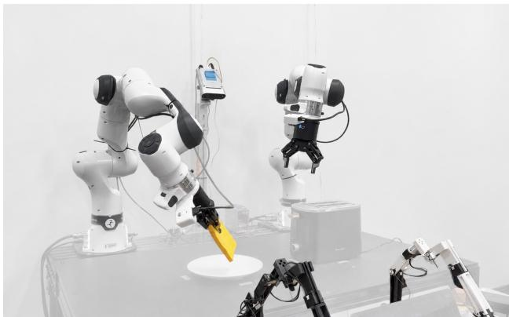

[← 返回 README](../README.md)

## A.4. Inference and Closed-Loop Evaluation

Sampling. We use 20 denoising steps for each modality, with the same modality-specific timestep schedules as in training. Video generation uses classifier-free guidance with scale 5.0, while no classifier-free guidance is applied to actions. Key–value caching is enabled during inference. The history window spans 15 generation chunks, corresponding to 60 latent video frames and the temporally aligned action history.

> 💡 **推理采样配置**: 每个模态都用 20 步去噪，并沿用训练时相同的模态专属 timestep schedule；视频生成启用 CFG scale 5.0，动作不加 CFG；推理时开启 key–value 缓存，历史窗口覆盖 15 个 generation chunk，对应 60 个 latent video 帧和与之时间对齐的动作历史。推断：动作不加 CFG 可能是因为动作低维、分布较集中，但原文并未给出理由，这一句属推测。

Action execution. After resetting to the episode’s initial state, the simulator is advanced for five zero-action steps to settle, and the policy is initialized from the final observation. The first generation chunk conditions on this single observation; the same startup convention is used during training, so no additional history frames are required before the first prediction. The policy executes each 16-step action chunk before replanning. Episodes terminate upon task success, after 800 environment steps (including the five initialization steps), or after 50 action chunks, whichever comes first.

> 💡 **执行与终止条件**: 重置到 episode 初始状态后先跑 5 步零动作让仿真器稳定，再从最终观测初始化策略；首个 chunk 只条件于这一帧观测，原文说明训练时使用同样的启动约定，因此首次预测不需要额外历史帧。之后每执行完一个 16 步 action chunk 才重规划，episode 在任务成功、跑满 800 环境步（含 5 步初始化）或 50 个 action chunk 时终止。注意终止步数 800 是含初始化 5 步在内的总步数。

Evaluation protocol. For each interaction program, we evaluate three independently trained seeds. Each checkpoint is evaluated on 10 tasks with 50 closed-loop episodes per task, for 500 episodes per seed. Within each task, all interaction programs use the same 50 environment seeds and therefore share the same set of initial conditions. An episode is counted as successful if the simulator’s task-success predicate is satisfied at any environment step, at which point the rollout terminates. We report the mean and standard deviation of the success rate across the three seeds.

> 💡 **评估协议与统计**: 每个 interaction program 用 3 个独立训练的 seed 评估，每个 checkpoint 测 10 个任务、每任务 50 个闭环 episode，共每 seed 500 次；同一任务下所有 interaction program 共用同一批 50 个环境种子，因而初始条件完全相同。成功定义为任意环境步满足 simulator 的 task-success 谓词并随即终止 rollout，最终报告 3 个 seed 上成功率的均值与标准差。推断：共用环境种子让方法间比较更公平，但代价是各条件之间不再独立；复现时需要严格对齐这 50 个固定种子。

  
Figure 5. Real-world bimanual setup with two Franka FR3 arms, Flexiv Grav grippers, bimanual GELLO teleoperation [83], two wrist-mounted RealSense D405 cameras, and a central Orbbec Femto Mega camera.

> 💡 **Figure 5 批读**: caption 描述的真实双臂平台包括两条 Franka FR3 臂、Flexiv Grav 夹爪、双臂 GELLO 遥操作、两个腕装 RealSense D405 相机和一个中央 Orbbec Femto Mega 相机（共三路视觉）。此处只提供 caption 文本、未获得图片视觉信息，因此不对画面内容作描述；caption 也未提及相机标定与时间同步方案。推断：这套硬件配置是为真实世界双臂任务提供多模态观测输入。

