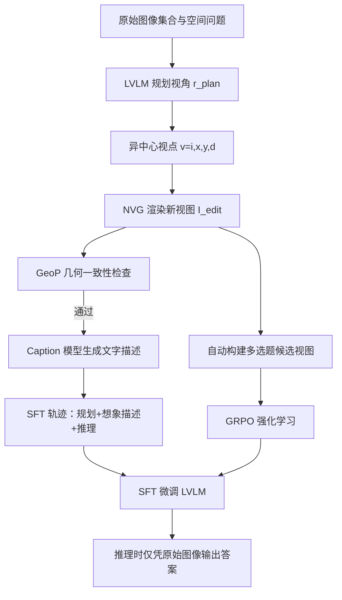

# SpatialASM: Internalizing Active Mentalization for Spatial Reasoning

**作者**: Yuhong Liu, Shenxi Wu, Junyi Chi, Beichen Zhang, Xuanlang Dai, Jiaqi Wang, Yuhang Zang, Dahua Lin | **会议 / 年份**: arXiv, 2026 | **链接**: https://arxiv.org/abs/2610.13832

## 一句话总结

用训练阶段的异中心新视角生成器合成空间推理思维链，把“依问题规划视角、并在心里想象该视角所见”的能力内化进 LVLM，使模型在推理时不再需要外部模拟器或空间工具也能答得更准。

## 核心贡献

- 提出 Active Spatial Mentalization（ASM）：把 LVLM 空间推理的瓶颈定位为 view planning（依问题选择任务相关视角）与 view imagination（想象该视角下的空间布局）两项能力的缺失。
- 设计 Allocentric Novel-View Generator（NVG），由预训练图像编辑模型 FLUX.2-klein-9B 微调得到，以单步异中心视点 $v=(i,x,y,d)$ 为条件渲染目标视图，避开了自中心接口的多步 rollout。
- 提出 Geometry Perturbation（GeoP）：先用原始图像重建点云，再把渲染视图加入后重建，以两次点云的 Chamfer distance 作为渲染视图几何一致性的代理指标，用于过滤合成数据。
- 构造两类互补监督：SFT 用的显式 ASM 轨迹（SpatialASM-66k，渲染图被替换为文字 caption）与 GRPO 用的自动可验证视角采择多选题（SpatialASM-RL-58k）。
- 在 Qwen3-VL / Qwen3.5 四个骨干上，7 个空间基准平均提升 +1.2 至 +3.5 分，通用 VQA 平均变化在 0.6 分以内。

## 📖 批读导航

| 章节 | 这一章解决什么 | 值得看的点 |
|---|---|---|
| Abstract & Sec. 1 | 定义 ASM，区分三条技术路线 | Fig. 2 的 (a) 答案级监督、(b) 推理时外部世界模型、(c) 内化 plan-imagine-reason 对比；allocentric 与 egocentric 的设计动机 |
| Sec. 2 & App. A | 相关工作定位 | 与 World2VLM（同样训练时用世界模型，但不产生推理轨迹）、工具蒸馏、GeoThinker 的差别；App. A.2 的空间数据合成综述 |
| Sec. 3.1 | NVG 与 GeoP 的定义 | Eq. 1–3；GeoP 是依赖重建模型 F 的代理指标 |
| Sec. 3.2 | ASM 轨迹合成与过滤 | Eq. 4–8；三重条件（先答错、看渲染后答对、GeoP 低于阈值）与 caption 替换 |
| Sec. 3.3 | RL 任务设计 | 两个互补多选题（观测→视角、位姿→观测）；$\theta_{RL}$ 按方向差异化 |
| Sec. 4 & App. C | 主结果与消融 | Tab. 1 四骨干七基准；Tab. 3 生成器对比；Tab. 4 SFT / RL / 过滤消融；App. C.1 训练超参 |
| App. B | 数据集细节 | SpatialASM-edit140k 的构造与统计；66k 子集不含 Mindcube-train 样本；B.2.2 三类 prompt 全文 |
| App. D | 定性案例 | NVG 渲染样例；内化后模型多数情况下不再显式输出 ASM 轨迹 |

## 关键数字

| 指标 | 数值 | 条件 |
|---|---|---|
| SR 平均提升 | +1.2 ~ +3.5% | 四个骨干：4B +3.5（43.8→47.3）、8B +2.9（46.2→49.1）、30B-A3B +2.5（44.7→47.2）、9B +1.2（51.1→52.3） |
| 单基准最高增益 | +8.7% | Spatial457-6d，Qwen3-VL-8B |
| MindCube 提升 | +5.2% | Qwen3-VL-4B |
| 通用 VQA 变化 | -0.6% | Qwen3-VL-4B；8B 为 +0.6%、30B-A3B 为 -0.5%、9B 为 +0.4%，均在 ±0.6 以内 |
| SFT 数据量 | 66k | SpatialASM-66k，仅由 Holi-Spatial 来源构建 |
| RL 数据量 | 58,346 | Holi-Spatial 28,594 + DL3DV 29,752 |
| NVG 底座 | FLUX.2-klein-9B | 仅微调 DiT，LoRA rank=512，训练 3 epochs |
| GeoP SFT 过滤阈值 | θ=2.5 | 相对宽松，因为 SFT 还会过滤推理答案的正确性 |
| GeoP RL 阈值 θ_RL | backward 1.2 / 其余 0.6 | 后向视角暴露更多未观测区域，GeoP 天然偏高 |

## 数据流：输入 → 中间表示 → 输出

## 优缺点与还能做什么

### 优点

- 推理时不需要外部世界模型或工具调用，省去额外延迟与部署复杂度。
- 异中心单步指定目标视角，比自中心多步 rollout 少一层累积误差，视角位置还能直接标在原图上。
- 渲染图只作脚手架，最终监督换成文字 caption，逼模型学内在想象而不是复述渲染像素。
- SFT 与 RL 互补：SFT 建立结构化推理模式，RL 强化视角条件下的感知与想象（Tab. 4）。

### 局限 / 风险

- GeoP 是依赖重建模型 F（论文用 MapAnything）的代理指标，不是几何一致性的真值。
- θ=2.5 与 θ_RL（backward 1.2、其余 0.6）由经验与人工检查设定，原文没有给出阈值或重建模型 F 的消融。
- 对照公平性：Holi-Spatial 与 SenseNova-SI 没有官方 system prompt，评估时改用本文自己的 prompt（App. C.3），原文未讨论这一差异的影响。
- 正文 Table 2 与 Table 7 在给定文本中列对齐错乱，复现时需回原表核对行列归属。
- 实验用的是静态多视角数据（DL3DV、Holi-Spatial、MindCube），动态场景与具身交互被作者列为未来工作。

### 还能做什么

- 推断：在 GeoP 之外加入跨视角物体一致性等过滤信号，可能进一步降低幻觉视图进入训练集的比例。
- 推断：异中心视角接口可与推理时世界模型叠加，由内化能力决定“何时需要新视角”，外部工具只负责高精度渲染。
- 推断：把 66k 的选取规则（来源、难度、视角类型）系统化，可检验不同数据配比对 RL 阶段收益的影响。

## 阅读 Q&A 记录

**Q：SpatialASM-128k 如何缩减为 SFT 用的 66k 子集？**
A：原文只说 66k 是 128k 的子集，且只由 Holi-Spatial 来源构建，不含 Mindcube-train 样本以避免与评测集重叠；具体的缩减或二次筛选规则未交代。（第 B.2.1 节）

**Q：GeoP 阈值 $\theta=2.5$ 与 $\theta_{RL}=0.6/1.2$ 是怎么定的？**
A：SFT 的 θ=2.5 被作者称为“相对宽松”，因为 SFT 还会过滤推理答案的正确性；RL 阈值在人工检查大量生成图与 GeoP 值后按方向设定（backward 1.2，其余 0.6）。原文未给出阈值消融。（第 B.2.2、B.3 节）

**Q：推理时模型是否必须显式输出 ASM 轨迹才能答对？**
A：不一定。App. D.3 的定性分析称多数情况下模型并未显式遵循 ASM 模式，整体准确率仍提升；只在更难的任务（Fig. 13/14）上生成包含规划与想象的 CoT。作者据此认为内化的是可泛化的空间能力，而非僵化的推理模板。

**Q：为什么 NVG 的 GeoP 高于 SVC，推理准确率却更高？**
A：作者归因于异中心表示：目标位置以单次查询指定并在原图上显式标出，模型更容易在最终多图推理中建立原场景与生成视图的对应；几何一致性本身不足以决定生成视图对下游推理的效用。（第 4.3 节、App. D.2）

**Q：与既有空间模型的比较是否公平？**
A：作者称 SpaceR-7B、VST-RL-7B 沿用其官方仓库的 system prompt，而 Holi-Spatial 与 SenseNova-SI-1.1-Qwen3-VL-8B 没有官方 prompt，评估时改用本文自己的 prompt。原文未讨论这一差异对结果的影响。（App. C.3）

## 📊 Citation Landscape

数据来源：应用提供的 Semantic Scholar API 结果（ARXIV:2610.13832）；references 采样最多前 100 条，不是完整引用图谱。

- 论文自身被引量：不可用（API 返回 HTTP 429）
- references 数据：约 80 条被引条目，集中在空间推理、3D 视觉与世界模型方向
- 高被引参考（Semantic Scholar 记录的 citationCount）：DeepSeekMath 9969、Mental Rotation 6181、ScanNet 6047、Grounding DINO 5249、Qwen3-VL Technical Report 2759、MMMU 2743、MMBench 2619、DUSt3R 2022、SpatialVLM 1114
- 主题聚类：空间推理基准（Spatial457、MindCube、MMSI-Bench、ESI-Bench、3DSRBench、ViewSpatial-Bench）；世界模型与新视角合成（Cosmos 3、Genie、Stable Virtual Camera、World2VLM）；LVLM 基座与训练配方（Qwen3-VL、Qwen3.5/3.6、Kimi K2.5、DeepSeekMath）
- 推荐相关论文：Unfold The World (2609.03729)、Seek-and-View Reasoning (2610.11810)、Render to Reason (2610.05417)、MV-STRIDE (2609.07258)、SpaceCast-Bench (2610.12402)
