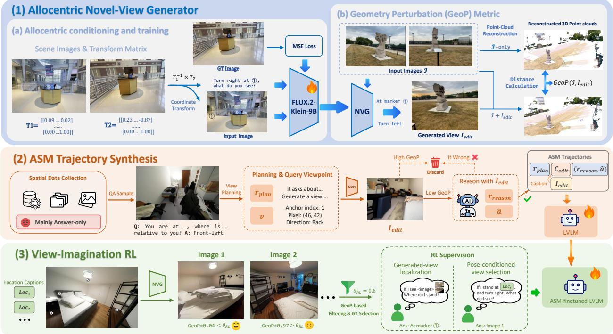
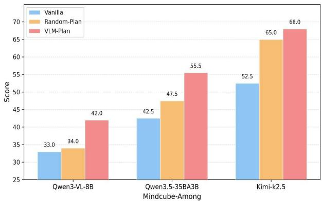
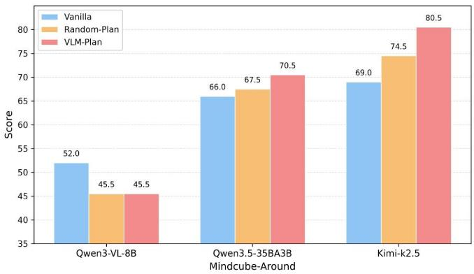

[← 返回 README](../README.md)

## 3. SpatialASM

SpatialASM (Fig. 3) uses an allocentric novel-view generator (NVG) � as a training-time spatial simulator that converts answer-only spatial QA data into two complementary forms of supervision. First, � is fine-tuned to render the observation from a queried allocentric viewpoint, and we introduce a Geometry Perturbation (GeoP) metric to assess the geometric consistency of its outputs (Sec. 3.1). We then synthesize explicit ASM trajectories for SFT, in which a pretrained LVLM plans task-relevant viewpoints, � renders the corresponding views, and the rendered views are then replaced by textual captions so that the model learns to imagine, rather than receive, the missing observations (Sec. 3.2). Finally, we construct automatically verifiable perspective-taking questions for reinforcement learning (RL), which expose the model to observations from diverse viewpoints and reinforce the association between a viewpoint description and its observation (Sec. 3.3). The trajectories supervise the full plan-imagine-reason procedure, while the RL tasks strengthen viewpoint-conditioned imagination.

> 💡 **方法总览**: SpatialASM 利用 NVG 将仅有答案的空间 QA 数据转化为两种监督：SFT 阶段通过“想象”缺失视图学习规划-推理流程，RL 阶段通过可验证的视角转换问题强化视点关联。

## 3.1. Allocentric Novel-View Generator

Allocentric conditioning. We obtain SpatialASM-NVG (denoted as �) by fine-tuning a pretrained image-editing model (FLUX.2-klein-9B [6] in our implementation) to render the observed scene from a queried viewpoint (Fig. 3(1a)). Most existing world models act as egocentric simulators: a viewpoint change is expressed as a sequence of ego-motion commands with quantified translations and rotations. In contrast, � is conditioned directly on the target viewpoint, so that a task-relevant perspective can be queried in a single step without specifying the camera motion that leads to it.

> 💡 **核心机制**: NVG 基于 FLUX.2-klein-9B 微调，区别于需逐步运动指令的自中心模拟器，它直接根据目标视点一步渲染场景，简化了空间查询过程。

Given a set of images $\mathcal { T } = \{ I _ { 1 } , \ldots , I _ { n } \}$ of the same scene, we define an allocentric viewpoint as $v =$ $( i , x , y , d )$ , where $( x , y )$ is a pixel coordinate on the anchor image $I _ { i }$ that specifies the target observation location and � is the viewing direction at that location. The anchor index � is required because a pixel coordinate is only meaningful relative to one image, and providing the full set ℐ gives � additional scene context beyond the anchor view. Given ℐ and $v , G$ renders the observation from the queried viewpoint:

> 💡 **视点定义**: 离中心视点 $v=(i,x,y,d)$ 由锚点图像索引、像素坐标及方向组成；提供全图集 $\mathcal{T}$ 而非仅锚点，以赋予模型更丰富的场景上下文。

$$
I _ { \mathrm { e d i t } } = G ( { \mathbb T } , v ) , \quad v = ( i , x , y , d ) .\tag{1}
$$

> 💡 **公式 1 批读**: 该式定义了 NVG 的映射关系：输入为场景图像集和指定视点，输出为该视点下的渲染观测值 $I_{edit}$。

Each training sample consists of the image set $\mathcal { T } ,$ an allocentric viewpoint $v = ( i , x , y , d )$ , and the groundtruth observation $I _ { \mathrm { g t } }$ from that viewpoint. In practice, $( x , y )$ is provided to � as a visual marker drawn on $I _ { i } ,$ , and $d$ as a textual prompt. We build such samples from public scene datasets that provide multiple posed observations of the same scene. For a pair of frames from one scene, we take one frame as the anchor $I _ { i }$ and the other as $I _ { \mathrm { { g t } } } ;$ the relative camera pose between them determines where the camera of $I _ { \mathrm { g t } }$ lies in $I _ { i }$ and which direction it faces, which yields $( x , y , d )$

> 💡 **数据构造**: 训练样本源自多视角公开数据集，利用帧间相对位姿确定目标视点的 $(x,y,d)$，其中位置信息以视觉标记形式注入，方向以文本提示提供。

Training. We fine-tune the image-editing model on these samples, supervising the rendered view $I _ { \mathrm { e d i t } } =$ $G ( \mathcal { T } , v )$ with the ground-truth observation $I _ { \mathrm { g t } }$ . This supervision asks � to preserve the scene content of $\mathcal { T }$ while changing the perspective as specified by �; whether the rendered views are geometrically consistent with the scene is assessed with the metric introduced next. Details of the data construction are given in the Appendix B.1.

> 💡 **训练目标**: 监督信号要求模型在保持原始场景内容不变的前提下，严格遵循视点指令改变透视，几何一致性则由后续 GeoP 指标评估。

  
Figure 3: Overview of SpatialASM. (1) An allocentric novel-view generator (NVG, �) renders the scene from a queried viewpoint, and GeoP measures how much a rendered view perturbs the 3D reconstruction of the inputs. (2) An LVLM plans viewpoints, � renders them, and filtered trajectories are converted to captions for SFT. (3) GeoP-filtered candidate views form verifiable perspective-taking questions for RL.

> 💡 **Figure 3 解读**: 图示给出三部分流程：NVG 按查询视点渲染、GeoP 度量该视图对输入 3D 重建的扰动；LVLM 规划的轨迹经筛选后转成文本描述用于 SFT，GeoP 过滤后的候选视图构成可验证的视角转换问题用于 RL。

Geometry Perturbation (GeoP) metric. Standard novel-view synthesis metrics such as PSNR, SSIM, and LPIPS measure image-level similarity to a reference view and therefore do not capture whether a rendered view is geometrically consistent with the scene under large viewpoint changes.

> 💡 **指标动机**: 传统 PSNR/SSIM 仅衡量与参考视图的图像级相似度，无法反映大视角变化下的几何合理性，故引入 GeoP 专门评估渲染视图与场景结构的一致性。

To assess the geometric plausibility of views rendered by $G ,$ we introduce GeoP, a model-based metric that measures how much a rendered view perturbs the 3D geometry inferred from the original observations (Fig. 3(1b)). Given the image set ℐ of a scene, we first reconstruct the scene with a pretrained feed-forward 3D reconstruction model $F ,$ , obtaining a point cloud $\mathcal { M } _ { \mathrm { o r i g } } = F ( \mathcal { T } )$ from the original observations alone. We then add the rendered view $I _ { \mathrm { e d i t } } = G ( \mathbb { Z } , v )$ to the observations and run the same reconstruction:

> 💡 **GeoP 原理**: 该指标通过对比“仅用原图重建”与“加入渲染图后重建”的点云差异，量化新视图对既有 3D 几何结构的扰动程度。

$$
\begin{array} { r } { T ^ { + } = \mathcal { T } \cup \{ I _ { \mathrm { e d i t } } \} , \quad \mathcal { M } _ { \mathrm { a u g } } = F ( \mathcal { T } ^ { + } ) . } \end{array}\tag{2}
$$

> 💡 **公式 2 批读**: 定义增强后的图像集 $\mathcal{T}^+$ 及其对应的重建点云 $\mathcal{M}_{aug}$，这是计算几何扰动前的必要中间步骤。

Both point clouds are produced by � in the same world coordinate system from its predicted depth maps, camera intrinsics, and camera poses, so they can be compared directly. We define $\mathrm { G e o P } ( \mathcal { T } , I _ { \mathrm { e d i t } } )$ as the Chamfer distance between $\mathcal { M } _ { \mathrm { o r i g } }$ and $\mathcal { M } _ { \mathrm { a u g } } , i . e .$ , the average squared nearest-neighbor distance between the two point sets in both directions:

> 💡 **比较基础**: 两个点云都由同一重建模型 $F$ 依据其预测的深度图、相机内参和相机位姿生成，处于同一世界坐标系，因此可直接比较，无需额外对齐。

$$
\begin{array} { r } { \mathrm { G e o P } ( \mathcal { T } , I _ { \mathrm { e d i t } } ) = \displaystyle \frac { 1 } { | \mathcal { M } _ { \mathrm { o r i g } } | } \sum _ { \mathbf { p } \in \mathcal { M } _ { \mathrm { o r i g } } } \operatorname* { m i n } _ { \mathbf { q } \in \mathcal { M } _ { \mathrm { a u g } } } \| \mathbf { p } - \mathbf { q } \| _ { 2 } ^ { 2 } } \\ { + \displaystyle \frac { 1 } { | \mathcal { M } _ { \mathrm { a u g } } | } \sum _ { \mathbf { q } \in \mathcal { M } _ { \mathrm { a u g } } } \operatorname* { m i n } _ { \mathbf { p } \in \mathcal { M } _ { \mathrm { o r i g } } } \| \mathbf { q } - \mathbf { p } \| _ { 2 } ^ { 2 } . } \end{array}\tag{3}
$$

> 💡 **公式 3 批读**: GeoP 定义为双向最近邻平均平方距离（Chamfer Distance），数值越大表示渲染视图导致重建几何发生越大的偏移。

A low GeoP means that adding $I _ { \mathrm { e d i t } }$ changes the reconstructed geometry little, i.e., � can explain the rendered view as another observation of the same scene. A high GeoP means that the rendered view forces � to alter its scene-level geometry, which we take as a sign of geometric inconsistency. GeoP is therefore a proxy that depends on $F$ rather than a ground-truth measure; we use it to filter rendered views with thresholds (Sec. 3.2 and Sec. 3.3) and to compare generators in our experiments.

> 💡 **局限说明**: GeoP 依赖重建模型 $F$ 的能力，是代理指标而非真值测量；作者用它按阈值筛除几何不一致的渲染视图（Sec. 3.2、3.3），也用于实验中的生成器比较。

## 3.2. ASM Trajectory Synthesis

Motivation. Existing spatial datasets ofer large-scale supervision, but most contain only question-answer (QA) pairs without intermediate reasoning. Such answer-only supervision does not teach a model how to perform ASM on spatial tasks that require reasoning beyond the given observations. Meanwhile, current LVLMs often select uninformative viewpoints and imagine novel views unreliably (Sec. 4.1). Directly prompting an LVLM to write ASM trajectories therefore risks inaccurate or hallucinated intermediate steps, which would yield misleading supervision.

> 💡 **问题动机**: 现有空间数据集提供大规模监督，但多数只有问答对、没有中间推理，这种答案级监督教不会模型做需要推理的 ASM。而当前 LVLM 常选无信息量的视角、想象新视图也不可靠（Sec. 4.1），直接让它写 ASM 轨迹会产生不准或幻觉的中间步骤。

Trajectory synthesis. We therefore synthesize ASM trajectories automatically, using � as an external spatial simulator during data construction only (Fig. 3(2)). From large-scale open-source spatial datasets, we select subtasks that require active perspective exploration beyond direct recognition, $e . g .$ , reasoning about camera-object relationships and spatial configurations, associating multiple input views, and inferring what is seen from a viewpoint other than the original ones.

> 💡 **合成策略**: 因此自动合成 ASM 轨迹，用外部空间模拟器（即式 5、式 9 中的 $G$）在数据构造阶段生成，推理时不用。子任务从大规模开源空间数据集中挑选，标准是必须主动探索视角：推理相机与物体的关系、关联多张输入视图、推断原始视角之外能看到什么。

Each QA sample from the selected subtasks is a triplet $( q , T , a )$ , where � is the question, ℐ is the set of input images, and � is the ground-truth answer from the source dataset. For each sample that � fails to answer from ℐ alone (see Filtering below), we prompt � to produce a view plan with two parts: a reasoning trace $r _ { \mathrm { p l a n } }$ that infers which viewpoints would help answer $q ,$ and � allocentric viewpoints $\{ v _ { k } \} _ { k = 1 } ^ { K }$ , each of which can be used directly as the condition of �:

> 💡 **规划机制**: 每条样本是 $(q, \mathcal{I}, a)$ 三元组。对主模型 $M$ 仅凭输入图像 ℐ 答不对的样本，提示 $M$ 产出两部分计划：推断哪些视角有用的推理链 $r_{plan}$，以及 K 个 allocentric（环境中心，不是自我中心）视角 $\{v_k\}$，每个视角可直接作为模拟器的渲染条件。

$$
( r _ { \mathrm { p l a n } } , \{ v _ { k } \} _ { k = 1 } ^ { K } ) = M ( q , \mathbb { Z } ) , \quad v _ { k } = ( i _ { k } , x _ { k } , y _ { k } , d _ { k } ) .\tag{4}
$$

> 💡 **公式 4 批读**: 视角计划由 $M(q, \mathcal{I})$ 生成，输出推理文本 $r_{plan}$ 和视角集合 $\{v_k\}_{k=1}^{K}$；每个视角 $v_k=(i_k, x_k, y_k, d_k)$ 含所锚定的输入图像索引、位置 $(x_k,y_k)$ 与方向 $d_k$，供后续渲染。

The planned viewpoints $\{ v _ { k } \}$ specify where and in which direction the model should observe the scene to answer �. � then renders a view for each of them:

> 💡 **渲染执行**: 规划出的视角指定模型应从哪个位置、朝哪个方向观察场景。模拟器 $G$ 为每个视角渲染一张视图 $I_{edit,k}$。

$$
I _ { \mathrm { e d i t } , k } = G ( { \mathbb T } , v _ { k } ) , \quad k = 1 , \ldots , K .\tag{5}
$$

> 💡 **公式 5 批读**: 渲染式 $I_{edit,k}=G(\mathbb{T}, v_k)$，$k=1,\dots,K$：输入是场景表示 $\mathbb{T}$ 和第 k 个规划视角，输出是该视角下的渲染视图。

The rendered views are then returned to � together with a textual description $t _ { \mathrm { d e s } }$ of the planned viewpoints, and � answers the question again, producing a reasoning trace $r _ { \mathrm { r e a s o n } }$ and an answer �ˆ:

> 💡 **二次推理**: 渲染视图连同视角的文字描述 $t_{des}$ 一起返回给主模型 $M$，$M$ 结合原图重新作答，产出推理链 $r_{reason}$ 和答案 $\hat{a}$。

$$
\begin{array} { r } { \left( r _ { \mathrm { r e a s o n } } , \hat { a } \right) = M \left( q , t _ { \mathrm { d e s } } , \mathcal { T } , \{ I _ { \mathrm { e d i t } , k } \} _ { k = 1 } ^ { K } \right) . } \end{array}\tag{6}
$$

> 💡 **公式 6 批读**: $(r_{reason}, \hat{a})=M(q, t_{des}, \mathcal{T}, \{I_{edit,k}\}_{k=1}^{K})$：模型在问题、视角描述、原始图像与渲染视图共同条件下输出推理与答案，这一步的结果成为监督数据的来源。

Filtering. We retain a trajectory only if the rendered views are both useful and geometrically consistent: � must answer incorrectly from ℐ alone but correctly after seeing the rendered views, and every rendered view must have a GeoP below a threshold �. Let $\hat { a } _ { 0 }$ denote the answer of � from ℐ alone. It is checked first, so that questions � already answers correctly are discarded before any viewpoint is planned or rendered (Fig. 3(2)). The set of retained image-form trajectories for a question $( q , { \mathcal { T } } )$ is

> 💡 **过滤标准**: 轨迹保留需同时满足：$M$ 仅凭 ℐ 答错、看到渲染视图后答对，且每个渲染视图的 GeoP 都低于阈值 $\theta$。检查顺序是先看 $\hat{a}_0$，答对的样本在规划、渲染之前就被丢弃，避免白做。

$$
\begin{array} { r } { \mathcal { T } _ { \mathrm { i m g } } = \big \{ \big ( r _ { \mathrm { p l a n } } , \{ I _ { \mathrm { e d i t } , k } \} _ { k = 1 } ^ { K } , r _ { \mathrm { r e a s o n } } , \hat { a } \big ) \big | \hat { a } _ { 0 } \ne a , \hat { a } = a , \operatorname* { m a x } _ { k } \mathrm { G e o P } ( \mathcal { L } , I _ { \mathrm { e d i t } , k } ) < \theta \big \} , } \end{array}\tag{7}
$$

> 💡 **公式 7 批读**: 保留的图像形式轨迹集合 $\mathcal{T}_{img}$ 由三个条件定义：$\hat{a}_0 \ne a$（原图答错）、$\hat{a}=a$（看渲染视图后答对）、$\max_k \mathrm{GeoP}(\mathcal{L}, I_{edit,k}) \lt \theta$（最大几何误差低于阈值）。

where � is a pre-defined threshold. The first two conditions select cases in which the rendered views change the outcome, so that the supervision reflects useful perspective exploration rather than redundant visual input; the third removes geometrically inconsistent views.

> 💡 **过滤逻辑**: 前两个条件确保渲染视图确实改变了结果，使监督反映有用的视角探索而不是冗余的视觉输入；第三个条件剔除几何不一致的视图。

Caption substitution. To internalize view imagination rather than view consumption, we replace each rendered view in a retained trajectory with a textual caption. A captioning model $M _ { \mathrm { c a p } }$ describes $I _ { \mathrm { e d i t } , k }$ as $C _ { \mathrm { e d i t } , k } = M _ { \mathrm { c a p } } ( I _ { \mathrm { e d i t } , k } )$ and is prompted to focus on the 2D layout and relative positions of objects in the view. The final ASM trajectories for a question $( q , { \mathcal { T } } )$ are

> 💡 **文本替换**: 关键设计：把保留轨迹中的每张渲染视图换成文字 caption，$C_{edit,k}=M_{cap}(I_{edit,k})$，并提示 captioning 模型关注视图内物体的 2D 布局与相对位置。目的是让模型内化“想象视角”，而不是消费现成的视图。

$$
\mathcal { T } _ { \mathrm { A S M } } = \left\{ \left( r _ { \mathrm { p l a n } } , \left\{ C _ { \mathrm { e d i t } , k } \right\} _ { k = 1 } ^ { K } , r _ { \mathrm { r e a s o n } } , \hat { a } \right) \Big | \left( r _ { \mathrm { p l a n } } , \left\{ I _ { \mathrm { e d i t } , k } \right\} _ { k = 1 } ^ { K } , r _ { \mathrm { r e a s o n } } , \hat { a } \right) \in \mathcal { T } _ { \mathrm { i m g } } \right\} .\tag{8}
$$

> 💡 **公式 8 批读**: 最终轨迹 $\mathcal{T}_{ASM}$ 由 $\mathcal{T}_{img}$ 中每条轨迹的 $\{I_{edit,k}\}$ 换成对应 caption $\{C_{edit,k}\}$ 得到，结构为 $(r_{plan}, \{C_{edit,k}\}, r_{reason}, \hat{a})$；监督文本中不再出现渲染图像。

Each trajectory thus supervises the model to plan informative viewpoints for the task, to imagine the observation and spatial layout from each planned viewpoint in text, and to reason with the imagined views. Because the rendered images never appear in the supervision, the model learns to carry out this procedure from the original observations alone and does not call � at inference time. This supervision targets multi-step spatial tasks that require information beyond the original observations; its efect is examined in our experiments.

> 💡 **监督内容**: 每条轨迹监督模型做三件事：为任务规划有信息量的视角、用文本想象每个视角的观测与空间布局、用想象出的视图推理。因为渲染图从不出现在监督里，模型只靠原始观测学会这套流程，推理时不调用模拟器；作者称其效果在实验中检验。

> 💡 **图表位置**: 此处是一张流程插图，正文以 Fig. 3(2) 指代轨迹合成与过滤阶段；给定文本没有该图的 caption 和图像内容，无法描述图中画了什么。

  
Figure 4: Evaluation of external ASM. We evaluate vanilla VLM reasoning, and two external ASM strategies with diferent viewpoint-planning methods. Both planning-based settings invoke SpatialASM-NVG and condition the final reasoning on the original and generated observations.

> 💡 **Figure 4 解读**: 图注说明它评估外部 ASM：对比 vanilla VLM 推理与两种不同视角规划方法的外部 ASM 策略，两种规划设置都调用 SpatialASM-NVG，并把原始观测与生成观测一起作为最终推理条件。推断：这张图给的是外部工具辅助推理的效果参照。

## 3.3. View-Imagination Reinforcement Learning

Motivation. To further strengthen the ability of LVLMs to imagine a scene from a designated allocentric viewpoint, we construct automatically verifiable multiple-choice questions and train the SFT model from Sec. 3.2 on them with GRPO [53] (Fig. 3(3)). These questions train the model to associate an allocentric viewpoint query with its observation, without manually annotated reasoning traces.

> 💡 **RL 动机**: 为进一步强化模型从指定 allocentric 视角想象场景的能力，构建可自动验证的多选题，用 GRPO 训练 Sec. 3.2 得到的 SFT 模型；这条路径不需要人工标注推理链，要训练的是把视角查询与其观测对应起来。

Candidate views. For an image set ℐ of a scene, we randomly sample four allocentric viewpoints $\{ v _ { k } =$ $( 1 , x _ { k } , y _ { k } , d _ { k } ) \} _ { k = 1 } ^ { 4 }$ anchored on $I _ { 1 }$ and render one candidate view for each with �:

> 💡 **候选视角采样**: 对场景的图像集 ℐ，随机采样 4 个锚定在 $I_1$ 上的 allocentric 视角 $v_k=(1,x_k,y_k,d_k)$，各渲染一张候选视图；首分量固定为 1 表示锚定图就是 $I_1$。

$$
\mathcal { V } = \{ I _ { \mathrm { e d i t } , 1 } , \dots , I _ { \mathrm { e d i t } , 4 } \} , \quad I _ { \mathrm { e d i t } , k } = G ( \mathcal { T } , v _ { k } ) .\tag{9}
$$

> 💡 **公式 9 批读**: 候选视图集合 $\mathcal{V}=\{I_{edit,1},\dots,I_{edit,4}\}$，$I_{edit,k}=G(\mathcal{T},v_k)$，即 4 张由模拟器按采样视角渲染出的图，供后续构造可自动验证的选择题。

From each candidate set � we build two complementary multiple-choice tasks. 1) Generated-view localization. We overlay four numbered markers on the anchor image $I _ { 1 }$ at the sampled locations $\{ ( x _ { k } , y _ { k } ) \}$ to obtain $I _ { \mathrm { m a r k } }$ and pick one candidate $I _ { \mathrm { e d i t } , j }$ . Given $( I _ { \mathrm { m a r k } } , \mathcal { T } , I _ { \mathrm { e d i t } , j } )$ , the model must determine at which numbered marker the candidate view was captured and the answer is $j .$ . 2) Pose-conditioned view selection. This task is the inverse: given a textual target pose, the model must pick the matching candidate. For a chosen index $j$ (selected as described below), we use $M _ { \mathrm { c a p } }$ to describe the location $( x _ { j } , y _ { j } )$ ) on $I _ { 1 }$ and combine this description with the viewing direction $d _ { j }$ into a target-pose specification $t _ { j }$ . Given $t _ { j } , \mathcal { I }$ , and the four candidates �, the model must select the candidate that depicts the scene from the described location and direction and the answer is �.

> 💡 **任务定义**: 构建两个互补的多选任务：1) 视角定位，在锚点图标记位置，让模型判断候选编辑图对应哪个标记；2) 姿态选择，给定文本描述的目标位姿，让模型从候选图中选出匹配视图。

Answer selection. The ground-truth candidate $I _ { \mathrm { e d i t } , j }$ must be geometrically consistent with ℐ for the reward to be meaningful, so we select � for each candidate set � with GeoP:

> 💡 **答案筛选**: 为保证奖励有效性，利用 GeoP 指标筛选几何一致的候选图作为真值标签 $j$，剔除不一致样本。

$$
\begin{array} { r } { K = \{ k \mid \mathrm { G e o P } ( \overline { { L } } , I _ { \mathrm { e d i t } , k } ) < \theta _ { \mathrm { R L } } \} , \quad j = \left\{ \begin{array} { l l } { \mathrm { a n y } k \in \mathcal { K } , } & { K \neq \emptyset , } \\ { \mathrm { d i s c a r d } \mathrm { t h e } s \mathrm { a m p l e } , } & { K = \emptyset , } \end{array} \right. } \end{array}\tag{10}
$$

> 💡 **公式解读**: 式 (10) 先取所有 GeoP 误差小于阈值 $\theta_{RL}$ 的候选构成集合 $K$；$K$ 非空时任取其中一个 $k$ 作为真值 $j$，为空则丢弃该样本。GeoP 衡量候选图与参考几何的一致性，阈值越小筛选越严。

where $\theta _ { \mathrm { R L } }$ is a pre-defined threshold. The two tasks provide complementary supervision: generated-view localization learns the inverse mapping from an observation to its allocentric viewpoint, whereas pose-conditioned view selection learns the forward mapping from a textual target pose to its expected observation. Both answers are derived automatically without human annotation, and the two tasks are intended to improve the ability of LVLMs to imagine and reason about scene layout and object configuration from viewpoints other than the observed ones.

> 💡 **机制意义**: 两任务分别学习“观测到视角”的逆映射和“文本位姿到观测”的正映射，无需人工标注即可增强 LVLM 对非当前视角场景布局的推理能力。

