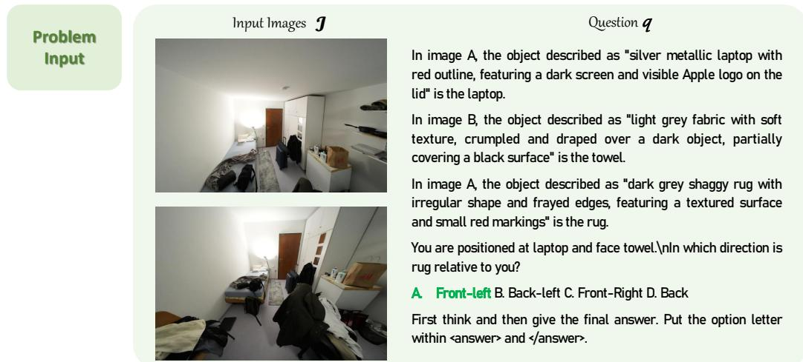
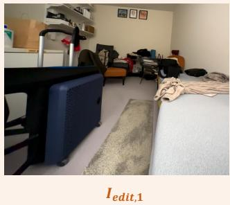

[← 返回 README](../README.md)

## B.2.2. Synthesis Protocols

Some detailed implementations for ASM trajectory synthesis are given in this section. In Sec. 3.2, we have mentioned that we use two pretrained LVLMs, � and $M _ { c a p ; }$ , to generate certain parts in our CoT trajectories. � is prompted to produce planning trace $r _ { p l a n }$ and the final reasoning trace $r _ { r e a s o n . }$ , and $M _ { c a p }$ is used to transform $\{ \bar { I _ { \mathrm { e d i t } , k } } \bar  \} _ { k = 1 } ^ { K }$ into $\{ C _ { \mathrm { e d i t } , k } \} _ { k = 1 } ^ { K }$ . In practice, we employ Qwen3.6-35BA3B [50] as � and Qwen3.6-27B [49] as $M _ { c a p } .$ For filtering, � is used to discard samples whose $\{ I _ { \mathrm { e d i t } , k } \} _ { k = 1 } ^ { K }$ have high GeoP values. Since we also filter for reasoning correctness in SFT (Equation 7), we adopt a relatively lenient quality threshold for $\{ I _ { \mathrm { e d i t } , k } \} _ { k = 1 } ^ { K }$ . We set $\theta = 2 . 5$ during our filtering process.

> 💡 **模型与过滤**: 规划与推理由 Qwen3.6-35BA3B 生成，图像转描述由 Qwen3.6-27B（$M_{cap}$）完成。过滤阶段同一个 LVLM 丢弃 GeoP 值偏高的编辑图样本，质量阈值 $\theta=2.5$；作者解释该阈值取得宽松，因为 SFT 阶段（式 7）还会过滤推理正确性。

Here we provide the system prompts of planning, reasoning, and captioning. The planning prompt is for producing $( r _ { \mathrm { p l a n } } \{ v _ { k } \} _ { k = 1 } ^ { K } )$ in Equation $4 ;$ the reasoning prompt is for producing $\left( r _ { r e a s o n } , \hat { a } \right)$ in Equation $6 ;$ the captioning prompt is for producing $\{ C _ { \mathrm { e d i t } , k } \} _ { k = 1 } ^ { K }$ in Equation 8.

> 💡 **Prompt 功能**: 介绍三类系统提示词（Planning, Reasoning, Captioning）分别对应公式 4、6、8 中的特定输出部分，为下文展示具体 Prompt 做铺垫。

  
The problem requires determining the direction of the rug relative to a person standing at the laptop and facing the towel. Based on the images, the laptop is on the bed (visible in Image $\mathsf { A l } ,$ and the towel (likely the white cloth on the table or pile of clothes) is in the foreground (visible in Image B). Image A shows the room looking towards the door, meaning the foreground (where the towel is) is behind the camera. Therefore, to face the towel from the laptop, the person would need to turn around to face the direction opposite to the door. This corresponds to a “Backwards” rotation relative to the viewpoint of Image A. I will generate a view from the laptop‘s position facing backwards to clarify the spatial layout of the rug, bed, and towel. Therefore, I need to imagine the views I will see in novel perspectives. Assume that all input images have the size (100, 100). Assume I add a marker ’1‘ at the position (38, 65) in Image A, I will get <image3>. At the marker '1' in <image3>, if I turn backwards. I will see <image4>:

> 💡 **规划实例**: 展示 Planning 阶段思维链：分析原图空间关系，确定需从笔记本电脑位置向后看以澄清地毯布局，并定义坐标假设以生成新视角指令。

In the immediate foreground on the left, a large blue unit sits next to a black frame. To its right, occupying the right foreground and extending into the mid-ground, is a bed covered with a light blue sheet and a crumpled beige blanket. To its left, a grey shag rug runs down the center of the floor, separating the blue unit on the left from the bed on the right. In the background on the left wall, white shelves are mounted high up, holding various small items. Below the shelves, further back in the room, is an orange armchair with a dark jacket draped over it. In the far background center, a desk area is cluttered with papers and objects, situated beneath three framed pictures hanging on the wall. A laptop is partially visible in the extreme bottom right corner.

> 💡 **描述生成**: 推断：这段最可能是 Captioning 阶段 $M_{cap}$ 的输出，紧接上文“I will see <image4>”，用 foreground/left/right 等词描述新视角下的物体布局，与 captioning prompt 的格式要求一致。

> 💡 **图片占位**: 该块只有一张图片链接，没有可读文字，也未获得图像的视觉内容，无法判断其具体画面。推断：它属于 Figure 6 示例轨迹中间的一帧。

Now I will rethink the problems based on input images and the imagined images. Based on the provided images and the spatial reasoning task:\n1. The problem states: “You are positioned at laptop and face towel.” This means we are to imagine ourselves standing at the location of the laptop (on the bed, as seen in image A) and facing the towel (which is draped over a dark object, likely a chair or bag, near the foot of the bed in image B).\n2. From this vantage point (laptop position, facing towel), we need to determine the direction of the rug.\n3. Looking at image A, the rug is located on the floor, running from the foot of the bed towards the door. Since we are standing at the head of the bed (laptop position) and facing towards the foot of the bed (towel position), the rug is directly in front of us.\n4. Image 4 provides an alternative perspective. It shows the bed (with the laptop visible on the right side of the frame) and the rug to its left, running along the floor towards the back of the room. This confirms that from the perspective of the bed's head, the rug is in front-left.

> 💡 **推理实例**: 展示 Reasoning 阶段如何利用生成的“想象图像”重新审视问题，结合原始图像和新视角描述，得出地毯位于左前方的最终结论。

Figure 6: Example in SpatialASM-128k. Note that $I _ { \mathrm { e d i t } , }$ 1 does not exist in the ASM trajectory.

> 💡 **图注说明**: 该图是 SpatialASM-128k 中的示例，图注特别指出 $I_{edit,1}$ 不存在于这条 ASM 轨迹里。推断：首个编辑图缺失意味着轨迹中 $I_{edit,k}$ 的编号起点或数量并不固定，看 Figure 6 时不宜假定图像序列从 1 开始。

• Planning prompt: I gave you several images and a spatial reasoning question. You can now use an image-editing model to generate images of the scene from new perspectives based on the input images. You do not need to answer the spatial reasoning question I gave you, but you need to reason based on the question and give commands to the image-editing model to provide more useful information for answering this question.

> 💡 **Planning Prompt**: 规定模型角色：不直接回答空间问题，而是通过推理决定需要哪些新视角，并向图像编辑模型发出指令以获取辅助信息。

For each command, you need to first select a source image from the input images. Then you need to select an area on the image and assign a facing direction, so that the image-editing model will generate the scene viewed from this area and specific facing direction.

> 💡 **指令格式**: 要求每条指令必须包含三个要素：源图像选择、目标区域定位（像素坐标）、以及指定的朝向方向。

Provide your answer in the following format: a list containing Dict(s):

> 💡 **输出结构**: 强制要求以字典列表形式返回答案，确保解析的规范性，便于后续程序化调用图像编辑 API。

[{‘source\_img’: ‘<e.g. 1>’, ‘pixel\_x’: ’<e.g. 22>’, ‘pixel $\underline { { \boldsymbol { y } } } ^ { \prime } \colon ^ { \cdot } < \mathbf { e } . \mathbf { g } . \ 6 3 > ^ { \prime }$ , ’Direction’: $\mathrm { ^ { \circ } e . g . < R i g h t > ^ { \prime } } \} , \ldots ]$ ‘source\_img’ is the anchor image number (the first image is numbered 1, and so on). ‘pixel\_x’ and ’pixel\_y’ represent the assigned area, and we assume the width and height of the images are both 100 for simplicity. Direction is chosen from $\mathrm { \bar { L } e f t { \ell } }$ , ‘Backwards’, ‘Forward’ and ‘Right’.

> 💡 **参数定义**: `source_img` 是锚图编号（第一张为 1），`pixel_x`/`pixel_y` 给出所选区域，作者假设图像宽高均为 100 以简化坐标，`Direction` 只取 'Left'、'Backwards'、'Forward'、'Right' 之一。

You can output an empty list if you believe there is no need for providing a new perspective.

> 💡 **空值处理**: 允许模型判断无需新视角时输出空列表，避免强行生成无效或干扰性的编辑指令，增加系统的鲁棒性。

First think and then give the final answer. The final answer should contain a short summary of your reasoning process (no more than 200 words), which only focus on how to derive the command without giving the answer of the original question, and the final list.

> 💡 **思维链约束**: 要求先思考再给答案，最终答案含不超过 200 words 的推理总结，且总结只讲如何推导出编辑指令，不给出原空间问题的答案，最后接指令列表。

The summary should be put within 
 and 
, and then output the list within <answer> and </answer>.

> 💡 **输出格式规范**: 规定模型需将总结包裹在 `
` 标签中，答案列表包裹在 `<answer>` 标签中。这种结构化输出便于后续程序自动解析提取关键信息。

• Reasoning prompt: First think and then give the final answer. Put the option letter within <answer> and </answer>.

> 💡 **推理任务指令**: 针对选择题类任务，要求模型先进行显式思考再给出最终答案，并将选项字母严格置于 `<answer>` 标签内。旨在利用思维链提升复杂逻辑题的准确率并规范评分接口。

• Captioning prompt: Describe the 3D location of the objects in the image. The location include left, right, top, bottom, background, foreground, and so on. You can describe the location of each object separately and the relative location between objects as well (e.g. Object A is to the right of Object B). The answer should be no more than 200 words.

> 💡 **空间描述协议**: 描述图像中物体的 3D 位置，使用 left、right、top、bottom、background、foreground 等词，可逐物体写也可写相对关系（如 A 在 B 右边），长度不超过 200 words。

