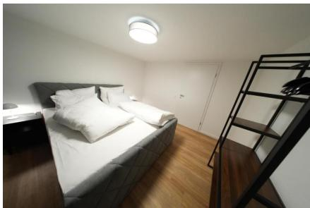
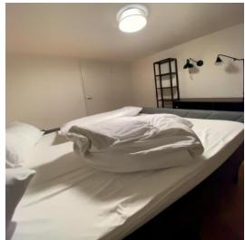
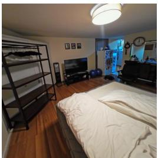
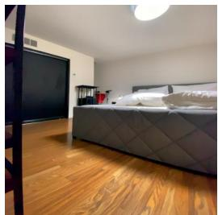
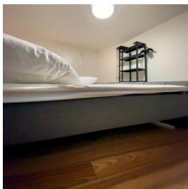

[← 返回 README](../README.md)

## Pose-conditioned view selection

  
<image1>

> 💡 **输入视角**: <image1> 是题目给出的唯一参考图，描绘一个真实 3D 场景，后续问题以它的视角为起点，要求推算在床头、床垫上方、最左侧枕头附近向右转身后看到什么。

  
<image2>: GeoP=0.04

> 💡 **正确选项置信度低**: <image2> 对应选项 A，是 GT 正确答案，但 GeoP 只有 0.04。GeoP 的含义原文未定义，从数值分布推断它是某种几何/视角预测置信度，且并不指示答案对错。

  
<image3>: GeoP=0.97

> 💡 **高置信度却是错项**: <image3> 对应选项 B，GeoP=0.97，是候选中最高的一个；而 GT 为 A，所以它是错误视角。这个反差说明该任务考察的是几何一致性，而非候选图的置信度高低。

Q: 1 image is provided <image1>, depicting a real-world 3D scene. From the viewpoint of <image1>, if I am positioned at the head of the bed, above the mattress, near the leftmost pillow. And I turn right. Which of the following images is the most similar as what I see?   
A. <image2> B. <image3> C. <image4> D. <image5>   
GT: A

> 💡 **任务定义**: 给定一张真实场景图和一段第一人称位姿描述（位于床头、床垫上方、靠近最左侧枕头，向右转身），要求在四张候选图中选出与转身后所见最接近的一张；GT 为 A，即 <image2>。

  
<image3>: GeoP=0.63

> 💡 **标注存疑**: 该图在原文中同样标为 <image3>，但 GeoP=0.63，与 block 3 的 <image3>（GeoP=0.97）冲突。按选项序列 A=<image2>、B=<image3>、C=<image4>、D=<image5> 推断此处应为 <image4>（选项 C），但原文未澄清，读者需留意。

  
<image5>: GeoP=0.05

> 💡 **低置信度错项**: <image5> 对应选项 D，GeoP=0.05，与正确答案 A 的 0.04 几乎相同，说明仅凭 GeoP 数值无法区分正确与错误视角。

Figure 7: Examples of view-imagination RL tasks.

> 💡 **图注**: Figure 7 汇总的是若干 view-imagination RL 任务示例，本节这几张图是其中一例；图注本身未给出任务设置步骤或 GeoP 的定义。

