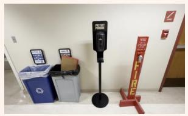
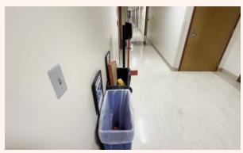
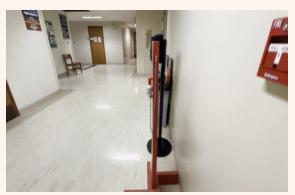

[← 返回 README](../README.md)

## D.3. Examples of LVLM Internalization

We have trained several LVLMs to internalize ASM capabilities and improved their overall spatial reasoning performance (Tab. 1). Here, we provide four qualitative comparisons between SpatialASM-8B and its baseline, Qwen3-VL-8B. These examples show that SpatialASM-8B can adaptively decide whether to employ the ASM reasoning pattern in its output according to the task type and dificulty, rather than simply overfitting to the ASM reasoning trajectories. In fact, we find that the model does not explicitly follow the ASM pattern in most cases, yet its overall spatial reasoning accuracy still improves substantially (Tab 1). This suggests that our training internalizes generalizable spatial reasoning capabilities instead of imposing a rigid reasoning template.

> 💡 **核心论点**: 本段通过定性对比论证 SpatialASM-8B 并非机械套用 ASM 模板，而是内化了通用空间推理能力。尽管多数情况下模型未显式遵循 ASM 模式，但 Tab. 1 显示其准确率仍显著提升，说明训练实现了能力的泛化而非过拟合。

Fig. 11 and Fig. 12 show two problems targeting the viewpoint of person and camera respectively. Though

> 💡 **案例背景**: Fig. 11 与 Fig. 12 分别针对“人”视角和“相机”视角的问题，用来检验模型在不同目标视点下的表现；本节开头称提供四组定性对比，而此处只出现这两个图号。

Target Viewpoint Anchor Image: Image 3

> 💡 **任务定义**: 明确该示例的目标视角锚点为 Image 3，即模型需基于此图像所代表的视点进行空间推理。

Input Images

> 💡 **输入说明**: 该标签标明其后紧接的是本示例所用的输入图像序列（共三张），是这组定性对比的视觉输入。

> 💡 **图像占位**: 本组第一张图。原文没有给这张图 caption，也未获得图像的视觉内容，因此不描述画面；它与 Fig. 11 / Fig. 12 的对应关系在所给文本中无法确定。

> 💡 **图像占位**: 本组第二张图，与前后两图同属 “Input Images” 序列；推断：这三张图即为正文所述示例的输入。

> 💡 **图像占位**: 本组第三张图，是 “Input Images” 序列的最后一张，其画面内容需查看原文图片。

