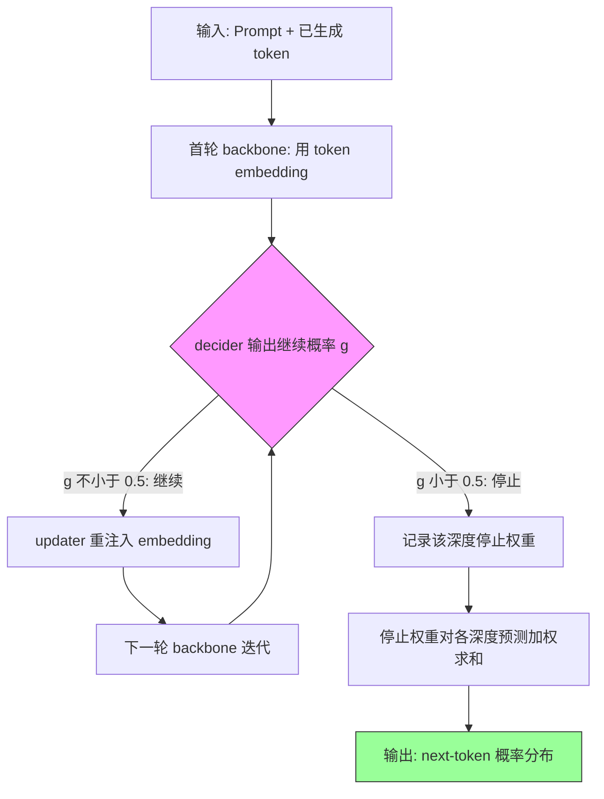

# IMPROVING TEST-TIME SCALING WITH ADAPTIVE LOOPED TRANSFORMERS

**作者**: Yichen You、Tianyu Fu、Aosong Feng、Xingtai Lv、Xuefei Ning、Ning Ding、Yu Wang（原文以 ∗ / † 标注部分作者，符号含义未定义）  
**机构**: 清华大学 (1)、耶鲁大学 (2)  
**会议 / 年份**: 原文未标注会议与年份（arXiv 编号 2609.35748；元数据 year 字段为空，故不臆断年份）  
**链接**: [arXiv:2609.35748](https://arxiv.org/abs/2609.35748)

## 一句话总结
在 post-training 设定下研究循环 Transformer 的测试时扩展：现有循环模型斜率更陡但在匹配算力下精度更低；作者提出 TaH2，用 lookahead depth supervision 联合后训练骨干与 token 级 iteration decider，把额外迭代分配给真正受益的 token。

## 核心贡献
1. **揭示缩放现象**：在相同预训练 checkpoint 与后训练数据下，固定深度 Ouro、自适应 Ouro、Huginn 的斜率（2.12 / 2.27 / 2.26）高于非循环基线 Standard（1.79），但在重叠算力区间内精度更低。
2. **TaH2 方法**：把 lookahead depth supervision 用于骨干与 iteration decider 的联合后训练，深度标签在线由当前骨干的预测损失变化导出；训练时的深度选择规则与推理一致（on-policy），而不是全深度训练后再推理早退。
3. **量化收益**：在 AIME 基准上准确率–计算斜率提升 53%（2.74 vs 1.79），匹配算力下超基线峰值约 3.4 分；增益随最大迭代深度 $M$ 从 2 增至 8 而持续扩大（+2.8 → +3.9）。
4. **跨规模与跨领域**：4B / 8B 上平均 +3.2 / +2.4 分，AIME 单点最高 +6.9 / +4.4 分；代码、QA、工具使用基准亦有正增益（Table 3）。
5. **token 级证据**：额外迭代对多数 token 无益——Ouro 52.3%、Huginn 33.5% 的 token 损失变化不超过 $10^{-3}$，21.7% / 15.9% 反而变差（Section 3.2, Figure 3）。

## 📖 批读导航

| Section | 内容 |
|---------|------|
| [00 - 标题与作者](sections/00-section.md) | 论文标题、作者与机构 |
| [01 - Abstract](sections/01-section.md) | 摘要 + Figure 1/2 |
| [02 - 1 Introduction](sections/02-section.md) | 动机、基线对比协议与缩放现象 |
| [03 - 中心问题](sections/03-section.md) | 如何在同算力下超越非循环 LLM + 贡献 |
| [04 - 2 Related Work](sections/04-section.md) | 测试时扩展、循环 Transformer、自适应计算 |
| [05 - 3 现有循环模型缩放分析](sections/05-section.md) | Eq. 1 形式化、斜率与 token 级损失分析 |
| [06 - 4 TaH2 方法](sections/06-section.md) | 架构、duo-causal 注意力、decider、Eq. 7 目标 |
| [07 - 5 Experiments](sections/07-section.md) | 主结果、test-time scaling、效率、消融、机制分析 |
| [08 - 6 Conclusion](sections/08-section.md) | 总结与作者自述局限 |
| [09 - AI Use Statement](sections/09-section.md) | AI 辅助声明 |
| [10 - Ethics Statement](sections/10-section.md) | 伦理声明 |
| [11 - Reproducibility Statement](sections/11-section.md) | 复现条件 |
| [12 - References](sections/12-section.md) | 参考文献 |
| [13 - Appendix A 总览](sections/13-section.md) | 实验配置入口 |
| [14 - A.1 Training Recipe](sections/14-section.md) | 训练配方入口 |
| [15 - A.1.1 超参数](sections/15-section.md) | Table 5 |
| [16 - A.1.2 训练数据](sections/16-section.md) | 1.7B 与 4B/8B 数据差异 |
| [17 - A.2 架构与基线总览](sections/17-section.md) | 模块与基线入口 |
| [18 - A.2.1 架构定义](sections/18-section.md) | updater/decider/Ouro/Huginn 细节 + Figure 7 |
| [19 - A.2.2 参数量](sections/19-section.md) | Table 6/7 |
| [20 - A.3 评测协议](sections/20-section.md) | Table 8、运行时测量 |
| [21 - A.4 算力核算](sections/21-section.md) | 口径入口 |
| [22 - A.4.1 定义](sections/22-section.md) | 单次调用 FLOPs + Table 9 |
| [23 - A.4.2 解码 FLOPs](sections/23-section.md) | Eq. 14–20 |
| [24 - A.4.3 训练 FLOPs](sections/24-section.md) | Eq. 21–23 + Table 10 |
| [25 - B 补充实验](sections/25-section.md) | 入口 |
| [26 - B.1 教师选择](sections/26-section.md) | Table 11 |
| [27 - B.2 超出训练上限的推理深度](sections/27-section.md) | Table 12 |
| [28 - C 补充分析](sections/28-section.md) | 入口 |
| [29 - C.1 后训练验证损失](sections/29-section.md) | Figure 8 |
| [30 - C.2 逐基准缩放](sections/30-section.md) | Figure 9 |
| [31 - C.3 并行缩放](sections/31-section.md) | cons@n |
| [32 - C.4 token 级深度分配](sections/32-section.md) | Figure 11 |
| [33 - C.5 跨迭代注意力](sections/33-section.md) | Figure 12/13 |
| [34 - D 监督完整形式化](sections/34-section.md) | Eq. 24–26 |
| [35 - E 扩展相关工作](sections/35-section.md) | 附录 E |

## 关键数字

| 指标 | 数值 |
|------|------|
| 骨干模型 | Qwen3-{1.7B, 4B, 8B}-Base |
| 斜率（点 / 解码 FLOPs 翻倍，<16K） | Standard 1.79；fixed Ouro 2.12；adaptive Ouro 2.27；Huginn 2.26；TaH2 $M=2$ 2.74（+53%） |
| 32K 评估峰值（AIME24–26 均值） | Standard 12.0%（191.7 TFLOPs/response）→ TaH2 15.4%（+3.4） |
| 深度增益（AIME，Figure 1b） | +2.8（$M=2$）→ +3.9（$M=8$） |
| 十基准平均（1.7B） | Standard 37.7；TaH2 $M=2/4/8$ 为 40.6 / 40.9 / 42.5（+2.9 / +3.2 / +4.8） |
| FLOPs/token（1.7B） | TaH2 1.21× / 1.47× / 2.37×；TaH2-fixed 1.99× / 3.97×；Ouro 1.91× / 3.75×（$M=2/4$） |
| 端到端延迟与吞吐（AIME26） | 延迟 batch1 1.34×、batch4 1.30×；吞吐 0.71× / 0.74× |
| 训练 FLOPs（1.7B, vs Standard） | TaH2 1.87×（$M=2$）、2.73×（$M=4$）、5.17×（$M=8$）；label lookahead 占 20–24% |
| 新增参数 | 1.7B 46.2M（2.6%）；4B 1.76%；8B 2.20% |
| 教师选择（AIME 均值） | Qwen3-8B 11.98 > 32B 10.35 > 235B-A22B 10.18 |
| 1.7B 超参 | batch 128、seq 16384、lr $4\times10^{-5}$、3 epochs、$\rho=0.99$、$\alpha_D=0.05$、$\tau_{\mathrm{exit}}=0.5$ |

## 数据流：输入 → 中间表示 → 输出

> 💡 **数据流批读**: 训练时同一张图还要多一条支线——被判定停止的 token 会再做一次无梯度的 lookahead 迭代（updater + backbone + LM head），其损失差 $\delta_t^{(m)} = \ell_t^{(m)} - \ell_t^{(m+1)}$ 生成在线继续标签与 cost-sensitive 权重；这条支线只在训练存在，推理时省略（Figure 2、Eq. 5、Eq. 23）。

## 优缺点与还能做什么

### 优点
- **把「加深度」变成「分配深度」**：不是对所有 token 一律加深，而是让 decider 逐 token 决定是否继续；Table 1 中 $M=8$ 的 FLOPs/token 为 2.37×，低于 TaH2-fixed $M=4$ 的 3.97×。
- **监督信号在线且与推理一致**：标签在训练 batch 内由当前骨干重算，不依赖离线 mismatch 标签，训练与推理使用同一停止规则。
- **附加模块轻量**：updater + decider 在 1.7B/4B/8B 上分别占 2.61% / 1.76% / 2.20% 参数（Table 7）。
- **收益覆盖面**：1.7B 到 8B、数学到代码/QA/工具使用均有正增益（Table 1、Table 3）。

### 局限 / 风险
- **训练成本**：训练 FLOPs 高于标准 SFT（M=8 时为 Standard 的 5.17 倍），no-gradient lookahead 占 TaH2 训练 FLOPs 的 20–24%（Table 10）。
- **仅在 SFT 下验证**：仅在 SFT 下研究，未扩展至 RL 或 on-policy 蒸馏（作者自述未来工作）。
- **延迟与吞吐**：端到端延迟 1.30–1.34×，吞吐为 Standard 的 0.71–0.74×；但作者指出实际服务中仍取得更好的测试时扩展与更高可达精度（Figure 5）。
- **推理上限敏感**：$M=8$ checkpoint 把推理上限升到 12 时平均精度不变（16.2），降到 4 时掉 2.7–3.1 分（Appendix B.2）。
- **统计信息有限**：主精度表未报告方差或显著性检验（本批读对全文的核对结论，非原文自述）。
- **GPQA 增益有限**：1.7B 上 GPQA 31.5 → 32.0（+0.5），低于 Huginn $M=3$ 的 33.7 与 Ouro $M=2$ 的 34.0（Table 1，本批读据表数据指出，原文未就此展开讨论）。

### 还能做什么（以下为批读推断，原文未提出）
- 把 lookahead depth supervision 接入 RL / on-policy 蒸馏管线（作者在 Conclusion 明确列为未来工作）。
- 宽度自适应（MoE 路由）与本文的深度自适应在同一 token 上联合决策。
- 在 GPQA 等弱增益任务上分析 decider 的失效模式，检查阈值 $\tau_{\mathrm{exit}}=0.5$ 是否需要按领域调整。
- 探索更激进的 depth batching / KV 复用调度，以缩小 1.30–1.34× 的延迟差。

## 阅读 Q&A 记录

- **Q: 为什么现有循环模型斜率更陡，但同算力下精度反而更低？**
  A: 来自 Section 3.2 与 Figure 3 的 token 级证据：固定深度对每个 token 都执行全部迭代，而 Ouro 52.3%、Huginn 33.5% 的 token 在额外迭代后损失变化不超过 $10^{-3}$，21.7% / 15.9% 反而变差。原文据此推出「循环在 post-training 下的差距在于深度分配而非深度本身」。需要注意：这是本文的归因，原文未给出「不受益 token 与受益 token 的比例性解释」。

- **Q: TaH2 与 TaH 的本质区别是什么？**
  A: 三点（Section 1 与 2、Section 4.1）：TaH 用离线 mismatch 标签且分阶段训练（oracle policy 训练、推理用学习决策）；Ouro 骨干只按全深度训练、推理早退，存在 train–inference mismatch；TaH2 在联合训练中在线计算 $\delta_t^{(m)} = \ell_t^{(m)} - \ell_t^{(m+1)}$，且训练时的停止规则与推理相同。批读提醒：原文未声称该设计「完全消除」mismatch，只说训练是 on-policy 的。

- **Q: 为什么选 Qwen3-8B 作教师，而不是更大的 235B？**
  A: Appendix B.1 用同一配方训练 Qwen3-1.7B-Base 学生，AIME 平均 11.98 / 10.35 / 10.18（8B / 32B / 235B），8B 分别领先 1.63 / 1.80 个百分点。原文只报告结果，未解释原因；「更大教师生成内容超出学生能力」属批读推断。

- **Q: 推理深度超过训练上限会怎样？**
  A: Appendix B.2：$M=8$ checkpoint 把推理上限升到 12，AIME24–26 均值仍为 16.2，mean depth 从 2.22 升到 2.72（约 +22.5%）；把上限降到 4 则平均掉到 13.4（低于原生 $M=2$ 的 15.5）。原文措辞是既不崩也不涨；「深度应严格对齐训练上限」是可推的部署含义，而非原文直接测量值。

- **Q: cost-sensitive BCE 的权重到底怎么算，越大越该被监督吗？**
  A: Appendix D Eq. 25：$w_t^{(m)} = \mathrm{clip}(|\delta_t^{(m)} - \delta_{\mathrm{cut}}^{(m)}|, 10^{-6}, 1)$，即权重取决于与当轮截断值的**距离**：靠近阈值时权重被下界压小，远离阈值（含很大增益或很负增益）时权重取到上界；已判停的 token 固定 $10^{-6}$。原文的说法是加强远离 cutoff 的监督、削弱边界噪声，而不是「增益越大权重越大」。

- **Q: 消融里哪个设计最关键？**
  A: Table 4（1.7B、$M=2$、32K 评估）：默认 Avg. 15.5；Uniform 决策权重 -3.6（最大降幅）、top-100 embedding updater -2.1、$\rho=1$ -1.9、Sampled 决策 -1.3、top-1 mismatch 标签 -1.1、只用最终迭代预测 -1.0。因此 cost-sensitive 权重与在线增益标签是本文方法的核心部件。

## 📊 Citation Landscape

> **数据来源**: Semantic Scholar API（论文 ID: ARXIV:2609.35748）。论文详情接口返回 HTTP 429（速率限制），因此 **TLDR、本论文被引次数、referenceCount、influentialCitationCount 全部不可用**；下列统计仅来自成功获取的 references（最多前 100 条，offset=0，next=100，非完整引用图谱）与 recommendations 接口。本节不做任何外部检索或引用数推算。

### 引用统计（可用部分）
- 本论文自身 citationCount / influentialCitationCount / TLDR：**不可用**（HTTP 429）。
- 参考文献采样：前 100 条可读，涉及循环 Transformer、自适应深度、测试时缩放与评测基准四大簇。

### 参考文献分组（按主题，每组列 citationCount 最高的 5 条；数值均取自接口）

**循环 / 递归 Transformer 架构**
| 论文 | 年份 | 引用数 |
|------|------|--------|
| Scaling up Test-Time Compute with Latent Reasoning: A Recurrent Depth Approach | 2025 | 460 |
| Reasoning with Latent Thoughts: On the Power of Looped Transformers | 2025 | 273 |
| Mixture-of-Recursions: Learning Dynamic Recursive Depths | 2025 | 158 |
| LoopFormer: Elastic-Depth Looped Transformers | 2026 | 67 |
| Parcae: Scaling Laws For Stable Looped Language Models | 2026 | 54 |

**测试时计算扩展与推理**
| 论文 | 年份 | 引用数 |
|------|------|--------|
| Scaling LLM Test-Time Compute Optimally can be More Effective than Scaling Model Parameters | 2024 | 2286 |
| s1: Simple test-time scaling | 2025 | 1543 |
| Large Language Monkeys: Scaling Inference Compute with Repeated Sampling | 2024 | 1067 |
| When More is Less: Understanding Chain-of-Thought Length in LLMs | 2025 | 228 |
| Think Deep, Not Just Long: Measuring LLM Reasoning Effort via Deep-Thinking Tokens | 2026 | 28 |

**自适应计算与深度路由**
| 论文 | 年份 | 引用数 |
|------|------|--------|
| Confident Adaptive Language Modeling | 2022 | 410 |
| LayerSkip: Enabling Early Exit Inference and Self-Speculative Decoding | 2024 | 384 |
| Mixture-of-Depths: Dynamically allocating compute in transformer-based language models | 2024 | 290 |
| Adaptive Depth in Looped Transformers: Diagnosing Learned Halting Gates and Trajectory Readouts | 2026 | 11 |
| AdaPonderLM: Gated Pondering Language Models with Token-Wise Adaptive Depth | 2026 | 10 |

**评测基准与数据**
| 论文 | 年份 | 引用数 |
|------|------|--------|
| Let's Verify Step by Step | 2023 | 4977 |
| GPQA: A Graduate-Level Google-Proof Q&A Benchmark | 2023 | 3663 |
| LiveCodeBench: Holistic and Contamination Free Evaluation of LLMs for Code | 2024 | 2405 |
| OlympiadBench | 2024 | 1430 |
| Towards Robust Mathematical Reasoning | 2025 | 90 |

### 推荐相关论文（Recommendations API，接口未返回引用数字段）
| 论文 | 年份 |
|------|------|
| Decoding Looped Transformers Better for (Almost) Free | 2026 |
| The Surprising Effectiveness of Shared Memory in Looped Transformers | 2026 |
| Trading Depth for Time in Recurrent Transformers | 2026 |
| One Model to Loop Them All: Elastic Latent Recurrence for Language Models | 2026 |
| Looped Transformers as Optimizers | 2026 |
| T-LoopFormer: Token-Level Elastic-Depth Looped Transformers | 2026 |
| Looping Beyond Twice: A Scalable Recipe for Looped Mixture-of-Experts | 2026 |
| RecurTrace: Adaptive Latent Reasoning with Loop-Time Memory | 2026 |
| Loop Dropout: Regularizing Shared Updates in Looped Language Models | 2026 |
| SMELT: Scaling Laws for Compute-Matched MoE Looped Transformers | 2026 |

**外部链接**:
- [Connected Papers（外部服务，本次未核验内容）](https://www.connectedpapers.com/main/2609.35748)
- Semantic Scholar paperId: `ARXIV:2609.35748`（详情接口本次返回 HTTP 429）
