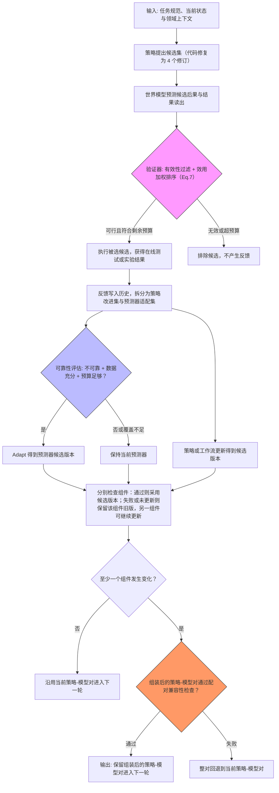

# RSI-Anything: Unlocking Recursive Self-Improvement with World Models

**作者**: Taoyong Cui, Pinxian Zeng, Wanghan Xu, Hao Xiao, Shuhan Xue, Qiang Gao, Wanli Ouyang, Pheng Ann Heng*, Zhenfei Yin*, Yingcheng Wu*, Ling Yang*（* 标记 4 位通讯作者）  
**机构**: PhAI Labs、The Chinese University of Hong Kong、University of Macau、Shanghai Jiao Tong University、Fudan University、University of Oxford、Stanford University、Peking University（共 8 个单位，见附录 A）  
**年份**: 原文正文未标注出版年份；据 arXiv 编号 2610.13912 推断为 2026-10（推断，未做外部核验）  
**链接**: [arXiv 2610.13912](https://arxiv.org/abs/2610.13912)  
**代码/模型**: 题头标注 “Code: RSI-Anything | Models: RSI-Anything”，原文未给出仓库地址

## 一句话总结
RSI-Anything 是构建在 JEPA-Anything 预测式世界模型之上的领域通用递归自我改进框架：世界模型预测被用来挑选候选动作、排序外部评估、选择或构造学习数据；外部反馈驱动策略学习或工作流修订，并按可靠性、数据与预算条件触发世界模型适配；组件检查与策略–模型配对兼容性检查决定保留哪一对，被保留的一对再塑造下一轮的候选与经验。

## 核心贡献
1. **把预测式世界模型显式并入递归自我改进循环**：在“策略–世界模型系统”层级定义持久改进，把“策略演化下的预测可靠性”列为核心设计要求。
2. **提出递归更新-保留机制**：把预测引导的动作/学习数据选择、反馈驱动的策略学习或工作流修订、条件式世界模型适配串起来，并用组件检查与配对兼容性检查决定保留哪一对，两个组件可以异步更新。
3. **跨域实证**：在 coder 固定的代码修复中，先引入世界模型引导的选择、再适配预测器，形成逐级增益（在线测试用量相当）；GUI 完成率提升且平均动作数下降；实验室规划在 5 个连续策略版本上改善；匹配实验次数下反应产率高于贝叶斯优化；另有免疫科学端到端案例（该案例原文未给出定量结果）。

## 📖 批读导航

| Section | 内容 |
|---------|------|
| [00 - 标题与题头元信息](sections/00-section.md) | 标题、11 位作者、8 个单位、资源命名 |
| [01 - Abstract](sections/01-section.md) | 摘要：框架定位与各领域关键数字 |
| [02 - Introduction](sections/02-section.md) | 动机、JEPA-Anything 底座、耦合更新难点、三点贡献 |
| [03 - Framework](sections/03-section.md) | 形式化定义、预测读出、选择与证据准入、条件适应、递归保留 |
| [04 - Results（代码修复 / GUI）](sections/04-section.md) | 代码修复三档成功率、APPS/LiveCodeBench、MiniWoB++ 与 OSWorld |
| [05 - Results（GUI 面板 / 实验室 / 化学 / 免疫）](sections/05-section.md) | Figure 4–7、Table 3、反应产率与免疫科学案例 |
| [06 - Related Work](sections/06-section.md) | RSI、验证与策略自改进、预测世界模型、科学与实验室代理 |
| [07 - Discussion](sections/07-section.md) | 世界模型的两个角色、异步更新设计与作者自述局限 |
| [08 - Experimental Methods](sections/08-section.md) | 领域绑定、Table 4、统计口径（含聚类推断单位） |
| [09 - References](sections/09-section.md) | 53 条参考文献（含书目层面核对） |
| [10 - Appendix A](sections/10-section.md) | 8 个作者单位列表 |
| [11 - Correspondence](sections/11-section.md) | 4 位通讯作者邮箱 |

## 关键数字

| 指标 | 数值 |
|------|------|
| 代码修复成功率（静态验证器 → 预测选择 → 模型适应） | 26.3% → 29.2% → 31.2% |
| 代码修复在线测试调用（固定世界模型 / 静态验证器） | 3.71 / 3.72 次每题 |
| 候选排序准确率与五类 Brier（静态验证器 → 固定世界模型） | 66.5% → 72.8%；0.488 → 0.358 |
| GUI MiniWoB++ click-checkboxes 成功率（baseline → 自适应 → 最终） | 51% → 79% → 99% |
| World-based 对照组成功率（三档） | 49% / 96% / 98% |
| GUI 平均每回合动作数（baseline → 最终） | 5.30 → 3.21（降 39.4%） |
| GUI 重复点击 / 错误提交回合 | 237 → 0；9 → 1 |
| OSWorld 相对 RLAnything 成功率提升 | +5.5%（相对初始 agent +18.4%） |
| 实验室规划（5 个连续策略版本 Final Score） | 21.80% → 38.03% → 41.99% → 44.56% → 46.01% |
| 实验室规划 L1 准确率（RSI-Anything vs 参考） | 0.700 vs 0.665 |
| 实验室规划 L2 最终 vs Actor–Simulator–Selector 参考 | 46.01% vs 45.32%（+0.69 pp） |
| 化学 GC 屏（20 次实验，最佳观测产率 vs BO） | 93.0% vs 87.5%（+5.5 pp） |
| 化学 flow LC–MS 屏（40 次实验，平均最佳产率 vs BO） | 96.15% vs 82.16%（+13.99 pp） |

说明：化学两屏的底物体系与分析手段不同（GC 屏 4-氯苯甲醚偶联 + Pd–NHC–DMS；flow 屏 Pd(OAc)₂ + LC–MS），两组增益不可合并归因（推断）。

## 数据流：输入 → 中间表示 → 输出

## 优缺点与还能做什么

### 优点
- **职责分离清楚**：预测用于决定“哪些候选值得花外部反馈”，反馈再拆成策略改进集与预测器适配集；动作决策与系统版本决策分开（原文 2.4、5 节）。
- **保留不是“改了就采纳”**：组件检查各自对照当前版本，配对检查在至少一个组件变化时比较组装后的系统，失败则整对回退（Eq. 13–18）。
- **可靠性评估有版本纪律**：只允许使用与当前模型版本绑定的预测，旧版预测不并入当前误差；覆盖不足判为 insufficient 而不是 reliable（原文 2.4）。
- **跨域共用一个 transition + feedback 契约**：代码、GUI、实验规划、化学反应与免疫科学共用同一更新-保留骨架，便于按域替换状态、动作与读出（框架层面）。

### 局限 / 风险
- 作者自述：尚缺“单一任务内策略与世界模型持续互促”的联合多轮评估；实验室结果仅覆盖协议对齐规划，物理执行可靠性需在真实设备与工作流验证；化学结果限于两个 Suzuki–Miyaura 筛选；免疫学治疗假设尚待实验测试。
- 统计口径：主结果多为点估计，只有代码修复给出配对的 95% 区间；GUI 的动作数、重复点击、错误提交三项诊断未给方差或显著性（其稳健性未知，属推断）。
- 跨域数字不可直接横向比较：成功率、Brier 分数、产率、L2 Final Score 是不同量纲（推断）。
- 实现细节缺口：CURE-WM-Lite 是保留 W1 不更新的配置，W1 采用 JEPA-Anything 的预测设计；化学与免疫是否在线更新世界模型在方法节未明说（免疫明确只有下游分析阶段冻结预测器）。
- 本次未能获得图片视觉信息：Figure 3–7 的曲线走势、配色与面板细节只能依据正文与 caption 转述。

### 还能做什么
- 在单一任务内做数十轮的策略–世界模型联合互促实验，观察长期稳定性（原文点名的空白，非新增主张）。
- 把配对兼容性检查从预声明判据推进为可学习的评估器（推断建议）。
- 在真实实验设备上闭环验证“预测选择 → 实测 → 更新”的执行可靠性（推断建议）。
- 化学两屏补做同底物、同分析手段的对照，以分离“实验预算”与“体系差异”的混淆（推断建议）。

## 阅读 Q&A 记录

- **Q: 为什么组件检查和配对兼容性检查都要做？**
  A: 组件检查分别评估策略或预测器的个体更新是否在门控数据上优于当前版本；但换策略会改变预测器需要评估的候选分布，换预测器会改变被选中的候选，因此至少在其中一个组件变化时要做组装后的配对检查，不通过就整对回退（Eq. 13–18，见 2.5 与 5 节）。

- **Q: 代码修复里“固定 coder”的意义？**
  A: 原文明确 ReasonFlux-Coder-7B 被 held fixed，两种配置分别评估“预测式选择”和“预测器适配”的增益；把它理解为“隔离变量”属于推断，原文未使用该术语（见 3.1 与 6.1）。

- **Q: Eq.(1) 首项 λ_d 与正文解释用的 χ_d 是同一个符号吗？**
  A: 公式写的是 λ_d，紧随其后的解释用 χ_d 表示“观测与上下文”，原文未说明二者关系，属待向作者核实的符号一致性问题（见 2.1）。

- **Q: 免疫科学应用有定量结果吗？**
  A: 没有。该部分是端到端案例展示，输出是“SIRPα 抑制 + IL-36γ 轴调节”的前瞻性提名，原文明确其尚待实验测试（见 3.5 与 6.1）。

- **Q: 为什么没有 TLDR、被引次数和参考文献分组？**
  A: 本次 Semantic Scholar 的论文详情接口与 references 接口均返回 HTTP 429（限流），因此引用统计不可用；只有 Recommendations 接口成功返回 10 篇相关论文。

## 📊 Citation Landscape

> **数据可用性说明**：Semantic Scholar API 的论文详情查询与 references 查询均返回 HTTP 429（rate limit），故 **TLDR、citationCount、influentialCitationCount、参考文献数与参考文献主题分组全部不可用**，本页不提供任何被引/引用统计数字；references 接口的 scope 说明为“最多前 100 条参考文献；不是完整引用图谱”，但本次未成功返回数据。

### 推荐相关论文（Recommendations API 返回，共 10 篇，照录未做外部核验）

| # | 标题 | 年份 | ArXiv ID |
|---|------|------|----------|
| 1 | Memento 3: Model-Based Recursive Self-Improvement through Reflective Rulebooks | 2026 | 2610.11794 |
| 2 | RSIAgent: Autonomous Exploration for Recursive Self-improvement in New Environments | 2026 | 2609.15364 |
| 3 | EmbodiRSI: Recursive Self-Improvement for Data-Efficient Robot Adaptation | 2026 | 2609.38905 |
| 4 | From Existing Methods to New Research Ideas: Two Perspectives on Recursive Self-Improvement | 2026 | 2610.14625 |
| 5 | NeoHorse-1: Towards Recursive Self-Improvement via Agentic Post-Training with Routing Harness | 2026 | 2609.08183 |
| 6 | Language Models as AI Research World Models | 2026 | 2610.12235 |
| 7 | EvoBelief: Falsifiable World Models for Self-Improving LLM Agents | 2026 | 2610.12789 |
| 8 | AReaL-RSI: Adaptive Scaling and Coordination of Recursive Self-Improvement | 2026 | 2610.18083 |
| 9 | ScienceBuddy: Recursive-in-Recursive Self-Improvement for Interactive Scientific Agents | 2026 | 2609.17523 |
| 10 | Predict Before You Modify: Learning Improvement Dynamics for Self-Evolving Agents | 2026 | 2610.13991 |

**Connected Papers**（按 arXiv ID 构造的链接，本次未验证可达性）: https://www.connectedpapers.com/main/2610.13912
