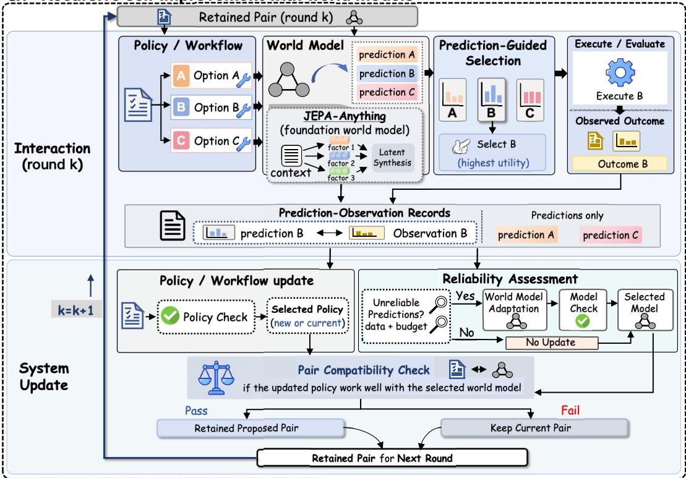
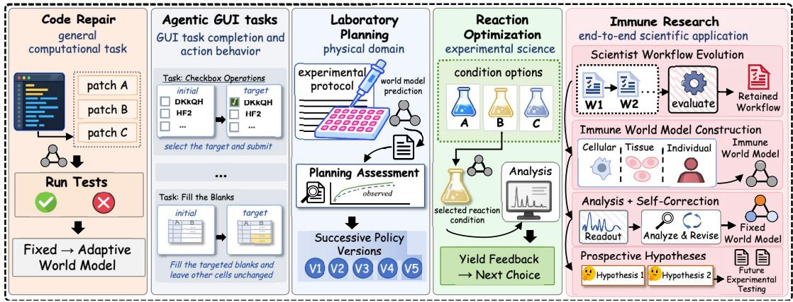

[← 返回 README](../README.md)

## 2. RSI-Anything Framework

RSI-Anything uses world-model predictions to guide action selection and feedback collection, then uses the resulting experience to propose and retain system updates (Figure 2).

> 💡 **AI 批注 | 机制概览**: RSI-Anything 的回路可拆为两步：世界模型的预测用于指导动作选择与反馈收集；由此得到的经验用于提出并保留系统更新（对应 Figure 2）。需注意本段只给出流程骨架，没有说明「预测能否替代真实评估」；配对监督信号来自被执行的候选，这一约束要等 Figure 2 的 caption 才写明，属于依据后文对前文的衔接（推断，依据 block 3 的 caption）。

a. Recursive self-improvement with world models  

> 💡 **AI 批注 | Figure 2a 图题定位**: 本块只有子图题「a. Recursive self-improvement with world models」和一张图片引用，没有正文。本次核对未获得该图片的视觉内容，因此只能依据 block 3 的 Figure 2 caption 判断 2a 的主题是「预测引导动作 + 保留系统更新」的递归回路；图中箭头、节点与示例候选 B 的具体画法需以实际图像为准，此处不代原文断言。

b. Shared mechanism across domains  
  
Figure 2 | RSI-Anything couples prediction-guided action with retained system updates. a, Building on JEPA-Anything, world-model predictions guide candidate selection for external evaluation. Only the executed candidate (B) yields paired prediction–observation feedback. Feedback supports policy or workflow revision and reliability assessment; world-model adaptation depends on prediction reliability, available data, and budget. Component and compatibility checks determine the retained policy–model pair, which shapes candidates and learning experiences in the next round. b, The shared mechanism is instantiated in code repair, GUI interaction, laboratory planning, and reaction optimization. An end-to-end immune-science application connects workflow evolution, immune world-model construction, analysis with self-correction, and prospective hypothesis generation.

> 💡 **AI 批注 | Figure 2 caption 批读**: caption 给出四条可核对的机制：(1) 起点是 JEPA-Anything，世界模型预测用于候选选择，再进入 external evaluation；(2) **只有被执行的候选 (B)** 才产生预测–观测配对反馈，未执行候选没有观测，不构成配对；(3) 反馈支持 policy/workflow revision 与 reliability assessment，而 world-model adaptation 的触发条件是预测可靠性、可用数据与预算三者；(4) 被保留的是 policy–model 对，由 component 与 compatibility 检查决定，并带入下一轮影响候选与经验。另外，2b 只列出代码修复、GUI 交互、实验室规划、反应优化四个实例与一个端到端免疫科学应用，caption 未给任何量化结果，不能据此推断这些领域已达到某种性能。

The retained policy–model pair determines subsequent candidates and the experience available for further improvement. The shared mechanism connects prediction-guided selection, feedback-driven updates, and component and pair acceptance. Domain implementations specify the models, action encodings, outcome readouts, and enabled pathways, including uncertainty-aware selection, multistep planning, and imaginedtrajectory learning. The full update-and-retention protocol is defined below; Table 4 identifies the update scope reported for each application.

> 💡 **AI 批注 | 状态演化与更新范围（纠偏）**: 本段的三条主张是：保留的 policy–model 对决定后续候选与可用经验；共享机制串起「预测引导选择 → 反馈驱动更新 → 组件与配对接受」；领域实现负责指定模型、动作编码、outcome readouts 与启用的通路（含 uncertainty-aware selection、multistep planning、imagined-trajectory learning），并指向 Table 4 报告各应用的 update scope。
> **纠正初稿**：初稿把「反馈历史扩展 ≠ 系统修订（改变 $\theta$ 或 $\phi$）」写在本段，该区分实际出自 block 10；初稿还在此处把世界模型参数写作 β 系符号，与原文的 $\phi$ 系不符（见 Eq. 2–4）。本段未提供任何性能证据，只能读作流程约束。

## 2.1. Problem formulation

For domain �, the task specification is

> 💡 **AI 批注 | 问题形式化引入**: 本块只有一句话引出「领域 d 的任务规范」，且领域下标在解析文本中显示为乱码。可以确定的是，这是对单一领域任务规范做元组化定义，为 Eq. (1) 和随后的符号解释做铺垫。
> **纠正初稿**：初稿称这是「典型的 POMDP 变体」，原文并未使用该术语，属于外部类比，不应作为原文主张；有原文支撑的特征是显式引入 world-model adapter 与 verifier 两个组件（见 Eq. 1 与 block 8）。

$$
\mathcal { T } _ { d } = ( \lambda _ { d } , S _ { d } , \mathcal { A } _ { d } , \mathcal { W } _ { d } , \mathcal { V } _ { d } , M _ { d } , C _ { d } , \mathcal { B } _ { d } ) ,\tag{1}
$$

> 💡 **AI 批注 | 公式 (1) 批读（符号按 LaTeX 还原）**: 原文 LaTeX 为 $\mathcal{T}_d = (\lambda_d, S_d, \mathcal{A}_d, \mathcal{W}_d, \mathcal{V}_d, M_d, C_d, \mathcal{B}_d)$，依次为上下文/领域项、任务状态、可用动作或干预、世界模型适配器、验证器、评估度量、约束、预算。
> **纠正初稿**：初稿把元组中多处符号写成 $\boldsymbol{\beta}$ 并称原文渲染有误，这是把草稿自身的渲染错误倒推给原文；按 LaTeX 源，正确符号是 $\lambda_d, \mathcal{W}_d, \mathcal{V}_d, \mathcal{B}_d$，与 β、ν 无关。
> **原文内部不一致（待证）**：Eq. (1) 首项写作 $\lambda_d$，而 block 8 正文用 $\chi_d$ 解释「观测与上下文」，二者是否同一符号原文未说明，不宜自行统一。

where $\chi _ { d }$ describes observations and context, $S _ { d }$ the task state, $\mathcal { A } _ { d }$ available actions or interventions, $\mathcal { W } _ { d }$ the world-model adapter, and $\mathcal { V } _ { d }$ the verifier for candidate validity and predicted utility. The remaining terms specify evaluation metrics, operational and safety constraints, and budgets for computation, simulation, and external interaction. Executing or evaluating a selected action yields observed feedback. The adapter links this feedback to the stored prediction, the action and context that produced it, and the evidence source.

> 💡 **AI 批注 | 变量语义与闭环证据链**: 本段把 Eq. (1) 各分量落到语义：$\chi_d$ 观测与上下文，$S_d$ 任务状态，$\mathcal{A}_d$ 可用动作/干预，$\mathcal{W}_d$ 世界模型适配器，$\mathcal{V}_d$ 验证候选有效性与预测效用的 verifier；其余三项对应评估度量、运行与安全约束、计算/仿真/外部交互预算（此处原文未逐一按序点名，属依据 Eq. (1) 顺序与句意的对应，标为推断）。
> 关键机制：执行或评估被选动作会产生 observed feedback，**adapter 的职责是把该反馈与存储的预测、产生该预测的动作与上下文、以及证据来源绑定**——这是「配对反馈」在数据结构层面的定义。
> **纠正初稿**：初稿把这些符号写成 $\boldsymbol{\beta}_d$ 并称「修正了公式中的符号歧义」，该修正本身是错的；原文符号即 $\chi_d, S_d, \mathcal{A}_d, \mathcal{W}_d, \mathcal{V}_d$。

We use � for action steps within a task and � for update-and-acceptance cycles. At cycle �, the accepted system is $( \theta _ { k } , \phi _ { d , k } )$ . The policy configuration $\theta _ { k }$ determines how candidates are generated or selected and can comprise trainable parameters or a persistent agent workflow; $\phi _ { d , k }$ specifies the current predictor. A cycle can aggregate feedback from several action steps, trajectories, or tasks. It ends after update decisions and acceptance checks, even if both components retain their current versions. Thus, � counts update cycles rather than successful revisions.

> 💡 **AI 批注 | 周期 k 的定义**: 本段区分两类计数：任务内的动作步与「更新–接受」周期（两个计数符号在解析文本中为乱码，按用法推断为 $t$ 与 $k$）。第 k 周期被接受的系统记作 $(\theta_k, \phi_{d,k})$：$\theta_k$ 是策略配置（可为可训练参数，也可为持久化 agent workflow），$\phi_{d,k}$ 是当前 predictor。一个周期可聚合多个动作步、轨迹或任务上的反馈。
> **最值得记住的一句**：周期在「更新决策 + 接受检查」完成后即结束，即使两个组件都保持当前版本；因此 $k$ 统计尝试更新的次数，不是成功修订的次数。
> **纠正初稿**：初稿把被接受系统写成 $(\boldsymbol{\beta}_k, \boldsymbol{\beta}_{d,k})$，与原文的 $(\theta_k, \phi_{d,k})$ 不符；乱码符号的还原属推断。

Within a run, the task objective, state and action definitions, interfaces, scoring criteria, constraints, acceptance and stopping rules, and total budget limits remain fixed. Remaining budgets decrease with resource use. Task states, candidate pools, feedback records, and accepted component versions can evolve. An action or observation changes the task state or available information; an accepted change to $\theta _ { k }$ or $\phi _ { d , k }$ changes the system used in subsequent decisions. Extending the feedback history alone is not a policy or model revision. Table 1 summarizes this distinction.

> 💡 **AI 批注 | 固定项 vs. 可变项**: 原文列出一次运行内保持不变的对象：任务目标、状态与动作定义、接口、评分标准、约束、接受与停止规则、总预算上限；仅剩余预算随资源消耗递减。可变项是任务状态、候选池、反馈记录与已接受的组件版本。两条边界写得很紧：(1) 动作或观测改变的是任务状态/可用信息；(2) 只有对 $\theta_k$ 或 $\phi_{d,k}$ 的接受性变更才算改变后续决策所用系统，**单纯延长反馈历史不构成策略或模型修订**。
> 初稿提出的「防止通过改变规则（放宽预算、修改目标）虚假提分」是合理解读，但属**推断**，原文只陈述「保持不变」，未陈述该设计意图。原文以 Table 1 结构化总结该区分。

Table 1 | Fixed settings, update rules, and retained state in a recursive run.
<table><tr><td>Object</td><td>Change rule</td><td>Carried forward</td></tr><tr><td>Task and evaluation specification</td><td>Fixed for the run</td><td>Task objectives and definitions, interfaces, evaluation criteria, constraints, budget limits, and</td></tr><tr><td>Task state and experience</td><td>Actions and observations revise the state and extend prediction-observation records</td><td>acceptance and stopping rules Current task state for subsequent actions; accumulated records for selection and learning</td></tr><tr><td>Policy configuration θ</td><td>Feedback-driven policy learning or workflow revision proposes a candidate version; component and pair checks</td><td>Accepted policy configuration; otherwise the current version</td></tr><tr><td>World model  $\phi _ { d }$ </td><td>govern acceptance Prediction unreliability, sufficient data and budget trigger an adaptation attempt; component and pair checks govern acceptance</td><td>Accepted predictor; otherwise the current version</td></tr></table>

> 💡 **AI 批注 | Table 1 批读**: 四行对象与规则：①任务与评估规范——运行内固定，携带任务目标与定义、接口、评估标准、约束、预算上限、接受与停止规则；②任务状态与经验——动作与观测改写状态并扩展预测–观测记录；③策略配置 $\theta$——由反馈驱动的策略学习或工作流修订提出候选，经组件与配对检查决定接受，否则沿用当前版本；④世界模型 $\phi_d$——触发条件是「预测不可靠 + 数据充分 + 预算允许」同时成立才尝试适配，同样经检查决定接受。
> 由此可得一个不对称结论：世界模型的适应是条件触发，而非每轮必做。
> **纠正初稿**：初稿把世界模型一列写成 $\boldsymbol{\beta}_d$，原文表格中为 $\phi_d$。
> **解析瑕疵提示**：该 HTML 表格单元格有跨行错位，「constraints, budget limits, and」与「acceptance and stopping rules」被拆开，阅读时应按语义拼接。

## 2.2. Predictive foundation

JEPA-Anything supplies a context–target predictive design in which orthogonal predictive factorization (OPF) organizes latent targets into complementary factors, predicts them from context, and synthesizes a complete latent state [9]. Its learning formulation combines factor prediction with orthogonality and representation regularization. This is the inherited model-construction foundation. Subsequent RSI adaptation specifies its own objectives and trainable parameter subset for the instantiated predictor.

> 💡 **AI 批注 | 继承关系：JEPA-Anything 提供什么、RSI 补什么**: 继承部分有两件事：(1) context–target 预测式设计，其中正交预测分解（OPF）把 latent target 组织为互补因子、由上下文预测、再合成完整 latent state；(2) 学习目标由因子预测 + 正交性 + 表示正则构成，引用号为 [9]。RSI 的增量被明确限定为「为实例化的 predictor 指定自己的目标与可训练参数子集」。
> 因此不要把 OPF 当成本文提出的新方法；本文是在既有预测基座上做适应与保留协议。[9] 的具体出处本次未做外部检索，不作断言。初稿的「从静态预测到动态自我改进」是对动机的解释性概括（推断），原文未使用「static」这类对照措辞。

At cycle $k ,$ encoding and action-conditioned latent prediction are written as

> 💡 **AI 批注 | 编码与预测方程引入**: 本块说明在第 k 周期，编码与动作条件化的 latent 预测分别写成两式（Eq. 2、Eq. 3）。注意函数下标均为 $\phi_{d,k}$，即当前 predictor 的参数，说明「世界模型随周期变化」通过这两个函数共享同一参数实现。**纠正初稿**：初稿写作 $E_{\boldsymbol{\beta}_{d,k}}$、$F_{\boldsymbol{\beta}_{d,k}}$，与原文的 $\phi$ 下标不符。

$$
z _ { t } = E _ { \phi _ { d , k } } ( s _ { t } , c _ { d } ) ,\tag{2}
$$

> 💡 **AI 批注 | 公式 (2) 批读**: $z_t = E_{\phi_{d,k}}(s_t, c_d)$——输入任务状态 $s_t$ 与领域上下文 $c_d$，输出 latent 表示 $z_t$，编码器参数随周期 $k$ 变动。
> **纠正初稿**：初稿的 $E_{\boldsymbol{\beta}_{d,k}}$ 应为 $E_{\phi_{d,k}}$；「把高维输入压成紧凑 latent」是常规解释，与原文一致。
> **待证点**：此处 $c_d$ 与 block 8 的 $\chi_d$（观测与上下文）是否同一实体，原文未明说。

$$
\widehat { z } _ { t + 1 } = F _ { \phi _ { d , k } } ( z _ { t } , a _ { t } , c _ { d } ) .\tag{3}
$$

> 💡 **AI 批注 | 公式 (3) 批读**: $\widehat{z}_{t+1} = F_{\phi_{d,k}}(z_t, a_t, c_d)$——给定当前 latent、候选动作与领域上下文，前推一步得到**被预测的下一时刻 latent**（带 hat，是预测值而非真实 latent）。这是「世界模型预测指导选择」的数学落点。
> **纠正初稿两处**：(a) 初稿的 $\boldsymbol{\beta}_{t+1} = F_{\boldsymbol{\beta}_{d,k}}(\cdot)$ 应为 $\widehat{z}_{t+1} = F_{\phi_{d,k}}(\cdot)$；(b) 初稿称「$F$ 体现了世界模型的因果推理能力」是对能力的强断言，原文只定义了函数形式与输入输出，未做因果性论证，应改为「结构上支持动作条件化的前向预测」，并标为推断。
> **另一处待证**：本式把 $a_t$ 作为显式输入，而 block 17 说适配器「可以」把动作编码并入 predictor 输入或上下文，二者是同一接口的两种实现，原文未强制其一。

Here $s _ { t }$ is the task state, $a _ { t }$ a candidate action, and $c _ { d }$ the domain context. The latent predictor � represents factor prediction and synthesis when OPF is instantiated. The readout � converts the predicted latent target $\widehat { z } _ { t + 1 }$ into an outcome prediction for selection and feedback comparison. These symbols denote functional roles; adapters specify the action encoding and can incorporate it into the predictor input or context.

> 💡 **AI 批注 | 读出层与符号的角色约定**: 本段给出三件事：(1) 符号释义——$s_t$ 任务状态、$a_t$ 候选动作、$c_d$ 领域上下文；(2) 读出 $R$ 的职责——把预测出的 latent target $\widehat{z}_{t+1}$ 转成用于选择与反馈比较的 outcome prediction；(3) 接口柔性声明：这些符号只表示功能角色，适配器自行规定动作编码方式，并可把它并入 predictor 输入或上下文。
> **解析瑕疵与推断标记**：原文「The latent predictor ...」「The readout ...」两处符号在解析文本中为乱码；依据 Eq. (3) 与上下文，最可能分别是 $F$ 与 $R$，但这是**推断**，不宜当作原文直述。
> **纠正初稿**：初稿把待转换对象写成 $\boldsymbol{\beta}_{t+1}$，原文为 $\widehat{z}_{t+1}$；把动作编码并入 predictor 输入或上下文的说法与原文一致，可保留。

A deterministic readout returns a point prediction, whereas a probabilistic readout returns a distribution. These are alternative domain instantiations of the outcome interface:

> 💡 **AI 批注 | 确定性读出 vs. 概率性读出**: 原文把两种 outcome interface 定义为并列的领域实例化选项：确定性读出返回点预测，概率性读出返回分布。这是接口层面的二选一，不是训练损失或损失组合。
> 「分布读出有助于 uncertainty-aware selection」在原文中有间接依据：block 4 把 uncertainty-aware selection 列为领域实现可启用的通路之一；但「非常关键」这一重要性判断属**推断**，原文未给出二者必须配套的约束。

$$
\widehat { o } _ { t + 1 } = R _ { \phi _ { d , k } } ( \widehat { z } _ { t + 1 } , c _ { d } ) \quad ( \mathrm { p o i n t ~ r e a d o u t } ) ,\tag{4}
$$

> 💡 **AI 批注 | 公式 (4) 批读**: $\widehat{o}_{t+1} = R_{\phi_{d,k}}(\widehat{z}_{t+1}, c_d)$（point readout）——读出函数以预测 latent 与领域上下文为输入，输出 outcome 的点预测，是连接内部预测与外部选择/反馈比较的出口。读出函数同样带 $\phi_{d,k}$ 下标，说明读出层随 predictor 随周期变化（是否可训练，原文未说明，待证）。
> **纠正初稿两处**：初稿写作 $\boldsymbol{\beta}_{t+1} = R_{\boldsymbol{\beta}_{d,k}}(\boldsymbol{\beta}_{t+1}, c_d)$，正确形式为 $\widehat{o}_{t+1} = R_{\phi_{d,k}}(\widehat{z}_{t+1}, c_d)$；初稿称「此处再次出现符号混淆」，实际混淆来自初稿自身的 β 替换，原文 LaTeX 在此式无歧义。
> 原文标号为 (4)，本块只列出 point readout 一支，概率读出对应的另一式未出现在本次提供的文本中，不做补写。

$$
\begin{array} { r } { p _ { \phi _ { d , k } } ( o _ { t + 1 } \mid s _ { t } , a _ { t } , c _ { d } ) = R _ { \phi _ { d , k } } ( \widehat { z } _ { t + 1 } , c _ { d } ) \quad \mathrm { ( p r o b a b i l i s t i c ~ r e a d o u t ) } . } \end{array}\tag{5}
$$

> 💡 AI 批注｜公式批读：Eq.5 定义概率读出：给定 $s_t,a_t,c_d$ 时，$o_{t+1}$ 的条件分布由 $R_{\phi_{d,k}}(\widehat{z}_{t+1},c_d)$ 给出。原文只说明这是概率读出接口，并未说明 $\widehat{z}_{t+1}$ 的具体来源或实现；“关键接口”是合理定位，但内部潜在表示如何构造属于待证。

The domain specification states how the readout is converted into task utility and compared with observed feedback. Point predictions use the corresponding outcome error; probabilistic predictions can additionally use distribution-sensitive scores or calibration measures. Any uncertainty estimator used in selection or training admission is specified separately. Reliability concerns agreement with observed outcomes and the coverage of those observations.

> 💡 AI 批注｜机制拆解：原文说域配置规定读出如何转为任务效用并与观测反馈比较；点预测用相应结果误差，概率预测可额外使用分布敏感分数或校准指标（原文是 can additionally use，不是必须）。用于选择或训练准入的不确定性估计器另行指定。可靠性指与观测结果的一致性和对这些观测的覆盖。初稿“需引入”应改为“可额外使用”。

One-step selection requires only an outcome readout. Multistep planning additionally requires an adapter that propagates a planning state. When this transition interface is available, a rollout of horizon � under goal $g$ has the form

> 💡 AI 批注｜问题动机与边界：单步选择只需结果读出；多步规划还需可传播规划状态的适配器。原文未说明“为何框架同时存在即时反馈与长期轨迹模拟两种模式”，该句是推断；horizon 处原文有乱码字符，不能据此补具体数值。

$$
p _ { \theta _ { k } , \phi _ { d , k } } ( \widehat { \tau } \mid s _ { 0 } , g , c _ { d } ) = \prod _ { t = 0 } ^ { H - 1 } \pi _ { \theta _ { k } } ( a _ { t } \mid s _ { t } , g ) p _ { \phi _ { d , k } } ( s _ { t + 1 } , o _ { t + 1 } \mid s _ { t } , a _ { t } , c _ { d } ) .\tag{6}
$$

> 💡 AI 批注｜公式批读：Eq.6 给出 horizon $H$ 下 rollout 的联合概率分解：对 $t=0$ 到 $H-1$，策略 $\pi_{\theta_k}$ 产生动作，联合转移读出 $p_{\phi_{d,k}}$ 产生 $(s_{t+1},o_{t+1})$。原文并未把 $s_{t+1}$ 说成“观测的一部分”，应区分预测状态与观测 $o_{t+1}$；“联合建模动态环境”可作为推断性解释，非原文结论。

The propagated $s _ { t + 1 }$ remains a predicted planning state until externally checked. The joint transition readout is needed only for applications that perform multistep rollouts.

> 💡 AI 批注｜核心洞察：传播得到的 $s_{t+1}$ 在被外部检查前仍是预测规划状态；联合转移读出只在做多步 rollout 的应用中需要。由“仅多步需要”推出“简单任务应避免复杂 rollout 以节省计算”属于推断，原文未给出效率导向的因果表述。

## 2.3. Prediction-guided selection

At state $s _ { t }$ and goal $g ,$ the current policy proposes $\mathcal { K } _ { t } = \operatorname { P r o p o s e } _ { \theta _ { k } } ( s _ { t } , g )$ . Each candidate receives an outcome prediction or, when supported, a bounded rollout ${ \widehat { \tau } } .$ The verifier records validity $\nu _ { \tau }$ , utility components $\mathbf { r } _ { \tau }$ , evidence provenance, and any available model or verifier uncertainty. Validity and operational constraints determine which candidates may be executed; the selection rule determines which feasible candidates receive feedback.

> 💡 AI 批注｜流程梳理：在状态 $s_t$ 和目标 $g$ 下，当前策略提出候选集 $\mathcal{K}_t$；每个候选获得结果预测，或在支持时获得有界 rollout。验证器记录有效性 $\nu_\tau$、效用分量 $\mathbf{r}_\tau$、证据来源以及模型/验证器不确定性。有效性与操作约束决定哪些候选可执行，选择规则决定哪些可行候选获得反馈。“数据标准化格式”是解读，不是原文术语。

For utility-based ranking, the candidate score is

> 💡 AI 批注｜过渡说明：原文在此引出基于效用的排序，下一式给出候选得分。该句没有额外主张。

$$
R _ { d } ( \widehat \tau ) = \sum _ { j } w _ { d , j } r _ { \tau , j } - \Delta _ { d } ( \widehat \tau ) ,\tag{7}
$$

> 💡 AI 批注｜公式批读：Eq.7 定义 $R_d(\widehat{\tau})=\sum_j w_{d,j} r_{\tau,j}-\Delta_d(\widehat{\tau})$。它是加权效用分量的线性组合再减去惩罚/修正项；原文随后才说明 $\Delta_d$ 是否启用。把它称为“决策论经典形式”是外部解释，非本文证据。

where $\Delta _ { d } ( \widehat { \tau } ) = \lambda _ { d } U ( \mathbf { u } _ { \tau } )$ when uncertainty penalization is enabled and $\Delta _ { d } ( \widehat { \tau } ) = 0$ otherwise. Invalid candidates are excluded before ranking. The domain configuration specifies utility weights, the implemented ranking or acquisition rule, batch size, and estimated feedback costs. Selection returns a feasible candidate or batch whose evaluation cost fits the remaining feedback budget. In code repair, the instantiated rule aggregates predicted execution-class probabilities to rank four proposed revisions before one revision is executed.

> 💡 AI 批注｜实例解析：当启用不确定性惩罚时 $\Delta_d(\widehat{\tau})=\lambda_d U(\mathbf{u}_\tau)$，否则为 0；无效候选在排序前排除。域配置指定效用权重、排序/获取规则、批量大小和估计反馈成本；选择返回评估成本符合剩余反馈预算的可行候选或批次。代码修复中，实例化规则聚合预测执行类概率，对四个提议修订排序后执行一个。初稿中“最大化信息增益”不准确：信息获取在下一段单独描述，此处是效用排序。

An explicitly enabled information-seeking acquisition rule can instead prioritize uncertain candidates for evaluation. Its definition and use are reported separately from utilitybased ranking. Once feedback is obtained, the observed outcome is stored separately from the prediction used to select the candidate.

> 💡 AI 批注｜机制补充：显式启用的信息获取规则可以改为优先评估不确定候选；其定义与使用和基于效用的排序分开报告。一旦获得反馈，观测结果与用于选择该候选的预测分开存储。“探索-利用权衡”是合理解读，但原文未使用该术语。

Evidence and imagined training data. RSI-Anything distinguishes deterministic rule checks (E0), learned-model predictions and rollouts (E1), specialized simulators or higher-fidelity calculations (E2), and external measurements or experiments (E3). Predicted and observed fields retain their own provenance. Evidence category records origin and intended fidelity; suficiency for training is determined by the admission criteria below.

> 💡 AI 批注｜分类体系：原文区分 E0 确定性规则检查、E1 学习模型预测与 rollout、E2 专用仿真器或更高保真计算、E3 外部测量或实验；预测字段和观测字段各自保留来源，证据类别记录来源与预期保真度，是否足以训练由后续准入标准决定。初稿所说“不同层级可信度和成本不同”未在原文明确排序，应标为推断。

For applications using imagined trajectories for learning, admission is governed separately from external-evaluation selection:

> 💡 AI 批注｜边界界定：对使用想象轨迹进行学习的应用，准入与外部评估选择分开管理。由此说“模型可以用自己的预测数据自我改进”是推断；原文只规定准入需独立治理，并未直接断言自我改进闭环。

$$
\begin{array} { r l } & { \quad { e } _ { \tau } = \mathbf { 1 } \{ \nu _ { \tau } = 1 \} \mathbf { 1 } \{ R _ { d } ( \widehat { \tau } ) \geq r _ { d } ^ { \operatorname* { m i n } } \} C _ { d } ^ { U } ( \widehat { \tau } ) \mathbf { 1 } \{ \ell _ { \tau } \in \mathcal { E } _ { d } ^ { \operatorname { t r a i n } } \} , } \\ & { \mathcal { D } _ { \sin , k } = \mathrm { C u r a t e } \{ \widehat { \tau } : e _ { \tau } = 1 \} . } \end{array}\tag{8}
$$

> 💡 AI 批注｜公式批读：Eq.8 用多个条件过滤构建 $\mathcal{D}_{\mathrm{sim},k}$：$e_\tau=1$ 要求有效（$\nu_\tau=1$）、达到最小效用阈值 $R_d(\widehat{\tau})\geq r_d^{\min}$、通过不确定性检查 $C_d^U$、且证据来源 $\ell_\tau$ 属于允许训练集 $\mathcal{E}_d^{\mathrm{train}}$；随后 Curate 保留 $e_\tau=1$ 的轨迹。“同时满足”与乘积形式一致。

Here $\ell _ { \tau }$ records the evidence used to support training admission. The uncertainty check $C _ { d } ^ { U }$ tests $U ( \mathbf { u } _ { \tau } ) \leq u _ { d } ^ { \operatorname* { m a x } }$ when enabled and returns one when omitted. The permitted evidence sources and thresholds are specified for the application. If imagined learning is disabled, $\mathcal { D } _ { \mathrm { s i m } , k }$ is empty. This training filter does not prevent external evaluation of uncertain candidates.

> 💡 AI 批注｜细节澄清：$\ell_\tau$ 记录支持训练准入所用证据；$C_d^U$ 在启用时检验 $U(\mathbf{u}_\tau)\leq u_d^{\max}$，省略时返回 1。允许证据源和阈值按应用指定。若禁用想象学习，$\mathcal{D}_{\mathrm{sim},k}$ 为空。该训练过滤器不阻止对不确定候选进行外部评估。“保留探索空间”是解读，非原文措辞。

## 2.4. Feedback-driven improvement

External feedback extends history $\mathcal { H } _ { k }$ with prediction–observation pairs linked to the generating system version. Records selected for policy improvement form $\mathcal { D } _ { \mathrm { p o l i c y } , k } ;$ records selected for predictor adaptation form $\mathcal { D } _ { \mathrm { a d a p t } , k }$ . The two sets serve diferent objectives and need not contain the same records. Policy improvement changes how candidates are generated or selected; predictor adaptation changes how their consequences are forecast.

> 💡 AI 批注｜架构解耦：外部反馈以预测-观测对扩展历史 $\mathcal{H}_k$，并关联生成系统版本。用于策略改进的记录构成 $\mathcal{D}_{\mathrm{policy},k}$，用于预测器适应的记录构成 $\mathcal{D}_{\mathrm{adapt},k}$；两者目标不同，不必包含同一批记录。策略改进改变候选如何生成/选择，预测器适应改变后果如何预测。初稿中“解决传统 RL 中模型更新与策略更新耦合导致的不稳定性”没有原文证据，属于过度推断，应删除或标为待证。

Policy learning or workflow revision. Feedback must be converted into a signal appropriate to the update object. Demonstration-based learning uses selected actions or trajectories as targets; preference learning compares alternatives using their evaluated outcomes; workflow search uses evaluation feedback to rank persistent agent-workflow configurations. Each application selects the update route appropriate to its policy representation and feedback. Eligible imagined trajectories can supplement policy data when that route is enabled. The policy update seeks better task behavior under the declared objective and constraints.

> 💡 AI 批注｜方法多样性：反馈要转成适合更新对象的信号：示范学习用被选动作/轨迹作目标，偏好学习按评估结果比较备选，工作流搜索用评估反馈给持久智能体工作流配置排名。每个应用按策略表示和反馈选择更新路线；启用时可让合格想象轨迹补充策略数据；策略更新在声明目标与约束下追求更好任务行为。“通用框架、适配不同下游算法”是总结性推断。

Let $u _ { k } ^ { \pi }$ indicate an enabled policy-update attempt at its declared schedule or feedback trigger, with the required learning evidence and suficient budget for the proposed attempt. A fixed-policy setting has $u _ { k } ^ { \pi } = 0$

> 💡 AI 批注｜控制变量：$u_k^\pi$ 表示在声明调度或反馈触发下启用一次策略更新尝试，并需具备所需学习证据和足够预算；固定策略设置中 $u_k^\pi=0$。初稿中“预算不足或无需更新时设为 0”可视为合理推断，但原文只明确固定策略设为 0；“细粒度计算资源管理”属于推断。

$$
\theta _ { k + 1 } ^ { \prime } = \left\{ \begin{array} { l l } { \mathrm { U p d a t e } ( \theta _ { k } , \mathcal { D } _ { \mathrm { p o l i c y } , k } , \mathcal { D } _ { \mathrm { s i m } , k } ) , } & { u _ { k } ^ { \pi } = 1 , } \\ { \theta _ { k } , } & { u _ { k } ^ { \pi } = 0 . } \end{array} \right.\tag{9}
$$

> 💡 AI 批注｜公式批读：Eq.9 是分段更新规则：当 $u_k^\pi=1$ 时，$\theta'_{k+1}=\mathrm{Update}(\theta_k,\mathcal{D}_{\mathrm{policy},k},\mathcal{D}_{\mathrm{sim},k})$；否则保持 $\theta_k$。原文没有把它称为伪代码，但含义一致；“数据驱动参数演进”是对分段函数的概括。

The instantiated route specifies how feedback constructs training targets or workflow scores, which parameters or configuration fields can change, and when updates are attempted.

> 💡 AI 批注｜实施规范：实例化路线要说明反馈如何构造训练目标或工作流分数、哪些参数或配置字段可改变、以及何时尝试更新。“确保可复现性”是推断性目标，原文只说需指定这些内容。

Conditional world-model adaptation. Adaptation uses observed targets to improve the corresponding predictions. Outcome labels can supervise an outcome readout; latent prediction targets require an observation that the domain target encoder can represent. A scalar outcome supplies an outcome target rather than a fully observed target state, although its loss can update upstream parameters when they are trainable. The adaptation specification identifies the available target, its predictive loss, and the trainable parameter subset. These choices can difer from those used in initial model construction.

> 💡 AI 批注 | **机制拆解**: 定义“条件世界模型适应（conditional world-model adaptation）”：用观测到的目标改进对应预测。原文区分了三类目标情形——① 结果标签（outcome labels）可监督一个 outcome readout；② latent 预测目标需要“域目标编码器能表示的观测”作为前提；③ 标量结果提供的是 outcome target，而非完整观测的目标状态，但其损失在参数可训练时（when they are trainable）可以更新上游参数。适应规范需明确：可用目标、其预测损失、可训练参数子集，且这些选择可与初始建模阶段（initial model construction）不同。注意：原文没有说明三类目标各自的具体实现形式，也没有给出 loss 表达式。

The reliability protocol requires predictions attributable to the current model version. For each historical observation included in the assessment, it uses either a stored prediction generated by that version or a new prediction obtained by applying the current model to the recorded input. Earlier-version predictions remain available for analysis of past decisions but are not pooled directly into the current error estimate. The implementation specifies record selection, version handling, and whether evaluation records have also been used for training.

> 💡 AI 批注 | **可靠性协议（版本一致性）**: 要求预测必须可归因于当前模型版本。对每条纳入评估的历史观测，只用两种来源：该版本当时存储的预测，或用当前模型对记录输入重新推理得到的新预测。早期版本的预测仍可留作历史决策分析，但不直接并入当前误差估计。实现层需声明三件事：记录选择规则、版本处理方式、以及评估记录是否也曾用于训练。这里的要点是“误差估计必须与某一确定模型版本绑定”，否则可靠性判定会混入跨版本误差。

Reliability is assessed from feedback history $\mathcal { H } _ { k }$ using this version rule and the candidate range considered in cycle $k ,$ denoted $\mathcal { K } _ { k }$ . Let $B _ { \mathrm { u p d a t e } , k }$ denote the remaining budget available for the proposed adaptation and $\widehat { c } _ { \mathrm { a d a p t } , k }$ its estimated cost in the same units. For an enabled adaptation pathway, the assessment and trigger are

> 💡 AI 批注 | **变量定义与触发前提**: 可靠性基于反馈历史 $\mathcal{H}_k$，并限定在第 $k$ 轮所考虑的候选范围 $\mathcal{K}_k$ 内。另定义适应剩余预算 $B_{\mathrm{update},k}$ 与适应估计成本 $\hat{c}_{\mathrm{adapt},k}$（同单位）。原文紧接着给出“对启用的适应路径，评估与触发为”Eq. 10–12，说明这几个符号正是后续公式的输入；预算与候选范围共同构成“反馈历史 + 资源约束”的决策框架。

$$
\boldsymbol \rho _ { k } ^ { W } = \mathrm { R e l i a b i l i t y } ( W _ { \boldsymbol \phi _ { d , k } } ; \mathcal { H } _ { k } , \mathcal { K } _ { k } ) \in \{ \mathrm { r e l i a b l e , u n r e l i a b l e , i n s u f f i c i e n t } \} ,\tag{10}
$$

> 💡 AI 批注 | **公式批读（Eq. 10）**: $\rho_k^W = \mathrm{Reliability}(W_{\phi_{d,k}}; \mathcal{H}_k, \mathcal{K}_k)$，取值三态：reliable / unreliable / insufficient。输入是世界模型 $W_{\phi_{d,k}}$、反馈历史、候选范围；输出是可靠性判定，而不是损失值或分数本身。它是启动适应的第一道判据。注意原文用 $\mathrm{Reliability}(\cdot)$ 抽象表示，具体判据由实现决定（见下一段）。撰写笔记时 `\tag{10}` 在 GitHub MathJax 下不渲染，应转为纯文本或图片。

$$
u _ { k } ^ { W } = \mathbf { 1 } \{ \rho _ { k } ^ { W } = \mathrm { u n r e l i a b l e } \} \mathbf { 1 } \{ \mathcal { D } _ { \mathrm { a d a p t } , k } \mathrm { ~ i s ~ s u f f i c i e n t } \} \mathbf { 1 } \{ B _ { \mathrm { u p d a t e } , k } \geq \widehat { c } _ { \mathrm { a d a p t } , k } \} .\tag{11}
$$

> 💡 AI 批注 | **公式批读（Eq. 11）**: $u_k^W = \mathbf{1}\{\rho_k^W = \mathrm{unreliable}\}\cdot\mathbf{1}\{\mathcal{D}_{\mathrm{adapt},k}\ \mathrm{is\ sufficient}\}\cdot\mathbf{1}\{B_{\mathrm{update},k} \geq \hat{c}_{\mathrm{adapt},k}\}$。三个指示函数相乘，要求同时满足：判定为不可靠、适应数据充分、预算足够。注意“unreliable”是触发条件——reliable 或 insufficient 都不会触发（insufficient 的处理见 Eq. 10 后一段）。该设计体现“确认不可靠且资源允许才适应”的保守取向，此评价属批注推断，非原文陈述。

The assessment applies the specified error, calibration, drift, and coverage criteria supported by the implementation. Because feedback comes from selected candidates, its conclusions are limited to the observed and covered candidate range. Insuficient coverage yields an insuficient assessment rather than evidence of reliability and does not activate the adaptation trigger. Subsequent selection follows the declared evaluation rule and remaining feedback budget.

> 💡 AI 批注 | **评估判据与覆盖度边界**: 评估施加实现所支持的误差、校准、漂移、覆盖度（error/calibration/drift/coverage）准则。关键限制：反馈来自被选中的候选，因此结论只在“已观测且被覆盖的候选范围”内有效。覆盖不足时输出 insufficient 判定，这既不等同于可靠证据，也不激活适应触发器。后续选择按已声明的评估规则和剩余反馈预算进行。原文只说明覆盖不足不会触发适应；“防止过拟合未探索区域”是对该保守设计的解读，属推断而非原文表述。

$$
\begin{array} { r } { \boldsymbol { \phi } _ { d , k + 1 } ^ { \prime } = \left\{ \begin{array} { l l } { \mathrm { A d a p t } ( \phi _ { d , k } , \mathcal { D } _ { \mathrm { a d a p t } , k } ) , } & { \boldsymbol { u } _ { k } ^ { W } = 1 , } \\ { \phi _ { d , k } , } & { \boldsymbol { u } _ { k } ^ { W } = 0 . } \end{array} \right. } \end{array}\tag{12}
$$

> 💡 AI 批注 | **公式批读（Eq. 12）**: $\phi'_{d,k+1} = \mathrm{Adapt}(\phi_{d,k}, \mathcal{D}_{\mathrm{adapt},k})$ 当 $u_k^W = 1$；否则 $\phi'_{d,k+1} = \phi_{d,k}$。即触发为 1 才产生候选新参数 $\phi'$，否则原样保留。这里输出的是“候选参数”（带撇号），正式是否采纳还要经过后文 2.5 节的组件检查与配对检查（Eq. 13–18），两者不可混淆。

This trigger governs adaptation after initial model construction; a disabled pathway sets $u _ { k } ^ { W } = 0$ . The budget specification identifies the constrained resource and accounts for adaptation, historical re-evaluation, and acceptance checks. When policy and model updates share a budget, each attempt uses the amount remaining after prior allocations. External feedback use is reported separately from update and evaluation computation. Either component can remain unchanged while the other is updated; proposed candidates enter the retained system only after acceptance.

> 💡 AI 批注 | **预算共享与组件解耦**: 该触发器只管“初始建模之后”的适应；路径被禁用时 $u_k^W = 0$。预算规范需指明受限资源，并计入适应、历史重评估、验收检查三类开销；当策略更新与模型更新共享预算时，每次尝试使用前序分配后的剩余额度。外部反馈的使用要与更新/评估计算分开报告。策略与世界模型可各自保持原状、也可各自更新，但候选组件只有在通过验收后才进入被保留的系统。

## 2.5. Recursive retention

The full retention protocol compares proposed components and their assembled pair with the current versions under predeclared acceptance criteria. Component checks address policy task utility and constraints, or predictor quality on relevant targets. The pair check addresses the dependency between them: a policy can generate candidates for which an otherwise improved predictor is unreliable, and a predictor can change which candidates are selected. Pair acceptance therefore concerns the decision behavior of the assembled system and predictor suitability on candidates proposed by the selected policy, beyond isolated component quality.

> 💡 AI 批注 | **递归保留协议概览**: 完整保留协议在预声明验收标准下，把“提议组件”与“组装后的组件对”同当前版本比较。组件级检查分别针对策略的任务效用与约束、预测器在相关目标上的质量；配对检查针对两者之间的依赖：策略可能生成让“本已改进的预测器”变得不可靠的候选，预测器也会改变哪些候选被选中。因此配对验收关心的是“组装后系统的决策行为”以及预测器在所选策略提议候选上的适配性，而非孤立的组件质量。

For compactness, define the component decisions as

> 💡 AI 批注 | **过渡句**: 为紧凑表达，先定义组件决策变量 $G_k^\pi$、$G_k^W$（紧接 Eq. 13、Eq. 14），再定义进入配对评估的中间版本 $\bar{\theta}_{k+1}$、$\bar{\phi}_{d,k+1}$（Eq. 15、16）。

$$
\begin{array} { r } { G _ { k } ^ { \pi } = Q _ { \pi } ( \theta _ { k + 1 } ^ { \prime } ; \theta _ { k } , \mathcal { D } _ { \mathrm { g a t e } , k } ^ { \pi } ) , } \end{array}\tag{13}
$$

> 💡 AI 批注 | **公式批读（Eq. 13）**: $G_k^\pi = Q_\pi(\theta'_{k+1}; \theta_k, \mathcal{D}^\pi_{\mathrm{gate},k})$。注意分号前是候选策略 $\theta'_{k+1}$，分号后是当前策略 $\theta_k$（作为对照基准）与门控数据。返回 1 表示满足预设的组件判据。这里用的数据是 $\mathcal{D}^\pi_{\mathrm{gate},k}$，而非更新所用的 $\mathcal{D}^\pi_{\mathrm{update},k}$。

$$
G _ { k } ^ { W } = Q _ { W } ( \phi _ { d , k + 1 } ^ { \prime } ; \phi _ { d , k } , \mathcal { D } _ { \mathrm { g a t e } , k } ^ { W } ) .\tag{14}
$$

> 💡 AI 批注 | **公式批读（Eq. 14）**: $G_k^W = Q_W(\phi'_{d,k+1}; \phi_{d,k}, \mathcal{D}^W_{\mathrm{gate},k})$。与 Eq. 13 同构：候选世界模型参数对当前参数、在门控数据上评估预测器质量。两个组件检查各自独立进行，均以门控数据为证据来源。

The arguments explicitly identify the current version as the comparator. Each check returns one only when its specified criteria are met. The policy and model versions passed to pair evaluation are

> 💡 AI 批注 | **比较基准显式化**: 原文强调公式参数显式标出“当前版本”作为比较对象（comparator）；每个检查只有在满足各自声明判据时才返回 1。由此得到进入配对评估的策略/模型版本，即 Eq. 15、16。这一段定义的是组件“及格线”，是进入配对评估的前提。

$$
\bar { \theta } _ { k + 1 } = \left\{ \begin{array} { l l } { \theta _ { k + 1 } ^ { \prime } , } & { u _ { k } ^ { \pi } = 1 \ \wedge \ G _ { k } ^ { \pi } = 1 , } \\ { \theta _ { k } , } & { \mathrm { o t h e r w i s e } , } \end{array} \right.\tag{15}
$$

> 💡 AI 批注 | **公式批读（Eq. 15）**: $\bar{\theta}_{k+1} = \theta'_{k+1}$ 当 $u_k^\pi = 1 \wedge G_k^\pi = 1$；否则 $\bar{\theta}_{k+1} = \theta_k$。即策略侧必须“触发器开”且“组件检查过”才带入候选，否则回退到当前策略。输出是组件过滤后的中间版本，尚未最终采纳。

$$
\bar { \phi } _ { d , k + 1 } = \left\{ \begin{array} { l l } { \phi _ { d , k + 1 } ^ { \prime } , } & { u _ { k } ^ { W } = 1 \land G _ { k } ^ { W } = 1 , } \\ { \phi _ { d , k } , } & { \mathrm { o t h e r w i s e } . } \end{array} \right.\tag{16}
$$

> 💡 AI 批注 | **公式批读（Eq. 16）**: $\bar{\phi}_{d,k+1} = \phi'_{d,k+1}$ 当 $u_k^W = 1 \land G_k^W = 1$；否则 $\bar{\phi}_{d,k+1} = \phi_{d,k}$。逻辑与 Eq. 15 对称。此处原文 Eq. 15 用 $\wedge$、Eq. 16 用 $\land$，两者同为逻辑与。至此两个组件分别完成独立筛选，准备联合测试。

When at least one component changes, the pair decision compares the assembled candidate with the current pair under the same prescribed evaluation conditions; otherwise $G _ { k } ^ { \mathrm { p a i r } } = 1$ without a new evaluation:

> 💡 AI 批注 | **配对决策的触发条件**: 当至少一个组件发生变化（即 $\bar{\theta}$ 或 $\bar{\phi}_d$ 不同于当前版本）时，才在相同的规定评估条件下把组装后的候选对与当前对比较；否则直接置 $G_k^{\mathrm{pair}} = 1$，不做新评估。原文只陈述“无变化则不评估且判为 1”；把它读作“避免无意义重复评估以节省算力”属于批注推断，原文未给出效率动机的明示说明。

$$
G _ { k } ^ { \mathrm { p a i r } } = Q _ { \mathrm { p a i r } } \big ( ( \bar { \theta } _ { k + 1 } , \bar { \phi } _ { d , k + 1 } ) ; ( \theta _ { k } , \phi _ { d , k } ) , \mathcal { D } _ { \mathrm { c o m p a t } , k } \big ) .\tag{17}
$$

> 💡 AI 批注 | **公式批读（Eq. 17）**: $G_k^{\mathrm{pair}} = Q_{\mathrm{pair}}\big((\bar{\theta}_{k+1}, \bar{\phi}_{d,k+1}); (\theta_k, \phi_{d,k}), \mathcal{D}_{\mathrm{compat},k}\big)$。分号前是组装后的候选对，分号后是当前对（比较基准），数据是兼容性/配对数据 $\mathcal{D}_{\mathrm{compat},k}$。这是系统级验收关卡，评估对象是“对”，而不是单个组件。

$$
( \theta _ { k + 1 } , \phi _ { d , k + 1 } ) = \left\{ \begin{array} { l l } { ( \bar { \theta } _ { k + 1 } , \bar { \phi } _ { d , k + 1 } ) , } & { G _ { k } ^ { \mathrm { p a i r } } = 1 , } \\ { ( \theta _ { k } , \phi _ { d , k } ) , } & { \mathrm { o t h e r w i s e . } } \end{array} \right.\tag{18}
$$

> 💡 AI 批注 | **公式批读（Eq. 18）**: $(\theta_{k+1}, \phi_{d,k+1}) = (\bar{\theta}_{k+1}, \bar{\phi}_{d,k+1})$ 当 $G_k^{\mathrm{pair}} = 1$；否则回退到 $(\theta_k, \phi_{d,k})$。只有当组件检查与配对检查都通过，中间版本才成为第 $k+1$ 轮的正式版本；配对失败则整个当前对原样保留（即使是部分组件本身改进过）。

The evaluation specification fixes the task metrics, prediction checks, constraints, feedback allowance, and acceptance thresholds. Corresponding task conditions can be matched even when the two policies generate diferent candidates. Failure of a component check retains its current version; failure of the pair check retains the entire current pair. If neither component changes, the current pair carries forward without a new pair comparison. Updates are retained when the candidate pair meets the prespecified acceptance criteria under matched evaluation conditions.

> 💡 AI 批注 | **评估规范与失败回退语义**: 评估规范固定任务指标、预测检查、约束、反馈额度与接受阈值；即使两个策略生成不同候选，也可在匹配的任务条件下比较。失败语义分两级：组件检查失败只保留该组件的当前版本；配对检查失败则保留整个当前对。若两个组件都没变，当前对直接结转、不做新配对比较。更新只有在候选对在匹配评估条件下满足预声明接受标准时才被保留。

Update data construct candidate versions, gate data select which versions are retained, and any designated held-out audit set is reserved for final reporting.

> 💡 AI 批注 | **三类数据的分工**: 更新数据（update data）用于构造候选版本；门控数据（gate data）用于决定哪些版本被保留；被指定的留出审计集（held-out audit set）只保留给最终报告。原文仅陈述这一分工；“这种分离防止数据泄露导致评估偏差”是对该设计的合理性解读，属批注推断，原文未直接给出该因果说明。

The retained pair and accumulated feedback history enter the next cycle. A changed policy can alter which candidates are proposed; a changed predictor can alter rankings and learning signals. Together, these changes afect which actions receive feedback and what experience is available for subsequent updates. This dependence of later interaction and learning on retained revisions defines the recursive mechanism. The six operations in Figure 2 therefore connect candidate proposal and prediction to external selection, observation, update construction, and system retention.

> 💡 **机制拆解（AI 批注）**: 本段定义 RSI-Anything 的递归闭环。输入是上一周期的 **retained pair**（外部筛选后保留的配对）与 **accumulated feedback history**（累积反馈历史）。原文区分两条因果链：(1) **policy** 变化 → 改变“哪些候选被提出（which candidates are proposed）”；(2) **predictor** 变化 → 改变“排序与学习信号（rankings and learning signals）”。二者共同决定哪些动作收到反馈（which actions receive feedback）、后续更新可用哪些经验（what experience is available for subsequent updates）。最后把“后续交互与学习依赖被保留的修订”命名为递归机制，并说明 Figure 2 的六个操作贯通 candidate proposal、prediction、external selection、observation、update construction 与 system retention。
> 💡 **初稿修正（AI 批注）**: 初稿把“改变学习信号”归因于策略变化，与原文不符：原文中 learning signals 的变更由 **predictor** 引起，policy 影响的是候选提出集合。初稿“形成自增强或自修正的数据流”超出原文证据：本段只定义递归依赖，未给出增益/修正方向性或自增强证据，应标为推断/待证。
> 💡 **Q&A 批注记录（待证）**: retained pair 具体由哪些字段构成？累积反馈历史是否有长度截断/遗忘策略？循环终止条件是什么？本段均未给出，需查 Method/Appendix 确认，不能从本段推断。

