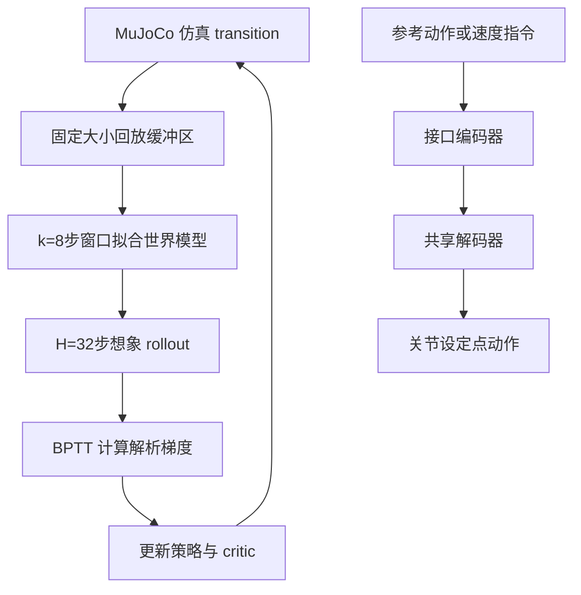

# SuperMimic: Scaling Humanoid Whole-Body Control with One Differentiable World Model

**作者**: Qiayuan Liao, Yiyang Shao*, Junfeng Long*, Kevin Zakka, Roberto Horowitz, Pieter Abbeel†, Koushil Sreenath† | **会议 / 年份**: arXiv, 2026 | **链接**: https://arxiv.org/abs/2610.28480

## 一句话总结
用单个可微分世界模型在短想象轨迹上做 BPTT，单 GPU 3 小时训练的人形全身动作跟踪策略在回报与失败数上超过 128 GPU 集群训练的 PPO 基线，GPU-hours 降低 1000 倍以上。

## 核心贡献
- 提出 SuperMimic：从标准刚体模拟器日志拟合单一可微世界模型，通过 BPTT 为策略提供解析梯度，兼容含非平滑接触的不可微模拟器（§3）。
- 单卡 H100 3 小时归一化回报超过 SONIC（128×L40 训练 7 天），GPU-hours 减少 >1000×；129,514 个基准动作中失败 25 个，双卡 9.8 小时零失败（§4.1, Appendix F）。
- 收益来源拆解：数据量扩大 264× 时 8 步预测误差稳定在 0.007–0.011；世界模型 rollout 比 MuJoCo Warp 快 >10×（64k 环境达 62×）；解析梯度使达到同等回报所需想象步数降至 PPO-WM 的约 1/64（§4.1–4.2）。
- 策略无需逐动作调参即迁移到物理 Unitree G1，完成跳跃、侧滚、空翻等杂技动作（§4.4, Figure 6）。
- 初步研究：同一世界模型用 RL 训练速度编码器，在 672 条阶跃指令中 650 条稳态误差低于蒸馏基线（§4.5, Appendix G）。

## 📖 批读导航
| 章节 | 这一章解决什么 | 值得看的点 |
|---|---|---|
| Abstract & Fig 1 | 全文主张与关键数字 | 1000× GPU-hours、失败数对比 |
| 1 Introduction | 为什么 model-free RL 扩展代价高 | "共享动力学摊销学习"的核心论点 |
| Contributions | 四项贡献清单 | 收益三因素拆解 |
| 2 Related Work | 定位四条线索 | Table 1 各方法三阶段训练策略对比 |
| 3 Method | POMDP 建模、世界模型与策略联合训练 | Eq.1–3、$H=32$、$k=8$、存活权重替代硬终止 |
| 4 Experimental Results | 效率、消融、真机、下游接口 | Fig 3–5 数据量扫描、rollout 吞吐、critic 消融 |
| 5 Conclusion | 总结与展示 | Fig 6 真机四类动作、Fig 7 速度跟踪误差 |
| 6 Limitations | 三项局限 | 仅平地、无真机数据、多接口并行必要性未验证 |
| Appendix A | 观测/动作/奖励/域随机化具体实现 | 93 维观测、终止条件、去掉根速度扰动 |
| Appendix B | 多目标接口联合训练 | 编码器独立、解码器共享、stop-gradient |
| Appendix C | 网络架构与伪代码 | MLP 宽度、Algorithm A.1 |
| Appendix D | 重置采样与超参数 | return-based reset sampling 混合分布 |
| Appendix E | 动作数据清洗 | 142,220→129,514：名称过滤＋可行性过滤（高架支撑、地面穿透、悬浮脚） |
| Appendix F | 评测协议与失败统计 | 同一失败判据下的分组计数、Table A.8 |
| Appendix G | 速度指令任务细节 | step test 协议、672 条指令构成 |

## 关键数字
| 指标 | 数值 | 条件 |
|---|---|---|
| GPU-hours 缩减 | >1000× | vs SONIC 128×L40 168 h（§4.1） |
| 归一化回报超越 SONIC | 单卡 3 h | H100 80 GB（§4.1） |
| 基准动作失败数 | 25 / 129,514 | 单卡 3 h（Appendix F） |
| 基准动作失败数 | 0 / 129,514 | 双卡 9.8 h（Appendix F） |
| 世界模型 8 步预测误差 | 0.007–0.011 | 数据 1→264 h（§4.2, Figure 3c） |
| Rollout 加速 | >10×, 最高 62× | vs MuJoCo Warp, 64k 环境（§4.2） |
| 想象步数节省 | ~64× | vs PPO-WM 达同等回报（§4.2） |
| 速度跟踪优势 | 650/672 条误差更低 | RL encoder vs 蒸馏（Appendix G） |

## 数据流：输入 → 中间表示 → 输出

## 优缺点与还能做什么
### 优点
- 将人形全身控制的算力门槛从集群级降到单卡级，使 scaling law 实验变得可负担。
- 世界模型不依赖可微模拟器，兼容带非平滑接触的标准刚体引擎，工程落地友好。
- 收益来源分析细致，把加速拆解为精度稳定、rollout 吞吐、解析梯度三项并分别量化。
- 真机迁移展示了跳跃、空翻等高动态动作，演示 sim-to-real 可行性。

### 局限 / 风险
- 仅在平地训练，未覆盖地形与物体交互（§6）。
- 真机部署未报告成功率或定量误差，只有定性视频展示（§4.4）。
- 主比较对象 SONIC 使用 611 h 数据而本文用 264.56 h，硬件也不同（H100 vs L40），作者承认这些混淆项但认为不足以解释 1000× 差距（§4.1）。
- 想象视界受 H100 显存限制：H=128 是能装下的最长视界，且从 64 升到 128 使达标时间近三倍、最终回报更低（§4.3）。

### 还能做什么
- 推断：引入真机 transition 微调世界模型可能进一步提升 sim-to-real 成功率（§6 提及但未实验）。
- 推断：将场景扩展到楼梯、斜坡等地形，检验世界模型在非平面接触下的预测稳定性。
- 推断：尝试更长视界或隐空间世界模型以突破当前显存对 $H$ 的限制。

## 阅读 Q&A 记录
- **Q：世界模型对模拟器分布外推能力如何？** A：原文未直接回答。§4.1 显示数据量扩大 264× 时预测误差稳定，但这仍在同一模拟器内；§6 承认真机数据有望改进模型。
- **Q：SONIC 与 SuperMimic 的失败判据不同，如何公平比较？** A：Appendix F.1 说明两者在同一确定性仿真里回放、各用自身训练时的执行器增益与观测构建方式；基准以“回放触发 SuperMimic 的训练终止”判失败，并注明 SONIC 自身的成功判据是根与末端高度偏差超过 0.25 m、不含朝向项，两套判据的差异未做校正。
- **Q：真机部署的成功率是多少？** A：原文未报告。§4.4 只说"一个跟踪器不做逐动作调参即可部署"并展示四类动作，无统计数据。
- **Q：为什么去掉自碰撞惩罚？** A：Appendix A 解释该惩罚原本用于防止随机策略挤压身体以抑制噪声，但本文想象 rollout 中策略是确定性的，故无收益。
- **Q：$H=128$ 为什么反而更差？** A：§4.3 指出 $H$ 从 64 升到 128 使达标时间接近三倍且最终回报更低，$H=128$ 是 H100 显存上限；推断长视界下世界模型累积误差增大导致梯度质量下降，但原文未给出定量证据。

## 📊 Citation Landscape

数据来源：Semantic Scholar API（查询状态：部分可用，HTTP 429 限流）。参考文献采样范围：最多前 100 条引用，非完整引用图谱。

**被引情况**：不可用（API 限流，无法获取本文被引数）。

**主要参考文献及引用数**（来自 Semantic Scholar）：
- PPO [Schulman et al., 2017]: 32,724 次
- MuJoCo [Todorov et al., 2012]: 8,230 次
- GAE [Schulman et al., 2015]: 5,123 次
- Dream to Control [Hafner et al., 2019]: 2,503 次
- MBPO [Janner et al., 2019]: 1,371 次
- Dyna [Sutton, 1990]: 1,287 次
- DreamerV3 [Hafner et al., 2025, Nature]: 803 次
- DayDreamer [Wu et al., 2022]: 643 次
- TD-MPC [Hansen et al., 2022]: 565 次
- Robust motion in-betweening [Harvey et al., 2020]: 470 次
- PHC [Luo et al., 2023]: 393 次
- BeyondMimic [2025, Science Robotics]: 368 次
- SONIC [2025, Science Robotics]: 284 次
- MaskedMimic [Tessler et al., 2024]: 208 次
- Universal Humanoid Motion Rep. [2023, ICLR]: 203 次
- Neural probabilistic motor primitives [2018, ICLR]: 197 次
- SHAC [2022, ICLR]: 178 次
- PhysicsVAE [Won et al., 2022]: 152 次
- MoConVQ [2023, TOG]: 103 次
- RWM [Li et al., 2025]: 70 次
- Quadruped diff sim [2024, CoRL]: 56 次
- Athletic tennis skills [2026]: 25 次
- SuperTrack / DeepMimic / ControlVAE / Scalable NN dynamics：引用数不可用（API 返回 null）。

**推荐阅读**（Semantic Scholar）：X-WBC (2026), BeJEPA (2026), TRACE (2026), Continual Humanoid Motion Learning (2026), MimicAll (2026) 等，均为同年人形控制相关工作。