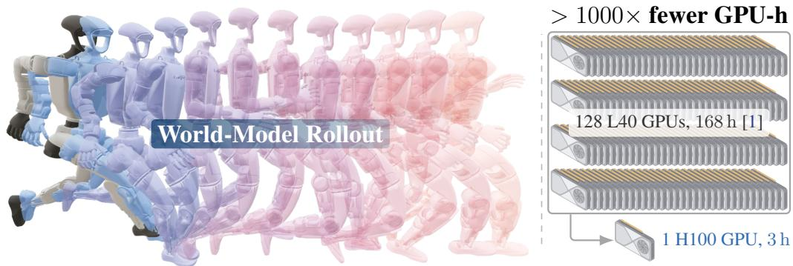

[← 返回 README](../README.md)

# SuperMimic: Scaling Humanoid Whole-Body Control with One Differentiable World Model

Qiayuan Liao Yiyang Shao∗ Junfeng Long∗ Kevin Zakka Roberto Horowitz Pieter Abbeel† Koushil Sreenath†

> 💡 **作者信息**: 第一作者为 Qiayuan Liao，Yiyang Shao 与 Junfeng Long 带 ∗ 标注，Kevin Zakka、Roberto Horowitz 参与，Pieter Abbeel 与 Koushil Sreenath 带 † 标注；∗ 和 † 的具体含义原文未说明（这类记号通常分别表示共同一作与共同指导）。

UC Berkeley https://supermimic.github.io

> 💡 **机构与主页**: 作者单位是 UC Berkeley，项目主页为 https://supermimic.github.io；该主页是否提供代码或演示视频，原文未说明。

  
Figure 1: A learned differentiable world model trains a humanoid whole-body controller and reduces GPU-hours by more than 1000× versus cluster-scale model-free reinforcement learning (§4.1). Left: the policy improves through imagined rollouts of the world model. Right: 128 L40 GPUs train for 168 h in SONIC [1], against one H100 for 3 h in this work.

> 💡 **Figure 1 解读**: 左图示意策略靠世界模型的想象 rollout 更新；右图对比显示 SONIC 用 128 张 L40 GPU 训练 168 小时，本文用 1 张 H100 训练 3 小时，GPU-hours 减少 1000 倍以上（§4.1）。图片本身的视觉内容这里未获得，只依据 caption 描述。

Abstract: Tracking large human-motion datasets has become the dominant route to general, expressive humanoid whole-body control, but scaling across many motions is expensive. Current pipelines use model-free reinforcement learning, either merging per-motion specialists through lossy distillation, or brute-forcing a single policy with cluster-scale compute. SuperMimic amortizes learning across all motions with one differentiable world model of their shared dynamics, fit from logged transitions of a standard rigid-body simulator. The world model and the tracking policy train together in one loop, and backpropagation-through-time over short imagined rollouts gives the policy analytic gradients. Fast imagined rollouts and analytic gradients make policy learning efficient. In 3 hours on a single GPU, SuperMimic surpasses the return of a state-of-the-art motion tracker baseline trained for 7 days on 128 GPUs. It reduces GPU-hours by more than 1000× and fails on only 25 of 129,514 benchmark motions, versus 179 failures for the baseline. After 9.8 hours on two GPUs, SuperMimic achieves zero failures. From 1 to 264 hours of motion, the world model’s prediction error stays stable, and GPU-hours to a target return grow slowly. Our policy transfers to a physical Unitree G1 across diverse and acrobatic motions. SuperMimic removes compute as the bottleneck to scaling humanoid whole-body control, making it practical to measure motiontracking scaling laws.

> 💡 **摘要批读**: SuperMimic 用一个可微分世界模型把学习成本摊销到所有动作上，对短程想象 rollout 做 BPTT 给策略提供解析梯度。单 GPU 训练 3 小时的回报即超过基线在 128 张 GPU 上训练 7 天的成绩（Figure 1 给出具体配置：1×H100 3 h 对 128×L40 168 h），失败动作从 179 个降到 25 个（共 129,514 个动作），在 2 张 GPU 上训练 9.8 小时可实现零失败，并已迁移到实体 Unitree G1。

Keywords: Humanoid Robot, Whole-Body Control, Model-Based Reinforcement Learning

> 💡 **关键词**: Humanoid Robot、Whole-Body Control、Model-Based Reinforcement Learning，说明本文定位在基于模型的强化学习做仿人全身控制。

