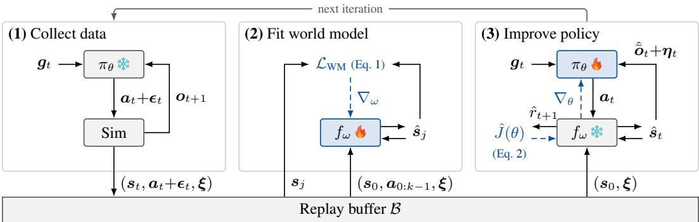

[← 返回 README](../README.md)

## 2 Related Work

Large-scale physics-based motion tracking. Physics-based motion imitation learns controllers that reproduce reference motions under contact-rich rigid-body dynamics. DeepMimic [2] demonstrated expressive character skills through model-free reinforcement learning, and PHC [11] extended this paradigm to large motion sets with robust recovery. SONIC [1] further demonstrated that scaling motion data, policy capacity, and training compute produces generalist controllers that transfer to humanoid hardware. These results establish motion tracking as a practical route to broad wholebody behavior coverage. However, training these large-scale motion trackers requires extensive simulator rollouts and substantial computation. SuperMimic addresses this bottleneck by learning a differentiable dynamics model shared across all motions, so policy improvement can exploit analytic gradients rather than model-free rollout estimates.

> 💡 **背景与瓶颈**: 指出大规模物理动作跟踪虽能实现通用人形控制，但依赖海量模拟器和算力。SuperMimic 通过共享可微动力学模型引入解析梯度，旨在解决这一训练效率瓶颈。

<table><tr><td>Method</td><td>Mimic</td><td>Latent</td><td>Downstream</td><td>Task signal</td><td>Real robot</td></tr><tr><td>NPMP [5]</td><td>SVG(0)</td><td>BC</td><td>SVG(0)</td><td>RL</td><td>X</td></tr><tr><td>ControlVAE [6]</td><td>MBRL</td><td></td><td>MBRL</td><td>RL</td><td>X</td></tr><tr><td>PhysicsVAE [7]</td><td>PPO</td><td>BC¹</td><td>PPO</td><td>RL</td><td>X</td></tr><tr><td>PULSE [8]</td><td>PPO</td><td>DAgger</td><td>PPO</td><td>RL</td><td>X</td></tr><tr><td>MaskedMimic [9]</td><td>A2C</td><td>DAgger</td><td></td><td>Distill</td><td>X</td></tr><tr><td>BeyondMimic [3]</td><td>PPO</td><td>DAgger</td><td>CGD</td><td>Distill</td><td>V</td></tr><tr><td>SONIC [1]</td><td></td><td>PPO</td><td></td><td>Distill²</td><td>V</td></tr><tr><td>LATENT [10]</td><td>PPO</td><td>DAgger</td><td>PPO</td><td>RL</td><td>√</td></tr><tr><td>SuperMimic</td><td></td><td>MBRL</td><td></td><td>Distill / RL</td><td>V</td></tr></table>

> 💡 **方法对比表**: Table 1 按 Mimic/Latent/Downstream 三阶段列出各方法的训练策略（PPO、DAgger、MBRL、A2C、CGD 等）、Task signal（RL 或 Distill）和真实机器人列，可用来定位 SuperMimic 的技术路线。SuperMimic 行只在 Latent 阶段填 MBRL、下游填 Distill/RL；表中 V、√、X 三种符号的含义原文未说明。

Table 1: Comparison of various methods and their training strategies across different stages. The Mimic, Latent, and Downstream columns indicate the training strategy used at each stage. Task signal is what trains the downstream interface: its own task reward (RL) or a reference-tracking signal (Distill). Merged cells denote jointly trained stages, while adjacent unmerged cells indicate sequential training, with each stage trained after freezing the previous one.  
SVG(0): stochastic value gradients; BC: offline behavior cloning on fixed expert rollouts, as opposed to DAgger’s student rollouts; CGD: classifier guidance diffusion; A2C: advantage actor–critic; DAgger: dataset aggregation. 1Behavior cloning with a one-step next-state consistency term through a frozen, learned dynamics model. 2Goal encoders train jointly with the tracker on the motion-tracking reward and latent-alignment losses; no task-specific reward.

> 💡 **表格术语定义**: 解释表中缩写含义及“合并单元格”代表联合训练、“相邻单元格”代表冻结前序阶段后顺序训练的机制，帮助读者准确解读各方法的架构差异。

Learned differentiable dynamics for motion control. SuperTrack [12] optimizes motion-control policies through a learned differentiable surrogate of the simulator. ControlVAE [6] jointly learns a dynamics model, latent skill representation, and generative controller, while MoConVQ [13] extends learned-model training to discrete motion representations over tens of hours of data. SuperDyno [14] scales differentiable neural dynamics to tens of thousands of motion clips. These methods establish the effectiveness of learned dynamics and analytic policy gradients for scalable simulated-character control. SuperMimic extends this direction to single-GPU training of a large-scale humanoid tracker and to its sim-to-real deployment: its world model conditions on simulator context, while the de ployed actor uses noisy proprioceptive observations and a goal input (§3.2). We evaluate how model accuracy, rollout throughput, and differentiable policy updates contribute to training efficiency, and how prediction error behaves as motion coverage grows (§4.1–4.2), and demonstrate physical de ployment of the resulting controller (§4.4).

> 💡 **可微动力学谱系**: SuperTrack、ControlVAE、MoConVQ、SuperDyno 这一支把学到的可微动力学与解析策略梯度扩展到大规模动作数据。SuperMimic 的增量是单 GPU 训练大规模人形跟踪器并做真机部署；注意其世界模型以模拟器上下文为条件，部署时的 actor 改用带噪本体感知观测加目标输入（§3.2）。

Model-based policy optimization and robot deployment. Dreamer [15] and DreamerV3 [16] learn latent dynamics for imagination-based actor–critic learning, while TD-MPC [17] combines short-horizon planning with terminal-value prediction. DayDreamer [18] demonstrates world-model learning directly on physical robots. SHAC [19] uses differentiable simulation for short-horizon actor–critic updates, motivating SuperMimic’s critic-bootstrapped objective. Analytic-gradient robot control can also combine a simplified differentiable surrogate with a high-fidelity forward simulator, as demonstrated for quadruped locomotion [20]. SuperMimic learns its surrogate from simulator transitions and backpropagates through short imagined rollouts, retaining compatibility with standard rigid-body simulators.

> 💡 **MBRL 脉络**: Dreamer/DreamerV3 用隐动力学做想象式 actor–critic，TD-MPC 加入短程规划，SHAC 用可微仿真做短程更新并启发了 SuperMimic 的 critic-bootstrapped 目标。SuperMimic 的动力学从模拟器 transition 中学习，反向传播穿过短程想象 rollout，因而仍兼容标准刚体模拟器。

RWM [21] and RWM-U [22] demonstrate that policies trained in learned neural simulators can transfer to physical robots. Both optimize policies using PPO on imagined rollouts; RWM-U additionally uses uncertainty-penalized offline optimization. SuperMimic instead optimizes the policy by differentiating the return through its learned dynamics. RWM and RWM-U pretrain the world model on trajectories from other policies. In contrast, SuperMimic fits its world model during training on data its own policy collects.

> 💡 **RWM 对比**: RWM 与 RWM-U 都在想象 rollout 上用 PPO，且世界模型先用其他策略的轨迹预训练，RWM-U 另加不确定性惩罚的离线优化。SuperMimic 改为在训练中用自己的策略采集的数据拟合世界模型，并对 return 求导来更新策略。

Reusable motion representations and downstream control. Reusable controllers connect motion tracking to downstream goal interfaces (Table 1). NPMP [5] and PhysicsVAE [7] learn latent motor representations from expert behavior; PULSE [8] and LATENT [10] use learned motion representations for downstream reinforcement learning. MaskedMimic [9] supports partial-body and multimodal goals through motion inpainting, while BeyondMimic [3] uses guided diffusion for goal following. SONIC [1] jointly trains goal encoders with its tracker using tracking rewards and latentalignment losses. ControlVAE [6] optimizes downstream task policies through its learned model while freezing the skill controller. SuperMimic jointly trains goal-specific encoders and a shared decoder through the same dynamics model (Appendix B). Goal interfaces can optimize either a reference-tracking reward or their own task reward. Our preliminary study trains a velocity interface concurrently with the motion-tracking interface, once on each objective (§4.5).

> 💡 **可复用表征**: 综述 NPMP、PhysicsVAE、PULSE、LATENT、MaskedMimic、BeyondMimic、SONIC、ControlVAE 如何把运动跟踪接到下游目标接口，各方法在 Table 1 的下游阶段与任务信号上不同。SuperMimic 通过同一个动力学模型联合训练目标专用编码器与共享解码器（附录 B），其初步研究还把速度接口与动作跟踪接口并行训练，并用两种目标各训练一次（§4.5）。

  
Figure 2: SuperMimic training loop. (1) The current policy $\pi _ { \theta }$ collects transitions in simulation into a fixed-size replay buffer B, where new transitions replace the oldest. (2) The differentiable world model is fit to k-step windows sampled from B (§3.2). (3) The policy is improved by backpropagation-through-time through the frozen world model over H imagined steps; a critic $V _ { \psi } ,$ trained in the same phase, bootstraps the return beyond H (§3.3). Dashed arrows are gradients; $\Updownarrow$ , = trained. Symbols: goal $\mathbf { \sigma } _ { \mathbf { \sigma } _ { \mathbf { \sigma } _ { \mathbf { \lambda } } } } \mathbf { \sigma } _ { \mathbf { \sigma } _ { \mathbf { \lambda } } } \mathbf { \sigma } _ { \mathbf { \lambda } _ { \mathbf { \lambda } } } \mathbf { \sigma } _ { \mathbf { \lambda } _ { \mathbf { \lambda } } } \mathbf { \sigma } _ { \mathbf { \lambda } _ { \mathbf { \lambda } } } \mathbf { \sigma } _ { \mathbf { \lambda } _ { \mathbf { \lambda } } } \mathbf { \sigma } _ { \mathbf { \lambda } _ { \mathbf { \lambda } } } \mathbf { \sigma } _ { \mathbf { \lambda } _ { \mathbf { \lambda } } }$ (e.g., reference motion), action ${ \mathbf { } } _ { \mathbf { } } \mathbf { ^ { } } \mathbf { ^ { } } \mathbf { ^ { } } \mathbf { ^ { } } \mathbf { ^ { } } \mathbf { ^ { } } \mathbf { ^ { } } \mathbf { ^ { } } \mathbf { ^ { } } \mathbf { ^ { } } \mathbf { ^ { } } \mathbf { ^ { } } \mathbf { ^ { } } \mathbf { ^ { } } \mathbf { ^ { } } \mathbf { ^ { } } \mathbf { ^ { } } \mathbf { ^ { } } \mathbf { ^ { } } \mathbf { ^ { } } \mathbf { ^ { } } \mathbf { ^ { } } \mathbf { ^ { } } \mathbf { ^ { } } \mathbf { ^ { } } \mathbf { ^ { } } \mathbf { ^ { } } \mathbf { ^ { } } \mathbf { ^ { } } \mathbf { ^ { } } \mathbf { ^ { } } \mathbf { ^ { } } \mathbf { ^ { } } \mathbf { ^ { } } \mathbf { ^ { } } \mathbf { ^ { } } \mathbf { ^ { } } \mathbf { ^ { } } \mathbf { ^ { } } \mathbf { ^ { } } \mathbf { ^ { } } \mathbf { ^ { } } \mathbf { ^ { } } \mathbf { ^ { } } \mathbf { ^ { } } \mathbf { ^ { } } \mathbf { ^ { } } \mathbf { ^ { } } \mathbf { ^ { } } \mathbf { ^ { } } \mathbf { ^ { } } \mathbf { ^ { } } \mathbf { ^ { } } \mathbf { ^ { } } \mathbf { ^ { } } \mathbf { } \mathbf { ^ { } } \mathbf { ^ } \mathbf { } \mathbf { ^ { } } \mathbf { } \mathbf { ^ } \mathbf { } \mathbf { ^ } \Sigma \Sigma  \mathbf \mathbf { } \mathbf { ^ { } } \mathbf \Sigma \Sigma \mathbf { ^ } \Sigma \Sigma \Sigma \Sigma \Sigma \Sigma \Sigma \Sigma \Sigma \Sigma \Sigma \Sigma \Sigma \Sigma \Sigma \Sigma \Sigma \Sigma \Sigma \Sigma \Sigma \Sigma \Sigma \Sigma \Sigma \Sigma \Sigma \Sigma \Sigma \Sigma \Sigma \Sigma \Sigma \Sigma \Sigma \Sigma \Sigma \Sigma \Sigma \Sigma \Sigma \Sigma \Sigma \Sigma \Sigma \Sigma \Sigma \Sigma \Sigma \Sigma \Sigma \Sigma \Sigma \Sigma \Sigma \Sigma \Sigma \Sigma \Sigma \Sigma \Sigma \Sigma \Sigma \Sigma \Sigma \Sigma \Sigma \Sigma \Sigma \Sigma \Sigma \Sigma \Sigma \Sigma \Sigma \Sigma \Sigma \Sigma \Sigma \Sigma \Sigma \Sigma \Sigma \Sigma \Sigma \Sigma \Sigma \Sigma \Sigma \Sigma \Sigma \Sigma \Sigma \Sigma $ action noise $\mathbf { \Psi } \mathbf { \epsilon } _ { t } ,$ observation $\mathbf { } _ { o _ { t } }$ , state s and predicted state sˆ, and sim context ξ (domain-randomization parameters). ${ \mathcal { L } } _ { \mathrm { W M } }$ is the world-model loss, $\bar { \mathbf { o } } _ { t }$ the predicted noise-free observation, $\pmb { \eta } _ { t }$ the sensor noise, $\hat { r } _ { t + 1 }$ the predicted reward, and $\hat { J } ( \theta )$ the policy objective.

> 💡 **Figure 2 解读**: 依 caption，SuperMimic 的训练闭环是：策略 $\pi_\theta$ 在仿真中采集 transition 存入固定大小的缓冲区 B（新样本替换最旧样本，caption 未说明替换频率），可微世界模型拟合 B 中采样的 k 步窗口，策略再经冻结世界模型的 H 步想象做 BPTT 更新，同一阶段训练的 critic $V_\psi$ 用 bootstrap 补足 H 步之外的回报；虚线箭头表示梯度。此处仅有 caption 可依，未获得图片的视觉信息，故不对画面布局作描述。

