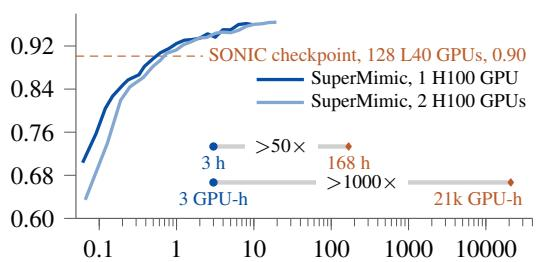
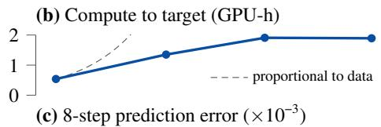
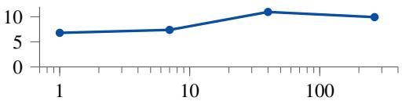
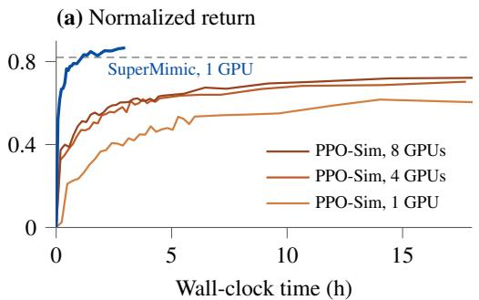
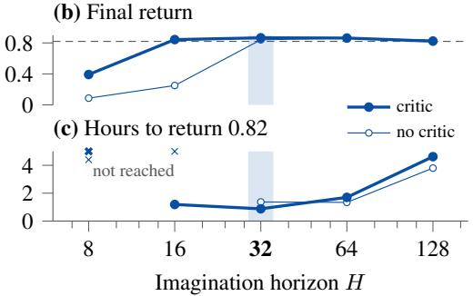
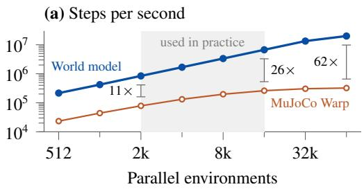
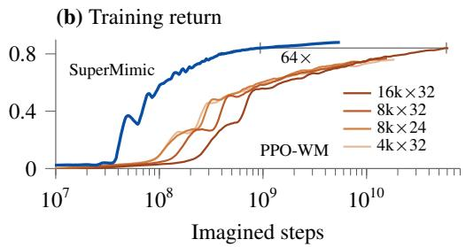

[← 返回 README](../README.md)

## 4 Experimental Results

We show that SuperMimic scales favorably relative to PPO pipelines, identify the world-model properties behind this scaling, demonstrate transfer on a real Unitree G1, and report a preliminary study of downstream goal interfaces. The simulator is MuJoCo Warp, a GPU implementation of MuJoCo [26]. All our reported costs are measured on NVIDIA H100 (80 GB SXM5) GPUs of Lambda on-demand instances. We ran several random seeds and found training very stable, which we attribute to the dense reward that motion tracking gives at every step. The figures therefore do not report seed variation. Normalized return, return for short, is the undiscounted sum of the per-step reward over the full episode, divided by the largest value this sum can take. A policy that terminates early therefore scores low.

> 💡 **读法与指标口径**: 先交代本节要证明的四件事：相对 PPO 流水线的可扩展性、背后的世界模型性质、真机 Unitree G1 迁移、下游目标接口初探。实验在 MuJoCo Warp 上跑、成本按 H100（80GB SXM5）计；因为密集的动作跟踪奖励让多个种子都很稳定，图里不画种子方差。“归一化回报”是全回合未折扣奖励和除以该和的理论最大值，早终止因此得分低——后面所有 0.82 这类数字都按这个口径读。

## 4.1 SuperMimic reaches SONIC-level tracking with far fewer GPU-hours

We compare against SONIC, a published PPO pipeline trained on a 128-GPU cluster. Both methods build on the BeyondMimic motion-tracking formulation [3], making SONIC the closest available published comparison. Within 3 h on one GPU, SuperMimic surpasses the normalized return of the released SONIC checkpoint (Figure 3(a)). On a shared benchmark of 129,514 motions, it also fails on fewer motions than SONIC: 25 after 3 h on one GPU and 0 after 9.8 h on two GPUs, against 179 for SONIC’s released checkpoint (Appendix F). We state the 3 h conservatively: from then on, every checkpoint is ahead of SONIC by at least half of the gap between SONIC and SuperMimic’s best result, in both return and failed motions. SuperMimic thus uses more than 50× less wall-clock time and more than 1000× fewer GPU-hours than SONIC.

> 💡 **效率对比的数字**: 单卡 3 h 内即超过 SONIC 发布检查点的归一化回报；在 129,514 个动作的共享基准上，失败动作数为 3 h 单卡 25 个、9.8 h 双卡 0 个，而 SONIC 检查点 179 个。作者由 3 h 与 SONIC 的 128 卡 7 天换算出 >50× 更少墙钟时间、>1000× 更少 GPU-hours；3 h 的取法偏保守，因为此后每个检查点在回报和失败数上都领先 SONIC 与自身最优差距的一半以上。

Compute accounting. The ratios compare SONIC’s reported 128 NVIDIA L40 GPUs for 7 days (about 21,000 GPU-hours) with 3 h on one NVIDIA H100, within which SuperMimic surpasses the return of SONIC’s released checkpoint. They are about 56× (> 50×) in wall-clock time and about 7200× (> 1000×) in GPU-hours. The 3 h cover the full training loop; checkpoint evaluations run after training and are not counted. SuperMimic trains on 264.56 h of motion from BONES-SEED [27], the public subset of SONIC’s data, about 2.3× less than SONIC’s 611 h. The GPU models also differ: in peak throughput, an H100 delivers 0.74× the fp32 and 5.5× the tensor-core performance of an L40; how much of that peak either run used is unknown. Nonetheless, 2.3× in data and at most 5.5× in peak GPU throughput cannot account for a 1000× gap in GPU-hours.

> 💡 **算力核算的可信度**: 把 SONIC 报告的 128 张 L40 跑 7 天（约 21,000 GPU-hours）与单张 H100 跑 3 h 对比，得 56×（>50×）墙钟和 7200×（>1000×）GPU-hours。作者主动列出两个混淆项：数据量 264.56 h（BONES-SEED）对 SONIC 611 h，约 2.3×；H100 相对 L40 峰值 fp32 为 0.74×、张量核 5.5×，实际利用率未知。推断：因此千倍差距主要来自算法而非硬件或数据规模，这是作者论证的关键一步，但 3 h 不含检查点评测时间。

Figure 4(a) gives a controlled comparison on LAFAN1 [28]. The baseline, PPO-Sim, is PPO trained in the simulator. PPO-Sim shares SuperMimic’s motions, observations, reward, termination, domain randomization, actor and critic network sizes, and evaluation protocol. It uses BeyondMimic’s PPO hyperparameters [3] and 8192 parallel environments per GPU, twice SuperMimic’s. PPO-Sim estimates its policy gradient from sampled simulator rollouts; SuperMimic backpropagates its imagined return through world-model rollouts. SuperMimic reaches a return of 0.82 in evaluation within 1.2 h on one GPU. Within the 18 h budget, PPO-Sim does not reach it. Its final return is 0.60 on one GPU, 0.70 on four, and 0.72 on eight, so going from four to eight GPUs barely helps.

> 💡 **控制变量对比**: PPO-Sim 与 SuperMimic 共用动作、观测、奖励、终止、域随机化、actor/critic 网络规模和评测协议，差别在 PPO-Sim 用 BeyondMimic 的 PPO 超参、每卡 8192 个并行环境（是 SuperMimic 的 2 倍），且从模拟器采样 rollout 估策略梯度，而 SuperMimic 把想象回报通过世界模型反传。结果：SuperMimic 单卡 1.2 h 达 0.82，PPO-Sim 在 18 h 预算内最好的终值是单卡 0.60、四卡 0.70、八卡 0.72，四卡到八卡几乎不涨。

Figure 3(b, c) shows that, for SuperMimic, GPU-hours to the target return grow slowly as dataset length increases, while on the same sweep the world model’s prediction error stays stable; §4.2 traces both trends to one world model amortizing the dynamics shared across motions.

> 💡 **缩放趋势预告**: 在同一个数据长度扫描上，达到目标回报所需 GPU-hours 随数据变长增长缓慢，世界模型的预测误差同期保持稳定；作者把两条趋势都归因于一个世界模型摊销了跨动作共享的动力学，交给 §4.2 展开。

(a) Normalized return  
  
GPU-hours (wall-clock on one GPU)

> 💡 **图 3(a) 坐标轴**: 这块只给出子图标题与坐标轴文字：纵轴归一化回报、横轴单卡墙钟 GPU-hours。读图时关注 SuperMimic 曲线何时越过 SONIC 检查点那条虚线；具体曲线形状此处无法从文本确认。

> 💡 **图 3 局部图**: 该块只有图片，没有 caption 或坐标轴文字，无法从文本判定是哪一幅子图；按上下文推断属于 Figure 3(b, c)，但曲线形态需看图确认。

  
Dataset length (h)

> 💡 **横轴说明**: 这里只给出横轴“Dataset length (h)”，应是 Figure 3(b)(c) 共用的 x 轴；0.007–0.011 的误差区间来自 caption，不来自这块文字。

Figure 3: SuperMimic surpasses SONIC’s tracking return with far fewer GPU-hours. (a) SuperMimic on one and two H100 GPUs surpasses the return of the released SONIC checkpoint (dashed), all three scored on the same benchmark of 129,514 motions (264 h). Two budget rows compare SuperMimic (dot) with SONIC (diamond): SuperMimic reduces wall-clock time by more than 50× and GPU-hours by more than 1000×. (b, c) On a shared dataset-length sweep, GPU-hours to target return (b) grow slowly while the world model’s 8-step prediction error (c) stays within 0.007–0.011 as the dataset grows from 1 to 264 h, consistent with one world model amortizing shared body and contact dynamics across motions. The prediction error counts the state only, is normalized by a predefined nominal error, and is measured online on policy rollouts.  

> 💡 **Figure 3 caption 要点**: (a) 单卡与双卡 H100 上的 SuperMimic 都超过 SONIC 发布检查点（虚线），三方在同一 129,514 个动作（264 h）基准上评测；(b, c) 数据集从 1 h 增到 264 h 时，达到目标回报的 GPU-hours 增长缓慢，8 步预测误差维持在 0.007–0.011。注意误差只计状态、按预设 nominal error 归一化，并在策略 rollout 上在线测量——这决定了该“稳定”说法的适用范围。

  
Figure 4: In controlled comparisons, SuperMimic reaches a higher return sooner than PPO-Sim, and the critic enables shorter imagination horizons. All runs use LAFAN1 (40 clips, 2.45 h). (a) SuperMimic backpropagates its imagined return through its world model on one GPU; PPO-Sim runs PPO in the simulator on 1, 4, or 8 GPUs (§4.1). Each point on a curve is a saved checkpoint scored on all 40 clips. (b, c) Final training return (b) and wall-clock hours until the training return reaches 0.82 (c) for each imagination horizon H, with and without the critic. The dashed line in (a) and (b) marks this target return of 0.82. Training return is the return of training episodes. Their initial states follow return-based reset sampling (Appendix D.1) and shift during training, so training return differs from the checkpoint scores in (a). In (c), a cross marks a horizon at which return 0.82 is not reached: both variants at H=8, no critic at H=16. The shaded band marks the default H=32.

> 💡 **Figure 4 caption 要点**: 全部用 LAFAN1（40 clips，2.45 h）。(a) SuperMimic 单卡反传想象回报，PPO-Sim 用 1/4/8 卡跑模拟器 PPO，每点是存档检查点在 40 clips 上的分数；训练回报因 return-based reset sampling 随训练漂移，故与 (a) 的分数不可直接比。(b, c) 扫想象视野 H 与有无 critic：有 critic 时 H=16 能到 0.82，无 critic 的 H=16 和两者在 H=8 都到不了，即 critic 让较短视野够用；默认 H=32 为阴影带。

## 4.2 Properties of the learned world model

These results rest on three properties of the learned world model $f _ { \omega } .$ : its accuracy holds as the motion library grows, and its rollouts are fast and differentiable.

> 💡 **机制总纲**: 作者把前面的效率结果归结为世界模型 $f_\omega$ 的三条性质：动作库变大时精度不降，rollout 快，且可微分。后文分别给出对应证据，读者可拿这三条来检验“为什么快”的因果链是否成立。

One model amortizes the motion library. In Figure 3(c), the world model’s 8-step prediction error stays between 0.007 and 0.011 as the dataset grows from 1 to 264 h. Every motion is executed by the same humanoid, so added clips supply more evidence about the shared body and contact dynamics rather than demanding new capacity. This is consistent with the slow growth of the compute needed to reach the target return (§4.1).

> 💡 **摊销机制**: 数据从 1 h 到 264 h，世界模型 8 步预测误差保持在 0.007–0.011；解释是所有动作由同一台人形执行，新增片段提供的是关于共享身体与接触动力学的更多证据，而不是要求更多模型容量，这与达到目标回报所需算力增长缓慢一致。推断：这是相关性证据，作者用“consistent with”而非因果证明。

Imagination accelerates rollouts. During policy optimization, rollout speed sets the update cost. Figure 5(a) shows that the world model runs more than 10× faster than MuJoCo Warp at the batch sizes used in practice, and up to 62× at 64k parallel environments.

> 💡 **rollout 速度**: 策略优化中 rollout 速度决定每次更新成本；在实用批量下世界模型比 MuJoCo Warp 快 10× 以上，64k 并行环境下最高 62×。这把 §4.1 的效率优势落到一个可复现的工程指标上。

> 💡 **图 5 局部图**: 该块只有图片无 caption，无法从文本确认内容；推断对应 §4.2 提到的 Figure 5(a)（世界模型与 MuJoCo Warp 的速度对比，实用批量下 >10×、64k 并行环境下最高 62×），具体数值需看图核对。

  
Figure 5: Imagined rollouts are fast and differentiable. (a) On an H100, over the batch sizes used in practice (shaded, 2k–16k parallel environments), the world model runs more than 10× faster than MuJoCo Warp; the gap widens to 62× at 64k, where MuJoCo Warp has flattened. One step is one 50 Hz control step, which MuJoCo Warp computes as four 5 ms substeps; the world model runs at the TF32 precision used in SuperMimic’s training. (b) On walk/run/sprint motions from LAFAN1 [28], SuperMimic, trained with its actor–critic update, reaches the best training return of PPO trained on world-model rollouts (PPO-WM) with about 64× fewer imagined steps. PPO-WM runs at four batch sizes (parallel rollouts × steps per rollout); $1 6 \mathrm { k } \times 3 2$ is the best. Each curve is a centered moving average over ±0.05 decade of imagined steps.

> 💡 **Figure 5 批读**: 在 H100 上，实际使用的 2k–16k 并行环境区间内，世界模型比 MuJoCo Warp 快 10 倍以上；到 64k 时差距扩大到 62 倍，此时 MuJoCo Warp 已饱和。图 (b) 中，SuperMimic 达到 PPO-WM 最佳训练回报只需约 1/64 的想象步数。注意：62 倍出现在实际批量之外；世界模型以 TF32 精度运行；一步是 50 Hz 控制步，MuJoCo Warp 将其拆成 4 个 5 ms 子步，因此比较速度时要看这些条件是否一致。

First-order gradients need fewer imagined steps. As a mechanism ablation, Figure 5(b) isolates the benefit of first-order policy updates: SuperMimic reaches the best PPO-WM return with about 64× fewer imagined steps, so the gain is not just rollout speed.

> 💡 **机制归因**: 作者用 Figure 5(b) 做机制消融，把 SuperMimic（经世界模型做一阶梯度更新）与在 rollout 上跑 PPO 的 PPO-WM 相比，在回报相同的情况下后者所需想象步数多约 64 倍，因此作者把收益归因于一阶梯度策略更新，而不只是 rollout 快。推断：两者同时还有 critic 使用上的差异，这一对比并未完全隔离单一因素。

## 4.3 A critic enables shorter horizons and push recovery

Figure 4(b, c) sweeps H with and without the critic. Without the critic, training fails at $H \leq 1 6$ With it, H=16 matches the critic-free H=32, and H=32 reaches a return of 0.82 fastest. Raising H from 64 to 128 nearly triples the time to that return and lowers the final return; H=128 is the longest horizon that fits on an H100. At matched return, the critic still changes behavior. Under 0.5–4 m/s velocity pushes while holding a static T-pose in simulation, the critic policy settles within 0.5–2.4 s. The critic-free policy never settles: it keeps stumbling even at 0.5 m/s and falls at 4 m/s.

> 💡 **critic 的作用**: 没有 critic 时，H≤16 的训练直接失败；有 critic 时，H=16 能达到无 critic 时 H=32 的水平，H=32 最快达到 0.82 的回报。把视界从 64 提到 128，达到该回报的时间接近三倍，最终回报也更低；H=128 是 H100 显存能容纳的最长视界。在同等回报下，有 critic 的策略在 0.5–4 m/s 速度推扰中 0.5–2.4 s 内稳定下来，无 critic 策略在 0.5 m/s 时就持续踉跄、4 m/s 时摔倒。

## 4.4 Real-robot transfer

One general motion tracker deploys on a real Unitree G1 without per-motion tuning (Figure 6). The four motions cover locomotion (a skipping jump), contact-rich whole-body motion with the torso and limbs on the floor (a side roll), and acrobatics (a 90◦ flip and an in-place 360◦ flip).

> 💡 **实机迁移**: 一个通用运动跟踪器不需要逐动作调参，就能部署到真实的 Unitree G1，覆盖四类动作：跳跃、接触丰富的侧滚，以及 90° 与原地 360° 空翻。作者在这里只说明部署方式与动作类型，正文没有给出成功率等量化指标；把它读作零样本泛化属于推断。

## 4.5 Downstream tasks: RL encoder vs. distillation baseline

SuperMimic trains downstream goal encoders jointly with the motion-tracking interface, sharing one decoder and world model (Appendix B). Our study of downstream interfaces is preliminary. We train one velocity encoder on a velocity-tracking reward through the world model. We compare it with a distillation baseline: a velocity encoder trained on the motion-tracking reward, with commands read from the reference motions. Figure 7 evaluates both on 672 step responses spanning the velocity space (Appendix G). The RL encoder has the lower steady-state error on 650 of them, and the distillation encoder on 15. Only the distillation encoder falls, on seven fast turns with almost no motion-library data.

> 💡 **下游对比**: 速度编码器与运动跟踪接口联合训练，共享同一个 decoder 和世界模型；对照的蒸馏基线则用运动跟踪奖励训练编码器，并从参考动作中读取指令。在 672 条速度阶跃响应上，RL 编码器在 650 条上稳态误差更低，蒸馏编码器在 15 条上更低，而且只有蒸馏编码器在 7 个缺乏动作库数据的快速转向中摔倒。650 加 15 与 672 之间的差额，原文没有说明。

