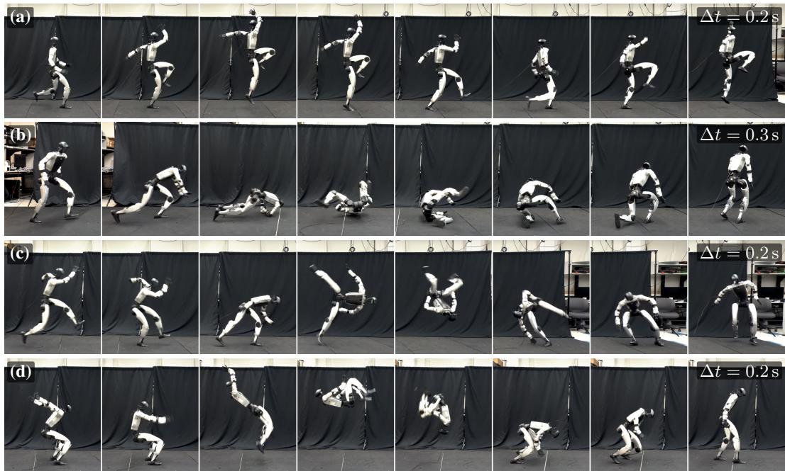
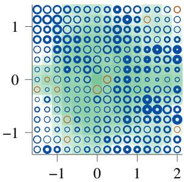
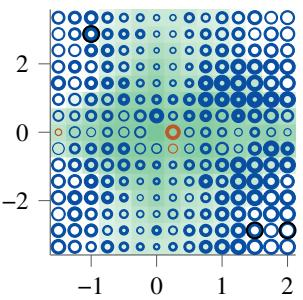
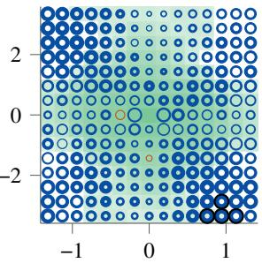
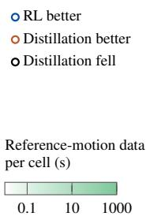

[← 返回 README](../README.md)

## 5 Conclusion

SuperMimic removes compute as the bottleneck to scaling humanoid whole-body control. A single learned, differentiable world model captures the dynamics every motion shares, and backpropagation-through-time through it amortizes a whole dataset into one policy. The policy trains on a single GPU, surpasses the return of a policy trained on a 128-GPU cluster, and transfers to a real Unitree G1. Its training cost grows slowly over a controlled dataset-length sweep. The

> 💡 **核心结论**: 计算不再是 scaling 人形全身控制的瓶颈：单个可微世界模型捕捉各动作共享的动力学，靠着时间反向传播（BPTT）把整个数据集摊销成一个策略。该策略单 GPU 训练，回报（return）超过在 128-GPU 集群上训练的策略，并能迁移到真实 Unitree G1，训练成本随受控的数据集长度扫描增长缓慢。

  
Figure 6: One general motion tracker, trained through the learned world model, transfers to a real Unitree G1. (a) Skipping jump, (b) side roll, (c) 90◦ flip, and (d) in-place 360◦ flip.

> 💡 **Figure 6 批读**: 通用动作追踪器经学习到的世界模型训练后迁移到真实 Unitree G1，四个子图分别是跳箱跳、侧滚、90° 翻转和原地 360° 翻转。可看点是这些高动态动作在真机上是否真的完成，但 caption 未给成功率和跟踪误差数字。

(a) vy vs. vx (m/s)  

> 💡 **Figure 7(a) 子图**: 横轴 $v_x$、纵轴 $v_y$（单位 m/s）的命令平面，第三分量为零；此处只有轴标签，未获得图像视觉信息，无法描述环带分布或误差大小。

(b) ωz (rad/s) vs. vx (m/s)  

> 💡 **Figure 7(b) 子图**: 横轴 $v_x$、纵轴 $\omega_z$（rad/s）的命令平面切片，与 (a)(c) 一起覆盖命令空间的三个正交平面。

(c) ωz (rad/s) vs. vy (m/s)  

> 💡 **Figure 7(c) 子图**: 横轴 $v_y$、纵轴 $\omega_z$ 的命令平面切片，是三个正交视角中的最后一个；具体误差量级需对照 Appendix G。

  
Figure 7: The policy with the RL-trained velocity encoder tracks step commands more accurately than the distillation baseline. Each panel is a plane of the command space with the third component at zero, and each ring is one command. The outer disc’s area is proportional to the larger of the two policies’ relative steady-state errors in the step response to that command, and the hole’s area to the smaller one; the color marks the better policy. Details in Appendix G.

> 💡 **Figure 7 解读**: 带 RL 训练速度编码器的策略在阶跃命令响应上比蒸馏基线更准。每个环代表一条命令，外圆盘面积正比于两策略中较大的相对稳态误差、内孔面积正比于较小的，颜色标出更优策略；caption 没给具体误差数值，细节在 Appendix G。

same model can train a downstream velocity interface directly on the interface’s own task reward.   
Measuring the scaling laws of motion tracking is now affordable, at one GPU per run.

> 💡 **后续方向**: 同一世界模型还能直接在该速度接口自身的任务奖励上训练下游速度接口；作者据此认为测量动作追踪的 scaling law 变得可负担——每次运行一块 GPU。这是作者的展望，本段未给该接口实验的定量结果。

