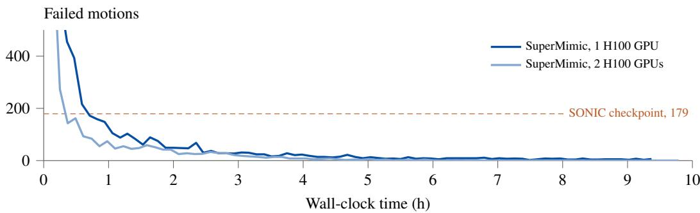

[← 返回 README](../README.md)

## F.2 Failed motions

Table A.8 counts failed motions per motion group. SONIC fails whole groups (all 44 flips, all 22 side rolls, and all 8 motions of one dance routine) and 15 of the 24 broad jumps. Its v1.1 checkpoint fails 239 motions, among them the same flips and dance motions and 19 of the 22 side rolls. After 3 h on one GPU, SuperMimic’s failures concentrate in a few small groups of hard motions: the first five groups of Table A.8, 195 motions, hold 14 of its 25 failures. In no group does it fail more motions than SONIC. After 9.8 h on two GPUs, SuperMimic fails on none. Figure A.1 shows the count over training. The benchmark motions are training motions for both methods, so the counts measure how fully each policy covers these training motions, not generalization to new motions.

> 💡 **失败模式对比**: SONIC 的发布版检查点在 44 个翻转、22 个侧滚和整套 8 个舞蹈动作上整组失败，24 个跳远中失败 15 个；其 v1.1 检查点失败数更多，达 239 个，其中侧滚 22 个里失败 19 个。SuperMimic 单卡 3 小时失败 25 个，且前五组 195 个动作就占了其中 14 个，没有任何一组的失败数超过 SONIC；双卡 9.8 小时后为 0。基准动作同时是两者的训练动作，因此这里统计的是训练动作覆盖度，不是泛化。

<table><tr><td></td><td></td><td colspan="2">SuperMimic</td></tr><tr><td>Motion group (motions)</td><td>SONIC</td><td>1 GPU × 3 h</td><td>2 GPUs × 9.8 h</td></tr><tr><td>side rolls (22)</td><td>22</td><td>2</td><td>0</td></tr><tr><td>flips:  $3 6 0 ^ { \circ } , 1 8 0 ^ { \circ } , 9 0 ^ { \circ } ( 4 4 )$ </td><td>44</td><td>1</td><td>0</td></tr><tr><td>fire-in-the-hole turns (20)</td><td>3</td><td>3</td><td>0</td></tr><tr><td>crossed legs (10)</td><td>9</td><td>0</td><td>0</td></tr><tr><td>lying, resting and standing up (99)</td><td>28</td><td>8</td><td>0</td></tr><tr><td>broad jumps (24)</td><td>15</td><td>0</td><td>0</td></tr><tr><td>dance routine (8)</td><td>8</td><td>0</td><td>0</td></tr><tr><td>all other motions (129,287)</td><td>50</td><td>11</td><td>0</td></tr><tr><td>total (129,514)</td><td>179</td><td>25</td><td>0</td></tr></table>

> 💡 **Table A.8 解读**: 表按动作组列出失败动作数，SONIC 列合计 179，SuperMimic 的两种设置分别为 25 和 0；SONIC 在 side rolls 22/22、flips 44/44 两组全军覆没。要注意 1 GPU×3 h 与 2 GPUs×9.8 h 同时改变了训练时长和并行规模，不能把 25→0 单独归因于算力提升；该表统计的是训练集上的失败数，反映拟合覆盖而非泛化。

Table A.8: Failed motions per motion group on the filtered BONES-SEED training-set benchmark. SONIC: released checkpoint. Bold: the policy fails every motion in the group.

> 💡 **基准定义说明**: 明确测试集为 BONES-SEED 训练集，因此结果反映“记忆/拟合”而非“泛化”。SONIC 使用官方发布检查点，作为对照基线。

  
Figure A.1: Failed motions during training on the filtered BONES-SEED training-set benchmark. Checkpoints are scored every 4000 iterations, for the runs of Figure 3(a). SONIC: released checkpoint.

> 💡 **Figure A.1 说明**: 图记录训练过程中失败动作数随迭代的变化，每 4000 次迭代评估一次检查点，对应对应 Figure 3(a) 的运行设置。SONIC 只给发布版检查点一个状态；图像本身未提供，曲线走势无法核对。

